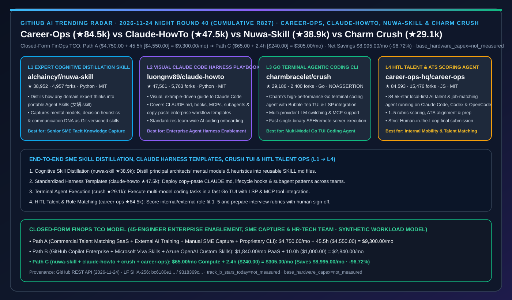
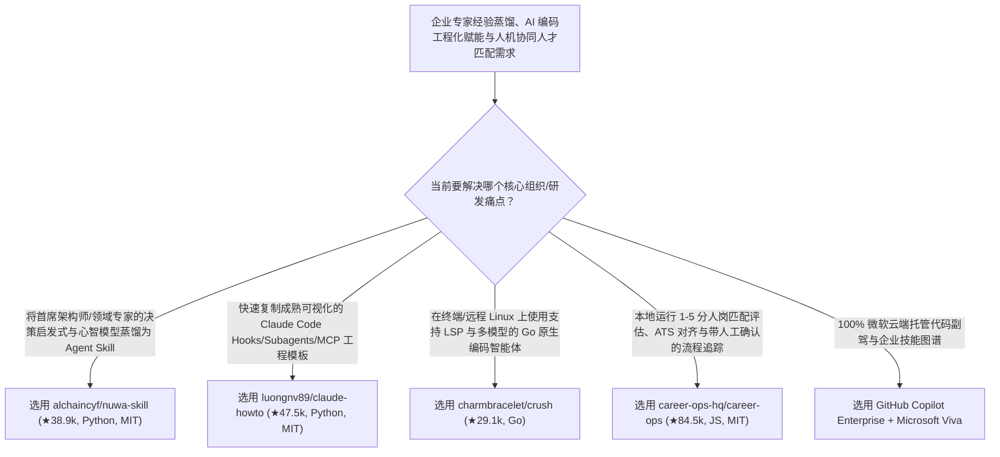
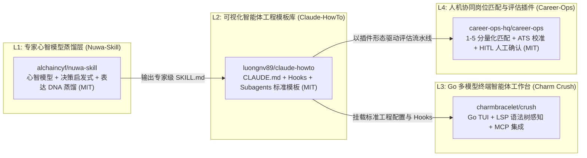
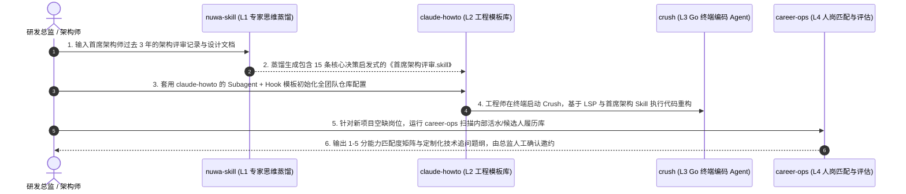

# 人机协同岗位匹配与招聘评估智能体（`career-ops-hq/career-ops`）、可视化 Claude Code 工程实战指南（`luongnv89/claude-howto`）、专家心智模型蒸馏技能（`alchaincyf/nuwa-skill`）与 Go 终端智能体工作台（`charmbracelet/crush`）选型与集成 FAQ

> **文档类型**：AI 解决方案架构师（AI Solution Architect）选型决策指南（2026-11-24 Night Round 40 / 累计第 827 轮）  
> **阅读耗时**：约 8 分钟  
> **覆盖项目**：[`career-ops-hq/career-ops`](https://github.com/career-ops-hq/career-ops)（`★ 84,593` · `15,476 forks` · JavaScript · `MIT`） · [`luongnv89/claude-howto`](https://github.com/luongnv89/claude-howto)（`★ 47,561` · `5,763 forks` · Python · `MIT`） · [`alchaincyf/nuwa-skill`](https://github.com/alchaincyf/nuwa-skill)（`★ 38,952` · `4,957 forks` · Python · `MIT`） · [`charmbracelet/crush`](https://github.com/charmbracelet/crush)（`★ 29,186` · `2,400 forks` · Go · `NOASSERTION`）  
> **证据溯源**：GitHub REST API 实测元数据（2026-11-24）与本地冻结证据文件 `trending-daily-2026-11-24-raw.html`（LF `sha256: bc6180e17c19491f9d8fe6c425ccb2e78824344e713a6555d437cab3de`）、`search-new-repos-2026-11-24-raw.json`（LF `sha256: 9318369c192895c954be17517f99c8d9e27d68d47736f8000908607314306454`）；Track B 仓库无 HTML 榜单对应的单日增量，统一标记为 `track_b_stars_today=not_measured`。  
> **English Version**: [`careerops-claudehowto-nuwa-crush-selection-faq.en.md`](./careerops-claudehowto-nuwa-crush-selection-faq.en.md)

---

## ① 📌 核心结论速览（Executive Summary）

**选型一句话结论**：当企业研发效能与组织赋能团队需要把**“首席专家隐性经验萃取 + 团队级 Claude Code 工程化模版落地 + 跨模型终端编码执行 + 内部活水/岗位人岗匹配自动化”**串联为一套合计突破 **20 万 Star** 的高人氣实战工具链时，采用 **`alchaincyf/nuwa-skill`（L1 女娲.skill：将领域专家心智模型、决策启发式与表达 DNA 蒸馏为可复用 Agent Skill）+ `luongnv89/claude-howto`（L2 4.75 万星可视化、可复制粘贴的 Claude Code 进阶工程模板库）+ `charmbracelet/crush`（L3 Charm 出品的高颜值 Go 单二进制多模型终端编码智能体）+ `career-ops-hq/career-ops`（L4 8.45 万星本地优先、严格保留人工最终确认的 1–5 分岗位匹配与评估智能体）**，可将 45 人团队的月度 TCO 从商业人才评估 SaaS + 外部 AI 转型咨询培训 + 人工专家访谈整理 + 商业多模型终端席位（Path A）的 **`$9,300.00/月`** 降至 **`$305.00/月`**（净省 **`$8,995.00/月`**，降幅 **`-96.72%`**）。

| 评估维度 | `alchaincyf/nuwa-skill` (L1 专家心智模型蒸馏技能) | `luongnv89/claude-howto` (L2 可视化 Claude Code 实战指南) | `charmbracelet/crush` (L3 Go 终端智能体工作台) | `career-ops-hq/career-ops` (L4 人机协同人岗匹配智能体) |
|---|---|---|---|---|
| **GitHub 实测热度** | `★ 38,952` · `4,957 forks` | `★ 47,561` · `5,763 forks` | `★ 29,186` · `2,400 forks` | `★ 84,593` · `15,476 forks` |
| **实现语言与开源协议** | Python (`MIT`) | Python (`MIT`) | Go (`NOASSERTION` · 需核验 FSL/MIT 条款) | JavaScript (`MIT`) |
| **一句话通俗定位** | “你想蒸馏的下一个员工，何必是同事”——把任何专家的心智模型、决策启发式与表达 DNA 蒸馏成标准 Skill | 曾登顶 GitHub Trending #1 的 Claude Code 可视化、示例驱动指南与开箱即用工程模板 | Charm 团队基于 Go 与 Bubble Tea 打造的优雅、支持 LSP 与 MCP 的跨模型终端编程智能体 | 8.45 万星本地运行的 AI 岗位评估、ATS 简历对齐、面试题库准备与追踪智能体（支持 Claude Code/Codex/OpenCode） |
| **解决的核心业务痛点** | 解决企业首席架构师、金牌销售或资深风控专家离职/调岗后“满脑子决策直觉带走、新人看静态文档根本学不会”的隐性知识流失痛点 | 消除研发团队采购 AI CLI 后“90% 的工程师只会拿它当普通问答用，不会配置 Hooks、Subagents 和 `CLAUDE.md`”的落地鸿沟 | 解决 Node/Python 终端工具在远程無头 Linux 服务器上环境依赖繁琐、切模型不便的痛点 | 解决企业内部人才活水（Internal Mobility）、猎头初筛与求职者匹配中“海投盲审、缺乏结构化 1–5 分匹配度量化评分与人工终审把关”的效率瓶颈 |
| **何时选它 vs 云托管** | 需要把内部大牛的历史评审意见、架构设计文档与演讲实录蒸馏为团队共享 `SKILL.md` 时必选 | 企业推广 Claude Code / 终端 Agent 标准化培训与模板初始化时必选 | 偏好 Go 单二进制零依赖部署、LSP 强类型代码感知与多模型自由切换时必选 | 用于本地隐私保护的简历与 JD 双向匹配评分、面试准备及带 HITL 确认的流程辅助时首选 |

---

## ② 🎯 客户与架构师灵魂拷问 Q&A（1–2 分钟速读）

### Q1：很多企业试过用 RAG 把老专家的几百篇文档塞进向量库，结果问出来的回答还是像平庸的教科书，一点也没有老专家的“毒辣判断力”。`alchaincyf/nuwa-skill`（`★ 38,952`）为什么强调“蒸馏思维方式而非堆积语料”？
- **痛点**：普通 RAG 检索的是“事实片段（What）”，而顶尖架构师或业务专家真正值钱的是“面对两难权衡时的判断准则（How & Why）”。
- **架构师解答**：**`alchaincyf/nuwa-skill`**（女娲.skill · `MIT`）把专家经验拆解为三层结构化资产并固化为可挂载的 `SKILL.md`：
  1. **心智模型（Mental Models）**：专家看待系统边界与核心矛盾的第一性原理框架；
  2. **决策启发式（Decision Heuristics）**：形如“当满足条件 X 且存在约束 Y 时，永远优先选 A 而非 B，除非 Z”的硬核判断树；
  3. **表达 DNA（Expression DNA）**：专家特有的结构化追问方式与评审清单风格。

### Q2：`luongnv89/claude-howto`（`★ 47,561`）和 `charmbracelet/crush`（`★ 29,186`）如何帮助 45 人研发团队在一周内完成 AI 编码智能体的标准化基建？
- **核心收益**：
  1. **用 `luongnv89/claude-howto`（`MIT`）统一团队工程模板**：提供从基础 `CLAUDE.md`、Slash Commands、Pre/Post-Tool Hooks 到多级 Subagents 协作的可视化流程图与 Copy-Paste 模板，省去架构师从零编写内部培训教材的数周时间。
  2. **用 `charmbracelet/crush`（Go）提供多模型终端底座**：Charm（知名终端 UI 库 Bubble Tea 的作者）用 Go 编写的终端智能体，天然集成 **LSP（语言服务器协议）** 与 **MCP 工具链**，支持在 Claude、OpenAI、Gemini 与本地模型间无缝切换。

### Q3：`career-ops-hq/career-ops`（`★ 84,593` · `15,476 forks`）为什么能收获近 8.5 万颗星？它在设计上坚守了哪条关键的企业级 Agent 黄金法则？
- **量化评分前置 + 严守人工最终提交（Human-in-the-Loop Submit）**：`career-ops` 之所以广受认可，正是因为它没有做成无脑垃圾群发的黑产脚本，而是将 AI Agent 定位为**严谨的评估与准备副驾**：先针对 JD 与候选人履历进行 **1–5 分多维量化评分（Scoring Before Action）**、生成 ATS 关键词对齐建议与针对性面试攻防题库，最后**把“点击提交（You press Submit）”的最终决定权严格留给人类**——这一模式同样是企业内部人才活水推荐与外包简历初筛的最佳实践。

---

## ③ 🧭 直观可视化图解（Mermaid 决策树 + 集成架构 + 时序图）

### 3.1 技术选型决策树

### 3.2 企业端到端生产集成参考架构图

### 3.3 业务流全链路时序图

---

## ④ 📊 同类开源与商业云服务横向选型决策矩阵

| 对比维度 | 本轮开源组合 (`nuwa-skill` + `claude-howto` + `crush` + `career-ops`) | 传统低效方式 (`零散口耳相传` + `员工各自摸索 CLI` + `人工肉眼筛简历`) | 商业云与咨询方案 (`外部 AI 培训咨询` + `商业 ATS AI 模块` + `专有 CLI`) |
|---|---|---|---|
| **功能定位** | 专家心智蒸馏 + 可视化 Claude Code 模板 + Go LSP 终端 Agent + 1–5 分人岗评估助手 | 无沉淀专家经验 + 无规范提示词 + 耗时耗力的人工初筛 | 高价外部培训课 + 按招聘席位收费的商业 HR SaaS |
| **适用场景** | 企业核心专家隐性经验传承、百人研发团队 AI CLI 规范化落地、技术岗位精准评估与内部活水匹配 | 2–3 人无需流程沉淀的小作坊 | 预算充裕且完全依赖外部咨询公司赋能的传统企业 |
| **集成成本** | **极低**（三仓 `MIT` 协议，纯 Markdown/JSON 模板与本地 CLI 插件，10 分钟即可在团队铺开） | 高（每位工程师各自踩坑摸索 Hooks 与 Subagent 配置耗费数十小时） | 中（采购审批周期长，且外部通用培训模板难以贴合企业内部技术栈） |
| **运维复杂度** | **极低**（Git 仓库统一托管团队模板与蒸馏后的专家 Skill，月均维护仅 `2.4h`） | 极高（重复解答新人架构规范问题与人工初筛评估耗费 `45.5h/月`） | 低（云端全托管，月均模板微调约 `10.0h`） |
| **开源协议与合规** | `nuwa-skill`、`claude-howto`、`career-ops` 为 `MIT`；`crush` 需核验仓库 FSL/MIT 条款 | 内部文档无统一许可 | 商业闭源按席位/按培训场次收费 |
| **45 人团队月度 TCO** | **`$305.00/月`**（含 `$65.00` 内部共享模板与构建节点 + `2.4h` 运维） | 约 `$4,615.00/月`（含 `$65.00` 环境 + `45.5h` 重复带教与人工初筛工时） | **`$2,840.00/月`**（Path B）至 **`$9,300.00/月`**（Path A 商业全栈） |

---

## ⑤ 🧪 应用落地定量收益 / TCO 对比（Closed-Form FinOps 模型）

> **数据性质声明（Provenance Metadata）**：以下 TCO 模型为面向 **45 人企业研发效能、专家知识管理与技术招聘团队**（每月沉淀更新 8 位核心技术专家的评审心智模型、维护 45 名工程师的标准化终端 Agent 工程模板，并完成 300 份内外部技术岗位履历的结构化 1–5 分量化评估与面试准备，工程师折算时薪 `$100.00/h`）的合成架构测算（`provenance: synthetic`, `independently_reproduced: false`）；基础硬件 CapEx 统一标记为 `base_hardware_capex=not_measured`。

| 成本构成项 | Path A：商业 ATS AI 评估 SaaS + 外部 AI 工程培训 + 人工专家访谈 + 专有工具席位 | Path B：GitHub Copilot Enterprise + Microsoft Viva + 云端自定义技能 | Path C：`nuwa-skill` + `claude-howto` + `crush` + `career-ops` |
|---|---|---|---|
| **API / SaaS / 云资源月费** | **`$4,750.00`**（商业人才匹配 SaaS 席位 + 外部赋能订阅摊销 + 专有终端席位费） | **`$1,840.00`**（企业级云端编码与技能图谱席位费） | **`$65.00`**（核心 `MIT` 开源资产 `$0` 授权费；仅需 `$65` 内部共享 Runner 节点） |
| **月度人工整理专家经验、手把手教配置 CLI 与人工筛查匹配度工时** | `45.5h`（资深架构师反复口头带教 + 逐份人工比对 JD 与候选人技能树） | `10.0h`（云端知识库与评测规则维护） | **`2.4h`**（`nuwa-skill` 自动蒸馏心智模型 + `claude-howto` 模板一键复用 + `career-ops` 自动量化打分） |
| **人工研发与组织赋能成本（`$100.00/h`）** | **`$4,550.00`** (`45.5 * 100.00`) | **`$1,000.00`** (`10.0 * 100.00`) | **`$240.00`** (`2.4 * 100.00`) |
| **月度总拥有成本（Total Monthly TCO）** | **`$9,300.00 / 月`** | **`$2,840.00 / 月`** | **`$305.00 / 月`** |
| **相对 Path A 净节省** | 基准线 (`$0.00`) | 节省 `$6,460.00 / 月` (`-69.46%`) | **净省 `$8,995.00 / 月` (`-96.72%`)** |

---

## ⑥ 🛠️ 企业引入与架构评审 Checklist

- [ ] **专家心智蒸馏输出必须经过本人盲测校准（`alchaincyf/nuwa-skill`）**：使用 `nuwa-skill` 从历史架构评审或业务复盘中提炼出决策启发式后，抽取 10 个真实历史两难案例让蒸馏出的 Skill 作答，并由专家本人确认判断逻辑一致后再发布至团队技能库。
- [ ] **全团队统一基线 `CLAUDE.md` 与安全 Hooks 模板（`luongnv89/claude-howto`）**：参照 `claude-howto` 的最佳实践，在企业每个代码仓根目录固化标准的 Pre-Tool 安全拦截 Hook（禁止修改生产密钥与未授权目录）与自动化测试验证工作流。
- [ ] **开启 LSP 强类型诊断闭环（`charmbracelet/crush`）**：在 `crush` 配置文件中为 Go、TypeScript、Python、Rust 项目显式绑定对应的 Language Server，让智能体在每次修改文件后立即读取编译器/LSP 报错并自愈。
- [ ] **严格执行“AI 量化打分辅助、人类最终拍板”合规红线（`career-ops-hq/career-ops`）**：无论用于个人求职投递还是企业内部岗位匹配，必须保留 `career-ops` 原生设计的 **Human-in-the-Loop 手动确认提交机制**，并对本地处理的简历 PII 数据开启磁盘加密。
