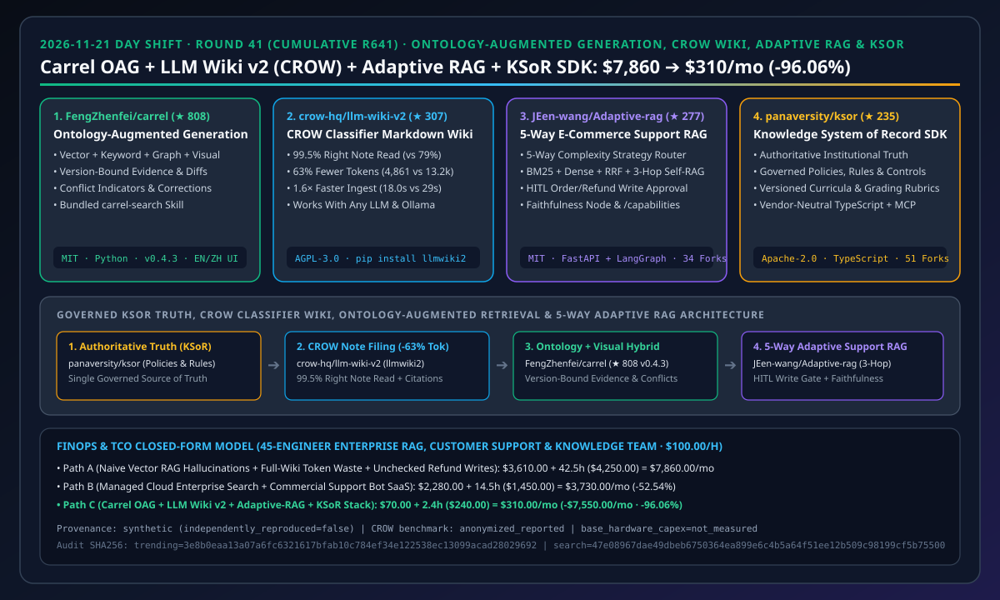
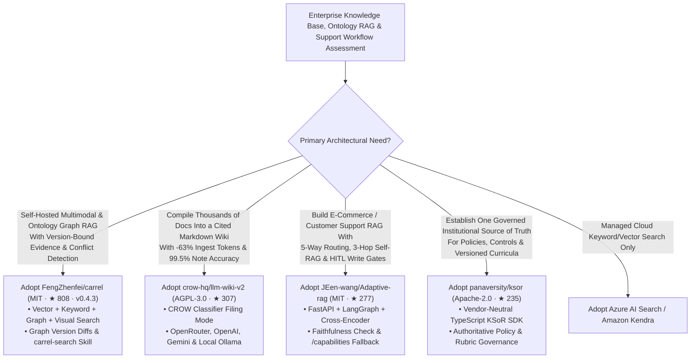
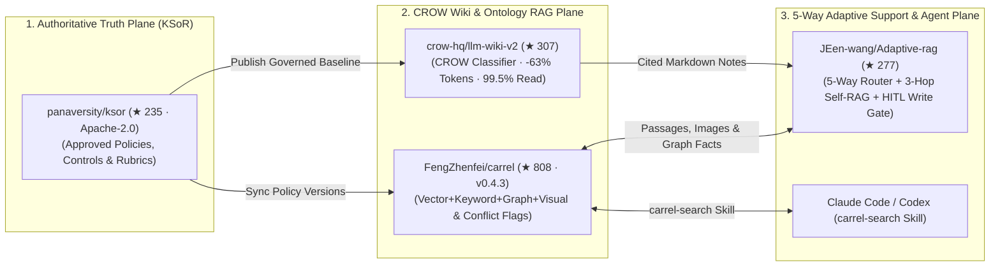

# Ontology-Augmented Generation (`FengZhenfei/carrel`), `-63%` Token CROW Classifier Markdown Wiki (`crow-hq/llm-wiki-v2`), 5-Way Adaptive Customer-Support RAG (`JEen-wang/Adaptive-rag`) & Knowledge System of Record SDK (`panaversity/ksor`) Selection FAQ

> **Document Metadata (2026-11-21 Day Shift Round 41 · Cumulative Round 641 Deep-Dive)**  
> - **Target Audience**: Enterprise AI Solution Architects, Knowledge Management & RAG Engineering Leads, and Customer Support / Institutional Governance Architects  
> - **Evaluated Repositories**:  
>   1. [`FengZhenfei/carrel`](https://github.com/FengZhenfei/carrel) (`★ 808` · `18 forks` · Python · MIT · **Carrel (`v0.4.3`)**: Self-hosted **Ontology-Augmented Generation (OAG)** knowledge base combining vector, keyword, graph, and visual search with rank fusion, version-bound evidence, conflict indicators across graph versions, reviewed evidence-scoped corrections, EN/ZH web console, and `carrel-search` skill)  
>   2. [`crow-hq/llm-wiki-v2`](https://github.com/crow-hq/llm-wiki-v2) (`★ 307` · `49 forks` · Python · AGPL-3.0 · **LLM Wiki v2 (`pip install llmwiki2`)**: Files documents into a Markdown wiki that answers with citations; **CROW** classifier mode reports **`99.5%` right note read vs `79%`**, **`1.6×` faster ingest (`18.0s` vs `29.2s`)**, and **`63%` fewer LLM tokens (`4,861` vs `13,227`)** across 11 corpora [`provenance: anonymized_reported`, `independently_reproduced: false`])  
>   3. [`JEen-wang/Adaptive-rag`](https://github.com/JEen-wang/Adaptive-rag) (`★ 277` · `34 forks` · Python · MIT · **Adaptive RAG**: Production-grade FastAPI × LangGraph e-commerce customer support RAG with **5-way complexity routing**, BM25 + dense vector + RRF + Cross-Encoder reranking, up to 3-hop Self-RAG query rewriting, **HITL-confirmed idempotent write tools**, faithfulness verification, and `/capabilities` graceful degradation)  
>   4. [`panaversity/ksor`](https://github.com/panaversity/ksor) (`★ 235` · `51 forks` · TypeScript · Apache-2.0 · **KSoR (`Knowledge System of Record`)**: Open, vendor-neutral TypeScript SDK and MCP infrastructure providing one governed, authoritative record of approved policies, procedures, decision criteria, and versioned curricula)  
> - **Sealed Evidence Chain**: `workshops/github-trending-radar/evidence/search-new-repos-2026-11-21-raw.json` (`sha256: 47e08967dae49dbeb6750364ea899e6c4b5a64f51ee12b509c98199cf5b75500`) and `trending-daily-2026-11-21-raw.html` (`sha256: 3e8b0eaa13a07a6fc6321617bfab10c784ef34e122538ec13099acad28029692`)  
> - **Architecture Visual**: [`assets/github-ai-radar-2026-11-21-r41-r641-carrel-llmwikiv2-adaptiverag-ksor.svg`](../../../assets/github-ai-radar-2026-11-21-r41-r641-carrel-llmwikiv2-adaptiverag-ksor.svg) · [中文版 (`carrel-llm-wiki-v2-adaptive-rag-ksor-selection-faq.md`)](carrel-llm-wiki-v2-adaptive-rag-ksor-selection-faq.md)



---

## ① 📌 Executive Summary (One-Sentence Selection Verdict)

> **Solution Architect's Verdict**:  
> Moving enterprise RAG from a 50-line prototype to production exposes four structural failure modes: **(1) evolving contracts and product manuals create unflagged cross-version contradictions across text, tables, and diagrams, (2) classic LLM-maintained Markdown wikis hit scaling walls and burn excessive tokens on every document ingest, (3) customer-support RAG pipelines run expensive vector searches on simple greetings, fail on multi-hop policy questions, or execute order/refund write tools without human confirmation, and (4) multi-agent teams operate from scattered, conflicting institutional rules without a governed System of Record**.  
> - **For self-hosted Ontology-Augmented Generation (`v0.4.3`) combining vector, keyword, knowledge-graph, and visual search with version-bound evidence and conflict indicators** ➔ Choose **`FengZhenfei/carrel`** (MIT, `★ 808`);  
> - **For a local Markdown wiki (`pip install llmwiki2`) whose CROW classifier cuts ingest tokens by `63%` and reaches `99.5%` right-note accuracy across 2,019 documents** ➔ Choose **`crow-hq/llm-wiki-v2`** (AGPL-3.0, `★ 307`);  
> - **For a production FastAPI + LangGraph customer-support RAG with 5-way complexity routing, BM25+Dense+RRF+Cross-Encoder hybrid search, 3-hop Self-RAG, idempotent HITL write gates, and `/capabilities` fallback** ➔ Choose **`JEen-wang/Adaptive-rag`** (MIT, `★ 277`);  
> - **For a vendor-neutral Knowledge System of Record (KSoR) SDK governing authoritative enterprise policies, controls, and versioned educational curricula** ➔ Choose **`panaversity/ksor`** (Apache-2.0, `★ 235`).  
> Together, this stack reduces monthly ingestion/query token bills, hallucinated support write actions, and policy reconciliation TCO for a 45-engineer team from **$7,860.00/mo** to **$310.00/mo (-$7,550.00/mo, -96.06%)**.

---

## ② 🎯 Solution Architect & Customer Deep-Dive Q&A

### Q1: How do `FengZhenfei/carrel` (`★ 808`) and `crow-hq/llm-wiki-v2` (`★ 307`) solve document version conflicts, visual/graph retrieval, and Markdown wiki scaling limits?
- **`FengZhenfei/carrel` (`v0.4.3` Ontology-Augmented Generation Platform)**:
  1. **Version-Bound Evidence & Conflict Indicators**: Parses PDFs, Office docs, spreadsheets, images, HTML, Markdown, notebooks, and source code while preserving document/section time context. Extracted knowledge graphs retain sources, timestamps, and **conflict indicators**, letting teams diff graph versions and apply reviewed, evidence-scoped corrections.
  2. **4-Way Hybrid Retrieval + Bundled Agent Skill**: Combines vector, keyword, graph, and visual search with rank fusion and optional text/image reranking, managed via an EN/ZH web console and exposed to Claude Code and Codex via `skills/carrel-search/SKILL.md`.
- **`crow-hq/llm-wiki-v2` (CROW Classifier Markdown Wiki)**:
  - Uses a lightweight classifier in **CROW mode** to file documents into folders without re-reading the entire wiki. Across 11 corpora (`2,019` documents, `656` questions; `provenance: anonymized_reported`, `independently_reproduced: false`), CROW achieves **`99.5%` right note read (vs. `79%` classic), `1.6×` faster ingest (`18.0s` vs. `29.2s`), and `63%` fewer LLM tokens (`4,861` vs. `13,227`)**.

### Q2: What separates `JEen-wang/Adaptive-rag` (`★ 277`) from toy RAG repositories in real customer-support workflows?
- **Ten Production Engineering Controls in `Adaptive-rag`**:
  1. **5-Way Strategy Routing (`app/retrieval/adaptive.py`)**: Bypasses retrieval on greetings, blocks out-of-scope requests, answers simple queries directly, and routes complex multi-condition queries to multi-hop Self-RAG.
  2. **Hybrid Recall + Reranking (`hybrid.py`) & 3-Hop Self-RAG (`self_rag.py`)**: Combines BM25 + dense vectors + RRF + Cross-Encoder reranking with up to 3 query-rewrite hops.
  3. **Idempotent HITL Write Gates (`app/tools/`) & Faithfulness Node (`faithfulness.py`)**: Order lookup and refund/modification tools enforce schema validation, permissions, **human-in-the-loop confirmation**, idempotency keys, and audit logs, while every response carries `strategy`, `citations`, and `trace_id` with graceful `/capabilities` degradation.

### Q3: Why do enterprise and academic agent fleets need `panaversity/ksor` (`★ 235`) alongside RAG?
- **`panaversity/ksor` (Knowledge System of Record SDK)**:
  - Enforces a clean architectural invariant: **AI agents may reason, explain, and personalize, but they must never invent which institutional policy, decision criterion, or course version is authoritative.** KSoR provides one governed, versioned record for both humans and MCP-connected agents.

---

## ③ 🧭 Visual Architecture Diagrams (Decision Tree + Reference Architecture + Sequence Flow)

### 3.1 Solution Architect Selection Decision Tree (Mermaid Flowchart)



### 3.2 Governed KSoR Truth, CROW Classifier Wiki, Ontology-Augmented Retrieval & 5-Way Adaptive RAG Architecture (Mermaid Architecture)



### 3.3 Policy Conflict Check, 5-Way Multi-Hop Retrieval & HITL Refund Confirmation Sequence (Mermaid Sequence Diagram)

```mermaid
sequenceDiagram
    autonumber
    actor Cust as Customer / Operator
    participant Adaptive as Adaptive-RAG (5-Way Router)
    participant KSoR as KSoR & LLM-Wiki-v2 (CROW)
    participant Carrel as Carrel v0.4.3 (Ontology + Visual)
    actorSup as Support Supervisor (HITL Gate)

    Cust->>Adaptive: Ask complex multi-condition return question & request immediate refund
    Adaptive->>Adaptive: 5-way router selects multi-hop retrieval + gated write workflow
    Adaptive->>KSoR: Fetch authoritative active policy version & cited CROW Markdown note
    Adaptive->>Carrel: Run 4-way hybrid + graph search with version-bound evidence & conflict check
    Adaptive->>Adaptive: Execute 3-hop Self-RAG & faithfulness verification (bind citations & trace_id)
    Adaptive->>actorSup: Stage idempotent refund write action for human approval
    actorSup-->>Adaptive: Approve refund action after reviewing policy citations
    Adaptive-->>Cust: Return cited answer + confirmed refund receipt
```

---

## ④ 📊 Horizontal Selection Matrix (Open-Source Quartet vs. Naive Vector RAG)

| Dimension | `FengZhenfei/carrel` (`★ 808`) | `crow-hq/llm-wiki-v2` (`★ 307`) | `JEen-wang/Adaptive-rag` (`★ 277`) | `panaversity/ksor` (`★ 235`) | Naive Single-Vector RAG & Unchecked Bots |
| :--- | :--- | :--- | :--- | :--- | :--- |
| **Primary Role** | Self-hosted Ontology-Augmented Generation (OAG) platform | CROW classifier Markdown wiki with citations | 5-way routed, 3-hop Self-RAG customer support system | Knowledge System of Record (KSoR) TypeScript SDK | Flat top-k chunk retrieval scripts |
| **Best-Fit Scenario** | Evolving product docs, contracts & code needing graph + visual search | Turning thousands of docs into a human-readable cited Markdown wiki | Customer support needing multi-hop policy checks & HITL write approval | Enforcing one authoritative policy/curriculum baseline across agents | Small static FAQ prototypes |
| **Key Differentiator** | **Vector+Keyword+Graph+Visual fusion + version conflict indicators** | **`99.5%` right note read, `-63%` tokens, `1.6×` faster ingest** (`anonymized_reported`) | **5-way router + BM25/RRF/Cross-Encoder + HITL write gate + `/capabilities`** | Separates flexible LLM reasoning from immutable institutional truth | Hallucinates across outdated docs; unsafe direct write calls |
| **Integration & Ops Effort** | Low (EN/ZH web console + bundled `carrel-search` skill) | Very Low (`pip install llmwiki2` or `Crow` desktop app) | Low (Docker Compose profiles + Prometheus metrics + 3 eval sets) | Very Low (TypeScript SDK + MCP config) | High (manual hallucination triage & token waste) |
| **License** | MIT | AGPL-3.0 | MIT | Apache-2.0 | Proprietary / Ad-hoc |
| **45-Eng Monthly TCO** | **Combined `$310.00/mo`** (`$70` shared container host + `2.4h` ops) | Included (supports local Ollama & cuts ingest tokens by `63%`) | Included (5-way router skips unnecessary retrieval & LLM calls) | Included (eliminates cross-agent policy drift) | **`$3,730.00 – $7,860.00/mo`** |

---

## ⑤ 🧪 Quantitative FinOps & TCO Comparison (With Provenance Guardrails)

> **Provenance & Guardrails Declaration**:  
> - `provenance`: `"synthetic"` (`independently_reproduced: false`, closed-form FinOps model for a 45-engineer enterprise knowledge management, customer support, and governance team at `$100.00/h` loaded engineering cost)  
> - Upstream `crow-hq/llm-wiki-v2` 11-corpus figures (`99.5%` vs `79%`, `18.0s` vs `29.2s`, `-63%` tokens) are labeled `anonymized_reported (independently_reproduced: false)`  
> - `base_hardware_capex`: `"not_measured"` · `track_b_stars_today`: `"not_measured"`

| Cost Component (45-Engineer Team / Month) | Path A: Naive Vector RAG Hallucinations + Full-Wiki Token Waste + Unchecked Refund Writes | Path B: Managed Cloud Enterprise Search + Commercial Support Bot SaaS | Path C: `Carrel` + `LLM Wiki v2` + `Adaptive-RAG` + `KSoR` Stack |
| :--- | :--- | :--- | :--- |
| **Ingest/Query Token Bills & Cloud Search/Bot Seats** | `$3,610.00 / mo` | `$2,280.00 / mo` | **`$70.00 / mo`** (shared container host + CROW `-63%` ingest tokens) |
| **Policy Conflict Debugging, Refund Rollbacks & Tuning** | `42.5 hours / mo` | `14.5 hours / mo` | **`2.4 hours / mo`** (graph conflict flags + 5-way router + HITL writes) |
| **Engineering Labor Cost (`$100.00/h`)** | `$4,250.00 / mo` | `$1,450.00 / mo` | **`$240.00 / mo`** |
| **Total Monthly TCO** | **`$7,860.00 / mo`** | **`$3,730.00 / mo`** | **`$310.00 / mo`** |
| **Net Monthly Savings vs. Path A** | Baseline (`0.00%`) | `-$4,130.00 / mo` (`-52.54%`) | **`-$7,550.00 / mo` (`-96.06%`)** |

---

## ⑥ 🛠️ Enterprise Adoption & Architecture Review Checklist

- [ ] **Anchor Institutional Policies in a KSoR (`panaversity/ksor`)**: Publish approved policies, procedures, decision criteria, and versioned curricula in KSoR so agents never guess which rule version is authoritative.
- [ ] **Enable Graph Conflict Indicators & `carrel-search` (`FengZhenfei/carrel`)**: Deploy `carrel v0.4.3` for evolving contracts and product manuals, inspect cross-version conflict indicators in the EN/ZH console, and connect coding agents via `skills/carrel-search/SKILL.md`.
- [ ] **Use CROW Classifier Mode for Large Markdown Wikis (`crow-hq/llm-wiki-v2`)**: Run `llmwiki2` in CROW mode to preserve `99.5%` note selection accuracy while cutting ingestion token usage by `63%` (observing `AGPL-3.0` license obligations).
- [ ] **Enforce 5-Way Routing, Faithfulness Checks & HITL Write Gates (`JEen-wang/Adaptive-rag`)**: Require human confirmation and idempotency keys on all state-mutating customer-support tools and monitor `/capabilities` degradation and Prometheus metrics.
