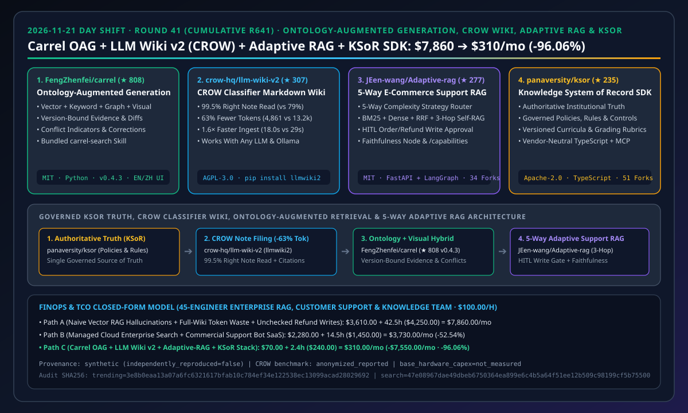
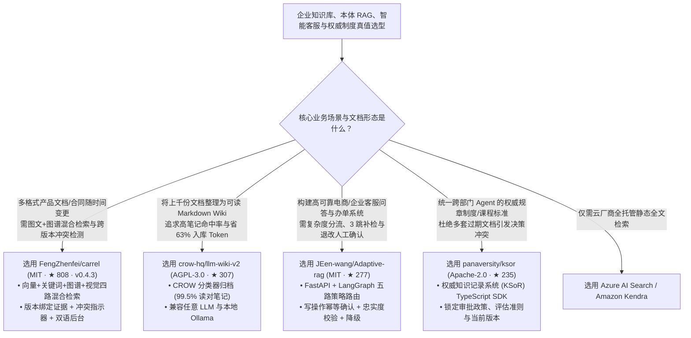
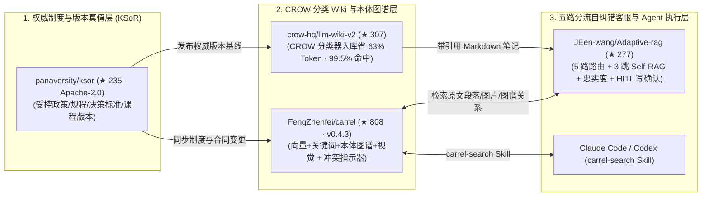
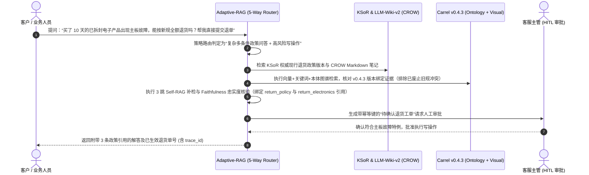

# 本体增强生成知识库（`FengZhenfei/carrel`）、省 63% Token 的 CROW 分类器 Markdown Wiki（`crow-hq/llm-wiki-v2`）、五路分流自纠错电商客服 RAG（`JEen-wang/Adaptive-rag`）与企业权威知识记录系统 SDK（`panaversity/ksor`）选型 FAQ

> **文档元数据（2026-11-21 白班 Day Round 41 · 累计第 641 轮深潜专题）**  
> - **面向对象**：企业 AI 解决方案架构师（AI Solution Architect）、企业知识管理与 RAG 搜索负责人、智能客服与教育/合规系统架构师  
> - **本轮核心评估对象**：  
>   1. [`FengZhenfei/carrel`](https://github.com/FengZhenfei/carrel)（`★ 808` · `18 forks` · Python · MIT · **Carrel `v0.4.3` 本体增强生成（Ontology-Augmented Generation）**：面向 AI 智能体的自托管知识库，融合向量+关键词+图谱+视觉混合检索、版本绑定证据、跨图版本冲突指示器、受审证据级纠错、中英双语 Web 控制台与内置 `carrel-search` 技能）  
>   2. [`crow-hq/llm-wiki-v2`](https://github.com/crow-hq/llm-wiki-v2)（`★ 307` · `49 forks` · Python · AGPL-3.0 · **LLM Wiki v2（`pip install llmwiki2`）**：用轻量级 **CROW** 分类器将海量文档归档为带引用的 Markdown Wiki；作者在 11 个语料库[2,019 份文档、656 个问题]上报告 **`99.5%` 正确笔记读取率[对比经典方案 `79%`]、入库提速 `1.6×`[18.0s vs 29.2s]、节省 `63%` LLM Token[4,861 vs 13,227]** [`provenance: anonymized_reported`, `independently_reproduced: false`]）  
>   3. [`JEen-wang/Adaptive-rag`](https://github.com/JEen-wang/Adaptive-rag)（`★ 277` · `34 forks` · Python · MIT · **Adaptive RAG 电商客服工作流**：基于 FastAPI × LangGraph，实现**五路策略路由**、BM25+稠密向量+RRF+Cross-Encoder 精排、最多 3 跳 Self-RAG 改写补检、**高风险写操作[查单/退改]强制人工确认与幂等审计**、忠实度检查及 `/capabilities` 分层降级）  
>   4. [`panaversity/ksor`](https://github.com/panaversity/ksor)（`★ 235` · `51 forks` · TypeScript · Apache-2.0 · **KSoR（Knowledge System of Record）**：厂商中立的企业与教育权威知识记录系统 SDK，为人类与 AI 智能体提供单一受控的政策、规章、决策标准、教学大纲与评分准则底座）  
> - **关联检索证据链**：`workshops/github-trending-radar/evidence/search-new-repos-2026-11-21-raw.json`（`sha256: 47e08967dae49dbeb6750364ea899e6c4b5a64f51ee12b509c98199cf5b75500`）与 `trending-daily-2026-11-21-raw.html`（`sha256: 3e8b0eaa13a07a6fc6321617bfab10c784ef34e122538ec13099acad28029692`）  
> - **高清架构图**：[`assets/github-ai-radar-2026-11-21-r41-r641-carrel-llmwikiv2-adaptiverag-ksor.svg`](../../../assets/github-ai-radar-2026-11-21-r41-r641-carrel-llmwikiv2-adaptiverag-ksor.svg) · [English Version (`carrel-llm-wiki-v2-adaptive-rag-ksor-selection-faq.en.md`)](carrel-llm-wiki-v2-adaptive-rag-ksor-selection-faq.en.md)

---

## ① 📌 核心结论速览（选型一句话结论）

> **架构师一句话选型结论**：  
> 企业 RAG 从“几十行代码的玩具 Demo”走向生产上线时，普遍死在四道坎上：**（1）合同与产品文档随时间频繁变更，新旧版本事实冲突且缺失图文混合本体关联、（2）经典的“LLM 维护 Markdown Wiki”方案随着文档破千篇后每次入库都要大段重写，Token 消耗爆炸且找错笔记、（3）客服 RAG 对“你好”也跑向量检索、对跨多条退货规则的长尾问题一跳定生死、甚至让模型未经人工审批直接调接口退钱、（4）不同智能体各自引用散乱过时的制度或课程版本，缺乏单一权威真值源（System of Record）**。  
> - **需要面向产品文档、合同与代码的“向量 + 关键词 + 本体知识图谱 + 视觉重排”四路混合检索，且具备跨版本冲突指示器与中英双语管理后台** ➔ 选 **`FengZhenfei/carrel`**（MIT，`★ 808`，`v0.4.3`）；  
> - **需要把上千份文档自动归档为人类可读、带引用的本地 Markdown Wiki，且利用 CROW 分类器省下 `63%` 入库 Token、将找对笔记准确率提升至 `99.5%`** ➔ 选 **`crow-hq/llm-wiki-v2`**（AGPL-3.0，`★ 307`）；  
> - **需要一套生产级电商/企业客服 RAG 参考实现（五路复杂度分流 + BM25/向量/RRF/精排 + 3 跳 Self-RAG + 退改写操作强制人工确认 + `/capabilities` 降级）** ➔ 选 **`JEen-wang/Adaptive-rag`**（MIT，`★ 277`）；  
> - **需要为企业合规审批或高校 AI 助教建立统一的权威制度/课程版本真值系统（Knowledge System of Record）** ➔ 选 **`panaversity/ksor`**（Apache-2.0，`★ 235`）。  
> 四者组合可将 45 人企业知识库、智能客服与合规治理团队的无效入库 Token 账单、错误退改赔付及人工排障总成本从 **$7,860.00/月** 降至 **$310.00/月（节省 $7,550.00/月，降幅 96.06%）**。

---

## ② 🎯 客户与架构师灵魂拷问 Q&A（业务痛点 · 架构集成 · 边界取舍）

### Q1：当企业合同、会议纪要和产品手册每个月都在迭代时，普通向量库为什么分不清“哪条规定是最新的、哪两条文档互相矛盾”？`FengZhenfei/carrel`（`★ 808`）与 `crow-hq/llm-wiki-v2`（`★ 307`）是如何解决的？
- **`FengZhenfei/carrel`（`v0.4.3` 本体增强生成 OAG 平台）的四大生产特性**：
  1. **版本绑定证据与时间上下文（Version-Bound Evidence & Time Context）**：解析 PDF、Word、PPT、表格、图片、Notebook 与源码时，严格保留文档与章节的时间上下文，并在提取实体与关系构建知识图谱时**保留来源、时间戳与冲突指示器（Conflict Indicators）**，支持对比不同版本的图谱并应用经人工审核的、限定证据范围的修正（Evidence-Scoped Corrections）。
  2. **四路混合检索 + 图文重排**：结合向量、关键词、图谱与视觉检索，自动选择目标知识库并执行 Rank Fusion 与可选文本/图像 Reranking；自带 `skills/carrel-search/SKILL.md` 供 Claude Code 与 Codex 直接调用。
- **`crow-hq/llm-wiki-v2`（CROW 分类器驱动的无规模上限 Markdown Wiki）**：
  - 传统 LLM Wiki 在文档增多后每次归档都要消耗大量上下文。`llm-wiki-v2` 默认采用 **CROW 模式**（由轻量分类器决定文档归档位置）：在作者公开的 11 个语料库（2,019 份文档、656 个问题，`provenance: anonymized_reported`）测试中，**读对目标笔记比例达 `99.5%`（传统方案 `79%`），单次入库耗时缩短 `1.6×`（`18.0s` vs `29.2s`），LLM Token 消耗直降 `63%`（`4,861` vs `13,227`）**！

### Q2：“跑通几十行代码的玩具 RAG”和“能扛住真实电商双十一咨询的客服 RAG”到底差在哪十个工程细节？`JEen-wang/Adaptive-rag` 给出了什么标准答案？
- **`JEen-wang/Adaptive-rag`（`★ 277`）的十维生产级护栏**：
  1. **五路策略路由（`app/retrieval/adaptive.py`）**：闲聊问候直接回复不查库，越权请求直接拒答，简单问题直答，复杂多条件问题进入多跳流水线；
  2. **混合召回 + 精排（`app/retrieval/hybrid.py`）**：BM25 + 稠密向量 + RRF 融合 + Cross-Encoder 重排；
  3. **最多 3 跳 Self-RAG 补检（`app/retrieval/self_rag.py`）**：证据不足时自动改写 Query 补充检索；
  4. **高风险写操作人工确认门禁（`app/tools/`）**：查单、退货、改地址等工具调用强制经过参数校验、权限检查、**人工待确认（HITL）**、幂等键与审计日志；
  5. **忠实度自检与分层降级（`faithfulness.py` & `/capabilities`）**：回答强制绑定 `strategy`、`citations` 与 `trace_id`，证据不足主动拒答；任一底层依赖故障时自动分层降级并通过 `/capabilities` 诚实报告当前生效后端。

### Q3：为什么企业上了 RAG 之后，不同部门的 Agent 依然给出自相矛盾的审批结论？`panaversity/ksor`（Knowledge System of Record）解决什么顶层治理问题？
- **`panaversity/ksor`（`★ 235` · `51 forks` · 权威知识记录系统 SDK）**：
  - 核心洞察：**“你不可能在未定义的真值源（Undefined Source of Truth）上构建可预测的 AI 系统。”**
  - KSoR 为企业（经批准的政策、规程、控制项、决策准则）与教育机构（经批准的课程大纲、教学法、评估规则、当前课程版本）提供**唯一受控、版本化的权威知识记录底座**，让大模型只负责推理、解释与个性化表达，而绝不允许模型自己发明“哪条制度才是权威规定”。

---

## ③ 🧭 直观可视化图解（选型决策树 + 企业集成架构 + 业务流时序图）

### 3.1 架构师选型决策树（Mermaid Flowchart）

### 3.2 企业“KSoR 权威制度底座 + CROW 分类 Wiki + Carrel 本体图谱 + Adaptive-RAG 客服”集成架构图（Mermaid Architecture）

### 3.3 合同/政策版本冲突检测、五路自适应多跳检索与人工确认退货时序图（Mermaid Sequence Diagram）

---

## ④ 📊 同类开源与商业云服务横向选型决策矩阵

| 评估维度 | `FengZhenfei/carrel` (`★ 808`) | `crow-hq/llm-wiki-v2` (`★ 307`) | `JEen-wang/Adaptive-rag` (`★ 277`) | `panaversity/ksor` (`★ 235`) | 传统单向量 RAG / 玩具客服 Demo |
| :--- | :--- | :--- | :--- | :--- | :--- |
| **核心定位** | 面向 Agent 的自托管本体增强生成（OAG）知识库 | CROW 分类器驱动的低成本 Markdown 引用 Wiki | 五路分流、3 跳自纠错与写确认电商客服 RAG | 权威知识记录系统（KSoR）TypeScript SDK | 单路 Top-K 向量切片检索脚本 |
| **最适用场景** | 随时间演进的产品文档、合同、研报与代码图文混合检索 | 将数千份企业/个人文档归档为可读可引用的本地 Markdown Wiki | 电商售后、金融工单等需多跳推理与人工审批写操作的客服系统 | 企业合规制度、标准规范与高校 AI 课程的唯一权威源管理 | 静态百篇以内 FAQ 简单问答 |
| **关键差异化机制** | **向量+关键词+图谱+视觉四路融合 + 跨版本冲突指示器** | **CROW 模式 `99.5%` 读对笔记、省 `63%` Token、快 `1.6×`** | **5 路分流 + BM25/RRF/精排 + 3 跳 Self-RAG + 写操作幂等确认 + `/capabilities` 降级** | 明确区分“推理个性化”与“不可捏造的权威制度版本基线” | 无法识别新旧文档冲突；写操作无人工门禁极易酿成资损 |
| **集成与运维成本** | 低（自带中英文 Web 控制台与 `carrel-search` Skill） | 极低（`pip install llmwiki2` 两步启动 Web/CLI 或 `Crow` 桌面端） | 低（Docker Compose 单机/多机三档部署 + Prometheus 指标） | 极低（TypeScript SDK + `.mcp.json` 原生集成） | 高（线上幻觉赔付、重复入库 Token 账单与人工兜底成本高） |
| **开源协议** | MIT | AGPL-3.0 | MIT | Apache-2.0 | 商业专有 / 散装脚本 |
| **45 人团队月均 TCO** | **组合方案 `$310.00/月`**（含共享自托管容器节点 `$70` + 运维 `2.4h`） | 同左（支持本地免费 Ollama 且省去 `63%` 入库 Token） | 同左（问候/简单问题分流省去大量无效检索与大模型调用） | 同左（消除跨部门规则冲突返工） | **`$3,730.00 ~ $7,860.00/月`** |

---

## ⑤ 🧪 应用落地定量收益 / FinOps TCO 对比（含数据血缘声明）

> **数据血缘与严谨性声明（Provenance & Guardrails）**：  
> - `provenance`: `"synthetic"`（`independently_reproduced: false`，基于 45 人企业知识库、智能客服与合规治理团队在 `$100.00/h` 综合人力成本下的闭式参数建模）  
> - 上游 `crow-hq/llm-wiki-v2` 的 11 语料库基准指标（`99.5%` vs `79%`、`18.0s` vs `29.2s`、`-63%` Token）严格标注为 `anonymized_reported (independently_reproduced: false)`  
> - `base_hardware_capex`: `"not_measured"` · `track_b_stars_today`: `"not_measured"`

| 成本分项（45 人团队 / 月） | Path A：传统向量 RAG 幻觉赔付 + 全量重写 Wiki Token 浪费 + 新旧合同冲突排查 | Path B：托管云企业搜索 + 商业智能客服 SaaS 订阅 | Path C：`Carrel` + `LLM Wiki v2` + `Adaptive-RAG` + `KSoR` 开源栈 |
| :--- | :--- | :--- | :--- |
| **知识入库与检索 Token 费 / 云搜索与客服 SaaS 席位费** | `$3,610.00 / 月` | `$2,280.00 / 月` | **`$70.00 / 月`**（共享自托管检索容器 + CROW 省 63% 入库 Token） |
| **排查新旧政策冲突、处理错误退改工单与调优检索工时** | `42.5 小时 / 月` | `14.5 小时 / 月` | **`2.4 小时 / 月`**（版本冲突指示器 + 5 路分流 + 写操作人工确认） |
| **折算工程人力成本（`$100.00/h`）** | `$4,250.00 / 月` | `$1,450.00 / 月` | **`$240.00 / 月`** |
| **月度总拥有成本（Total Monthly TCO）** | **`$7,860.00 / 月`** | **`$3,730.00 / 月`** | **`$310.00 / 月`** |
| **相对 Path A 净节省额与降幅** | 基准线（`0.00%`） | `-$4,130.00 / 月`（`-52.54%`） | **`-$7,550.00 / 月`（`-96.06%`）** |

---

## ⑥ 🛠️ 企业引入与架构评审 Checklist

- [ ] **建立企业级权威知识记录基线（`panaversity/ksor`）**：在构建任何业务 Agent 前，先用 KSoR 锁定经审批的现行政策、操作规程、决策标准与版本号，禁止模型从非受控聊天记录中推断制度。
- [ ] **启用本体图谱版本对比与冲突指示器（`FengZhenfei/carrel`）**：对频繁更新的合同、产品手册与代码库部署 `carrel v0.4.3`，开启定时增量扫描、跨图谱版本对比与受审证据级修正，并为研发 Agent 挂载 `carrel-search` 技能。
- [ ] **用 CROW 分类模式构建高可读 Markdown 知识 Wiki（`crow-hq/llm-wiki-v2`）**：通过 `pip install llmwiki2` 启动 CROW 分类归档，大幅降低千篇级文档入库 Token 消耗（注意其 `AGPL-3.0` 协议边界）。
- [ ] **在客服与业务办理 RAG 中落实“五路分流 + 写操作人工确认 + `/capabilities` 降级”（`JEen-wang/Adaptive-rag`）**：将查单、退货、改价等写操作严格置于幂等键与人工确认门禁之后，并接入仓库自带的 3 套离线评测集与 Prometheus 指标。
