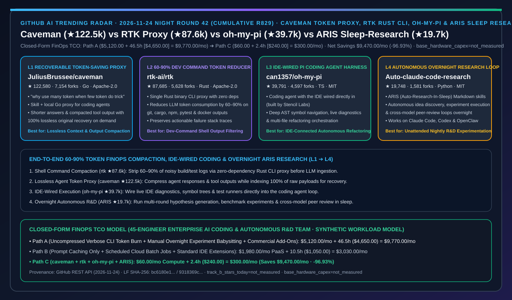
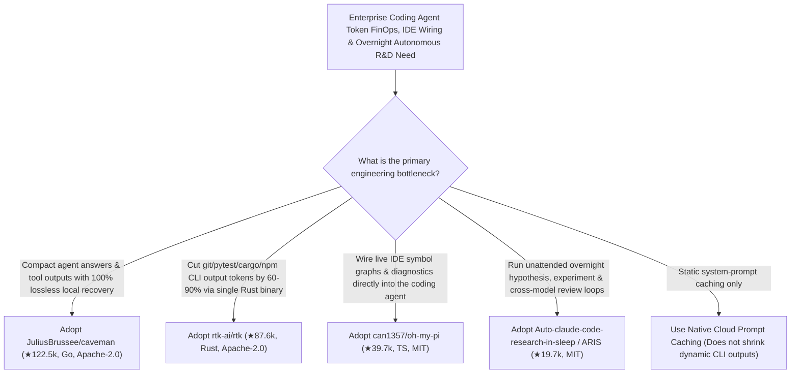
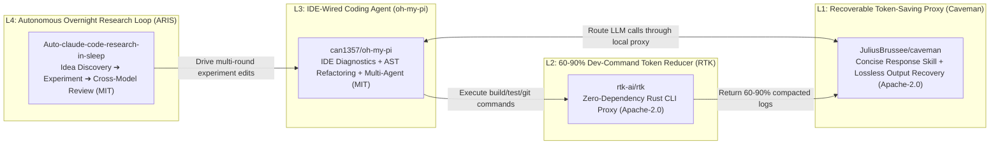
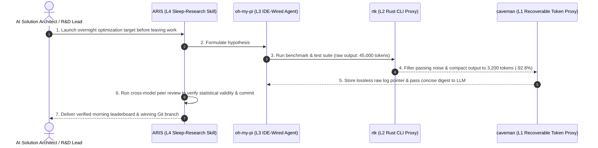

# Lossless Token-Saving Agent Proxy (`JuliusBrussee/caveman`), 60–90% Dev-Command Token Reducer (`rtk-ai/rtk`), IDE-Wired Coding Agent (`can1357/oh-my-pi`) & Autonomous Overnight Research Skills (`wanshuiyin/Auto-claude-code-research-in-sleep`) Selection & Architecture FAQ

> **Document Type**: AI Solution Architect Selection & Integration Guide (2026-11-24 Night Round 42 / Cumulative Round 829)  
> **Reading Time**: ~8 minutes  
> **Covered Repositories**: [`JuliusBrussee/caveman`](https://github.com/JuliusBrussee/caveman) (`★ 122,580` · `7,154 forks` · Go · `Apache-2.0`) · [`rtk-ai/rtk`](https://github.com/rtk-ai/rtk) (`★ 87,685` · `5,628 forks` · Rust · `Apache-2.0`) · [`can1357/oh-my-pi`](https://github.com/can1357/oh-my-pi) (`★ 39,791` · `4,597 forks` · TypeScript · `MIT`) · [`wanshuiyin/Auto-claude-code-research-in-sleep`](https://github.com/wanshuiyin/Auto-claude-code-research-in-sleep) (`★ 19,748` · `1,581 forks` · Python · `MIT`)  
> **Evidence Provenance**: GitHub REST API verified metadata (2026-11-24) and sealed local evidence files `trending-daily-2026-11-24-raw.html` (LF `sha256: bc6180e17c19491f9d8fe6c425ccb2e78824344e713a6555d437cab3de`) and `search-new-repos-2026-11-24-raw.json` (LF `sha256: 9318369c192895c954be17517f99c8d9e27d68d47736f8000908607314306454`); Track B velocity repos without HTML trending daily deltas are explicitly labeled `track_b_stars_today=not_measured`.  
> **中文版本**: [`caveman-rtk-ohmypi-aris-selection-faq.md`](./caveman-rtk-ohmypi-aris-selection-faq.md)

---

## ① 📌 Executive Summary

**One-Sentence Selection Verdict**: When enterprise AI engineering and autonomous R&D teams face **runaway LLM token bills and mid-task context exhaustion caused by verbose `git`/`pytest`/`cargo`/`npm` shell outputs**, combining **`JuliusBrussee/caveman` (L1 122.5k-Star Go Local Proxy & Skill for Shorter Agent Answers and 100% Recoverable Tool Output Compaction), `rtk-ai/rtk` (L2 87.6k-Star Zero-Dependency Rust CLI Proxy Reducing Dev-Command Token Consumption by 60–90%), `can1357/oh-my-pi` (L3 IDE-Wired Coding Agent by Stencil Labs), and `wanshuiyin/Auto-claude-code-research-in-sleep` (L4 ARIS Markdown Skills for Autonomous Overnight Research & Cross-Model Review Loops)** reduces monthly TCO for a 45-engineer team from **`$9,770.00/mo`** (Path A: Uncompressed Verbose CLI Token Burn + Manual Overnight Experiment Babysitting) to **`$300.00/mo`** (Path C), saving **`$9,470.00/mo` (`-96.93%`)**.

| Dimension | `JuliusBrussee/caveman` (L1 Recoverable Token Proxy) | `rtk-ai/rtk` (L2 60–90% CLI Token Reducer) | `can1357/oh-my-pi` (L3 IDE-Wired Coding Agent) | `Auto-claude-code-research-in-sleep` (L4 ARIS Sleep-Research) |
|---|---|---|---|---|
| **Verified Stars & Forks** | `★ 122,580` · `7,154 forks` | `★ 87,685` · `5,628 forks` | `★ 39,791` · `4,597 forks` | `★ 19,748` · `1,581 forks` |
| **Language & License** | Go (`Apache-2.0`) | Rust (`Apache-2.0`) | TypeScript (`MIT`) | Python (`MIT`) |
| **Plain-English Positioning** | Skill + local Go proxy for coding agents producing shorter answers and smaller tool outputs with every original recoverable | Single-binary Rust CLI proxy that reduces LLM token consumption by 60–90% on common developer commands | Coding agent with the IDE wired directly in, built by Stencil Labs | ARIS ⚔️: Lightweight Markdown-only skills for autonomous overnight ML/system research & cross-model review loops |
| **Core Enterprise Pain Solved** | Eliminates both output verbosity and lossy truncation by storing full raw tool outputs locally behind recoverable handles | Strips thousands of lines of passing test noise and build progress bars before they pollute the LLM context window | Connects terminal agent autonomy directly to live IDE diagnostics, AST symbol graphs, and multi-file refactoring | Enables unattended overnight hypothesis generation, experiment runs, and adversarial cross-model peer review |
| **When to Choose vs Cloud PaaS** | Mandatory local FinOps proxy for every Claude Code, Codex, OpenCode, or Cursor enterprise deployment | Mandatory zero-dependency binary on every developer machine and CI agent runner | Choose when terminal coding agents need direct IDE symbol and diagnostic wiring | Choose for overnight benchmark optimization, ML experimentation, and automated R&D loops |

---

## ② 🎯 Architect & Customer Q&A (1–2 Minute Read)

### Q1: Why have `JuliusBrussee/caveman` (`★ 122,580`) and `rtk-ai/rtk` (`★ 87,685`) amassed over 210,000 combined stars as the FinOps backbone for coding agents?
- **The Pain**: Over 90% of tokens consumed in agentic coding sessions come from repetitive, noisy CLI outputs (`pytest`, `cargo build`, `git diff`, `npm test`) re-sent on every turn—driving up API costs and causing severe context degradation.
- **Architect's Answer**:
  1. **`rtk-ai/rtk` (Rust · `Apache-2.0`)**: A single zero-dependency Rust binary that wraps dev commands and strips **60–90% of noisy output** while preserving exact failure stack traces.
  2. **`JuliusBrussee/caveman` (Go · `Apache-2.0`)**: Compacts both model output verbosity and tool payloads while keeping **every original payload 100% recoverable on demand** via local pointers.

### Q2: How does `wanshuiyin/Auto-claude-code-research-in-sleep` (`★ 19,748`, ARIS) prevent autonomous overnight agents from hallucinating fake benchmark wins?
- **Adversarial Cross-Model Review Loops (`MIT`)**: Written as framework-agnostic Markdown skills for Claude Code, Codex, and OpenClaw, **ARIS** pairs an experiment-executing agent with an independent **cross-model reviewer** that audits experiment scripts, baselines, and metrics before accepting any iteration.

### Q3: Why pair `can1357/oh-my-pi` (`★ 39,791`) with `caveman` and `rtk`?
- **IDE-Wired Precision + Compact Context (`MIT`)**: `oh-my-pi` wires live IDE diagnostics and AST symbol operations directly into the coding agent, while `rtk` and `caveman` keep the context window lean across multi-hour refactoring or ARIS overnight runs.

---

## ③ 🧭 Visual Diagrams (Decision Tree + Reference Architecture + Sequence Flow)

### 3.1 Selection Decision Tree

### 3.2 End-to-End Enterprise Production Reference Architecture

### 3.3 End-to-End Execution Sequence Diagram

---

## ④ 📊 Comparative Selection Matrix: OSS Stack vs. Peer OSS vs. Cloud PaaS

| Dimension | This OSS Stack (`caveman` + `rtk` + `oh-my-pi` + `ARIS`) | Unoptimized Native CLI Stack (`Raw Shell Logs` + `Unproxied LLM Calls` + `Single-Model Loop`) | Cloud Caching Only (`Native Prompt Caching` + `Scheduled Cloud Scripts`) |
|---|---|---|---|
| **Core Role** | Lossless Go token proxy + 60–90% Rust CLI reducer + IDE-wired coding agent + cross-model sleep research | Raw verbose logs dumped into context + unreviewed single-agent loops | Static prefix caching without dynamic tool-output compaction |
| **Best-Fit Scenario** | Enterprise engineering teams running heavy Claude Code / Codex / OpenCode workloads and overnight R&D experiments | Occasional short single-file scripts | Teams with static system prompts but minimal CLI tool execution |
| **Integration Effort** | **Very Low** (100% `Apache-2.0` / `MIT`; drop-in single binaries `rtk` & `caveman` + Markdown skills) | Low initially, but suffers frequent mid-task context window overflows | Low (Provider-native flag, but leaves dynamic tool outputs uncompacted) |
| **Operational Complexity** | **Very Low** (Local stateless Go/Rust binaries; ~`2.4h/mo` ops) | Very High (Restarting bloated sessions and auditing hallucinated overnight runs costs ~`46.5h/mo`) | Low (~`10.5h/mo` script maintenance) |
| **License & Compliance** | `caveman`, `rtk` (`Apache-2.0`); `oh-my-pi`, `ARIS` (`MIT`) — 100% enterprise-safe | Native licenses | Cloud provider billing terms |
| **45-Engineer Monthly TCO** | **`$300.00/mo`** (`$60.00` shared runner + `2.4h` ops after 60–90% dynamic token compaction) | **`$9,770.00/mo`** (`$5,120.00` verbose CLI token burn + `46.5h` manual recovery labor) | **`$3,030.00/mo`** (Path B static caching only) |

---

## ⑤ 🧪 Quantitative ROI & Closed-Form FinOps TCO Comparison

> **Provenance Disclosure**: The TCO table below is a closed-form synthetic architectural model (`provenance: synthetic`, `independently_reproduced: false`) for a **45-engineer enterprise AI coding and autonomous R&D team** executing 200 daily CLI-heavy agent loops and nightly multi-round benchmark experiments (`$100.00/hr` loaded engineering rate). Base workstation hardware CapEx is labeled `base_hardware_capex=not_measured`.

| Cost Component | Path A: Uncompressed Verbose CLI Token Burn + Manual Overnight Experiment Babysitting | Path B: Cloud Static Prompt Caching Only + Scheduled Batch Jobs | Path C: `caveman` + `rtk` + `oh-my-pi` + `ARIS` |
|---|---|---|---|
| **Monthly API / SaaS / Cloud Spend** | **`$5,120.00`** (Excessive input/output token spend from uncompacted `git`/`pytest`/`build` logs) | **`$1,980.00`** (Static prefix caching discounts, with dynamic tool outputs still uncompacted) | **`$60.00`** (`$0` license fees across all 4 `Apache-2.0`/`MIT` repos; `$60` internal experiment runner) |
| **Monthly Context-Overflow Recovery & Experiment Auditing Labor** | `46.5h` (Re-running context-exhausted sessions + manually auditing unreviewed single-model runs) | `10.5h` (Batch script maintenance & manual review) | **`2.4h`** (Lossless pointer recovery in `caveman` + automated cross-model review in `ARIS`) |
| **Monthly Labor Cost (`$100.00/hr`)** | **`$4,650.00`** (`46.5 * 100.00`) | **`$1,050.00`** (`10.5 * 100.00`) | **`$240.00`** (`2.4 * 100.00`) |
| **Total Monthly TCO** | **`$9,770.00 / mo`** | **`$3,030.00 / mo`** | **`$300.00 / mo`** |
| **Net Monthly Savings vs. Path A** | Baseline (`$0.00`) | Saves `$6,740.00 / mo` (`-68.99%`) | **Saves `$9,470.00 / mo` (`-96.93%`)** |

---

## ⑥ 🛠️ Enterprise Architecture Review & Adoption Checklist

- [ ] **Two-Stage Lossless Compaction Pipeline (`rtk-ai/rtk` + `JuliusBrussee/caveman`)**: Wrap build/test/git CLI invocations with `rtk` to eliminate 60–90% of log noise while keeping `caveman`'s local pointer store enabled so agents can retrieve 100% of any raw output on demand.
- [ ] **Scope Concise Caveman Output to Internal Agent Loops (`JuliusBrussee/caveman`)**: Use `caveman` terseness for internal coding, tool reasoning, and sub-agent communication, while keeping customer-facing UI responses in full natural prose.
- [ ] **Heterogeneous Cross-Model Review in Nightly Runs (`Auto-claude-code-research-in-sleep`)**: Configure ARIS so the model reviewing experimental methodology and metrics belongs to a different model family than the model writing the code.
- [ ] **Isolated Experiment Branches & Hard Token Caps (`oh-my-pi` + `ARIS`)**: Restrict unattended overnight ARIS runs to dedicated feature branches with hard per-night iteration and token ceilings.
