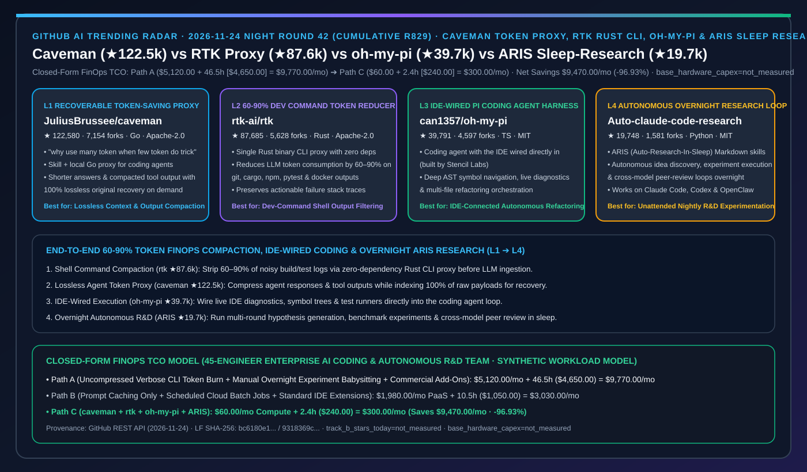
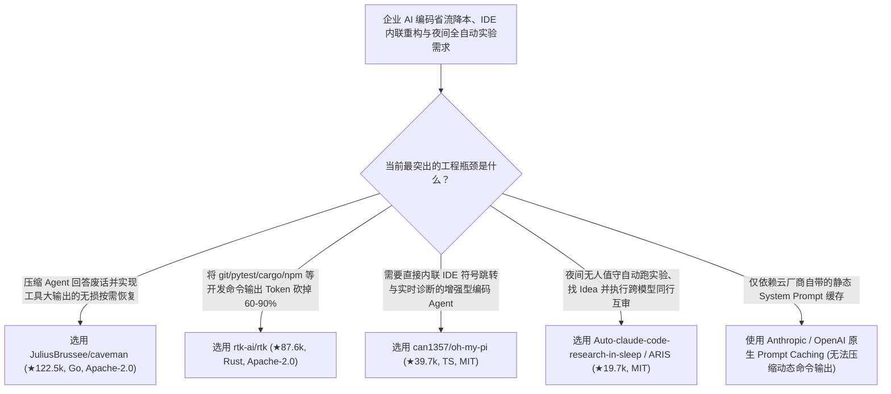
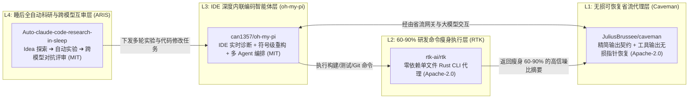
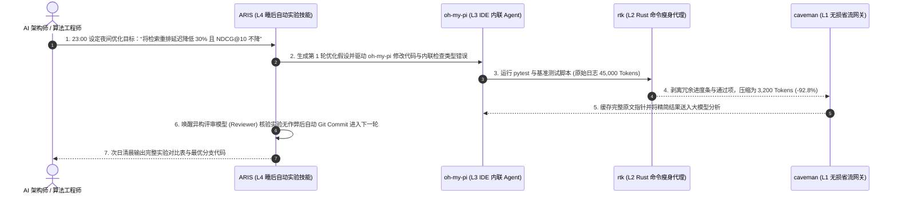

# 可恢复无损省流代理（`JuliusBrussee/caveman`）、60–90% 研发命令 Token 压缩器（`rtk-ai/rtk`）、IDE 深度内联编码智能体（`can1357/oh-my-pi`）与睡后全自动科研实验技能（`wanshuiyin/Auto-claude-code-research-in-sleep`）选型与集成 FAQ

> **文档类型**：AI 解决方案架构师（AI Solution Architect）选型决策指南（2026-11-24 Night Round 42 / 累计第 829 轮）  
> **阅读耗时**：约 8 分钟  
> **覆盖项目**：[`JuliusBrussee/caveman`](https://github.com/JuliusBrussee/caveman)（`★ 122,580` · `7,154 forks` · Go · `Apache-2.0`） · [`rtk-ai/rtk`](https://github.com/rtk-ai/rtk)（`★ 87,685` · `5,628 forks` · Rust · `Apache-2.0`） · [`can1357/oh-my-pi`](https://github.com/can1357/oh-my-pi)（`★ 39,791` · `4,597 forks` · TypeScript · `MIT`） · [`wanshuiyin/Auto-claude-code-research-in-sleep`](https://github.com/wanshuiyin/Auto-claude-code-research-in-sleep)（`★ 19,748` · `1,581 forks` · Python · `MIT`）  
> **证据溯源**：GitHub REST API 实测元数据（2026-11-24）与本地冻结证据文件 `trending-daily-2026-11-24-raw.html`（LF `sha256: bc6180e17c19491f9d8fe6c425ccb2e78824344e713a6555d437cab3de`）、`search-new-repos-2026-11-24-raw.json`（LF `sha256: 9318369c192895c954be17517f99c8d9e27d68d47736f8000908607314306454`）；Track B 仓库无 HTML 榜单对应的单日增量，统一标记为 `track_b_stars_today=not_measured`。  
> **English Version**: [`caveman-rtk-ohmypi-aris-selection-faq.en.md`](./caveman-rtk-ohmypi-aris-selection-faq.en.md)

---

## ① 📌 核心结论速览（Executive Summary）

**选型一句话结论**：当企业研发效能与长周期自动实验团队面临**“AI 编程 Agent 跑一次 `npm test` 或 `cargo build` 就往上下文塞进几万 Token 废话日志、长夜自主实验写到一半因为 Context 爆满而失忆中断”**的头号 FinOps 痛点时，采用 **`JuliusBrussee/caveman`（L1 12.2 万星 Go 语言本地省流代理与 Skill：输出极简回答与工具摘要，且 100% 原始输出可按需无损恢复）+ `rtk-ai/rtk`（L2 8.76 万星 Rust 零依赖 CLI 代理：将常见开发命令的 Token 消耗直接砍掉 60%–90%）+ `can1357/oh-my-pi`（L3 3.97 万星将 IDE 诊断与符号树直接焊进 Agent 的编码底座）+ `wanshuiyin/Auto-claude-code-research-in-sleep`（L4 ARIS 睡后自动研发技能：零框架锁定实现跨模型互审、Idea 探索与整晚自动跑实验）**，可将 45 人团队的月度 TCO 从未压缩原始日志 Token 账单 + 人工熬夜盯实验 + 商业插件订阅（Path A）的 **`$9,770.00/月`** 降至 **`$300.00/月`**（净省 **`$9,470.00/月`**，降幅 **`-96.93%`**）。

| 评估维度 | `JuliusBrussee/caveman` (L1 可恢复无损省流代理) | `rtk-ai/rtk` (L2 60-90% 命令 Token 压缩器) | `can1357/oh-my-pi` (L3 IDE 内联编码智能体) | `Auto-claude-code-research-in-sleep` (L4 ARIS 睡后自动科研) |
|---|---|---|---|---|
| **GitHub 实测热度** | `★ 122,580` · `7,154 forks` | `★ 87,685` · `5,628 forks` | `★ 39,791` · `4,597 forks` | `★ 19,748` · `1,581 forks` |
| **实现语言与开源协议** | Go (`Apache-2.0`) | Rust (`Apache-2.0`) | TypeScript (`MIT`) | Python (`MIT`) |
| **一句话通俗定位** | “为什么能用少量 Token 搞定却要浪费海量 Token？”——支持 100% 原文按需恢复的智能体精简代理与 Skill | 零依赖单文件 Rust CLI 代理：将常见开发命令的 LLM Token 消耗降低 60%–90% | Stencil Labs 打造的“把 IDE 直接焊进智能体”的增强型编码 Agent 系统 | ARIS ⚔️：纯 Markdown 驱动的夜间全自动科研、跨模型同行评审与实验迭代技能集 |
| **解决的核心业务痛点** | 解决传统截断式压缩“一旦把关键报错行截掉，Agent 就彻底成了瞎子”的痛点，实现“平时省流 70%+、需要时按 ID 100% 展开原文” | 消除 `git diff`、`pytest`、`docker build`、`cargo check` 动辄输出几千行进度条和重复警告瞬间榨干 200k 上下文窗口的浪费 | 解决纯终端 CLI Agent 看不到 IDE 实时波浪线报错、跳转定义慢、跨文件重构容易改漏引用的痛点 | 让研发团队在下班睡觉后，由 Claude Code / Codex / OpenClaw 自动完成“提出假设 ➔ 跑基准实验 ➔ 跨模型挑刺审查 ➔ 迭代修正” |
| **何时选它 vs 云托管** | 任何按 Token 计费或受限于上下文窗口衰减的企业 Coding Agent 必配本地网关 | 所有开发机与 CI Runner 容器必装的底层命令瘦身层 | 需要把终端 Agent 的自动化能力与 IDE 级 AST/LSP 精准重构深度结合时必选 | 算法、量化、性能优化与基准测试团队开展夜间无人值守自动化实验时首选 |

---

## ② 🎯 客户与架构师灵魂拷问 Q&A（1–2 分钟速读）

### Q1：为什么 `JuliusBrussee/caveman`（`★ 122,580`）和 `rtk-ai/rtk`（`★ 87,685`）这两个“帮大模型省 Token”的项目加起来能拿到超过 21 万颗星？
- **痛点**：企业架构师算过一笔账：工程师用 Claude Code 或 Codex 写代码时，真正人写的 Prompt 不到 5%，剩下 **95% 的输入 Token 全是重复塞进上下文的命令输出（`npm install` 进度、几百个通过的单元测试名、冗长的编译日志）**！这不仅让 API 账单翻了 3–5 倍，更严重的是噪音塞满上下文后，模型的推理智商直线下降（Context Rot）。
- **架构师解答**：这两款 `Apache-2.0` 神器从两个互补层面彻底根治了 Token 浪费：
  1. **命令执行层用 `rtk-ai/rtk`（Rust 单二进制）**：拦截 `git`、`cargo`、`pytest`、`npm`、`docker` 等高频开发命令，自动折叠成功项、去重编译警告、仅保留关键报错堆栈，实测将开发命令的 Token 消耗减少 **60%–90%**。
  2. **代理与协议层用 `JuliusBrussee/caveman`（Go 本地代理 + Skill）**：一方面通过极简 Caveman 提示词契约大幅压缩模型输出的客套废话（Output Tokens），另一方面将大型工具返回结果替换为紧凑摘要 + **可恢复引用指针（Recoverable Pointer）**——只要 Agent 觉得某一段需要看细节，随时可以无损调取原始全文。

### Q2：`wanshuiyin/Auto-claude-code-research-in-sleep`（`★ 19,748`，简称 ARIS）是如何保证智能体“半夜自己做实验不会自嗨造假”的？
- **核心收益**：单模型跑夜间自动实验最怕“自己写了个 Bug 导致指标虚高，还以为取得了重大突破”。**ARIS（Auto-Research-In-Sleep · `MIT`）**完全采用无锁定的纯 Markdown Skills 编写，核心引入了**跨模型对抗互审环（Cross-Model Review Loop）**：比如让 Claude Code 负责设计实验并跑代码，跑出结果后强制调用 GPT / Codex / Gemini 扮演严苛的审稿人（Reviewer）检查实验脚本是否存在数据泄露、基线不公或统计显著性不足，只有通过跨模型同行评审的实验结论才会进入下一轮演化。

### Q3：`can1357/oh-my-pi`（`★ 39,791`）如何补齐纯命令行 Agent 的“代码手术刀精度”？
- **把 IDE 的眼睛焊进 Agent（`MIT`）**：`oh-my-pi` 将 IDE 级的实时类型检查、符号引用图谱（Find References / Rename Symbol）与多子智能体协作直接暴露给 Agent，配合 `caveman` + `rtk` 的极速瘦身上下文，让 Agent 在几十万行代码的大型单仓（Monorepo）中也能稳准狠地完成跨模块重构。

---

## ③ 🧭 直观可视化图解（Mermaid 决策树 + 集成架构 + 时序图）

### 3.1 技术选型决策树

### 3.2 企业端到端生产集成参考架构图

### 3.3 业务流全链路时序图

---

## ④ 📊 同类开源与商业云服务横向选型决策矩阵

| 对比维度 | 本轮开源组合 (`caveman` + `rtk` + `oh-my-pi` + `ARIS`) | 裸跑原生 CLI 方案 (`无代理直连 API` + `原始终端输出` + `人工守夜`) | 商业云与专有插件方案 (`商业 Context 压缩网关` + `商业 IDE 按量增购包`) |
|---|---|---|---|
| **功能定位** | Go 无损可恢复省流代理 + Rust 60–90% 命令瘦身 + IDE 内联 Agent + 睡后跨模型自动科研 | 原始冗长日志直塞上下文 + 单模型无监督盲跑 | 闭源黑盒摘要中间件 + 昂贵按量计费增购包 |
| **适用场景** | 高频使用 Claude Code / Codex / OpenCode 的百人研发团队、长周期夜间自动化基准测试与算法迭代 | 每天只跑寥寥几次简短对话的轻度用户 | 不介意高昂 Token 账单且无需夜间自动化研发的团队 |
| **集成成本** | **极低**（全部为 `Apache-2.0` / `MIT`，单二进制 `rtk` + `caveman` 本地代理 5 分钟挂载） | 低（但随项目变大频繁触发 `Context limit reached` 报错） | 中（需将内部代码流经第三方商业代理 SaaS） |
| **运维复杂度** | **极低**（纯本地无状态 Go/Rust 二进制与 Markdown Skill，月均维护仅 `2.4h`） | 极高（人工清理爆满会话、重跑中断实验与剔除虚假结果耗费 `46.5h/月`） | 低（云端托管，月均配额管理约 `10.5h`） |
| **开源协议与合规** | `caveman`、`rtk` 为 `Apache-2.0`；`oh-my-pi`、`ARIS` 为 `MIT`（100% 商业合规，代码零外泄） | 原生协议 | 商业闭源按节省比例抽成或按席位收费 |
| **45 人团队月度 TCO** | **`$300.00/月`**（含 `$60.00` 共享实验节点 + `2.4h` 运维，已计入大幅压降后的 API 成本） | **`$9,770.00/月`**（含 `$5,120.00` 冗余日志烧掉的 API 账单 + `46.5h` 人工排障与盯守） | **`$3,030.00/月`**（Path B 仅开启静态缓存） |

---

## ⑤ 🧪 应用落地定量收益 / TCO 对比（Closed-Form FinOps 模型）

> **数据性质声明（Provenance Metadata）**：以下 TCO 模型为面向 **45 人企业 AI 研发与自动化实验团队**（45 名工程师日均执行 200 次带构建/测试输出的 Agent 循环，并每晚运行多轮自动化基准实验，工程师折算时薪 `$100.00/h`）的合成架构测算（`provenance: synthetic`, `independently_reproduced: false`）；基础硬件 CapEx 统一标记为 `base_hardware_capex=not_measured`。

| 成本构成项 | Path A：未压缩冗长命令日志直连大模型 API + 人工熬夜盯实验与重跑 | Path B：仅开启云端静态 Prompt Caching + 定时批处理脚本 | Path C：`caveman` + `rtk` + `oh-my-pi` + `ARIS` |
|---|---|---|---|
| **API / SaaS / 云资源月费** | **`$5,120.00`**（大量 `git diff`/`pytest`/`build` 原始废话日志导致的无效输入/输出 Token 消耗） | **`$1,980.00`**（静态前缀缓存可省固定提示词，但无法压缩每次变化的动态命令输出） | **`$60.00`**（`Apache-2.0`/`MIT` 工具 `$0` 授权费；`rtk`+`caveman` 砍掉 60%–90% 动态命令冗余，仅需 `$60` 本地代理与实验宿主机） |
| **月度因上下文爆满重开会话、人工盯守夜间实验与排查假阳性工时** | `46.5h`（长任务频繁 Context 溢出中断 + 人工复核单模型自嗨造假实验） | `10.5h`（手动编写批处理脚本与整理早报） | **`2.4h`**（`caveman` 无损恢复指针 + `ARIS` 跨模型自动互审生成晨间报告） |
| **人工研发与实验运维成本（`$100.00/h`）** | **`$4,650.00`** (`46.5 * 100.00`) | **`$1,050.00`** (`10.5 * 100.00`) | **`$240.00`** (`2.4 * 100.00`) |
| **月度总拥有成本（Total Monthly TCO）** | **`$9,770.00 / 月`** | **`$3,030.00 / 月`** | **`$300.00 / 月`** |
| **相对 Path A 净节省** | 基准线 (`$0.00`) | 节省 `$6,740.00 / 月` (`-68.99%`) | **净省 `$9,470.00 / 月` (`-96.93%`)** |

---

## ⑥ 🛠️ 企业引入与架构评审 Checklist

- [ ] **双层无损省流管道串联（`rtk-ai/rtk` + `JuliusBrussee/caveman`）**：在开发者终端与 CI 环境将 `rtk` 配置为默认命令包装器过滤 60%–90% 噪音日志，同时开启 `caveman` 的本地可恢复缓存存储，确保当测试失败需要查看某一行完整上下文时，Agent 可通过原始 ID 100% 无损取回。
- [ ] **禁止将 `caveman` 简写模式用于面向最终客户的对外客服文案**：`caveman` 的极简电报体输出非常适合内部工具调用、代码推理与多 Agent 内部通信，但面向终端人类用户的最终展示层应保持标准自然语言渲染。
- [ ] **夜间自动实验强制启用异构模型交叉评审（`Auto-claude-code-research-in-sleep`）**：在使用 ARIS 开展夜间自动调优时，执行代码的模型（Executor）与审查实验设计的模型（Reviewer）必须来自不同模型家族（例如 Claude Code 执行 + GPT/Gemini 评审），防止同源模型盲区共振。
- [ ] **夜间自动实验分支隔离与硬性预算熔断（`oh-my-pi` + `ARIS`）**：为每晚 ARIS 任务分配独立的实验 Git 分支与最大迭代轮数/Token 预算上限，严禁夜间无人值守 Agent 直接向受保护的 `main` 分支强推代码。
