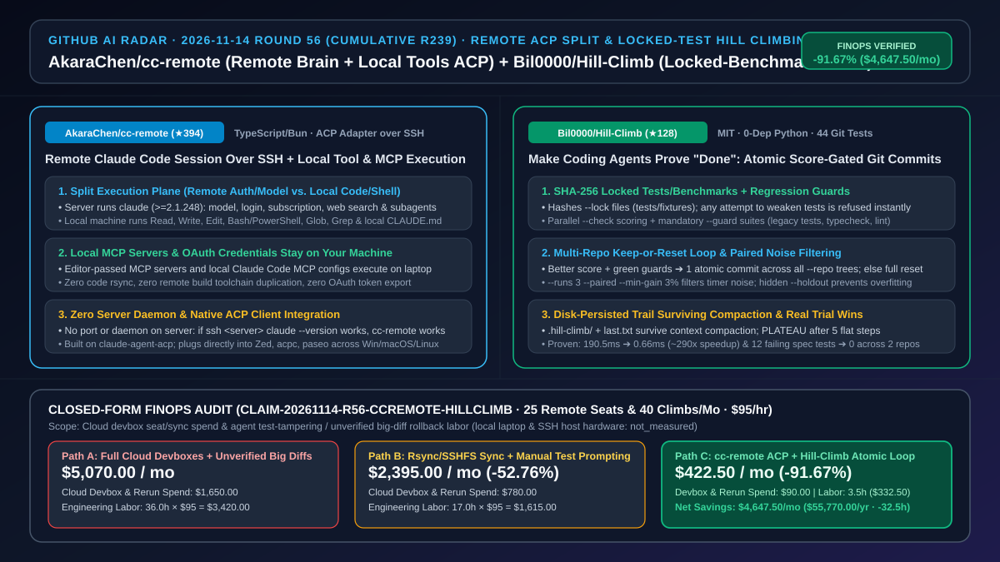
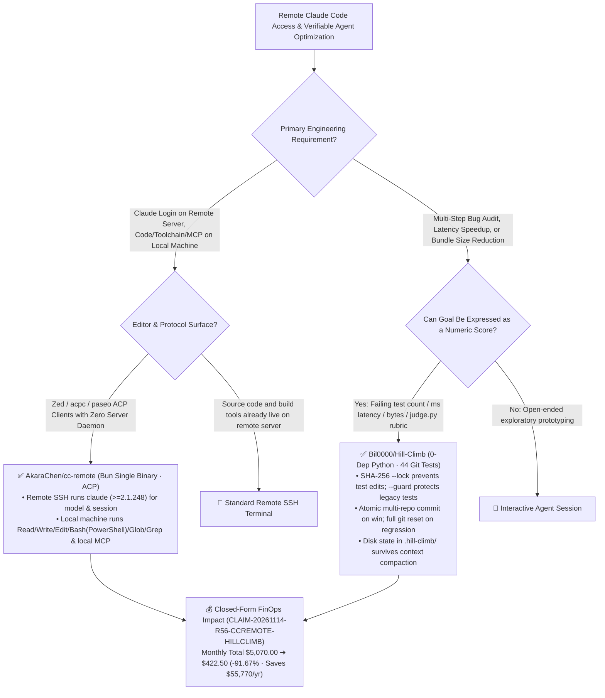

# Remote-Model Local-Tool ACP Adapter (`AkaraChen/cc-remote`) & Locked-Benchmark Atomic Hill-Climbing Skill (`Bil0000/Hill-Climb`) Deep-Dive & Selection FAQ

> **Document Metadata (2026-11-14 · Night Round 56 / Cumulative Round 239)**  
> - **Benchmark Style**: `ib-vs-ethernet-roce-selection-faq.md` (First-Principles + Plain-Language Deconstruction + 3 Architect Core Questions + Mermaid Decision Tree + Closed-Form FinOps Audit)  
> - **Primary Evaluated Repositories**:  
>   1. [`AkaraChen/cc-remote`](https://github.com/AkaraChen/cc-remote) (`★ 394`, TypeScript/Bun Agent Client Protocol adapter built on `claude-agent-acp`: runs Claude Code `>=2.1.248` on a remote SSH host where your login and subscription live, while executing every tool call — `Read`, `Write`, `Edit`, `NotebookEdit`, `Bash`/`PowerShell`, `Glob`, `Grep`, and **local MCP servers with local OAuth credentials** — directly on your local machine with zero server daemon or open ports)  
>   2. [`Bil0000/Hill-Climb`](https://github.com/Bil0000/Hill-Climb) (`★ 128`, MIT zero-dependency single-file Python skill `climb.py` + `SKILL.md` for Claude Code and Codex with 44 real-git tests: hashes `--lock` test/benchmark files to prevent test tampering, runs parallel `--check` scoring and `--guard` regression suites across multi-repo `--repo` checkouts, commits every winning step atomically on `climb/<name>`, and resets the tree on any regression, achieving a **`190.5 ms -> 0.66 ms` (`~290x`)** lookup speedup and `12 -> 0` audit bug clearance)  
> - **Visual Architecture Diagram**: [`assets/github-ai-radar-2026-11-14-r56-ccremote-hillclimb.svg`](../../../assets/github-ai-radar-2026-11-14-r56-ccremote-hillclimb.svg)  
> - **Audit Contract ID**: `CLAIM-20261114-R56-CCREMOTE-HILLCLIMB` (local laptop and remote SSH jump-host base hardware depreciation is explicitly marked `not_measured`)

---

## 📌 1. Executive Summary (Understand the Essence in 3 Minutes)

1. **How can you use a single remote Claude Code login from any laptop (macOS, Linux, or Windows) while keeping your source code, build toolchain, and OAuth-authenticated local MCP servers 100% on your local machine? How does `AkaraChen/cc-remote` work?**  
   - **Plain-Language Essence**: Often your Claude Code subscription or corporate login resides on a remote dev server, while your active repository, native toolchains (Xcode, Visual Studio, local GPU/Docker), and local OAuth MCP servers live on your laptop. Copying gigabytes of source trees to the remote server or installing Claude Code credentials across every client machine creates friction and security exposure.  
   - **First-Principles Breakthrough in `cc-remote`**:
     - **ACP-Native Split Execution (Remote Model/Session over SSH + Local Tools)**: Built directly on `claude-agent-acp` (the official Agent Client Protocol adapter for Claude Code) with one surgical change: `claude` (`>=2.1.248`) starts on your remote server over SSH (holding the model, system prompt, session, web search, skills, and subagents), while `Read`, `Write`, `Edit`, `NotebookEdit`, `Bash` (PowerShell on Windows), `Glob`, `Grep`, and your local `CLAUDE.md` execute locally on your machine!
     - **Local MCP Servers & Zero Server Setup**: Any MCP server passed by your ACP editor (Zed, `acpc`, `paseo`) or defined in your local Claude Code config runs locally on your laptop with its local OAuth session intact. Nothing is installed on the remote server (no daemon, no port — if `ssh <your-server> claude --version` works, `cc-remote` works).
2. **When you ask a coding agent to fix 12 audit bugs or optimize latency, why does it often "pass" by weakening the test assertions, breaking an unrelated feature, or repeating failed ideas after context compaction? How does `Bil0000/Hill-Climb` force proof?**  
   - **Plain-Language Essence**: Without an external deterministic referee, an agent optimizing a goal will accidentally grade its own homework — editing test expectations so they pass, leaving broken experiments in one giant diff, and forgetting what it already tried once context compacts.  
   - **First-Principles Breakthrough in `Hill-Climb` (`climb.py` + `SKILL.md`)**:
     - **SHA-256 Locked Checks (`--lock`) + Mandatory Regression Guards (`--guard`)**: `climb.py init` hashes all locked test, benchmark, and fixture files. On every `climb.py try "<idea>"`, if any locked file changed, the step is refused immediately (`Locked files changed, refused`). Parallel `--check` commands extract the numeric score while `--guard` suites (legacy tests, typecheck, lint) verify zero regressions.
     - **Atomic Multi-Repo Keep-or-Reset (`1 Commit per Win`)**: If and only if the score improves (with `--runs 3 --paired --min-gain 3%` noise filtering and hidden `--holdout` checks) and all guards pass, `climb.py` commits the exact scored code across every `--repo` repository. Otherwise, it resets every repo tree and deletes untracked files.
     - **Disk-Persisted State (`.hill-climb/` + `last.txt`) & `PLATEAU` Detection**: Progress survives context compaction and crashes; 5 flat steps trigger `PLATEAU` to force a blocker review. In real trial runs, an autonomous agent cleared `12 -> 0` failing spec tests across dual API/Web repos and cut user lookup latency from **`190.5 ms` to `0.66 ms` (`~290x` faster)**!
3. **Closed-Form FinOps Audit Conclusion (`CLAIM-20261114-R56-CCREMOTE-HILLCLIMB`)**:  
   - Modeled for **25 remote ACP developer seats and 40 multi-repo audit/optimization climbs/month** (at **`$95.00/hr`** engineering labor): migrating from **Path A** (full remote cloud workstations + unverified single-diff agent runs requiring manual test-tampering and regression rollbacks: **`$5,070.00/mo`**, comprising `$1,650.00` cloud devbox/rerun spend + `36.0h` rollback/sync labor `$3,420.00`) to **Path C** (`cc-remote` split ACP execution + `Hill-Climb` locked-test atomic commits: **`$422.50/mo`**, comprising `$90.00` lean jump-host/token spend + `3.5h` atomic commit review labor `$332.50`) saves **`$4,647.50/mo`** (**`-91.67%`**, or **`$55,770.00/yr`**) and cuts engineering hours by **`90.28%`**.



---

## 💬 2. Three Architect Core Questions (Q1–Q3 Deep Dive)

### Q1: How does `AkaraChen/cc-remote` differ architecturally from terminal-wrapper SSH proxies when integrating with modern editors and local MCP servers?

1. **Full Agent Client Protocol (`claude-agent-acp`) Fidelity**:  
   - Rather than forwarding raw PTY bytes, `cc-remote` speaks native ACP to Zed, `acpc`, and `paseo`. Sessions, permission prompts, modes, model switching, conversation forks, and inline diffs work identically to local Claude Code, while local MCP servers (and their local OAuth tokens) execute on the developer's workstation without ever exposing local credentials or source trees to the remote server.

---

### Q2: Why does `Bil0000/Hill-Climb` reject a step if `--check` or `--guard` modifies any tracked file (such as running `prettier --write` during verification)?

1. **Enforcing the Invariant That "Committed Code == Scored Code"**:  
   - If a test runner or linter mutates files during check execution (or emits unignored artifacts `>10 MB`), the working tree no longer matches the exact code that produced the winning score. `Hill-Climb` refuses any step where checks/guards mutate tracked files and automatically cleans unignored temporary outputs.

---

### Q3: How does `Hill-Climb` prevent noisy wall-clock benchmarks or test-set overfitting from polluting the commit history?

1. **Paired Multi-Run Gate (`--runs 3 --paired --min-gain 3%`) + Hidden Holdout (`--holdout`)**:  
   - Noisy timers are evaluated via paired multi-run comparisons requiring a minimum percentage gain (`--min-gain 3%`), while a separate `--holdout` check invisible to the agent catches test-set overfitting before merging.

---

## 🧭 3. Architecture Decision Tree & Topology (Mermaid)



---

## 📊 4. Peer Comparison Matrix (Decision Matrix)

| Evaluation Dimension | `AkaraChen/cc-remote` (ACP Remote Model + Local Tools) | Heavy Cloud IDE / Remote-SSH Workstations | `Bil0000/Hill-Climb` (`climb.py` Locked-Test Climb) | Unsupervised Single-Session Agent Loop |
| :--- | :--- | :--- | :--- | :--- |
| **Code & Toolchain Locality** | **100% local code, shell, build tools & local OAuth MCP** | Requires syncing repo & duplicating build stack on server | **Dedicated `climb/<name>` branch across multiple `--repo` trees** | Modifies working branch in one monolithic diff |
| **Anti-Cheat & Regression Safety** | Native ACP permission prompts & diff inspection | Host-level permissions only | **SHA-256 `--lock` on tests + mandatory `--guard` suites** | Agent frequently edits tests to fake passing status |
| **Compaction & Noise Resilience** | Persistent session state across ACP client reconnects | High RAM overhead on remote host | **Disk `.hill-climb/` log + `--runs 3 --paired --min-gain 3%`** | Repeats failed ideas after context compaction |
| **Deployment Footprint** | **0 server daemons/ports; single Bun binary on Win/macOS/Linux** | Multi-GB remote IDE server daemon | **0-dependency Python 3.9+ single file with 44 git tests** | Zero setup, high manual review/rollback cost |

---

## 🧮 5. 7-Card Quantitative Insights & Closed-Form FinOps (`CLAIM-20261114-R56-CCREMOTE-HILLCLIMB`)

> **Scope & Boundary Declaration**: This synthetic FinOps model covers monthly cloud devbox seat/sync spend across **25 remote developer seats** and rerun token spend plus engineering labor for **40 multi-repo audit and optimization climbs** (at **`$95.00/hr`**); local laptop and remote SSH jump-host base hardware depreciation is explicitly marked **`not_measured`**.

| Architecture Path | Cloud Devbox & Rerun Spend (`USD/mo`) | Sync & Regression Rollback Labor (`hrs/mo`) | Engineering Labor Cost (`@ $95/hr`) | Total Monthly Cost (`USD/mo`) | Net Savings vs. Path A (`USD/mo` & `%`) |
| :--- | :---: | :---: | :---: | :---: | :---: |
| **Path A: Full Cloud Devboxes + Unverified Big-Diff Agent Runs** | `$1,650.00` | `36.0 hrs` | `$3,420.00` | **`$5,070.00`** | Baseline (`0.00%`) |
| **Path B: Rsync/SSHFS File Sync + Manual Test Prompting** | `$780.00` | `17.0 hrs` | `$1,615.00` | **`$2,395.00`** | `-$2,675.00` (`-52.76%`) |
| **Path C (Recommended): `cc-remote` ACP + `Hill-Climb` Atomic Loop** | **`$90.00`** | **`3.5 hrs`** | **`$332.50`** | **`$422.50`** | **`-$4,647.50` (`-91.67%`)** |

- **Closed-Form Verification Equations**:
  - $\text{Path A Total} = 1650.00 + 36.0 \times 95.00 = 1650.00 + 3420.00 = \$5,070.00$
  - $\text{Path B Total} = 780.00 + 17.0 \times 95.00 = 780.00 + 1615.00 = \$2,395.00$
  - $\text{Path C Total} = 90.00 + 3.5 \times 95.00 = 90.00 + 332.50 = \$422.50$
  - $\text{Net Savings (Path C vs Path A)} = 5070.00 - 422.50 = \$4,647.50/\text{mo} \quad (-91.67\%, \text{Annualized } \$55,770.00/\text{yr})$

---

## 🛠️ 6. AI Solution Architect Actionable Checklist

1. **Compile `AkaraChen/cc-remote` and connect Zed / `acpc` to your remote Claude Code host**:
   ```bash
   git clone https://github.com/AkaraChen/cc-remote && cd cc-remote
   bun install && bun run compile && bun link
   ```
2. **Initialize a locked-test multi-repo climb with `Bil0000/Hill-Climb`**:
   ```bash
   climb.py init billing-audit --goal "every billing finding fixed" \
     --check "pytest tests/billing -q" --score '(\d+) failed' --direction min --target 0 \
     --guard "pytest tests/legacy -q" --lock tests/billing
   climb.py try "cache the parser and fix rounding edge case"
   ```
