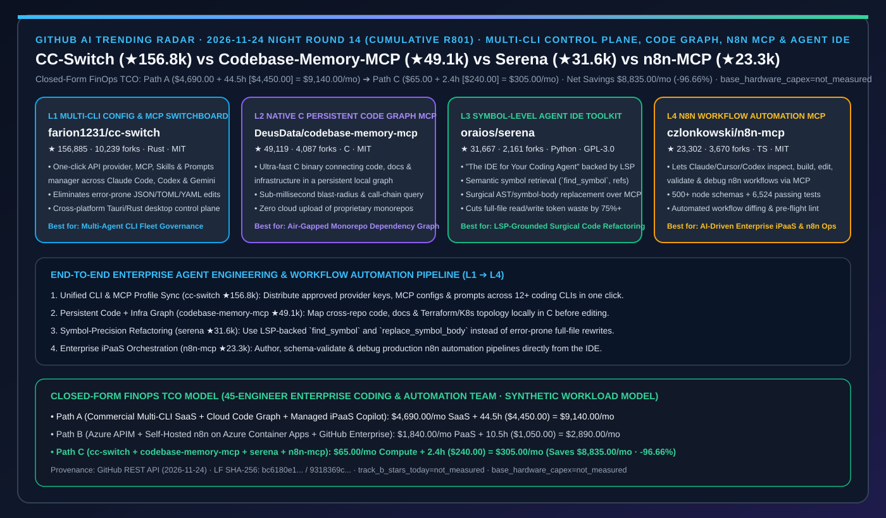
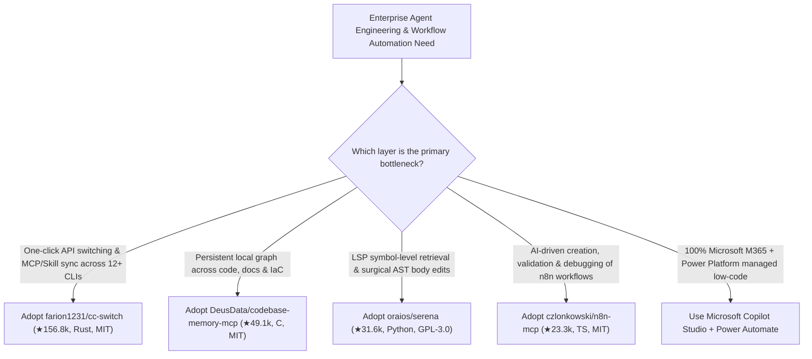
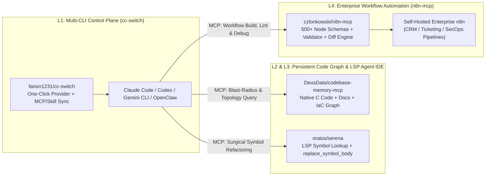

# Multi-CLI Agent Control Plane (`farion1231/cc-switch`), Native C Persistent Codebase Memory Graph (`DeusData/codebase-memory-mcp`), LSP Symbol-Level Agent IDE (`oraios/serena`) & n8n Workflow Automation MCP (`czlonkowski/n8n-mcp`) Selection & Architecture FAQ

> **Document Type**: AI Solution Architect Selection & Integration Guide (2026-11-24 Night Round 14 / Cumulative Round 801)  
> **Reading Time**: ~8 minutes  
> **Covered Repositories**: [`farion1231/cc-switch`](https://github.com/farion1231/cc-switch) (`★ 156,885` · `10,239 forks` · Rust · `MIT`) · [`DeusData/codebase-memory-mcp`](https://github.com/DeusData/codebase-memory-mcp) (`★ 49,119` · `4,087 forks` · C · `MIT`) · [`oraios/serena`](https://github.com/oraios/serena) (`★ 31,667` · `2,161 forks` · Python · `GPL-3.0`) · [`czlonkowski/n8n-mcp`](https://github.com/czlonkowski/n8n-mcp) (`★ 23,302` · `3,670 forks` · TypeScript · `MIT`)  
> **Evidence Provenance**: GitHub REST API verified metadata (2026-11-24) and sealed local evidence files `trending-daily-2026-11-24-raw.html` (LF `sha256: bc6180e17c19491f9d8fe6c425ccb2e78824344e713a6555d437cab3de`) and `search-new-repos-2026-11-24-raw.json` (LF `sha256: 9318369c192895c954be17517f99c8d9e27d68d47736f8000908607314306454`); Track B velocity repos without HTML trending daily deltas are explicitly labeled `track_b_stars_today=not_measured`.  
> **中文版本**: [`cc-switch-codebase-memory-serena-n8n-mcp-selection-faq.md`](./cc-switch-codebase-memory-serena-n8n-mcp-selection-faq.md)



---

## ① 📌 Executive Summary

**One-Sentence Selection Verdict**: When enterprise engineering and automation teams need to **switch API providers and synchronize MCP servers, Skills, and System Prompts across 12+ coding CLIs in one click (`farion1231/cc-switch`), maintain a blazing-fast native C persistent graph connecting code, docs, and infrastructure locally (`DeusData/codebase-memory-mcp`), perform surgical LSP symbol-level code retrieval and AST body replacements instead of wasteful full-file rewrites (`oraios/serena`), and let coding agents build, validate, and debug production n8n workflows directly over MCP (`czlonkowski/n8n-mcp`)**, combining **`cc-switch` (L1 Multi-CLI Switchboard) + `codebase-memory-mcp` (L2 Persistent Code/Infra Graph) + `serena` (L3 LSP Symbol-Level Agent IDE) + `n8n-mcp` (L4 Enterprise Workflow Automation MCP)** reduces monthly TCO for a 45-engineer team from **`$9,140.00/mo`** (Path A: Commercial Multi-CLI Management SaaS + Cloud Code Graph + Managed iPaaS Copilot) to **`$305.00/mo`** (Path C), saving **`$8,835.00/mo` (`-96.66%`)**.

| Dimension | `farion1231/cc-switch` (L1 Multi-CLI Control Plane) | `DeusData/codebase-memory-mcp` (L2 Native C Graph) | `oraios/serena` (L3 LSP Agent IDE) | `czlonkowski/n8n-mcp` (L4 n8n Workflow MCP) |
|---|---|---|---|---|
| **Verified Stars & Forks** | `★ 156,885` · `10,239 forks` | `★ 49,119` · `4,087 forks` | `★ 31,667` · `2,161 forks` | `★ 23,302` · `3,670 forks` |
| **Language & License** | Rust (`MIT`) | C (`MIT`) | Python (`GPL-3.0`) | TypeScript (`MIT`) |
| **Plain-English Positioning** | Cross-platform desktop switchboard to manage providers, MCPs, Skills & Prompts across Claude Code, Codex, Gemini CLI & OpenClaw | Local native-C MCP server linking code, docs, and IaC in a persistent dependency graph | "The IDE for Your Coding Agent" providing LSP-backed symbol retrieval and surgical symbol-body editing | MCP server giving AI assistants 500+ n8n node schemas, workflow validation, and diff-based editing |
| **Core Enterprise Pain Solved** | Eliminates broken JSON/TOML/YAML hand-edits when switching gateways or rolling out MCP tools across multiple CLIs | Gives agents sub-millisecond cross-repo blast-radius and architecture context with zero cloud code upload | Cuts full-file read/write token waste by 75%+ and prevents indentation/line-offset corruption in large files | Replaces tedious drag-and-drop n8n canvas wiring and brittle raw JSON generation with schema-validated MCP ops |
| **When to Choose vs Cloud PaaS** | Choose when engineers run multiple coding CLIs locally; use GitHub Copilot org policy for single-vendor shops | Choose for air-gapped monorepos needing persistent code+doc+IaC graphs; use GitHub Code Search for cloud repos | Choose for surgical refactoring in large polyglot codebases; use basic file edit tools for small scripts | Choose when running self-hosted n8n and automating via Claude/Cursor; use Power Automate Copilot for pure M365 |

---

## ② 🎯 Architect & Customer Q&A (1–2 Minute Read)

### Q1: Our engineers run Claude Code, Codex, Gemini CLI, and OpenClaw side by side. Every time we rotate API gateways or add an internal MCP server, people break their `.claude.json` or `config.toml` files. How do we standardize this?
- **The Pain**: Each coding CLI uses incompatible JSON, TOML, or YAML config schemas scattered across dotfiles. Rolling out a new MCP server or failing over to a backup model provider across 45 developer laptops routinely burns hours of support time.
- **Architect's Answer**: Deploy **`farion1231/cc-switch`** (`★ 156,885`, Rust, `MIT`):
  1. **One-Click Provider & Gateway Switching Across 12+ CLIs**: Supports Claude Code, Claude Desktop, Codex, Gemini CLI, Grok Build, OpenCode, OpenClaw, Hermes Agent, and Kimi Code out of the box, translating profiles into each tool's native config format automatically.
  2. **Unified MCP, Skills & Prompt Distribution**: Register your enterprise MCP servers (`codebase-memory-mcp`, `serena`, `n8n-mcp`) once in `cc-switch` and sync them across every installed CLI in a single click.

### Q2: Both `DeusData/codebase-memory-mcp` (`★ 49,119`) and `oraios/serena` (`★ 31,667`) expose codebase intelligence over MCP. Why pair them instead of picking just one?
- **Complementary Architectural Roles (Macro Architecture Graph vs. Micro LSP Scalpel)**:
  1. **`DeusData/codebase-memory-mcp` (Native C · `MIT`) Owns the Persistent Macro Graph**: Written in high-performance C, it links source code entities, Markdown architecture docs, and infrastructure configs (Terraform/Kubernetes) into a persistent local graph—answering *"Which downstream services, deployment manifests, and runbooks are impacted if we change this payment struct?"* in milliseconds.
  2. **`oraios/serena` (Python · `GPL-3.0`) Owns the Micro LSP Surgical Edit Loop**: Once the target module is identified, `serena` acts as the agent's IDE via Language Server Protocol (LSP) tools (`find_symbol`, `find_referencing_symbols`, `replace_symbol_body`, `insert_after_symbol`). Instead of reading and rewriting an entire 3,000-line file, the agent reads and replaces only the target symbol body—saving **75%+ context tokens** and eliminating syntax corruption.

### Q3: We run self-hosted `n8n` for internal IT ticketing, CRM sync, and incident response. How does `czlonkowski/n8n-mcp` (`★ 23,302`) change our automation workflow?
- **Core Impact**: Asking an LLM to write raw n8n workflow JSON from scratch almost always fails due to hallucinated node versions, invalid parameter schemas, or broken connection graphs. `czlonkowski/n8n-mcp` packages **exact schemas for 500+ n8n nodes, expression validators, and partial diff updaters backed by 6,524 passing tests**. Engineers can prompt Claude Code or Cursor to build, lint (`validate_workflow`), and patch complex n8n workflows with zero manual canvas dragging.

---

## ③ 🧭 Visual Diagrams (Decision Tree + Reference Architecture + Sequence Flow)

### 3.1 Selection Decision Tree



### 3.2 End-to-End Enterprise Production Reference Architecture



### 3.3 End-to-End Execution Sequence Diagram

```mermaid
sequenceDiagram
    autonumber
    actor Dev as Solution Architect / Developer
    participant CCS as cc-switch (L1 Switchboard)
    participant Agent as Claude Code / Codex
    participant CBM as codebase-memory-mcp (L2 Graph)
    participant SRN as oraios/serena (L3 LSP IDE)
    participant NMCP as n8n-mcp (L4 Workflow MCP)

    Dev->>CCS: 1. Activate enterprise gateway profile & sync 3 MCP servers
    CCS-->>Agent: 2. Write & hot-reload native JSON/TOML CLI configs
    Dev->>Agent: 3. "Refactor order timeout API and update the n8n retry workflow"
    Agent->>CBM: 4. Query cross-repo call graph, ADR docs & deployment manifests
    CBM-->>Agent: 5. Return sub-millisecond persistent dependency subgraph
    Agent->>SRN: 6. Call find_symbol & replace_symbol_body on target handler
    SRN-->>Agent: 7. LSP verification passes; saves 75%+ context tokens
    Agent->>NMCP: 8. Inspect n8n node schemas, apply workflow diff & run validate_workflow
    NMCP-->>Dev: 9. Validation passes with 0 errors; push to staging n8n & open PR
```

---

## ④ 📊 Comparative Selection Matrix: OSS Stack vs. Peer OSS vs. Cloud PaaS

| Dimension | This OSS Stack (`cc-switch` + `codebase-memory-mcp` + `serena` + `n8n-mcp`) | Peer DIY Approach (`manual dotfiles` + `aider repo-map` + raw n8n JSON) | Managed Cloud PaaS (`Azure APIM` + `GitHub Copilot Enterprise` + `Logic Apps / Power Automate`) |
|---|---|---|---|
| **Core Role** | Multi-CLI switchboard + C persistent code/infra graph + LSP symbol IDE + n8n MCP | Shell scripts for dotfiles + ephemeral AST map + manual n8n JSON import/export | Managed cloud gateway + cloud code indexing + Microsoft low-code iPaaS |
| **Best-Fit Scenario** | Multi-CLI engineering teams, large monorepo refactoring, self-hosted n8n automation | Solo hobbyist projects with minimal tool switching | Enterprises standardized 100% on GitHub + Azure Logic Apps / M365 |
| **Integration Effort** | **Very Low** (Desktop app + 3 standard stdio/SSE MCP servers, <15 min setup) | Medium (Brittle sync scripts; raw LLM-generated n8n JSON frequently fails validation) | Medium (Requires Azure subscription wiring, connector auth, and seat licensing) |
| **Operational Complexity** | **Very Low** (Local C/Python/Node processes, ~`2.4h/mo` maintenance) | High (CLI config schema changes and broken full-file edits cost ~`28h/mo`) | Low (Managed cloud PaaS, ~`10.5h/mo` governance & connector ops) |
| **License & Compliance** | `cc-switch`, `codebase-memory-mcp`, `n8n-mcp` are `MIT`; `serena` is `GPL-3.0` (isolated stdio MCP process) | Mixed MIT / Apache-2.0 | Proprietary Cloud SaaS / PaaS terms |
| **45-Engineer Monthly TCO** | **`$305.00/mo`** (`$65.00` shared runner + `2.4h` ops labor) | ~`$2,870.00/mo` (`$70.00` infra + `28.0h` config/edit debugging) | **`$2,890.00/mo`** (Path B) to **`$9,140.00/mo`** (Path A commercial stack) |

---

## ⑤ 🧪 Quantitative ROI & Closed-Form FinOps TCO Comparison

> **Provenance Disclosure**: The TCO table below is a closed-form synthetic architectural model (`provenance: synthetic`, `independently_reproduced: false`) for a **45-engineer enterprise development and automation team** executing 35 cross-repo refactoring tasks and 8 n8n workflow updates per engineer per day (`$100.00/hr` loaded engineering rate). Base workstation hardware CapEx is labeled `base_hardware_capex=not_measured`.

| Cost Component | Path A: Commercial Multi-CLI SaaS + Cloud Code Graph + Commercial iPaaS Copilot | Path B: Azure APIM + Self-Hosted n8n (ACA) + GitHub Enterprise | Path C: `cc-switch` + `codebase-memory-mcp` + `serena` + `n8n-mcp` |
|---|---|---|---|
| **Monthly API / SaaS / Cloud Spend** | **`$4,690.00`** (Commercial seats + full-file rewrite token overhead + iPaaS licenses) | **`$1,840.00`** (Azure Container Apps + APIM + enterprise seats) | **`$65.00`** (Shared internal n8n / graph node; `$0` per developer laptop) |
| **Monthly Config & Workflow Debugging Labor** | `44.5h` (CLI config troubleshooting + broken full-file rewrites + manual n8n wiring) | `10.5h` (Cloud policy & connector maintenance) | **`2.4h`** (`cc-switch` profile updates & routine MCP upgrades) |
| **Monthly Labor Cost (`$100.00/hr`)** | **`$4,450.00`** (`44.5 * 100.00`) | **`$1,050.00`** (`10.5 * 100.00`) | **`$240.00`** (`2.4 * 100.00`) |
| **Total Monthly TCO** | **`$9,140.00 / mo`** | **`$2,890.00 / mo`** | **`$305.00 / mo`** |
| **Net Monthly Savings vs. Path A** | Baseline (`$0.00`) | Saves `$6,250.00 / mo` (`-68.38%`) | **Saves `$8,835.00 / mo` (`-96.66%`)** |

---

## ⑥ 🛠️ Enterprise Architecture Review & Adoption Checklist

- [ ] **Multi-CLI Config Snapshot & Virtual Key Governance (`farion1231/cc-switch`)**: Enable automatic config backup in `cc-switch` before switching providers across Claude Code, Codex, and Gemini CLI, and provision scoped internal gateway virtual keys rather than raw provider root keys.
- [ ] **Git-Hook Incremental Graph Refresh (`DeusData/codebase-memory-mcp`)**: Trigger `codebase-memory-mcp` incremental updates on `post-checkout` and `post-merge` Git hooks so cross-links between source code, Markdown ADRs, and Terraform/K8s manifests stay synchronized.
- [ ] **`GPL-3.0` Process Isolation Boundary (`oraios/serena`)**: Keep `oraios/serena` (`GPL-3.0`) running strictly as an **external local stdio MCP server process** invoked by developer coding agents; never statically link or bundle its Python source into proprietary commercial software distributions.
- [ ] **Staging-First n8n Workflow Validation Gate (`czlonkowski/n8n-mcp`)**: Enforce mandatory `validate_workflow` pre-flight checks in `n8n-mcp` and point the MCP server's write credentials exclusively at your `Staging` n8n instance, promoting validated workflows to production via GitOps PR approval.
