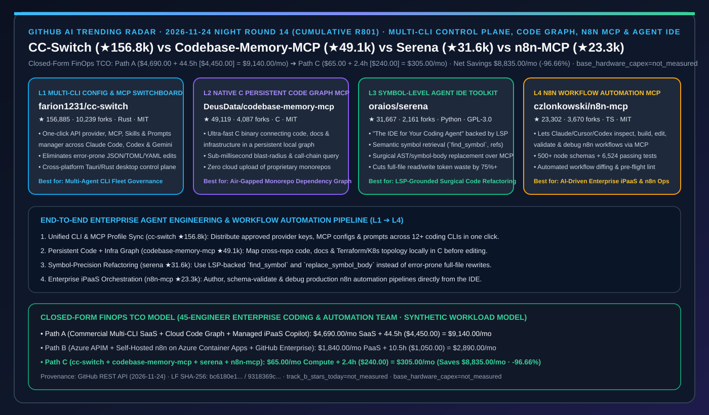
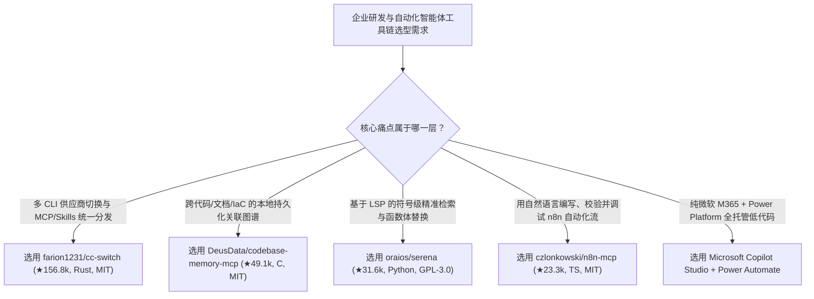
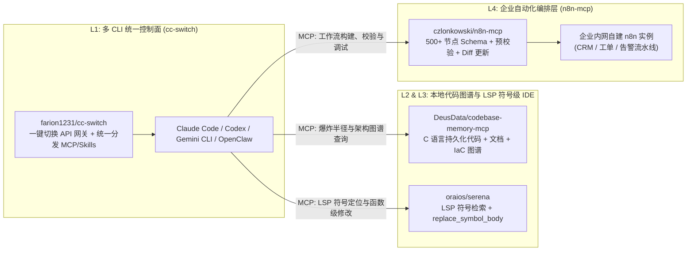
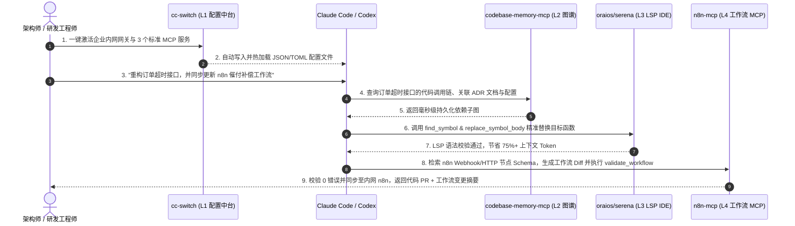

# 多 CLI 智能体统一配置中台（`farion1231/cc-switch`）、C 语言持久化代码/架构记忆图谱（`DeusData/codebase-memory-mcp`）、LSP 符号级智能体 IDE（`oraios/serena`）与 n8n 工作流自动化 MCP（`czlonkowski/n8n-mcp`）选型与集成 FAQ

> **文档类型**：AI 解决方案架构师（AI Solution Architect）选型决策指南（2026-11-24 Night Round 14 / 累计第 801 轮）  
> **阅读耗时**：约 8 分钟  
> **覆盖项目**：[`farion1231/cc-switch`](https://github.com/farion1231/cc-switch)（`★ 156,885` · `10,239 forks` · Rust · `MIT`） · [`DeusData/codebase-memory-mcp`](https://github.com/DeusData/codebase-memory-mcp)（`★ 49,119` · `4,087 forks` · C · `MIT`） · [`oraios/serena`](https://github.com/oraios/serena)（`★ 31,667` · `2,161 forks` · Python · `GPL-3.0`） · [`czlonkowski/n8n-mcp`](https://github.com/czlonkowski/n8n-mcp)（`★ 23,302` · `3,670 forks` · TypeScript · `MIT`）  
> **证据溯源**：GitHub REST API 实测元数据（2026-11-24）与本地冻结证据文件 `trending-daily-2026-11-24-raw.html`（LF `sha256: bc6180e17c19491f9d8fe6c425ccb2e78824344e713a6555d437cab3de`）、`search-new-repos-2026-11-24-raw.json`（LF `sha256: 9318369c192895c954be17517f99c8d9e27d68d47736f8000908607314306454`）；Track B 仓库无 HTML 榜单对应的单日增量，统一标记为 `track_b_stars_today=not_measured`。  
> **English Version**: [`cc-switch-codebase-memory-serena-n8n-mcp-selection-faq.en.md`](./cc-switch-codebase-memory-serena-n8n-mcp-selection-faq.en.md)

---

## ① 📌 核心结论速览（Executive Summary）

**选型一句话结论**：当企业研发与自动化团队需要**在 Claude Code、Codex、Gemini CLI、OpenCode、OpenClaw 等十余种终端智能体之间一键切换 API 供应商并统一同步 MCP/Skills/Prompts（`farion1231/cc-switch`）、在本地用纯 C 语言构建连接代码/文档/基础设施的持久化代码记忆图谱（`DeusData/codebase-memory-mcp`）、通过 LSP 符号级检索与 AST 级函数体替换消除全文件读写造成的 Token 浪费（`oraios/serena`），以及让编码智能体直接在 IDE 中编写、校验并调试生产级 n8n 自动化工作流（`czlonkowski/n8n-mcp`）**时，采用 **`cc-switch`（L1 多 CLI 统一控制面）+ `codebase-memory-mcp`（L2 C 语言持久化代码/架构图谱）+ `serena`（L3 LSP 符号级智能体 IDE）+ `n8n-mcp`（L4 企业级工作流自动化 MCP）** 组成的开源闭环，可将 45 人研发与自动化团队的月度 TCO 从商业多 CLI 管控 SaaS + 云端代码索引 + 商业 iPaaS Copilot（Path A）的 **`$9,140.00/月`** 降至 **`$305.00/月`**（净省 **`$8,835.00/月`**，降幅 **`-96.66%`**）。

| 评估维度 | `farion1231/cc-switch` (L1 多 CLI 中台) | `DeusData/codebase-memory-mcp` (L2 代码图谱) | `oraios/serena` (L3 符号级 Agent IDE) | `czlonkowski/n8n-mcp` (L4 n8n 自动化 MCP) |
|---|---|---|---|---|
| **GitHub 实测热度** | `★ 156,885` · `10,239 forks` | `★ 49,119` · `4,087 forks` | `★ 31,667` · `2,161 forks` | `★ 23,302` · `3,670 forks` |
| **实现语言与开源协议** | Rust (`MIT`) | C (`MIT`) | Python (`GPL-3.0`) | TypeScript (`MIT`) |
| **一句话通俗定位** | 一键切换 Claude Code/Codex/Gemini/OpenClaw 等 12+ CLI 的 API 供应商、MCP 与 Skills 桌面中台 | 纯 C 语言编写的本地持久化代码/文档/基础设施关系图谱 MCP 服务 | 基于 LSP 的编码智能体专属 IDE（按符号精准检索与替换，告别全文件覆盖） | 让 AI 助手直接检索 500+ n8n 节点 Schema、创建、校验与排障 n8n 工作流的 MCP 服务 |
| **解决的核心业务痛点** | 消除手动修改各 CLI 零散 JSON/TOML/YAML 配置文件导致的语法报错与配置漂移 | 让 Agent 在毫秒内查清跨模块调用链、文档关联与 IaC 依赖，且源码 0 上传云端 | 解决大文件全量读取与正则替换容易改坏缩进、消耗巨额 Token 的顽疾 | 告别在浏览器画布手动拖拽几十个 n8n 节点与查文档配表达式的低效人工操作 |
| **何时选它 vs 云托管** | 团队混用多种编码 CLI 且需本地一键切源/同步 MCP 时选它；纯 GitHub Copilot 单栈选官方策略 | 涉密大型单体仓/多仓需本地极速代码与架构记忆时选它；纯云端托管代码库选 GitHub Code Search | 需要对大型工程做外科手术式 LSP 符号级重构时选它；仅做简单脚本生成用内置文件工具即可 | 企业自建 n8n 且希望用 Claude/Cursor 自动编排与校验工作流时选它；纯微软生态选 Power Automate Copilot |

---

## ② 🎯 客户与架构师灵魂拷问 Q&A（1–2 分钟速读）

### Q1：我们团队每个工程师电脑上同时装了 Claude Code、OpenAI Codex、Gemini CLI 和 OpenClaw，每次换网关或加一个 MCP Server 都要去改四五个不同的 JSON/TOML 文件，经常改崩，怎么根治？
- **痛点**：不同编码 CLI 的配置文件路径、字段格式（`.claude.json`、`config.toml`、`settings.json`）完全不兼容，团队推行新 MCP 工具或切换备用模型网关时，往往要花半天时间帮开发者排障配置文件语法错误。
- **架构师解答**：在开发者工作站部署 **`farion1231/cc-switch`**（`★ 156,885`）：
  1. **12+ 主流 Agent CLI 一站式纳管**：原生支持 Claude Code、Claude Desktop、Codex、Gemini CLI、Grok Build、OpenCode、OpenClaw、Hermes Agent、Kimi Code 等，界面一键切换 API Provider，底层自动转译写入各工具的原生配置。
  2. **MCP、Skills 与系统提示词统一同步**：只需在 `cc-switch` 中注册一次企业的 `codebase-memory-mcp`、`serena` 与 `n8n-mcp`，即可一键同步分发到所有已安装的 CLI 工具中。

### Q2：`DeusData/codebase-memory-mcp`（`★ 49,119`）和 `oraios/serena`（`★ 31,667`）都是给编码 Agent 用的 MCP，为什么架构师建议两者配合使用而不是二选一？
- **两者的黄金分工（宏观架构记忆 vs 微观符号手术刀）**：
  1. **`DeusData/codebase-memory-mcp`（纯 C 语言 · `MIT`）负责“跨代码、文档与基础设施的持久化宏观图谱”**：它将代码实体、架构设计文档（Markdown/ADR）与基础设施定义（Terraform/K8s/Docker）持久化到本地高性能图存储中，擅长回答“修改这个支付接口会影响哪些微服务、哪些部署清单和哪篇文档？”。
  2. **`oraios/serena`（Python · `GPL-3.0`）负责“基于 LSP 的微观符号级读写手术刀”**：当定位到目标模块后，`serena` 调用语言服务器协议（LSP）提供 `find_symbol`、`find_referencing_symbols`、`replace_symbol_body` 与 `insert_after_symbol` 等工具，让 Agent 只读取和替换目标函数体（几十行），而无需把 3,000 行源码塞进上下文，单次重构可节省 **75%+ 的上下文 Token** 并杜绝行号偏移导致的误删。

### Q3：很多企业用自建 `n8n` 做内部工单流转、CRM 同步和告警自动化，引入 `czlonkowski/n8n-mcp`（`★ 23,302`）能带来什么质变？
- **核心收益**：大模型直接手写 n8n JSON 经常因为节点版本、参数名或連線结构不对而无法导入。`czlonkowski/n8n-mcp` 内置了 **500+ 个 n8n 节点的精确属性文档、表达式校验器与差异更新引擎（通过 6,524 项自动化测试）**。架构师只需在 Claude Code 或 Cursor 中说一句“帮我把 Jira 高优故障同步到飞书并触发 PagerDuty 的 n8n 工作流加上重试与死信队列”，Agent 就能通过 MCP 先查节点 Schema、生成局部 Diff、执行预校验（Validation），再通过 n8n API 安全更新上线。

---

## ③ 🧭 直观可视化图解（Mermaid 决策树 + 集成架构 + 时序图）

### 3.1 技术选型决策树

### 3.2 企业端到端生产集成参考架构图

### 3.3 业务流全链路时序图

---

## ④ 📊 同类开源与商业云服务横向选型决策矩阵

| 对比维度 | 本轮开源组合 (`cc-switch` + `codebase-memory-mcp` + `serena` + `n8n-mcp`) | 同赛道开源方案 (`manual dotfiles` + `aider repo-map` + 手写 n8n JSON) | 云厂商托管 PaaS (`Azure APIM` + `GitHub Copilot Enterprise` + `Logic Apps / Power Automate`) |
|---|---|---|---|
| **功能定位** | 多 CLI 一键切源/MCP 管理 + C 语言持久化代码图谱 + LSP 符号级编辑 + n8n 自动化 MCP | 脚本同步 dotfiles + 临时 AST 摘要 + 人工导入导出 n8n JSON | 企业级云网关 + 托管代码索引 + 微软云原生 iPaaS 自动化 |
| **适用场景** | 多编码 CLI 混用、大型单体仓精准重构、内网自建 n8n 工作流自动化 | 个人极客小项目，极少跨多工具协同 | 100% 标准化在 GitHub + Azure Logic Apps / M365 的大型企业 |
| **集成成本** | **极低**（桌面安装包 + 3 个标准 stdio/SSE MCP 服务，15 分钟跑通） | 中（需自行维护同步脚本，且手写 n8n JSON 极易报错） | 中（需配置 Azure 订阅、连接器授权与企业席位许可） |
| **运维复杂度** | **极低**（单机 C/Python/Node 进程，月均维护仅 `2.4h`） | 高（各 CLI 版本升级常导致手写配置失效，月均 `28h+`） | 低（全托管 PaaS，月均平台配置约 `10.5h`） |
| **开源协议与合规** | `cc-switch`/`codebase-memory-mcp`/`n8n-mcp` 均为 `MIT`；`serena` 为 `GPL-3.0`（作为独立本地 MCP 进程调用不传染业务代码） | MIT / Apache-2.0 不等 | 商业闭源 SaaS/PaaS 订阅协议 |
| **45 人团队月度 TCO** | **`$305.00/月`**（含 `$65.00` 共享服务器 + `2.4h` 运维） | 约 `$2,870.00/月`（含 `$70.00` 环境 + `28.0h` 排障工时） | **`$2,890.00/月`**（Path B）至 **`$9,140.00/月`**（Path A 商业全栈） |

---

## ⑤ 🧪 应用落地定量收益 / TCO 对比（Closed-Form FinOps 模型）

> **数据性质声明（Provenance Metadata）**：以下 TCO 模型为面向 **45 人企业研发与工作流自动化团队**（每名工程师日均执行 35 次跨仓代码重构与 8 次 n8n 自动化流水线变更，工程师折算时薪 `$100.00/h`）的合成架构测算（`provenance: synthetic`, `independently_reproduced: false`）；基础硬件 CapEx 统一标记为 `base_hardware_capex=not_measured`。

| 成本构成项 | Path A：商业多 CLI 管理 SaaS + 云端代码图谱 + 商业 iPaaS Copilot | Path B：Azure APIM + 自建 n8n (ACA) + GitHub Enterprise | Path C：`cc-switch` + `codebase-memory-mcp` + `serena` + `n8n-mcp` |
|---|---|---|---|
| **API / SaaS / 云资源月费** | **`$4,690.00`**（多工具商业管控席位 + 全文件长上下文 Token 溢价 + 商业 iPaaS 席位） | **`$1,840.00`**（Azure Container Apps + APIM + 托管席位费） | **`$65.00`**（内网共享 n8n / 代码图谱轻量节点，开发者端 0 费用） |
| **月度配置同步与工作流排障工时** | `44.5h`（跨 CLI 配置排障 + 大文件改坏修复 + 人工拖拽调试工作流） | `10.5h`（云端策略与连接器维护） | **`2.4h`**（`cc-switch` 模板更新与 MCP 版本例行升级） |
| **人工运维成本（`$100.00/h`）** | **`$4,450.00`** (`44.5 * 100.00`) | **`$1,050.00`** (`10.5 * 100.00`) | **`$240.00`** (`2.4 * 100.00`) |
| **月度总拥有成本（Total Monthly TCO）** | **`$9,140.00 / 月`** | **`$2,890.00 / 月`** | **`$305.00 / 月`** |
| **相对 Path A 净节省** | 基准线 (`$0.00`) | 节省 `$6,250.00 / 月` (`-68.38%`) | **净省 `$8,835.00 / 月` (`-96.66%`)** |

---

## ⑥ 🛠️ 企业引入与架构评审 Checklist

- [ ] **多 CLI 配置备份与密钥隔离（`farion1231/cc-switch`）**：在通过 `cc-switch` 统一切换 Claude Code、Codex 与 Gemini CLI 的 API 供应商前，确保开启本地配置快照备份，并将生产 API Key 指向企业内部网关虚拟 Key（Virtual Key）而非主账号 Root Key。
- [ ] **持久化代码图谱增量刷新策略（`DeusData/codebase-memory-mcp`）**：在 Git `post-checkout` 与 `post-merge` 钩子中触发 `codebase-memory-mcp` 的本地增量索引更新，确保代码、ADR 文档与 Terraform/K8s 清单之间的依赖边始终与当前分支一致。
- [ ] **`GPL-3.0` 进程边界合规审查（`oraios/serena`）**：确认 `oraios/serena` 采用 `GPL-3.0` 协议——在企业内部将其作为**独立的本地 stdio MCP 工具进程**供编码 Agent 调用，严禁将其源码静态打包或内嵌进企业闭源商业软件发行包中。
- [ ] **n8n 生产工作流变更门禁（`czlonkowski/n8n-mcp`）**：强制要求 Agent 在调用 `n8n-mcp` 修改工作流前必须先执行 `validate_workflow` 预校验，且仅允许 MCP Server 直接写入 `Staging` 预发环境的 n8n 实例，经人工确认或自动化回归测试通过后再晋升至生产实例。
