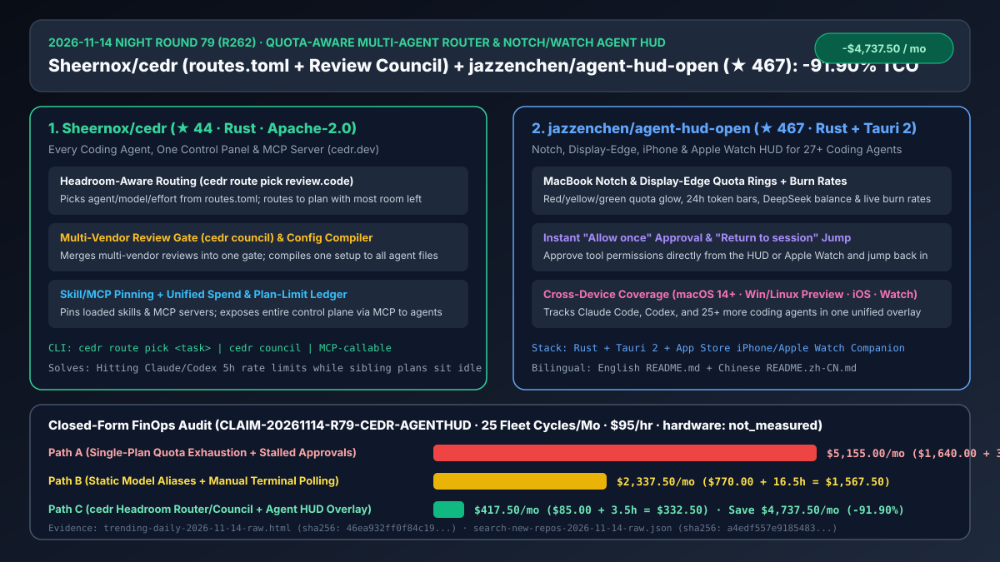
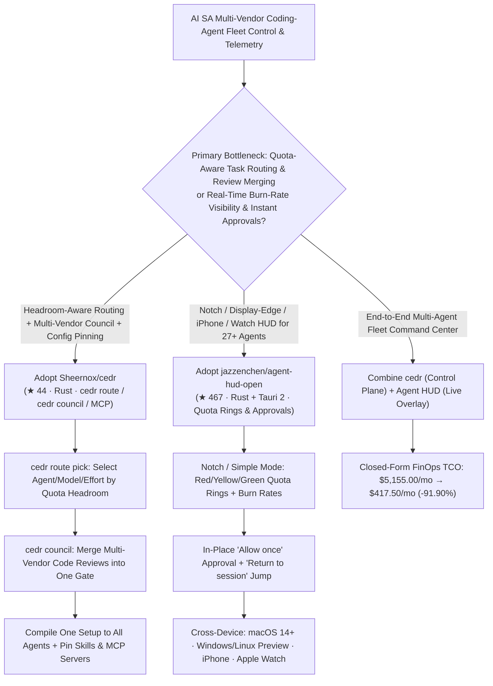

# Quota-Aware Multi-Agent Router & Review Council (`Sheernox/cedr`) & Notch/Watch 27-Agent Quota & Approval HUD (`jazzenchen/agent-hud-open`) Selection & Architecture FAQ

> **Track**: GitHub AI Trending & High-Velocity Breakout Selection Guide · 2026-11-14 Night Round 79 (Cumulative Round 262 / R262)  
> **Benchmark Standard**: Modeled after `ib-vs-ethernet-roce-selection-faq.md` (Plain-Language Essence + First Principles + 6-Part Structure + Closed-Form FinOps Audit)  
> **Claim ID**: `CLAIM-20261114-R79-CEDR-AGENTHUD`  
> **Architecture Visual**: [`assets/github-ai-radar-2026-11-14-r79-cedr-agenthud.svg`](../../../assets/github-ai-radar-2026-11-14-r79-cedr-agenthud.svg)  
> **中文版本**: [阅读中文版 (`cedr-agent-hud-open-quota-aware-multi-agent-router-council-notch-watch-approval-hud-selection-faq.md`)](./cedr-agent-hud-open-quota-aware-multi-agent-router-council-notch-watch-approval-hud-selection-faq.md)

---

## 📌 1. Executive Summary (What Are They & What Pain Points Do They Solve?)

1. **Plain-Language Breakdown**:
   - **`Sheernox/cedr` (`★ 44`, Rust, Apache-2.0)** is the open-source control-plane CLI and MCP server behind `cedr.dev`: **"every coding agent, one control panel"**. When teams run Claude Code, Codex, Cursor, and OpenCode simultaneously, one subscription hits its 5-hour rate limit while another sits idle, and MCP/skill configurations drift across agent-specific dotfiles. `cedr` solves this with **`cedr route`** (`cedr route pick review.code`, selecting the agent, model, and effort from `routes.toml` while routing equally suited tasks to the plan with the most quota headroom and skipping plans near their limits), **`cedr council`** (merging code reviews from multiple vendors into one unified gate), deterministic skill/MCP pinning, single-source config compilation across agents, and unified spend/limit reporting.
   - **`jazzenchen/agent-hud-open` (`★ 467`, Rust + Tauri 2, Apache-2.0)** is a **real-time Heads-Up Display (HUD) for Claude Code, Codex, DeepSeek, and 25+ additional coding agents** that lives in the MacBook notch (`Notch mode`), display edge (`Simple mode`), iPhone, and Apple Watch (`id6812113619`). Hovering or clicking reveals red/yellow/green quota rings, hourly burn rates, 24-hour token bars, and API balances—and when an agent blocks on a permission prompt or finishes a turn, you can click **`Allow once`** or **`Return to session`** directly from the HUD or your wrist.
2. **Quantified FinOps Impact (`CLAIM-20261114-R79-CEDR-AGENTHUD`)**:
   - Evaluated across **25 monthly multi-vendor coding-agent fleet operation cycles** at an AI Solution Architect rate of **$95.00/hr** (local workstation hardware telemetry: `not_measured`):
   - **Path A (Unrouted Single-Plan Quota Exhaustion + Manual Config Sync + Stalled Approval Context-Switching)**: **$1,640.00/mo** in pay-as-you-go overage spikes and wasted turns + **37.0 hrs/mo ($3,515.00)** syncing agent dotfiles, reconciling multi-vendor reviews, and hunting for stalled terminal tabs = **$5,155.00/mo**.
   - **Path B (Static Model Alias Scripts + Manual Terminal Tab Polling)**: **$770.00/mo** in overage/tool spend + **16.5 hrs/mo ($1,567.50)** in manual monitoring = **$2,337.50/mo**.
   - **Path C (`Sheernox/cedr` Headroom Router/Council + `jazzenchen/agent-hud-open` Notch/Watch HUD)**: **$85.00/mo** in quota-balanced marginal spend + **3.5 hrs/mo ($332.50)** of engineering review = **$417.50/mo**, delivering **$4,737.50/mo in net savings (-91.90%, $56,850.00/yr annualized, and -90.54% engineering hours)**.



---

## 🔍 2. Core Architectural Q&A (Q1–Q3 First-Principles Deep Dive)

### Q1: How does `Sheernox/cedr` prevent subscription rate-limit lockouts and single-model review blind spots?
- **Headroom-Aware Routing + Multi-Vendor Review Council**:
  1. **Dynamic Quota Balancing (`cedr route`)**: Evaluates `routes.toml` by task category and work size, automatically dispatching work to the subscription plan with the most remaining headroom and bypassing plans approaching rate limits.
  2. **Cross-Vendor Review Gate (`cedr council`) & Config Compiler**: Aggregates multi-vendor code reviews into a single pass/fail gate while compiling one canonical skill and MCP server configuration into every coding agent's native config format.

### Q2: Why do background coding agents lose hours waiting on human prompts, and how does `jazzenchen/agent-hud-open` eliminate terminal hunting?
- **Zero-Footprint Peripheral Supervision**:
  1. **Notch & Edge Quota Burn-Rate Telemetry**: Renders breathing red/yellow/green quota segments for 27+ agents alongside 24-hour token bars and click-to-toggle burn rates.
  2. **In-Place `Allow once` & `Return to session`**: Delivers actionable permission prompts and completion cards to the MacBook notch, Windows/Linux desktop edge, iPhone, and Apple Watch.

### Q3: How should AI Solution Architects combine `cedr` and `agent-hud-open`?
- **Automated Dispatch + Human-in-the-Loop Cockpit**: Use `cedr` (via CLI or MCP) to route tasks across subscriptions and gate PRs with `cedr council`, and run `agent-hud-open` to monitor live burn rates and approve permissions in one click.

---

## 🧭 3. Mermaid Selection Decision Tree & Architecture Flow



---

## 📊 4. Peer Comparison Matrix

| Evaluation Dimension | `Sheernox/cedr` | `jazzenchen/agent-hud-open` | Static API Proxy (e.g., LiteLLM) | Manual Terminal Switching & Config Copy |
| :--- | :--- | :--- | :--- | :--- |
| **Primary Role** | Quota-aware multi-agent router, review council & config compiler | Notch/edge/iOS/Watch quota, burn-rate & approval HUD for 27+ agents | HTTP API model proxy | Manual CLI invocation & tab hunting |
| **Quota & Burn-Rate Awareness** | **Routes to plan with most room left; skips plans near limits** | **Live quota rings, hourly burn rates & 24h token bars** | Blind to subscription CLI rolling windows | Hits rate-limit walls unexpectedly |
| **Multi-Vendor Review & Config Sync** | **`cedr council` gate + compiles one config to all agent files** | Unified multi-agent session status list | No skill/MCP config compilation | Manual edits across `.claude`/`.codex`/`.cursor` |
| **Approval & Session Jump UX** | CLI + MCP server callable by agents | **One-click `Allow once` & `Return to session` on screen/Watch** | None | Manual window cycling |
| **Monthly TCO (25 Fleet Cycles)** | **Combined Path C: $417.50/mo (incl. 3.5h review)** | **Combined Path C: $417.50/mo (incl. 3.5h review)** | Path B: $2,337.50/mo (incl. 16.5h maint) | Path A: $5,155.00/mo (incl. 37.0h overhead) |

---

## 🧮 5. Quantitative Insights & Closed-Form FinOps Audit (`CLAIM-20261114-R79-CEDR-AGENTHUD`)

> **Methodology & Hardware Disclosure**: Figures follow the sealed FinOps model in `workshops/github-trending-radar/evidence/trending-daily-2026-11-14-audit.json` across 25 monthly fleet operation cycles at `$95.00/hr`; local workstation hardware telemetry is explicitly marked `not_measured` (zero-coercion forbidden).

| Architecture Path | Monthly Overage API & Idle Waste Spend (USD) | Monthly Engineering Labor (Hours @ $95.00/hr) | Monthly Engineering Labor Cost (USD) | Total Monthly TCO (USD) | Net Savings vs Path A (USD / %) |
| :--- | :---: | :---: | :---: | :---: | :---: |
| **Path A: Unrouted Single-Plan Quota Exhaustion + Stalled Approvals** | `$1,640.00` | `37.0 hrs` | `$3,515.00` | **`$5,155.00`** | Baseline (`0.00%`) |
| **Path B: Static Model Aliases + Manual Terminal Polling** | `$770.00` | `16.5 hrs` | `$1,567.50` | **`$2,337.50`** | `-$2,817.50` (`-54.66%`) |
| **Path C: `cedr` Headroom Router/Council + `Agent HUD` Overlay** | **`$85.00`** | **`3.5 hrs`** | **`$332.50`** | **`$417.50`** | **`-$4,737.50` (`-91.90%`)** |

- **Closed-Form Verification Identities**:
  - $\text{Path A Total} = \$1,640.00 + 37.0 \times \$95.00 = \$1,640.00 + \$3,515.00 = \$5,155.00/\text{mo}$
  - $\text{Path B Total} = \$770.00 + 16.5 \times \$95.00 = \$770.00 + \$1,567.50 = \$2,337.50/\text{mo}$
  - $\text{Path C Total} = \$85.00 + 3.5 \times \$95.00 = \$85.00 + \$332.50 = \$417.50/\text{mo}$
  - $\text{Monthly Savings} = \$5,155.00 - \$417.50 = \$4,737.50/\text{mo}\ (-91.90\%)$, $\text{Annualized Savings} = \$56,850.00/\text{yr}$

---

## 🛠️ 6. 15-Minute AI SA Actionable Adoption Checklist

1. **Build `Sheernox/cedr` and Test Quota-Headroom Routing**:
   ```bash
   git clone https://github.com/Sheernox/cedr.git
   cd cedr && cargo build --release
   ./target/release/cedr route pick review.code
   ```
   - **Verification Gate**: Configure `routes.toml` across your installed coding agents and verify `cedr route pick` selects the plan with the highest remaining headroom and pins MCP/skill versions.
2. **Launch `jazzenchen/agent-hud-open` for Live Quota Rings & One-Click Approvals**:
   ```bash
   git clone https://github.com/jazzenchen/agent-hud-open.git
   cd agent-hud-open && cargo tauri dev
   ```
   - **Verification Gate**: Verify live quota rings and 24-hour token bars for Claude Code and Codex, and test `Allow once` permission resolution directly from the HUD card.
3. **Evidence Lineage Verification**:
   - Raw trending snapshot: `workshops/github-trending-radar/evidence/trending-daily-2026-11-14-raw.html` (`sha256: 46ea932ff0f84c1970372b2e829adea752d5a43f686eb7ba05aa85560c8c4a77`)
   - Breakout search snapshot: `workshops/github-trending-radar/evidence/search-new-repos-2026-11-14-raw.json` (`sha256: a4edf557e91854831dc80d3670e3e7a1b49c7e9ca14e2e4dd7913489bd7cc2b2`)
