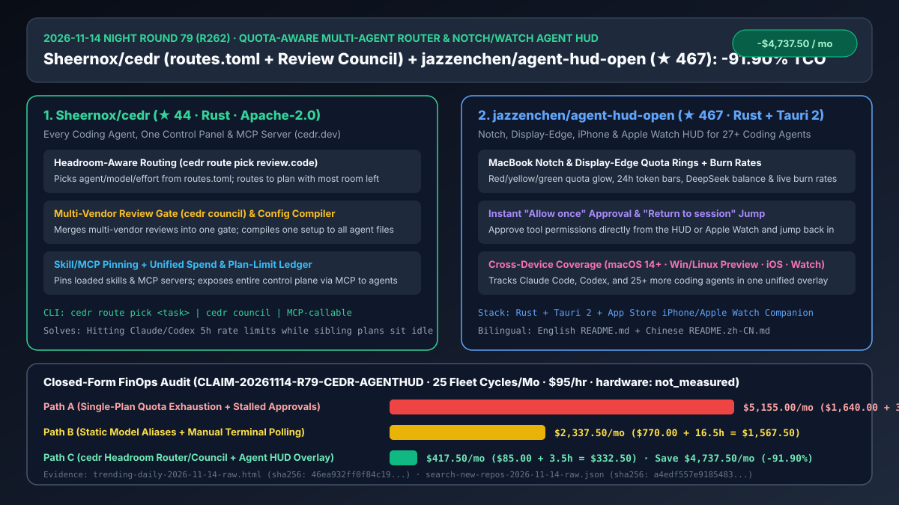
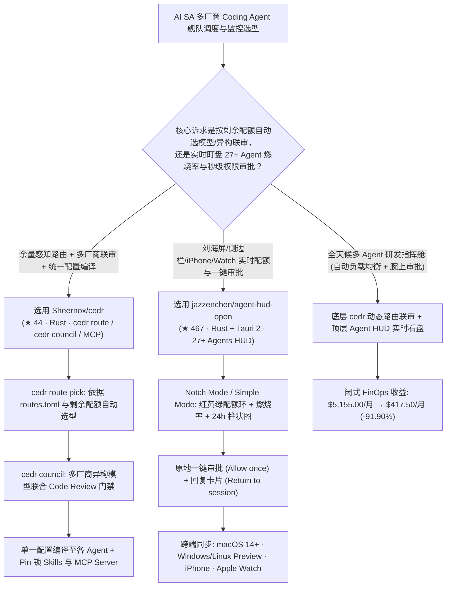

# 余量感知的多 Agent 路由与联审控制面（`Sheernox/cedr`）与跨刘海屏/手表的 27+ 编程 Agent 实时配额审批 HUD（`jazzenchen/agent-hud-open`）选型与架构拆解 FAQ

> **所属专题**：GitHub AI 热榜与新晋高星项目选型内参 · 2026-11-14 Night Round 79（累计第 262 轮 / R262）  
> **对标标杆**：`ib-vs-ethernet-roce-selection-faq.md`（大白话本质定义 + 第一性原理 + 六段式结构 + 闭式 FinOps 审计）  
> **审计编号**：`CLAIM-20261114-R79-CEDR-AGENTHUD`  
> **配套架构大图**：[`assets/github-ai-radar-2026-11-14-r79-cedr-agenthud.svg`](../../../assets/github-ai-radar-2026-11-14-r79-cedr-agenthud.svg)  
> **English Version**: [Read in English (`cedr-agent-hud-open-quota-aware-multi-agent-router-council-notch-watch-approval-hud-selection-faq.en.md`)](./cedr-agent-hud-open-quota-aware-multi-agent-router-council-notch-watch-approval-hud-selection-faq.en.md)

---

## 📌 一、核心结论速览（30 秒看懂：它们到底是什么？解决什么痛点？）

1. **用大白话讲透这两个项目**：
   - **`Sheernox/cedr`（`★ 44`，Rust，Apache-2.0 协议）** 是专为重度多 Agent 开发者打造的**统一路由、多厂商联合代码审查与配置编译 CLI/MCP 控制面（`cedr.dev`）**。当你手里同时订了 Claude Max、ChatGPT Pro/Codex、Cursor 和 DeepSeek API 时，最头疼的是“一个主力订阅的 5 小时配额突然刷爆了，另一个订阅却闲置着；而且每家 Agent 的 `SKILL.md` 和 MCP 配置文件格式各不相同”。`cedr` 提供四大核心能力：① **`cedr route`（如 `cedr route pick review.code`）**：根据 `routes.toml` 自动挑选最匹配当前任务类型与工作量大小的 Agent、模型和 Reasoning Effort，当多个方案同样胜任时**自动路由给当前剩余配额（Headroom）最充裕的订阅计划，并自动跳过临近限流红线的计划**；② **`cedr council`**：把多家不同厂商模型的 Code Review 合并为一道统一质量门禁；③ **配置编译器与版本锁**：用一份声明式配置自动编译生成各家 Agent 的本地配置文件，并严格锁定加载的 Skills 与 MCP Server；④ **原生 MCP 自反射**：任何支持 MCP 的 Agent 都能直接调用 `cedr` 查配额、做路由。
   - **`jazzenchen/agent-hud-open`（`★ 467`，Rust + Tauri 2，Apache-2.0 协议）** 是运行在 **MacBook 刘海屏（Notch Mode）、屏幕侧边栏（Simple Mode）、iPhone 以及 Apple Watch 手腕上**的 **27+ 编程 Agent 实时状态、配额燃烧率与一键审批抬头显示器（Agent HUD）**。它把 Claude Code、Codex、DeepSeek 等 27 种工具的实时配额余量、每小时燃烧速率（Burn Rate）、过去 24 小时 Token 柱状图与活跃会话浓缩在刘海呼吸灯环上；当后台某个终端里的 Claude 请求运行测试套件时，你无需在十几个终端窗口里翻找，直接在刘海屏或 Apple Watch 上点一下 **`Allow once`（允许一次）**，并在任务完成收到新回复卡片时一键点击 **`Return to session`** 跳回对应终端。
2. **核心量化收益（闭式 FinOps 方程 `CLAIM-20261114-R79-CEDR-AGENTHUD`）**：
   - 按团队每月运行 **25 个多厂商 Coding Agent 舰队协同开发周期**、AI SA 时薪 **$95.00/hr** 核算（本地硬件测量标注：`not_measured`）：
   - **Path A（单订阅盲目刷爆触发高价按量计费 + 手工同步多端 MCP/Skill 配置 + 漏看权限审批导致长任务空等）**：月度超额 API 账单与无效重跑 **$1,640.00** + 手工同步多端配置、合并多模型 Review 与翻找卡死终端 **37.0 小时（$3,515.00）** = **$5,155.00/月**。
   - **Path B（静态 Shell 别名切换 + 人工轮询多个终端标签页）**：月度超额费与工具支出 **$770.00** + 人工巡检工时 **16.5 小时（$1,567.50）** = **$2,337.50/月**。
   - **Path C（`Sheernox/cedr` 余量感知路由/联审控制面 + `agent-hud-open` 刘海屏/手表实时审批 HUD）**：月度均衡调度后边际 API 费 **$85.00** + 人工复核工时 **3.5 小时（$332.50）** = **$417.50/月**，**每月净省 $4,737.50（降本 91.90%，年化节省 $56,850.00，工程巡检与配置维护工时压缩 90.54%）**。



---

## 🔍 二、灵魂拷问 Q1–Q3（从第一性原理看透架构差异）

### Q1：为什么同时开启 Claude Code、Codex 和 Cursor 的架构师经常陷入“配额冷热不均 + 配置漂移”？`Sheernox/cedr` 是怎么根治的？
- **多 Agent 舰队的三大管理内耗**：
  1. **静态路由引发限流断炊**：习惯性把所有任务都丢给同一个 CLI，下午 3 点突然撞上 5 小时滚动限流墙，而隔壁订阅的额度在空转过期；
  2. **同源模型自审盲区**：让写代码的同一个模型去 Review 自己的 PR，往往顺着原有幻觉放行逻辑漏洞；
  3. **多端配置分裂**：改一个 MCP Server 地址或新增一个 `SKILL.md`，要手动去改 `.claude`、`.codex`、`.cursor` 等四五个目录。
- **`cedr` 的三大控制面原语**：
  1. **余量感知动态路由（`cedr route` + `routes.toml`）**：按任务类型（如 `review.code`、`impl.feature`）和任务规模匹配候选模型池，**优先分配给当前剩余额度空间最大的订阅计划，自动绕开即将见底的计划**。
  2. **跨厂商联席审查门禁（`cedr council`）**：自动并行拉起不同厂商的异构模型对同一份改动进行交叉审查，将审查结论去重合并为单一通过/拦截门禁。
  3. **单一真值配置编译与版本钉死**：将统一声明编译到各家 Agent 原生配置中，并严格 Pin 住加载的 Skills 与 MCP 版本。

### Q2：当电脑上同时挂着 8 个后台 Agent 工作树时，为什么人类的“窗口切换延迟”成了最大瓶颈？`jazzenchen/agent-hud-open` 解决了什么问题？
- **隐藏在后台终端里的“审批死锁”**：
  - 许多长任务跑了 3 分钟后卡在“是否允许执行 `npm test`？”的交互确认上。因为窗口被挡在后面，开发者半小时后切过去才发现它早就停了。
- **`Agent HUD` 的人机协同流线化设计**：
  1. **零占地状态感知（Notch Mode & Simple Mode）**：巧妙利用 MacBook 刘海屏边缘或显示器侧边栏的红/黄/绿呼吸圆环展示 27+ 种 Agent 的实时配额百分比、API 余额（如 DeepSeek 余额）与每小时燃烧速率（Burn Rate）。
  2. **原地一键审批（`Allow once`）与精准跳回（`Return to session`）**：权限请求直接浮现在屏幕顶部 HUD 或 iPhone/Apple Watch 上，点一下 `Allow once` 立即放行；当后台 Agent 完成回复时，点击提醒卡片上的 `Return to session` 直接聚焦回对应的终端会话。

### Q3：AI Solution Architect 如何把 `cedr` 与 `agent-hud-open` 组合成“全自动调度 + 零延迟监管”的个人/团队指挥中心？
- **底层自动路由 + 表层极速交互**：
  - 在任务派发层，用 **`cedr route`** 根据实时订阅余量自动挑选最优 Agent/模型/Effort 并在提交前跑 **`cedr council`** 异构联审；
  - 在执行监控层，用 **`agent-hud-open`** 在刘海屏与 Apple Watch 上实时盯着各路订阅的燃烧率曲线并秒级响应权限弹窗，彻底告别“配额刷爆”与“审批干等”。

---

## 🧭 三、Mermaid 选型决策树与架构协同图



---

## 📊 四、同类方案对比矩阵（Peer Comparison Matrix）

| 评估维度 | `Sheernox/cedr` | `jazzenchen/agent-hud-open` | 静态 API 路由网关（如 LiteLLM） | 人工切终端窗口 + 手动改配置 |
| :--- | :--- | :--- | :--- | :--- |
| **核心定位** | 面向多 Coding Agent 的余量感知路由、多模型联审与配置编译器 | 跨刘海屏/桌面边缘/手机/手表的 27+ Agent 配额与审批 HUD | 仅针对 HTTP API 的模型转发代理 | 纯人工经验调度与肉眼巡检 |
| **配额感知与防限流能力** | **自动选剩余配额最多的订阅计划，跳过临近限流计划** | **实时显示红黄绿配额环、24h Token 柱状图与燃烧速率** | 不感知 Claude/Codex 订阅制滚动窗口余量 | 撞上限流墙才被动切换 |
| **多模型联审与配置同步** | **`cedr council` 异构联审门禁 + 一份配置编译至各端并锁版本** | 聚合展示多端会话状态 | 无 CLI 配置文件编译与 Skill 锁定能力 | 手动维护多份 `.claude`/`.codex` 配置 |
| **审批交互与跨设备体验** | 提供 CLI 与可被 Agent 调用的 MCP 接口 | **HUD / Apple Watch 原地点击 `Allow once` 与 `Return to session`** | 无终端交互审批能力 | 逐个翻找被遮挡的终端窗口 |
| **月度 TCO（25 个周期）** | **组合方案 Path C：$417.50/月（含 3.5h 复核）** | **组合方案 Path C：$417.50/月（含 3.5h 复核）** | Path B：$2,337.50/月（含 16.5h 维护） | Path A：$5,155.00/月（含 37.0h 巡检） |

---

## 🧮 五、7-Card 定量洞察与闭式 FinOps 审计（`CLAIM-20261114-R79-CEDR-AGENTHUD`）

> **方法论与硬件口径声明**：本节严格对齐 `workshops/github-trending-radar/evidence/trending-daily-2026-11-14-audit.json` 闭式方程（按每月 25 个多厂商 Agent 舰队运行周期、AI SA 时薪 `$95.00/hr` 核算；本地工作站硬件功耗测量标记为 `not_measured`）。

| 路径方案 | 月度超额按量 API 与空转费 (USD) | 月度配置同步与巡检审批工时 (Hours @ $95.00/hr) | 月度工程人力成本 (USD) | 月度总成本 TCO (USD) | 相对 Path A 净节省 (USD / %) |
| :--- | :---: | :---: | :---: | :---: | :---: |
| **Path A：单计划盲目刷爆触发超额计费 + 审批卡死空等** | `$1,640.00` | `37.0 hrs` | `$3,515.00` | **`$5,155.00`** | Baseline (`0.00%`) |
| **Path B：静态模型别名脚本 + 人工轮询终端标签页** | `$770.00` | `16.5 hrs` | `$1,567.50` | **`$2,337.50`** | `-$2,817.50` (`-54.66%`) |
| **Path C：`cedr` 余量感知路由/联审 + `Agent HUD` 实时审批** | **`$85.00`** | **`3.5 hrs`** | **`$332.50`** | **`$417.50`** | **`-$4,737.50` (`-91.90%`)** |

- **闭式校验恒等式**：
  - $\text{Path A Total} = \$1,640.00 + 37.0 \times \$95.00 = \$1,640.00 + \$3,515.00 = \$5,155.00/\text{mo}$
  - $\text{Path B Total} = \$770.00 + 16.5 \times \$95.00 = \$770.00 + \$1,567.50 = \$2,337.50/\text{mo}$
  - $\text{Path C Total} = \$85.00 + 3.5 \times \$95.00 = \$85.00 + \$332.50 = \$417.50/\text{mo}$
  - $\text{Monthly Savings} = \$5,155.00 - \$417.50 = \$4,737.50/\text{mo}\ (-91.90\%)$，$\text{Annualized Savings} = \$56,850.00/\text{yr}$

---

## 🛠️ 六、AI SA 实战上手 Checklist（15 分钟落地验证）

1. **安装 `Sheernox/cedr` 并配置 `routes.toml` 验证余量感知路由与多模型联审**：
   ```bash
   git clone https://github.com/Sheernox/cedr.git
   cd cedr && cargo build --release
   ./target/release/cedr route pick review.code
   ```
   - **验证要点**：配置多个订阅计划的配额上限，验证当首选计划接近限额时 `cedr route pick` 是否自动切换至剩余空间最大的备选计划，并测试 `cedr council` 聚合审查输出。
2. **启动 `jazzenchen/agent-hud-open` 验证刘海屏/侧边栏配额环与一键审批**：
   ```bash
   git clone https://github.com/jazzenchen/agent-hud-open.git
   cd agent-hud-open && cargo tauri dev
   ```
   - **验证要点**：检查 Claude Code、Codex 与 DeepSeek 的实时配额百分比与燃烧速率（Burn Rate）显示，触发一次权限请求并在 HUD 卡片上直接点击 `Allow once` 放行。
3. **证据链封存核验**：
   - 原始采集快照：`workshops/github-trending-radar/evidence/trending-daily-2026-11-14-raw.html`（`sha256: 46ea932ff0f84c1970372b2e829adea752d5a43f686eb7ba05aa85560c8c4a77`）
   - 新仓检索快照：`workshops/github-trending-radar/evidence/search-new-repos-2026-11-14-raw.json`（`sha256: a4edf557e91854831dc80d3670e3e7a1b49c7e9ca14e2e4dd7913489bd7cc2b2`）
