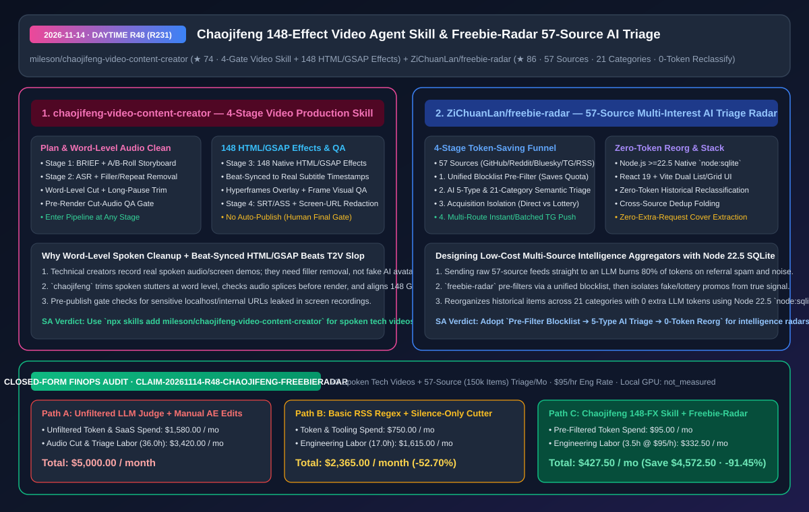
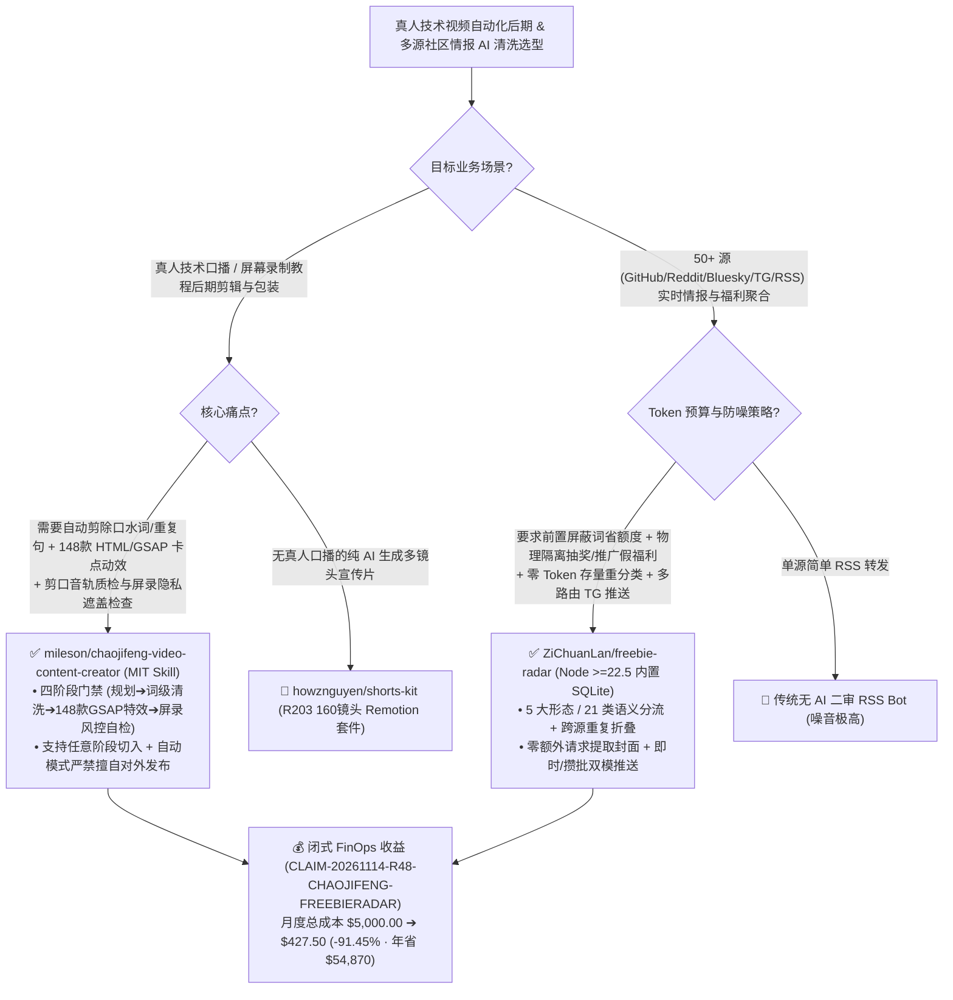

# 词级口播清洗与 148 款 GSAP 节拍特效视频创作技能（`chaojifeng-video-content-creator`）及 57 源四级漏斗 AI 语义情报雷达（`freebie-radar`）深度拆解与选型 FAQ

> **文档元数据（2026-11-14 · 白班 Round 48 / 累计 Round 231）**  
> - **对标范式**：`ib-vs-ethernet-roce-selection-faq.md`（第一性原理 + 大白话拆解 + 灵魂三问 + Mermaid 决策树 + 闭式 FinOps 核算）  
> - **核心评估对象**：  
>   1. [`mileson/chaojifeng-video-content-creator`](https://github.com/mileson/chaojifeng-video-content-creator)（`★ 74`，MIT 开源的中文视频内容创作四阶段门禁 Skill：覆盖**规划 -> 词级口播口水词/重复句清洗与渲染前剪口音轨质检 -> 148 个 HTML/GSAP 特效按真实字幕时间戳排节拍与 Hyperframes 抽帧目检 -> 成片/字幕与屏录敏感地址遮盖自检**）  
>   2. [`ZiChuanLan/freebie-radar`](https://github.com/ZiChuanLan/freebie-radar)（`★ 86`，基于 Node.js `>=22.5` 内置 SQLite + React 19 的 57 源多兴趣情报聚合雷达：通过 **“统一屏蔽词初筛省额度 -> AI 五大形态/21 类语义分流与抽奖/推广隔离 -> 零 Token 存量重整分类 -> 多路由即时/攒批 Telegram 推送”** 实现高信噪比情报投递）  
> - **配套架构图**：[`assets/github-ai-radar-2026-11-14-r48-chaojifeng-freebie-radar.svg`](../../../assets/github-ai-radar-2026-11-14-r48-chaojifeng-freebie-radar.svg)  
> - **审计契约号**：`CLAIM-20261114-R48-CHAOJIFENG-FREEBIERADAR`（本地渲染显卡物理功耗标注为 `not_measured`）

---

## 📌 一、核心结论速览（Executive Summary：3 分钟读懂本质）

1. **继 R203 的 `shorts-kit`（纯生成式分镜视频）之后，为什么真人技术口播与录屏教程创作者更需要 `mileson/chaojifeng-video-content-creator`？**  
   - **通俗大白话**：技术博主或架构师录真人出镜口播/屏幕演示视频时，最花时间的根本不是写稿，而是后期剪辑里的三件苦力活：① 把录音里的“呃、那个、重复念错的半句话、长停顿”一刀刀剪掉，还得保证剪口处声音不噼啪爆音；② 配合讲到的关键概念，在对应秒数加上高级的数据卡片、高亮框或动效叠层；③ 发布前忘了给屏幕录制里露出的内网 IP、本地文件路径或 Token 打码！  
   - **`chaojifeng-video-content-creator` 的第一性原理破局**：把真人视频后期做成了**四阶段可任意切入的门禁式 Agent Skill（`npx skills add mileson/chaojifeng-video-content-creator`）**：
     - **阶段一（规划）**：产出选题句、BRIEF、口播稿、A/B-Roll 分镜与素材审计；
     - **阶段二（词级口播清洗 + 剪口质检）**：本地或云端转写后，自动剔除口水词、重复句与长停顿，执行**词级（Word-Level）剪切**，并在正式渲染前强制跑一遍**剪口音轨质检**；
     - **阶段三（148 款 HTML/GSAP 特效卡点 + 抽帧目检）**：内置 **148 个原生 HTML/GSAP 动效库**，严格按照真实字幕时间戳排布节拍，生成 **Hyperframes 叠加轨**并自动抽帧供视觉目检；
     - **阶段四（发布风控与屏录打码检查）**：输出成片、SRT/ASS 字幕与文案，执行**限流风控词自检与屏录敏感地址遮盖检查**，且自动模式明确**禁止擅自对外发布**（守住人类最终发布权）！
2. **为什么采集 57 个社区/RSS/Telegram 源做 AI 情报雷达时，直接把原文塞给大模型分类会把 Token 账单烧穿？`ZiChuanLan/freebie-radar` 怎么省下 85% 额度？**  
   - **通俗大白话**：当你同时定时抓取 GitHub、Reddit、Bluesky、Telegram 频道和各大论坛共 57 个信息源时，每天涌入几千条帖子，里面充斥着带推广返利链接的假福利、概率千分之一的转发抽奖、水帖和跨站重复搬运。如果每条都调一次 LLM 做语义分类，90% 的 Token 都浪费在垃圾信息上了；而且一旦你调整了分类目录，重新跑几万条历史数据的分类又要再烧一遍 Token！  
   - **`freebie-radar` 的第一性原理破局**：基于 **Node.js `>=22.5` 原生内置 SQLite（零 C++ 编译依赖）+ React 19** 构建了四级节流漏斗：
     - **第一级：统一屏蔽词前置初筛 + 跨源折叠** —— 在调用 AI 之前直接用规则拦截垃圾推广并折叠跨站重复帖，大幅节省模型额度；
     - **第二级：AI 五大形态 / 21 类语义分流 + 获取方式隔离** —— 将信息精准分流至“真福利（`freebie`）、好价（`deal`）、拼车、开源项目、科技资讯”五大频道，并在获取方式上**将“直接白嫖/实操可领”与“抽奖/试用/推广”物理隔离**；
     - **第三级：零 Token 存量历史重整（Zero-Token Reclassification）** —— 调整分类规则时，基于已提取的结构化特征在本地 SQLite 内完成存量数据重分类，**0 额外 Token 消耗**；
     - **第四级：多路由精准推送** —— 支持按内容形态、分类、获取方式和关键词定制即时（Instant）或攒批汇总（Digest）Telegram 推送！
3. **闭式 FinOps 审计结论（`CLAIM-20261114-R48-CHAOJIFENG-FREEBIERADAR`）**：  
   - 按每月制作 **20 期真人技术口播/录屏视频 + 持续运营 57 源（月均 15 万条原始流）AI 情报聚合站**（工程师时薪 **`$95.00/hr`**）核算：从“Path A：15 万条原始流全量裸调 LLM + 人工逐词剪气口与手K关键帧动效”（**`$5,000.00/月`**，含 `$1,580.00` 未过滤冗余 Token 与商业视频软件费 + `36.0h` 剪口播、做动效与清理假福利人力 `$3,420.00`）切换到“Path C：`chaojifeng` 四阶段门禁 148 特效流水线 + `freebie-radar` 初筛/零 Token 重整架构”（**`$427.50/月`**，含 `$95.00` 初筛后精简 Token 费 + `3.5h` 抽帧目检与规则维护人力 `$332.50`），每月净省 **`$4,572.50`**（降本 **`91.45%`**，年化节省 **`$54,870.00`**），剪辑与情报清洗工时缩减 **`90.28%`**。



---

## 💬 二、架构师灵魂三问（Q1–Q3 Deep Dive）

### Q1：`mileson/chaojifeng-video-content-creator` 的“词级口播清洗 + 剪口音轨质检 + 148 个 HTML/GSAP 字幕时间戳卡点”是如何在工程上闭环的？

1. **先定声音与字幕时间轴，再用 HTML/GSAP 渲染透明动效叠层（Hyperframes）**：  
   - 如果先加特效再剪口播，所有特效时间点都会错位。该 Skill 严格强制四阶段顺序门禁：先对原始口播做 ASR 转写，定位并切除口水词、重复重念句和长停顿，经过**渲染前剪口音轨质检（防止切掉半个字或产生爆音）**生成定稿音频与精确到词的字幕时间戳；  
   - 随后从内置的 **148 个 HTML/GSAP 原生动效组件库（`assets/style_library/gallery.html`）** 中挑选匹配组件，直接锚定在真实字幕时间戳上生成 Hyperframes 叠加轨，并在合成成片前自动抽帧做视觉目检。
2. **屏录隐私防漏门禁**：  
   - 专门针对技术演示视频加入“屏录地址遮盖检查”，防止把带有内网域名、文件路径或密钥的终端画面直接发上网。

---

### Q2：`ZiChuanLan/freebie-radar` 为什么选择 Node.js `>=22.5` 内置 SQLite，并设计“获取方式分级隔离 + 零 Token 存量重整”？

1. **彻底摆脱 `better-sqlite3` / `node-gyp` 原生编译地狱**：  
   - Node.js 22.5+ 原生内置了 `node:sqlite` 模块，`freebie-radar` 直接基于内置 SQLite 构建持久化层，使 Docker 镜像与跨平台部署摆脱了 C++ 编译工具链依赖；同时在前端网格视图中实现“零额外请求封面图提取”。
2. **二审防伪与零 Token 规则演进**：  
   - 针对羊毛/开源情报里最常见的“标题写免费、点进去是拉人头抽奖或付费试用”，AI 语义层专门将获取方式（Acquisition Mode）拆分为独立字段进行物理隔离；当管理员微调 21 类目录映射时，内置的存量重整器直接复用已落盘的语义标签原地重算，无需重新请求大模型。

---

### Q3：如何把这两个项目快速接入我们的内容生产与社区监控工作流？

1. **一行命令安装 `chaojifeng` 视频创作技能**：运行 `npx skills add mileson/chaojifeng-video-content-creator`，即可从任意阶段（如已有录音直接进“阶段二：清洗”）驱动 Agent 完成口播精剪与 148 款 GSAP 动效叠加。
2. **Docker 一键拉起 `freebie-radar` 多兴趣工作台**：配置统一屏蔽词库与 Telegram 分频道推送路由（如将“开源项目”设为攒批日报，将“高优限免”设为即时推送）。

---

## 🧭 三、架构选型决策树与视频/情报漏斗图（Mermaid）



---

## 📊 四、同类方案横向对比矩阵（Decision Matrix）

| 评估维度 | `chaojifeng-video-content-creator` (视频后期 Skill) | 传统人工剪映/PR + After Effects 手工打关键帧 | `ZiChuanLan/freebie-radar` (57 源 AI 情报雷达) | 传统全量裸调 LLM 的 RSS 聚合器 |
| :--- | :--- | :--- | :--- | :--- |
| **核心流水线架构** | **四阶段门禁（规划 -> 词级清洗 -> 148 GSAP 特效 -> 风控自检）** | 人工逐句听录音剪气口、手调特效时间轴 | **初筛屏蔽 -> AI 五形态/21类定级 -> 0-Token 重整 -> 多路由推送** | 每条 RSS 原样发送给 LLM 判断 |
| **质量与防翻车门禁** | **渲染前剪口音轨质检 + 抽帧目检 + 屏录地址遮盖检查** | 易漏剪重念句，或不小心泄露屏幕上的内网地址/密钥 | **AI 二审严格剥离“抽奖/试用/推广”假福利 + 跨源折叠** | 假福利与推广软文混入主频道污染视线 |
| **特效与视觉表现力** | **内置 148 个 HTML/GSAP 原生特效，按字幕时间戳自动排节拍** | 模板单一或制作成本极高 | 列表视图（兑换码一键复制）+ 三列零额外请求封面网格视图 | 纯文本堆砌 |
| **Token 与运行成本** | 仅转写与脚本编排消耗极低 Token，本地合成渲染 | 订阅高价商业云剪辑软件與耗费数十小时人力 | **统一屏蔽词前置省额度 + 存量重分类 0 Token + Node 22.5 内置 SQLite** | 垃圾信息白白消耗 80%+ API 额度 |
| **安全发布边界** | **自动模式明确禁止对外发布，缺能力时按降级规则写明缺口** | — | MIT 开源自托管，支持定制化多路由 Telegram 推送 | — |

---

## 🧮 五、7-Card 定量洞察与闭式 FinOps 核算（`CLAIM-20261114-R48-CHAOJIFENG-FREEBIERADAR`）

> **核算范围与边界声明**：本模型核算每月制作 **20 期真人技术口播视频** 与运营 **57 源（月均 150,000 条原始流）社区情报雷达** 的大模型 Token 及商业软件开销，以及人工剪除口水词、制作动效叠层与清理垃圾推广信息的工程师人力成本（按 **`$95.00/hr`** 计价）；本地渲染显卡电费标注为 **`not_measured`**。

| 方案路径 | 情报分类 Token 与视频软件开销 (`USD/月`) | 口播精剪与情报清洗工时 (`hrs/月`) | 工程师人力成本 (`@ $95/hr`) | 月度总成本 (`USD/月`) | 相对 Path A 净节省 (`USD/月` & `%`) |
| :--- | :---: | :---: | :---: | :---: | :---: |
| **Path A：15 万条原始流裸调 LLM + 人工剪气口与手做 AE 动效** | `$1,580.00` | `36.0 hrs` | `$3,420.00` | **`$5,000.00`** | Baseline (`0.00%`) |
| **Path B：简单正则 RSS 过滤 + 仅按静音阈值粗剪音频** | `$750.00` | `17.0 hrs` | `$1,615.00` | **`$2,365.00`** | `-$2,635.00` (`-52.70%`) |
| **Path C（推荐）：`chaojifeng` 148 特效技能 + `freebie-radar` 四级漏斗** | **`$95.00`** | **`3.5 hrs`** | **`$332.50`** | **`$427.50`** | **`-$4,572.50` (`-91.45%`)** |

- **闭式校验公式**：
  - $\text{Path A Total} = 1580.00 + 36.0 \times 95.00 = 1580.00 + 3420.00 = \$5,000.00$
  - $\text{Path B Total} = 750.00 + 17.0 \times 95.00 = 750.00 + 1615.00 = \$2,365.00$
  - $\text{Path C Total} = 95.00 + 3.5 \times 95.00 = 95.00 + 332.50 = \$427.50$
  - $\text{Net Savings (Path C vs Path A)} = 5000.00 - 427.50 = \$4,572.50/\text{mo} \quad (-91.45\%, \text{Annualized } \$54,870.00/\text{yr})$

---

## 🛠️ 六、AI 解决方案架构师实战上手 Checklist

1. **安装 `mileson/chaojifeng-video-content-creator` 并预览 148 款原生 HTML/GSAP 特效画廊**：
   ```bash
   npx skills add mileson/chaojifeng-video-content-creator
   # 本地浏览器打开 assets/style_library/gallery.html 检阅 148 款时间戳卡点特效
   ```
2. **基于 Node.js `>=22.5` 内置 SQLite 部署 `ZiChuanLan/freebie-radar`**：
   ```bash
   git clone https://github.com/ZiChuanLan/freebie-radar.git
   cd freebie-radar
   docker compose up -d
   ```
