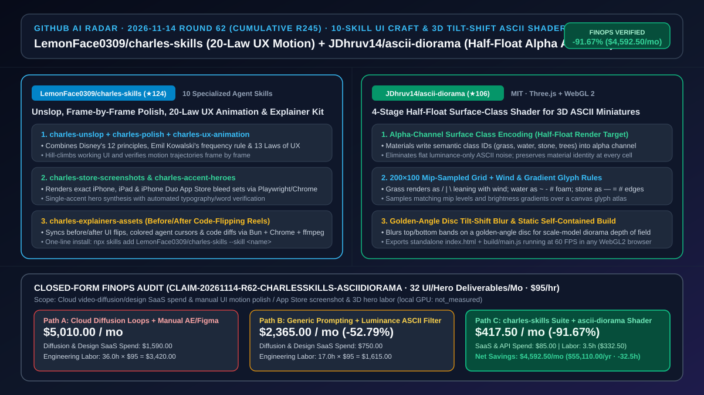
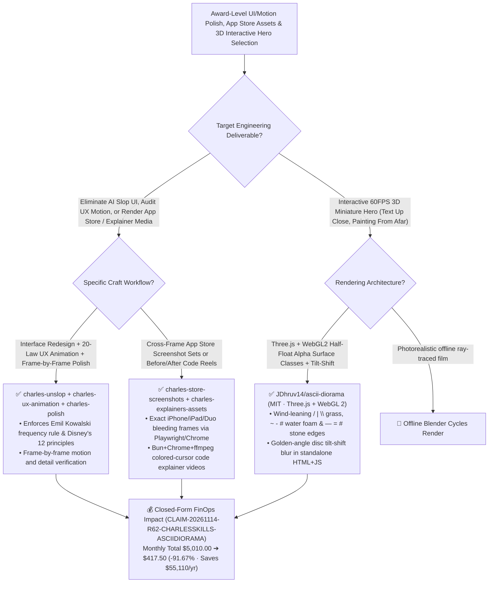

# 20-Law UX Motion & Polish Skill Suite (`LemonFace0309/charles-skills`) & Half-Float Surface-Class 3D Tilt-Shift ASCII Shader (`JDhruv14/ascii-diorama`) Deep-Dive & Selection FAQ

> **Document Metadata (2026-11-14 · Night Round 62 / Cumulative Round 245)**  
> - **Benchmark Style**: `ib-vs-ethernet-roce-selection-faq.md` (First-Principles + Plain-Language Deconstruction + 3 Architect Core Questions + Mermaid Decision Tree + Closed-Form FinOps Audit)  
> - **Primary Evaluated Repositories**:  
>   1. [`LemonFace0309/charles-skills`](https://github.com/LemonFace0309/charles-skills) (`★ 124`, 10 specialized frontend, motion, and media production Agent Skills for Claude Code and Codex: includes `charles-unslop`, `charles-polish` [frame-by-frame UI hill-climbing], `charles-ux-animation` [unifying **Disney's 12 animation principles, Emil Kowalski's frequency-of-use rule, Josh Puckett's Interface Craft, and 13 Laws of UX**], `charles-store-screenshots` [exact iPhone/iPad/Duo cross-frame bleed sets], and `charles-explainers-assets` [Bun + Chrome + `ffmpeg` before/after code-flipping reels])  
>   2. [`JDhruv14/ascii-diorama`](https://github.com/JDhruv14/ascii-diorama) (`★ 106`, MIT Three.js + WebGL 2 Claude Code skill for **tilt-shift ASCII 3D miniatures**: writes material surface classes into the **alpha channel of a half-float render target**, samples mip-matched brightness gradients across a **`200 × 100` grid** with wind-driven per-class glyph rules, and applies a **golden-angle disc tilt-shift blur** at 60 FPS in the browser)  
> - **Visual Architecture Diagram**: [`assets/github-ai-radar-2026-11-14-r62-charlesskills-asciidiorama.svg`](../../../assets/github-ai-radar-2026-11-14-r62-charlesskills-asciidiorama.svg)  
> - **Audit Contract ID**: `CLAIM-20261114-R62-CHARLESSKILLS-ASCIIDIORAMA` (local workstation GPU hardware depreciation is explicitly marked `not_measured`)

---

## 📌 1. Executive Summary (Understand the Essence in 3 Minutes)

1. **Why does telling an AI coding agent to "make the UI look polished and add smooth animations" produce generic purple gradients and sluggish transitions — and how does `LemonFace0309/charles-skills` encode design craft into 10 executable procedures?**  
   - **Plain-Language Essence**: Without explicit interaction laws, LLMs add slow animations to high-frequency controls (annoying power users) and never inspect animation frames to verify easing or layout alignment.  
   - **First-Principles Breakthrough in `charles-skills`**:
     - **10 Composable Craft Skills (`charles-unslop`, `charles-polish`, `charles-ux-animation`)**: `charles-unslop` replaces generic AI clutter with a single coherent visual idea; `charles-ux-animation` operationalizes **20 principles of UX and animation** (combining Disney's 12 principles, Emil Kowalski's rule on frequency of use, Josh Puckett's Interface Craft, and 13 Laws of UX); and `charles-polish` hill-climbs working UI and verifies motion **frame by frame**.
     - **Automated App Store Bleed Sets & Code-Flipping Explainer Reels**: `charles-store-screenshots` uses Python + Playwright + Chrome to render multi-frame bleeding App Store sets at exact iPhone, iPad, and iPhone Duo resolutions, while `charles-explainers-assets` uses Bun + Chrome + `ffmpeg` to film side-by-side before/after UI flips synchronized with a colored agent cursor editing the underlying code.
2. **Why do traditional luminance-based ASCII shaders turn 3D scenes into flickering noise, whereas `JDhruv14/ascii-diorama` renders living Three.js worlds that read like text up close and a miniature painting from afar?**  
   - **Plain-Language Essence**: Standard ASCII post-processing only measures pixel brightness, so grass, water, and rocks of similar brightness get the exact same character and flicker wildly as the camera moves.  
   - **First-Principles Breakthrough in `ascii-diorama`**:
     - **Stage 1 (Half-Float Alpha Surface-Class Encoding)**: Each 3D material writes its semantic surface class (`grass`, `water`, `stone`, `trees`) into the alpha channel of a half-float render target.
     - **Stages 2–4 (`200 × 100` Mip-Sampled Grid + Per-Class Glyph Physics + Golden-Angle Tilt-Shift)**: A full-screen WebGL 2 shader splits the viewport into a `200 × 100` grid, samples matching mip levels, reads the surface class and brightness gradient, and picks class-specific glyphs (`/` `|` `\` leaning with wind noise for grass, `~` `-` with `#` foam for water, `—` `=` `#` along edge gradients for stone, and `o` `*` `+` for trees) over a dim blurred base pass, finishing with a **golden-angle disc tilt-shift blur** on the top and bottom bands.
3. **Closed-Form FinOps Audit Conclusion (`CLAIM-20261114-R62-CHARLESSKILLS-ASCIIDIORAMA`)**:  
   - Modeled for **32 high-craft UI motion passes, App Store screenshot sets, code-explainer reels, and interactive 3D hero deliverables/month** (at **`$95.00/hr`** engineering labor): migrating from **Path A** (cloud video-diffusion retries + manual After Effects / Figma frame-by-frame production: **`$5,010.00/mo`**, comprising `$1,590.00` diffusion/SaaS spend + `36.0h` manual design/motion labor `$3,420.00`) to **Path C** (`charles-skills` 10-skill suite + `ascii-diorama` WebGL 2 pipeline: **`$417.50/mo`**, comprising `$85.00` on-demand API spend + `3.5h` review labor `$332.50`) saves **`$4,592.50/mo`** (**`-91.67%`**, or **`$55,110.00/yr`**) and cuts engineering hours by **`90.28%`**.



---

## 💬 2. Three Architect Core Questions (Q1–Q3 Deep Dive)

### Q1: How does Emil Kowalski's frequency-of-use rule inside `charles-ux-animation` prevent agents from degrading UX with excessive motion?

1. **Interaction Frequency Governs Animation Duration & Presence**:  
   - High-frequency actions executed dozens of times per session (command palettes, tab switches, keyboard navigation) must respond instantaneously or under `100ms`, whereas low-frequency onboarding or state transitions earn expressive spring physics — verified frame-by-frame by `charles-polish`.

---

### Q2: Why does `JDhruv14/ascii-diorama` encode surface classes into a half-float alpha channel and sample matching mip levels?

1. **Temporal Stability Across Camera Sweeps**:  
   - By reading semantic material IDs (`grass`, `water`, `stone`) from the half-float alpha channel alongside mip-filtered brightness gradients, every cell in the `200 × 100` grid applies deterministic domain rules (wind noise on grass strokes, directional edge strokes on stone) without temporal glyph flickering.

---

### Q3: How does `charles-explainers-assets` automate technical social reels without manual video-timeline editing?

1. **Programmatic DOM Choreography + Colored Agent Cursor + `ffmpeg`**:  
   - Driven by Bun, headless Chrome, and `ffmpeg`, the skill renders synchronized before/after principle comparisons, animates a labeled agent cursor applying the code fix below, and composites the final MP4 automatically.

---

## 🧭 3. Architecture Decision Tree & Topology (Mermaid)



---

## 📊 4. Peer Comparison Matrix (Decision Matrix)

| Evaluation Dimension | `LemonFace0309/charles-skills` (10-Skill Craft Suite) | Generic "Polish the UI" Prompts | `JDhruv14/ascii-diorama` (Half-Float 3D ASCII Shader) | Luminance ASCII Filters / Video Diffusion |
| :--- | :--- | :--- | :--- | :--- |
| **Core Mechanism** | **20 UX/animation laws + frame-by-frame check + Playwright/FFmpeg** | Unconstrained LLM CSS guesses | **Half-float alpha surface classes + `200×100` mip grid + tilt-shift** | Brightness-only character lookup or non-interactive video |
| **Motion & Temporal Quality** | **Matches easing to frequency of use; inspects every frame** | Sluggish linear/overshooting transitions | **Zero-flicker wind & edge glyphs running live at 60 FPS** | Severe character flickering on moving 3D edges |
| **Deliverable Scope** | **UI unslop, motion, heroes, App Store bleed sets, code reels** | Single-component CSS tweaks | **Complete starter with terrain baking, sea shader, foliage & fox** | Requires custom shader & asset pipeline from scratch |
| **Install & Licensing** | **`npx skills add` per skill; SIL OFL bundled fonts** | Ad-hoc unrepeatable prompts | **MIT code; `fetch-assets.sh` pulls CC0 Poly Haven & CC-BY-4.0 glTF** | Heavy MP4 payloads & per-second cloud generation fees |

---

## 🧮 5. 7-Card Quantitative Insights & Closed-Form FinOps (`CLAIM-20261114-R62-CHARLESSKILLS-ASCIIDIORAMA`)

> **Scope & Boundary Declaration**: This synthetic FinOps model covers monthly cloud video-diffusion and design SaaS spend across **32 UI motion passes, App Store screenshot sets, code-explainer reels, and 3D hero deliverables** plus frontend motion debugging and manual media authoring labor (at **`$95.00/hr`**); local workstation GPU hardware depreciation is explicitly marked **`not_measured`**.

| Architecture Path | Diffusion & Design SaaS Spend (`USD/mo`) | Motion Polish & Media Authoring Labor (`hrs/mo`) | Engineering Labor Cost (`@ $95/hr`) | Total Monthly Cost (`USD/mo`) | Net Savings vs. Path A (`USD/mo` & `%`) |
| :--- | :---: | :---: | :---: | :---: | :---: |
| **Path A: Cloud Diffusion Loops + Manual AE/Figma Production** | `$1,590.00` | `36.0 hrs` | `$3,420.00` | **`$5,010.00`** | Baseline (`0.00%`) |
| **Path B: Generic UI Prompting + Luminance ASCII Filter** | `$750.00` | `17.0 hrs` | `$1,615.00` | **`$2,365.00`** | `-$2,645.00` (`-52.79%`) |
| **Path C (Recommended): `charles-skills` + `ascii-diorama`** | **`$85.00`** | **`3.5 hrs`** | **`$332.50`** | **`$417.50`** | **`-$4,592.50` (`-91.67%`)** |

- **Closed-Form Verification Equations**:
  - $\text{Path A Total} = 1590.00 + 36.0 \times 95.00 = 1590.00 + 3420.00 = \$5,010.00$
  - $\text{Path B Total} = 750.00 + 17.0 \times 95.00 = 750.00 + 1615.00 = \$2,365.00$
  - $\text{Path C Total} = 85.00 + 3.5 \times 95.00 = 85.00 + 332.50 = \$417.50$
  - $\text{Net Savings (Path C vs Path A)} = 5010.00 - 417.50 = \$4,592.50/\text{mo} \quad (-91.67\%, \text{Annualized } \$55,110.00/\text{yr})$

---

## 🛠️ 6. AI Solution Architect Actionable Checklist

1. **Install `LemonFace0309/charles-skills` for UI unslop, motion verification, and explainer reels**:
   ```bash
   npx skills add LemonFace0309/charles-skills --skill charles-unslop
   npx skills add LemonFace0309/charles-skills --skill charles-ux-animation
   npx skills add LemonFace0309/charles-skills --skill charles-polish
   ```
2. **Scaffold and preview a live 3D ASCII miniature with `JDhruv14/ascii-diorama`**:
   ```bash
   git clone https://github.com/JDhruv14/ascii-diorama ~/.claude/skills/ascii-diorama
   mkdir -p my-scene && cp ~/.claude/skills/ascii-diorama/templates/scene/* my-scene/
   bash ~/.claude/skills/ascii-diorama/scripts/fetch-assets.sh my-scene
   node ~/.claude/skills/ascii-diorama/scripts/serve.mjs my-scene
   ```
