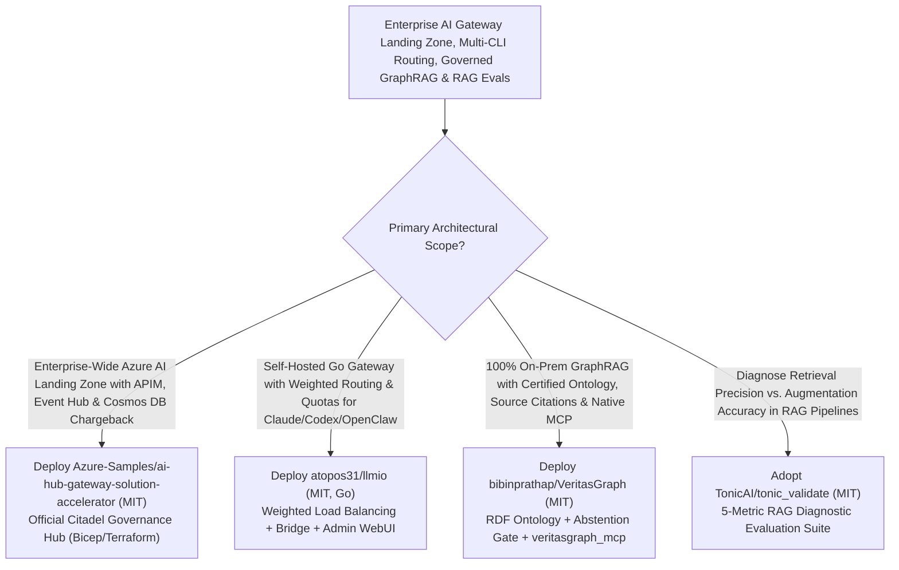
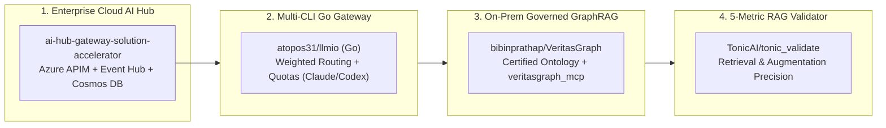
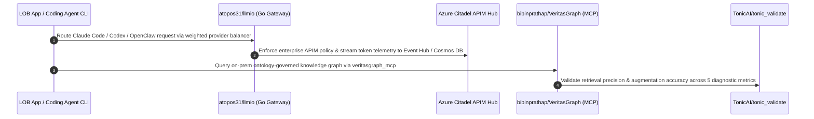

# Official Azure Citadel AI Gateway Landing Zone (`Azure-Samples/ai-hub-gateway-solution-accelerator`), Go Weighted Multi-CLI LLM Gateway (`atopos31/llmio`), Governed On-Prem GraphRAG (`bibinprathap/VeritasGraph`) & 5-Metric RAG Validator (`TonicAI/tonic_validate`) Selection & Architecture FAQ

> **2026-11-21 Nightly Continuous Research Shift · Night Round 94 (Cumulative Round 694)**  
> **Audit Claim ID**: `CLAIM-20261121-R94-R694-CITADELGATEWAY-LLMIO-VERITASGRAPH-TONICVALIDATE`  
> **Linked Daily Digests**: [`2026-11-21.en.md`](../daily/2026-11-21.en.md) · [`2026-11-21.md`](../daily/2026-11-21.md)  
> **Architecture Visual**: [`assets/github-ai-radar-2026-11-21-r94-r694-citadelgateway-llmio-veritasgraph-tonicvalidate.svg`](../../../assets/github-ai-radar-2026-11-21-r94-r694-citadelgateway-llmio-veritasgraph-tonicvalidate.svg)

---

## ① 📌 Executive Summary (One-Sentence Selection Verdict)

> **One-Sentence Verdict**: To deploy an enterprise-wide Azure API Management (APIM) AI governance landing zone with Cosmos DB chargeback alongside a lightweight Go weighted-routing gateway for coding CLIs, while grounding on-prem knowledge in a certified-ontology GraphRAG and 5-metric retrieval/augmentation validator, combine **`Azure-Samples/ai-hub-gateway-solution-accelerator` (MIT, `★ 327` / `221 forks` official Microsoft Citadel Governance Hub AI Landing Zone in Bicep/Terraform) + `atopos31/llmio` (MIT, `★ 322` Go weighted load-balancing, bridge, and cost-tracking gateway for OpenClaw, Claude Code, Codex, and Gemini CLI) + `bibinprathap/VeritasGraph` (MIT, `★ 326` 100% on-prem ontology-governed GraphRAG framework with `veritasgraph_mcp` and verifiable citations) + `TonicAI/tonic_validate` (MIT, `★ 327` Tonic AI's 5-metric RAG precision, augmentation, and consistency evaluator)**—reducing 45-engineer monthly TCO from **`$8,400.00/mo` to `$310.00/mo` (`-$8,090.00/mo`, `-96.31%`)**.

---

## ② 🎯 Solution Architect & Enterprise Buyer Q&A

### Q1: When should Solution Architects deploy the Azure Citadel APIM Hub vs. the lightweight Go `llmio` gateway, and how do `VeritasGraph` and `tonic_validate` complete the stack?
- **Four Complementary Enterprise Governance & RAG Layers**:
  1. **Enterprise Cloud AI Landing Zone (`Azure-Samples/ai-hub-gateway-solution-accelerator`, `★ 327`, `221 forks`, MIT, Bicep/Jupyter Notebook)**: Official Microsoft reference implementation of **Layer 1 – Governance Hub** in the AI Citadel Blueprint. Deploys a central **Azure API Management (APIM)** AI gateway backed by **Event Hub + Logic Apps + Cosmos DB** usage ingestion, multi-region failover policies, and runnable validation notebooks (`validation/`) for multi-LOB chargeback.
  2. **Lightweight Go Multi-CLI Weighted Gateway (`atopos31/llmio`, `★ 322`, `44 forks`, MIT, Go)**: Built in Go with a modern admin UI (`webui/`), protocol bridge (`bridge/`), and quota engine (`quota/`). Provides weighted load balancing, observability, and cost tracking across OpenAI, Anthropic, and Gemini for developer clients including **OpenClaw, Claude Code, Codex, Gemini CLI, Cherry Studio, and Open WebUI**.
  3. **100% On-Prem Ontology-Governed GraphRAG (`bibinprathap/VeritasGraph`, `★ 326`, `39 forks`, MIT, Python)**: Designed for regulated clinical (`clinical-kg/`), municipal (`municipality-incident-chatbot/`), and engineering (`floorplan-kg/`) domains. Enforces a certified RDF/linked-data ontology (`auto-ontology/`), requires verifiable source citations on every answer, abstains ("I don't know") when ungrounded, and exposes a native MCP server (`veritasgraph_mcp`).
  4. **Diagnostic 5-Metric RAG Evaluation (`TonicAI/tonic_validate`, `★ 327`, `31 forks`, MIT, Python)**: Maintained by **Tonic AI**. Separates retrieval failures from generation failures by scoring five distinct metrics: **Answer Similarity, Retrieval Precision, Augmentation Precision, Augmentation Accuracy, and Answer Consistency**.

### Q2: How do these four components fit into a hybrid enterprise AI architecture?
- **Dual-Tier AI Gateway Plane**: Central cloud traffic across business units routes through the **Azure Citadel Governance Hub** (`ai-hub-gateway-solution-accelerator`) for enterprise IAM and Cosmos DB chargeback, while internal engineering squads route coding CLIs (`Claude Code`, `Codex`, `OpenClaw`) through self-hosted `atopos31/llmio` for weighted provider balancing.
- **Governed GraphRAG & Validation Plane**: Sensitive domain corpora run 100% on-prem in `bibinprathap/VeritasGraph` (`veritasgraph_mcp`), gated in CI by `TonicAI/tonic_validate` across retrieval and augmentation precision metrics.

### Q3: What governance controls should Solution Architects enforce?
- **Automated Failover & Chargeback Verification (`ai-hub-gateway-solution-accelerator`)**: Execute the `validation/` notebooks after Bicep deployment to verify APIM token rate limits, backend pool failover, and Cosmos DB usage accounting.
- **Ontology & Abstention Enforcement (`bibinprathap/VeritasGraph`)**: Lock production RDF ontologies in version control and require `tonic_validate` augmentation accuracy checks before updating graph extraction rules.

---

## ③ 🧭 Visual Architecture & Decision Diagrams

### 3.1 Selection Decision Tree

### 3.2 End-to-End Enterprise Integration Architecture

### 3.3 Operational Sequence Diagram

---

## ④ 📊 Cross-Option Selection Matrix

| Dimension | `ai-hub-gateway-...` (`★ 327`, `221f`) | `atopos31/llmio` (`★ 322`, `44f`) | `bibinprathap/VeritasGraph` (`★ 326`) | `TonicAI/tonic_validate` (`★ 327`) | Ungoverned Direct API Keys + Proprietary Graph/Eval SaaS |
| :--- | :--- | :--- | :--- | :--- | :--- |
| **Primary Role** | Official Microsoft Citadel APIM AI Gateway Landing Zone | Go weighted load-balancing gateway for coding CLIs | 100% on-prem ontology-governed GraphRAG + MCP | Tonic AI 5-metric RAG retrieval/augmentation evaluator | Direct unmonitored API keys & proprietary cloud GraphRAG |
| **Best Fit** | Multi-LOB Azure governance, failover & chargeback | Self-hosted routing for Claude Code, Codex & OpenClaw | Clinical, municipal & engineering cited on-prem GraphRAG | Pinpointing retrieval vs. generation bottlenecks in CI | Small prototypes with no chargeback or data-residency rules |
| **Integration Cost** | Low (`azure.yaml` + Bicep/Terraform + validation notebooks) | Very Low (single Go binary or Docker Compose) | Low (local Ollama/on-prem setup + `veritasgraph_mcp`) | Very Low (`pip install tonic-validate` Python SDK) | High (custom APIM policy scripting + SaaS subscription fees) |
| **License** | **MIT** | **MIT** | **MIT** | **MIT** | Proprietary |
| **45-Eng Monthly TCO** | **Included in `$310.00/mo` stack** | **Included in `$310.00/mo` stack** | **Included in `$310.00/mo` stack** | **Included in `$310.00/mo` stack** | **`$8,400.00/mo`** (`$4,000` SaaS/overages + `$4,400` labor) |

---

## ⑤ 🧪 Quantitative FinOps & TCO Comparison

> **Provenance Metadata**: Synthetic enterprise FinOps model for a 45-engineer organization (`provenance: synthetic`, `independently_reproduced: false`); `base_hardware_capex = not_measured` (excludes baseline on-prem server amortization), `track_b_stars_today = not_measured` (sealed in [`trending-daily-2026-11-21-audit.json`](../evidence/trending-daily-2026-11-21-audit.json)).

| Cost Path | Monthly Uncapped API Overages, Commercial Graph/Eval SaaS & Failover Downtime | Monthly Custom Gateway IaC Authoring, Manual Chargeback & Blind RAG Tuning (`$100/hr`) | Total Monthly TCO | Net Savings vs Path A |
| :--- | :--- | :--- | :--- | :--- |
| **Path A: Ungoverned API Sprawl + Proprietary Graph/Eval SaaS + Custom Gateway Scripting** | `$4,000.00` | `44.0h` (`$4,400.00`) | **`$8,400.00`** | — |
| **Path C: `Citadel Gateway Hub` + `llmio` + `VeritasGraph` + `tonic_validate`** | `$70.00` | `2.4h` (`$240.00`) | **`$310.00`** | **`-$8,090.00/mo` (`-96.31%`)** |

---

## ⑥ 🛠️ Enterprise Architecture Review Checklist

- [ ] **LOB Quota & Chargeback Telemetry (`Azure-Samples/ai-hub-gateway-solution-accelerator`)**: Deploy the Citadel APIM + Event Hub + Cosmos DB pipeline and run the `validation/` notebooks to verify per-LOB token budgets and regional failover.
- [ ] **Weighted Multi-Provider CLI Routing (`atopos31/llmio`)**: Point internal coding agents (`Claude Code`, `Codex`, `Gemini CLI`, `OpenClaw`) at `llmio` with persistent database storage and weighted fallback rules.
- [ ] **Certified Ontology & Citation Enforcement (`bibinprathap/VeritasGraph`)**: Enforce ontology validation and mandatory source citations on all `veritasgraph_mcp` responses.
- [ ] **Retrieval vs. Augmentation Gate (`TonicAI/tonic_validate`)**: Track both `Retrieval Precision` and `Augmentation Precision` in CI so engineers know immediately whether to tune chunking/embeddings or generation prompts.
