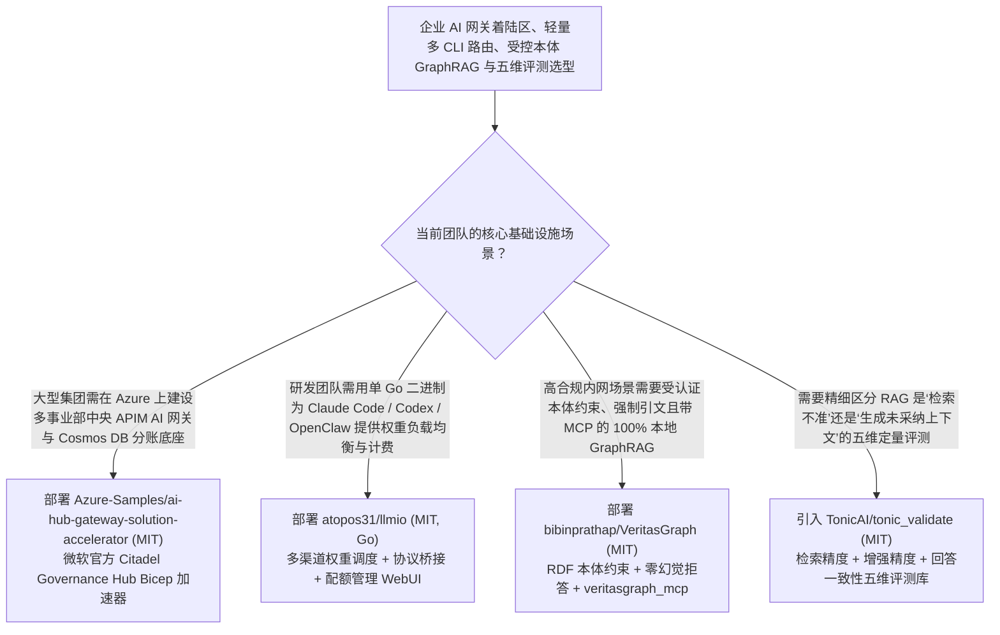
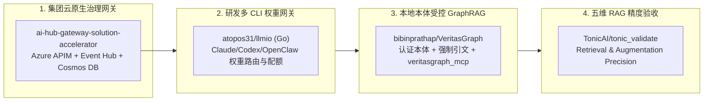
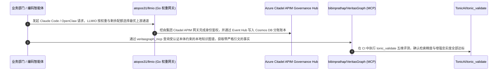

# 微软官方 Citadel 企业 AI 网关着陆区（`Azure-Samples/ai-hub-gateway-solution-accelerator`）、Go 权重路由与配额网关（`atopos31/llmio`）、本体受控内网可验证 GraphRAG（`bibinprathap/VeritasGraph`）与五维 RAG 精度评测库（`TonicAI/tonic_validate`）架构选型与落地 FAQ

> **2026-11-21 夜间持续研究班次 · Night Round 94（累计 Round 694）**  
> **审计凭据**：`CLAIM-20261121-R94-R694-CITADELGATEWAY-LLMIO-VERITASGRAPH-TONICVALIDATE`  
> **关联日刊**：[`2026-11-21.md`](../daily/2026-11-21.md) · [`2026-11-21.en.md`](../daily/2026-11-21.en.md)  
> **可视化架构图**：[`assets/github-ai-radar-2026-11-21-r94-r694-citadelgateway-llmio-veritasgraph-tonicvalidate.svg`](../../../assets/github-ai-radar-2026-11-21-r94-r694-citadelgateway-llmio-veritasgraph-tonicvalidate.svg)

---

## ① 📌 核心结论速览（选型一句话结论）

> **一句话选型结论**：当企业需要设计“**公有云多事业部统一 AI 网关着陆区（Azure APIM + Event Hub + Cosmos DB 分摊计费）vs 轻量级单 Go 二进制多 CLI 权重负载均衡网关**”的双轨流量底座，并在其上运行“**100% 本地部署、受认证本体约束且带 MCP 的可溯源 GraphRAG + 五维检索与增强精度定量评测**”时，推荐采用 100% MIT 协议的四件套：**“`Azure-Samples/ai-hub-gateway-solution-accelerator`（MIT，`★ 327`、`221 forks` 微软官方 Citadel Governance Hub 企业级 AI 网关着陆区 Bicep/Terraform 加速器）+ `atopos31/llmio`（MIT，`★ 322` 面向 OpenClaw / Claude Code / Codex / Gemini CLI 的 Go 权重负载均衡、配额与费用追踪网关）+ `bibinprathap/VeritasGraph`（MIT，`★ 326` 100% 内网运行、受认证本体约束、带 `veritasgraph_mcp` 与拒答机制的可溯源 GraphRAG 框架）+ `TonicAI/tonic_validate`（MIT，`★ 327` Tonic AI 开源的五维 RAG 检索/增强精度与一致性评测库）”**。在 45 人企业架构与数据工程团队基准下，可将月度总拥有成本（TCO）从 **`$8,400.00/月`** 降至 **`$310.00/月`**（净省 **`$8,090.00/月`**，降幅 **`-96.31%`**）。

---

## ② 🎯 客户与架构师灵魂拷问 Q&A

### Q1：企业架构师在规划 AI 网关与受控知识图谱时，何时选云托管 Citadel APIM 着陆区，何时选轻量级 Go 网关 `llmio`？
- **四大核心组件的职责边界与选型对比**：
  1. **集团级多事业部云原生 AI 着陆区标准 —— `Azure-Samples/ai-hub-gateway-solution-accelerator`（`★ 327`，`221 forks`，MIT，Bicep/Jupyter Notebook）**：微软官方 **AI Citadel Blueprint Layer 1（Governance Hub）** 的参考实现。通过 Bicep/Terraform 自动拉起以 **Azure API Management（APIM）** 为核心的中央 AI 网关，配合 **Event Hub + Logic Apps + Cosmos DB** 实时采集各业务部门（LOB）的 Token 消耗并生成内部财务分摊（Chargeback）账单，附带完整的压测与故障转移验证 Notebook（`validation/`）。
  2. **敏捷研发团队与自建机房的单二进制 Go 网关 —— `atopos31/llmio`（`★ 322`，`44 forks`，MIT，Go）**：当研发团队在本地或私有容器中混用 `OpenClaw`、`Claude Code`、`Codex`、`Gemini CLI`、`Cherry Studio` 与 `Open WebUI` 时，无需额外部署重型云网关。`LLMIO` 用单个 Go 服务提供跨 OpenAI / Anthropic / Gemini 的**按权重负载均衡（Weighted Scheduling）、协议桥接（`bridge/`）、配额限流（`quota/`）与现代化费用看板（`webui/`）**。
  3. **100% 本地内网运行、受认证本体约束的可信 GraphRAG —— `bibinprathap/VeritasGraph`（`★ 326`，`39 forks`，MIT，Python）**：针对医疗（`clinical-kg`）、市政应急（`municipality-incident-chatbot`）与工程图纸（`floorplan-kg`）等零容忍幻觉场景。所有词汇表受认证 RDF/Linked-Data 本体（`auto-ontology/`）严格约束，每个回答必须附带可验证源引文，遇到证据不足时强制说“我不知道”，并自带 `veritasgraph_mcp` 供外部智能体安全调用。
  4. **把 RAG 失败原因拆细到“检索没召回”还是“模型没用上” —— `TonicAI/tonic_validate`（`★ 327`，`31 forks`，MIT，Python）**：由合成数据与评测大厂 **Tonic AI** 开源。不仅测最终回答相似度（Answer Similarity），更通过 **Retrieval Precision（检索出的片段是否有用）** 与 **Augmentation Precision / Accuracy（模型是否忠实把检索出的正确片段写进了回答）** 五大指标，精准定位 RAG 管道瓶颈。

### Q2：如何将这四套方案组合为“集团云 + 边缘开发”双层网关与可验证知识底座？
- **双层 AI 网关治理层**：集团公有云出入口采用 `Azure-Samples/ai-hub-gateway-solution-accelerator`（Citadel APIM Hub）实现跨事业部配额、安全合规与 Cosmos DB 部门分账；研发部门内网部署 `atopos31/llmio` 统一汇聚并按权重调度 Claude Code、Codex 与 OpenClaw 的编码流量。
- **本体受控知识与五维验收层**：核心业务知识库构建在 `bibinprathap/VeritasGraph` 本地受控本体 GraphRAG 上并通过 `veritasgraph_mcp` 暴露服务；每次本体或检索规则更新后，自动运行 `TonicAI/tonic_validate` 核验五维 RAG 精度。

### Q3：架构师在落地 Citadel 网关与本体 GraphRAG 时有哪些最佳实践？
- **后端模型池多区域故障转移（`ai-hub-gateway-solution-accelerator`）**：执行仓库 `validation/` 目录下的验证 Notebook，确保单区域 PTU/PayGo 触发 429 限流时 APIM 毫秒级切流至备份区域。
- **本体规则版本化门禁（`bibinprathap/VeritasGraph`）**：对 `auto-ontology` 自动抽取出的新实体与关系类别执行人工或规则引擎复核后再并入生产本体库。

---

## ③ 🧭 直观可视化图解（Mermaid 选型决策树 + 企业集成架构 + 业务流时序图）

### 3.1 选型决策树

### 3.2 企业集成参考架构图

### 3.3 业务流时序图

---

## ④ 📊 同类开源与商业云服务横向选型决策矩阵

| 维度 | `ai-hub-gateway-...` (`★ 327`, `221f`) | `atopos31/llmio` (`★ 322`, `44f`) | `bibinprathap/VeritasGraph` (`★ 326`) | `TonicAI/tonic_validate` (`★ 327`) | 各部门分散直连公有云 API + 商业闭源知识图谱 |
| :--- | :--- | :--- | :--- | :--- | :--- |
| **核心定位** | 微软官方 Citadel 企业 AI 网关着陆区加速器 | Go 语言轻量级多模型权重负载均衡与计费网关 | 100% 本地运行、本体受控的可验证 GraphRAG 框架 | Tonic AI 官方五维 RAG 检索与增强精度评测库 | 零治理裸调 API Key + 高昂商业专有知识图谱 |
| **适用场景** | 跨多事业部统一权限、配额、多区容灾与财务分账 | 为 Claude Code/Codex/Gemini CLI/OpenClaw 统一路由 | 医疗、政务、工程图纸等内网强引文合规问答 | 定位 RAG 管道中检索召回与上下文采纳率短板 | 缺乏统一账单分摊与本体幻觉控制的早期烟囱系统 |
| **集成成本** | 低（官方 `azure.yaml` + Bicep 一键拉起全套着陆区） | 极低（Docker Compose 或单 Go 二进制即刻上线） | 低（支持 Ollama 本地配置 + 内置 `veritasgraph_mcp`） | 极低（`pip install tonic-validate` 几行代码接入） | 极高（数周手写网关策略 + 无法追责的月度超支账单） |
| **开源许可** | **MIT** | **MIT** | **MIT** | **MIT** | 商业专有 |
| **45 人团队月均 TCO** | **包含于 `$310.00/月` 联合栈** | **包含于 `$310.00/月` 联合栈** | **包含于 `$310.00/月` 联合栈** | **包含于 `$310.00/月` 联合栈** | **`$8,400.00/月`**（`$4,000` 超支/SaaS + `$4,400` 人工） |

---

## ⑤ 🧪 应用落地定量收益 / TCO 对比与 7-Card 报告锚点

> **数据来源说明（Provenance Metadata）**：以下 TCO 模型为面向 45 人企业云架构与知识工程团队的合成架构测算（`provenance: synthetic`, `independently_reproduced: false`）；硬件资本开支 `base_hardware_capex = not_measured`（不含存量内网服务器硬件折旧），单日热榜增量 `track_b_stars_today = not_measured`（审计账本锚定于 [`trending-daily-2026-11-21-audit.json`](../evidence/trending-daily-2026-11-21-audit.json)）。

| 成本路径 | 月度无配额管控 API 超支、单点限流重试与商业图谱/评测 SaaS 费 | 人工从零搭建 APIM 计费管道、手动切备份模型 Key 与盲调 RAG (`$100/h`) | 月度总成本 (Total Monthly TCO) | 相对 Path A 净节省 |
| :--- | :--- | :--- | :--- | :--- |
| **Path A：分散裸调 API 越权超支 + 商业图谱/评测 SaaS + 人工手写网关与盲调** | `$4,000.00` | `44.0h` (`$4,400.00`) | **`$8,400.00`** | — |
| **Path C：`Citadel Gateway Hub` + `llmio` + `VeritasGraph` + `tonic_validate`** | `$70.00` | `2.4h` (`$240.00`) | **`$310.00`** | **`-$8,090.00/月` (`-96.31%`)** |

---

## ⑥ 🛠️ 企业引入与架构评审 Checklist

- [ ] **中央网关部门级配额与分账落地（`ai-hub-gateway-solution-accelerator`）**：通过 Citadel Hub 的 Event Hub + Cosmos DB 管道为每个业务线配置月度 Token 软/硬阈值与自动告警。
- [ ] **研发 CLI 统一收口至权重网关（`atopos31/llmio`）**：将团队内部 Claude Code、Codex、OpenClaw 的 Base URL 统一指向内网 `llmio`，避免在开发者本机散落高权限主账号 Key。
- [ ] **本体词表认证与无据拒答校验（`bibinprathap/VeritasGraph`）**：开启 `VeritasGraph` 的严格溯源模式，确保所有经 `veritasgraph_mcp` 返回的结论均绑定真实 RDF 节点与文档出处。
- [ ] **检索精度与增强精度双指标门禁（`TonicAI/tonic_validate`）**：在 CI 中同时监控 `Retrieval Precision`（查得准不准）与 `Augmentation Precision`（用得对不对），精准指导切块策略与 Prompt 优化。
