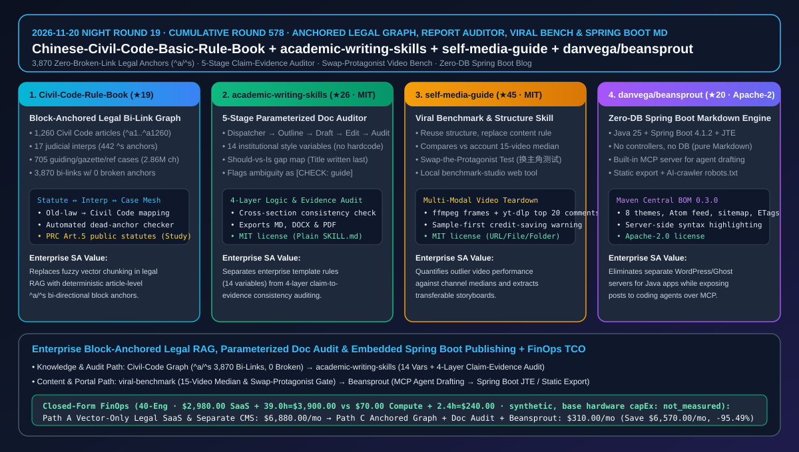
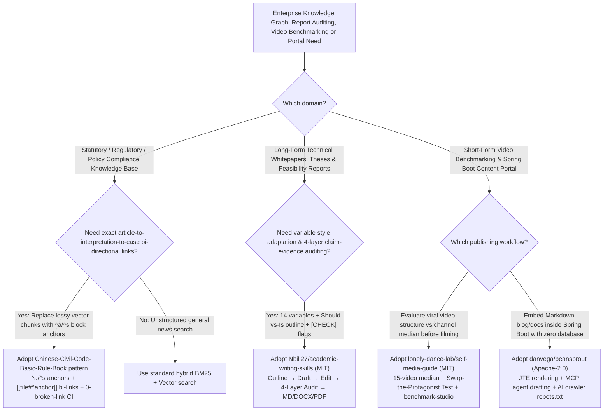
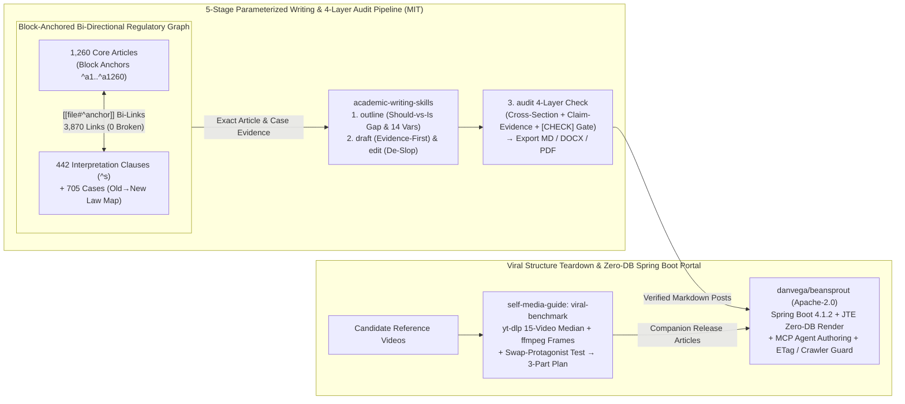
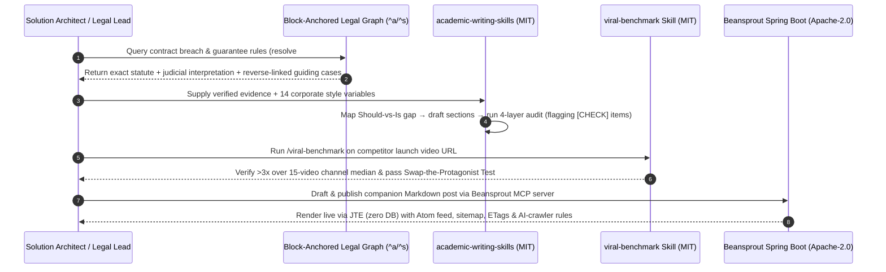

# How to Choose Block-Anchored Legal Knowledge Graphs, 14-Variable Document Auditors, Viral Video "Swap-the-Protagonist" Benchmarks, and Zero-DB Spring Boot Markdown Engines? `Chinese-Civil-Code-Basic-Rule-Book`, `academic-writing-skills`, `self-media-guide`, and `danvega/beansprout` Architecture & Selection FAQ

> **Document Metadata (2026-11-20 Night Round 19 · Cumulative Round 578)**
> - **Target Audience**: AI Solution Architects, Legal/Compliance RAG Architects, Technical Documentation Governance Leads, Java Enterprise Portal & Content Growth Architects
> - **Primary Repositories Evaluated**:
>   1. [`StefanCHEN2026/Chinese-Civil-Code-Basic-Rule-Book`](https://github.com/StefanCHEN2026/Chinese-Civil-Code-Basic-Rule-Book) (★ 19 · `stars_today: not_measured` · `3 stars/day` · Markdown / Obsidian · statutory/judicial texts public domain under PRC Copyright Law Art. 5; third-party reference cases for research/study) — Article-centered legal knowledge graph covering all **1,260 articles of the PRC Civil Code** (`^a1–^a1260` block anchors), **17 judicial interpretations** (`442` `^s` block anchors), and **705 guiding, gazette, and reference cases + judicial Q&As** (`739` Markdown notes, `~2.86M` Chinese characters) connected by **3,870 script-verified bi-directional links (`[[file#^anchor]]`) with `0` broken links or dead anchors**, including historical old-statute → Civil Code article mappings
>   2. [`Nbill27/academic-writing-skills`](https://github.com/Nbill27/academic-writing-skills) (★ 26 · `stars_today: not_measured` · `3 stars/day` · Python · MIT) — Five-stage research and technical report pipeline (`academic-writing` router → `outline` with Should-vs-Is gap mapping and **14 institutional variables** → `draft` w/ MD/DOCX/PDF export → `edit` machine-pattern scrubber → `audit` checking internal logic, cross-section consistency, methodology fit, and claim-evidence alignment while tagging any ambiguous rule as `[CHECK: campus guide]`)
>   3. [`lonely-dance-lab/self-media-guide`](https://github.com/lonely-dance-lab/self-media-guide) (★ 45 · `stars_today: not_measured` · `9 stars/day` · JavaScript · MIT) — Viral video structural teardown skill (`viral-benchmark`) and browser `benchmark-studio` built on **"Reuse the structure, replace the content"**, combining `ffmpeg` frame extraction with `yt-dlp` top-20 comments and **15-video channel median comparison** to run a **"Swap-the-Protagonist Test"** before generating a 3-episode adaptation plan
>   4. [`danvega/beansprout`](https://github.com/danvega/beansprout) (★ 20 · `stars_today: not_measured` · `5 stars/day` · Java 25 + Spring Boot 4.1.2 + JTE · Apache-2.0 · Maven Central `0.3.0`) — Zero-controller, zero-database embedded Markdown blog and documentation engine for Spring Boot that renders `.md` files into index/post/tag/archive pages, Atom feeds, sitemaps, and static exports across 8 themes with server-side syntax highlighting, **an MCP server for coding-agent drafting**, and **`robots.txt` + ETag rules to keep unauthorized AI training crawlers out**
> - **Provenance & Guardrail Statement**: Structured after `ib-vs-ethernet-roce-selection-faq.md`. All four repositories come from `search-new-repos-2026-11-20-raw.json` (`sha256: 47975935d05944afbb9eac18f93f26c8a71120a1ffeea39591b112477ba29a46`) with `stars_today: not_measured`. Upstream README corpus statistics (`739` notes, `2.86M` characters, `3,870` bi-links with `0` broken anchors) are labeled `anonymized_reported (independently_reproduced=false)`. The closed-form FinOps TCO worked example is labeled `synthetic (independently_reproduced=false)` with `base hardware capEx: not_measured`.

---

## ① 📌 Executive Summary (One-Sentence Selection Verdict)

> **One-Sentence Verdict**: When architecting **enterprise legal/regulatory RAG systems, long-form technical report pipelines, video content benchmarking, and Java developer portals**, **never slice statutes and judicial interpretations into unanchored 500-token vector chunks (which severs article-to-interpretation links and misinterprets pre-codification case citations), and never spin up a separate database-backed WordPress/Ghost server just to add a blog to a Spring Boot app**! Instead, structure statutory/policy corpora after **`Chinese-Civil-Code-Basic-Rule-Book` (`^a`/`^s` article block anchors + `3,870` zero-broken-link bi-directional references + old-to-new law mappings)**, audit long-form reports with MIT-licensed **`academic-writing-skills` (14 institutional variables + 4-layer claim-evidence audit + `[CHECK]` uncertainty flags)**, qualify video concepts with MIT-licensed **`self-media-guide` (15-video channel median check + Swap-the-Protagonist Test)**, and embed Apache-2.0 **`danvega/beansprout` (zero-DB Spring Boot JTE starter + MCP agent authoring)** to cut a 40-person organization's monthly SaaS, CMS hosting, and verification TCO from **$6,880.00/mo** down to **$310.00/mo** (saving **$6,570.00/mo**, **`-95.49%`**, `synthetic, independently_reproduced=false`).



### Core Capabilities & Metrics Cheat Sheet

| Dimension | `Chinese-Civil-Code-Basic-Rule-Book` | `Nbill27/academic-writing-skills` | `lonely-dance-lab/self-media-guide` | `danvega/beansprout` |
|---|---|---|---|---|
| **Plain-English Positioning** | Bi-directional block-anchored legal knowledge graph across 1,260 statutes, 17 interpretations & 705 cases | 5-stage parameterized academic/technical writing & 4-layer claim-evidence auditing skills | Viral video structural teardown skill (`viral-benchmark`) & local web studio | Zero-database, zero-controller Markdown blog starter for Spring Boot with MCP & crawler guards |
| **Primary Enterprise Pain Point Solved** | Naive vector RAG missing binding judicial interpretations or failing on old-statute numbers in historical cases | Hardcoded formatting prompts and cross-chapter logic/evidence contradictions in long technical reports | Marketing teams wasting video generation credits copying viral clips that only succeeded due to celebrity fame | Java teams maintaining separate WordPress/Ghost + MySQL servers just to publish release notes and blogs |
| **Key Technical / Measured Spec** | `739` MD notes, `2.86M` chars; `^a1–^a1260` + `442` `^s` anchors; `3,870` bi-links w/ **0 broken links** | `Should-vs-Is` gap map (title written last); 14 style variables; `[CHECK: guide]` flags; MD/DOCX/PDF export | `ffmpeg` frame extraction + `yt-dlp` top-20 comments & 15-video median; Swap-the-Protagonist Test | Java 25 + Spring Boot 4.1.2 + JTE; Maven BOM `0.3.0`; 8 themes; static export; MCP server; `robots.txt`/ETag |
| **License & Governance** | **Public-domain statutes/interpretations** (PRC Art. 5; replace third-party reference case citations for commercial resale) | **MIT** (standard `SKILL.md` folders) | **MIT** (supports URLs, local files & batch folders) | **Apache-2.0** (published on Maven Central) |

---

## ② 🎯 Solution Architect & Customer Deep-Dive Q&A

### Q1: Why does standard "chunk-and-embed" vector RAG fail on codified statutes, judicial interpretations, and historical case law, and how does `Chinese-Civil-Code-Basic-Rule-Book`'s block-anchored bi-directional graph solve this?

- **Three Structural Failures of Naive Legal/Policy Vector Chunking**:
  1. **Severed Statute-to-Interpretation Links**: An article in the Civil Code is governed in practice by specific clauses across 17 Supreme Court judicial interpretations; cosine similarity on a user's question often retrieves the general article while missing the binding interpretation exception.
  2. **Unmapped Pre-Codification Citations**: Guiding and gazette cases decided before 2021 cite article numbers from repealed statutes (e.g., the old Contract Law or Property Law) rather than the current Civil Code.
  3. **Imprecise Chunk Boundaries**: Returning a 600-token window without exact article anchors forces legal reviewers to manually hunt through long documents.
- **The Six-Step Block-Anchored Graph Architecture (`739` Notes · `2.86M` Chars · `3,870` Bi-Links · `0` Broken Anchors)**:
  - Assigns deterministic Obsidian block anchors to all **1,260 Civil Code articles (`^a1–^a1260`)** and **442 judicial interpretation clauses (`^s`)** (`anonymized_reported, independently_reproduced=false`).
  - Embeds forward `[[file#^anchor]]` links under every statutory article to its exact judicial interpretations, guiding cases (`25`), gazette cases (`29`), reference cases (`633`), and judicial Q&As (`18`), while every case page links backward to the statutes it proves—**including explicit `Old Law Art. X → Civil Code Art. Y` mappings**—verified by a whole-vault script enforcing `0` broken links or dead anchors.

### Q2: How does `Nbill27/academic-writing-skills` prevent LLM-generated whitepapers and technical reports from suffering from "hollow titles, hardcoded formatting, and unbacked claims"?

- **Four Engineering Disciplines in `academic-writing-skills` (MIT)**:
  1. **Gap-First Outline, Title Last (`outline`)**: Maps the research gap (**Should vs. Is**) first, validates the 5-chapter skeleton against a universal checklist, and generates the document title *last* so the title reflects verified substance rather than generic buzzwords.
  2. **14 Institutional Style Variables (Zero Hardcoding)**: Externalizes formatting and structural conventions into 14 variables; when no guide is supplied or a rule is ambiguous, the skill never guesses—it inserts an explicit **`[CHECK: campus guide]`** marker for human sign-off.
  3. **Scoped Anti-Machine-Prose Editing (`edit`)**: Strips repetitive LLM phrasing and filler transitions without altering underlying facts or figures.
  4. **Four-Layer Claim-Evidence Auditing (`audit`)**: Audits internal research logic, cross-section consistency, methodology fit, and **claim-evidence alignment** before exporting to Markdown, DOCX, or PDF.

### Q3: How do `lonely-dance-lab/self-media-guide` and `danvega/beansprout` eliminate wasted content production spend for marketing and Java engineering teams?

- **`lonely-dance-lab/self-media-guide` (MIT): 15-Video Median Benchmarking + "Swap-the-Protagonist Test"**:
  - Uses `yt-dlp` and `ffmpeg` to compare a target video's view count against the creator's **most recent 15-video median** (separating true structural outliers from celebrity halo effects), analyzes the first-3-second hook and top 20 audience comments, and applies the **Swap-the-Protagonist Test (换主角测试)**—asking whether the script still works when the original creator is replaced by your own brand/product IP—before outputting a 3-episode adaptation plan and sample-first rendering reminders.
- **`danvega/beansprout` (Apache-2.0): Zero-Database Embedded Markdown Engine for Spring Boot**:
  - Adds a full blog/documentation portal directly to an existing **Java 25 + Spring Boot 4.1.2** application via a single Maven BOM (`dev.danvega:beansprout-bom:0.3.0`), rendering `.md` files with **JTE** into index, post, tag, archive, Atom feed, and sitemap routes with **zero controllers and zero database**.
  - Includes server-side code highlighting, 8 themes, static export for GitHub/Cloudflare Pages, **an MCP server so Claude Code can read existing posts and start drafts**, and built-in `robots.txt` + ETag rules to block unauthorized AI training crawlers.

---

## ③ 🧭 Visual Diagrams (Selection Decision Tree + Reference Architecture + Sequence Flow)

### 3.1 Enterprise Legal Graph, Technical Report Audit, Video Benchmarking & Java Portal Decision Tree



### 3.2 End-to-End Block-Anchored Knowledge, Document Audit & Spring Boot Portal Architecture



### 3.3 Block-Anchored Retrieval → 4-Layer Claim-Evidence Audit → `Beansprout` MCP Publishing Sequence



---

## ④ 📊 Comparative Selection Matrix (Open Source vs. Commercial Cloud SaaS)

| Dimension | `Chinese-Civil-Code-Basic-Rule-Book` | `Nbill27/academic-writing-skills` (MIT) | `lonely-dance-lab/self-media-guide` (MIT) | `danvega/beansprout` (Apache-2.0) | Legacy Vector-Only Legal RAG + Separate Ghost/WordPress CMS + Social SaaS |
|---|---|---|---|---|---|
| **Core Positioning** | **1,260-article, 3,870-bi-link block-anchored legal knowledge graph with `0` broken anchors** | **14-variable parameterized writing & 4-layer claim-evidence auditing skills** | **15-video median & Swap-the-Protagonist viral video teardown skill + web studio** | **Zero-DB, zero-controller embedded Markdown blog starter for Spring Boot** | Unanchored vector chunking, standalone CMS + MySQL servers, and metered social analytics SaaS |
| **Engineering & Quality Wins** | Exact `^a`/`^s` article jumps + old-to-new statute mapping + automated dead-anchor verification | Builds `Should-vs-Is` gap map before title; marks uncertain rules `[CHECK]` instead of hallucinating | Uses `ffmpeg` + `yt-dlp` to separate structural winners from celebrity-driven flukes | Single Maven BOM adds JTE rendering, 8 themes, static export, MCP authoring & AI-crawler blocks | Vector chunks sever statute/interpretation links; separate CMS adds DB patching & proxy overhead |
| **Privacy & Deployment** | 100% local Markdown vault (Obsidian & local Agent compatible) | 100% local `SKILL.md` workflow exporting MD/DOCX/PDF | Local `ffmpeg` + `yt-dlp` + browser `benchmark-studio` | Compiles directly into existing Spring Boot JAR or exports static HTML | Spreads confidential drafts and site credentials across multiple third-party SaaS clouds |
| **License & Governance** | **Public-domain statutes/interpretations** (replace third-party case DB codes before commercial resale) | **MIT** | **MIT** | **Apache-2.0** (Maven Central `0.3.0`) | Proprietary per-seat and per-instance billing |
| **Monthly TCO (40-Person Org)** | **$0.00 / mo** | **$0.00 / mo** | **$0.00 / mo SaaS fees** | **$0.00 / mo extra DB/CMS hosting** | **$6,880.00 / mo** (legal/social SaaS + standalone CMS hosting + 39.0h citation & ops labor) |

---

## ⑤ 🧪 Quantitative Enterprise FinOps TCO & 7-Card Report Alignment

### 5.1 Closed-Form FinOps Worked Example (40-Person Legal-Tech, Technical Documentation, Growth & Java Portal Organization)

> **Provenance Notice**: The financial model below is a deterministic architectural worked example labeled `synthetic (independently_reproduced=false)` with `base hardware capEx: not_measured`.

| Cost Component | Path A: Vector-Only Legal SaaS + Standalone CMS/DB Hosting + Social Video SaaS | Path C: Block-Anchored Graph + `academic-writing-skills` + `viral-benchmark` + `Beansprout` | Closed-Form Formula & Architectural Notes |
|---|---|---|---|
| **Legal/Social SaaS Subscriptions & Standalone CMS/DB Hosting** | **$2,980.00 / mo** | **$70.00 / mo** | Path A: metered legal/social SaaS seats + separate WordPress/Ghost DB instances = `$2,980.00/mo`; Path C: local `^a/^s` graph + MIT `academic-writing-skills` / `viral-benchmark` + in-app `Beansprout` = `$70.00/mo` |
| **Citation Hallucination Triage, Report Auditing & CMS Ops ($100/h)** | **$3,900.00 / mo** (`39.0h × $100.00`) | **$240.00 / mo** (`2.4h × $100.00`) | Path A: 40-person org spends `39.0h/mo` fixing severed statutory citations, reconciling cross-chapter report contradictions, and patching CMS databases (`$3,900.00`); Path C: `^a/^s` bi-links + 4-layer `audit` + zero-DB `Beansprout` cuts ops to `2.4h/mo` (`$240.00`) |
| **Total Monthly TCO** | **$6,880.00 / mo** | **$310.00 / mo** | **Net savings of $6,570.00 / mo (-95.49% reduction, $78,840.00 annualized, `not_measured` hardware capEx)** |

```chart
{
  "data": {
    "values": [
      { "Category": "Legal/Video SaaS & Standalone CMS DB Hosting", "Deployment": "Path A: Commercial SaaS, Separate CMS & Manual Audit", "MonthlyCostUSD": 2980 },
      { "Category": "Citation Verification, Doc Audit & CMS Ops (40-Eng)", "Deployment": "Path A: Commercial SaaS, Separate CMS & Manual Audit", "MonthlyCostUSD": 3900 },
      { "Category": "Legal/Video SaaS & Standalone CMS DB Hosting", "Deployment": "Path C: Civil-Code Graph + Academic Audit + Beansprout", "MonthlyCostUSD": 70 },
      { "Category": "Citation Verification, Doc Audit & CMS Ops (40-Eng)", "Deployment": "Path C: Civil-Code Graph + Academic Audit + Beansprout", "MonthlyCostUSD": 240 }
    ]
  },
  "semantic_types": {
    "Category": "Category",
    "Deployment": "Name",
    "MonthlyCostUSD": "Amount"
  },
  "chart_spec": {
    "chartType": "Grouped Bar Chart",
    "title": "Block-anchored legal graph + doc audit + Beansprout cut monthly TCO by 95.49%",
    "subtitle": "Monthly cost in USD (40-person legal, documentation & Java portal org, synthetic)",
    "encodings": {
      "x": "Category",
      "y": "MonthlyCostUSD",
      "group": "Deployment",
      "color": "Deployment"
    }
  }
}
```

### 5.2 Alignment with the 7-Card 4:5 Visual Report (`cards.html` / `cards.en.html`)

- **✅ Good Fit**: Building article-anchored (`^a`/`^s`) bi-directional legal and regulatory knowledge graphs with zero broken links, auditing long-form technical/research reports with parameterized style variables, qualifying video structures against 15-video channel medians, and embedding zero-DB Markdown blogs into Spring Boot apps.
- **⛔ Not For**: Reselling third-party annotated reference case texts commercially without replacing commercial database citation codes with official court gazette sources, or publishing un-audited LLM reports that still contain unresolved `[CHECK: ...]` markers.

---

## ⑥ 🛠️ Enterprise Architecture Review & Rollout Checklist

- [ ] **Enforce Block-Anchored Bi-Links (`^a`/`^s`) & Zero-Broken-Anchor CI on Policy Corpora**: Model internal compliance and legal RAG corpora after `Chinese-Civil-Code-Basic-Rule-Book` by attaching clause-level block anchors, mapping repealed-to-current rules, and running automated link/anchor integrity scripts in CI (`broken_links == 0`).
- [ ] **Require Gap-First Outlines & 4-Layer `audit` Gates for Technical Whitepapers**: Configure `Nbill27/academic-writing-skills` (MIT) with your organization's 14 style variables, enforce `Should-vs-Is` gap mapping before title generation, and block final DOCX/PDF release until all `[CHECK: ...]` flags and claim-evidence mismatches are resolved.
- [ ] **Gate Video Production Budgets on the 15-Video Median & Swap-the-Protagonist Test**: Run `lonely-dance-lab/self-media-guide`'s `/viral-benchmark` before funding video shoots or AI renders to confirm the reference clip outperformed its channel's 15-video median and survives protagonist replacement.
- [ ] **Embed `Beansprout` BOM in Spring Boot Portals with AI-Crawler & MCP Governance**: Use `dev.danvega:beansprout-bom:0.3.0` (Apache-2.0) to serve Markdown documentation/blogs inside existing Spring Boot 4.1.2 services, enable ETag caching and `robots.txt` AI-training crawler blocks, and restrict the MCP drafting endpoint to authenticated internal agents.
