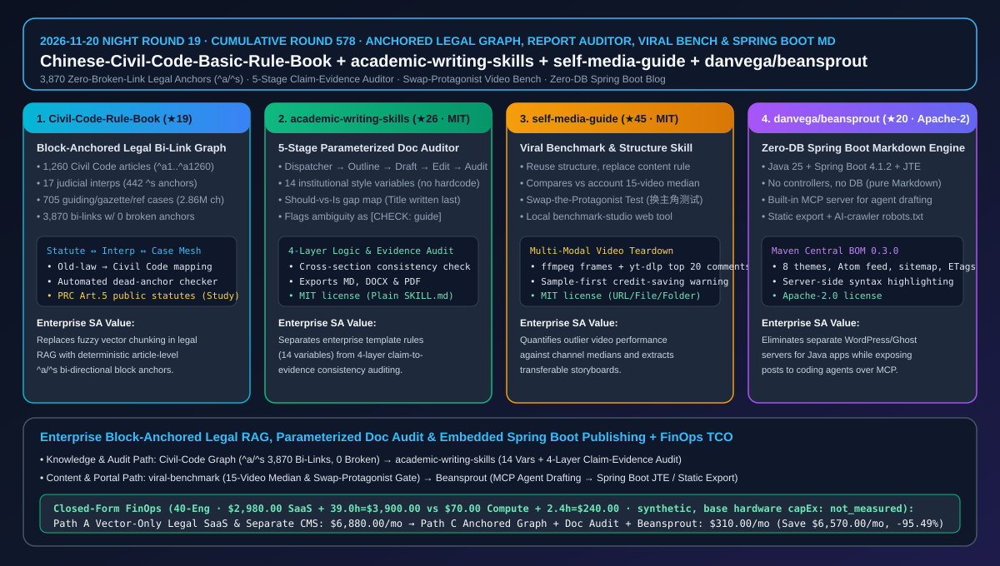
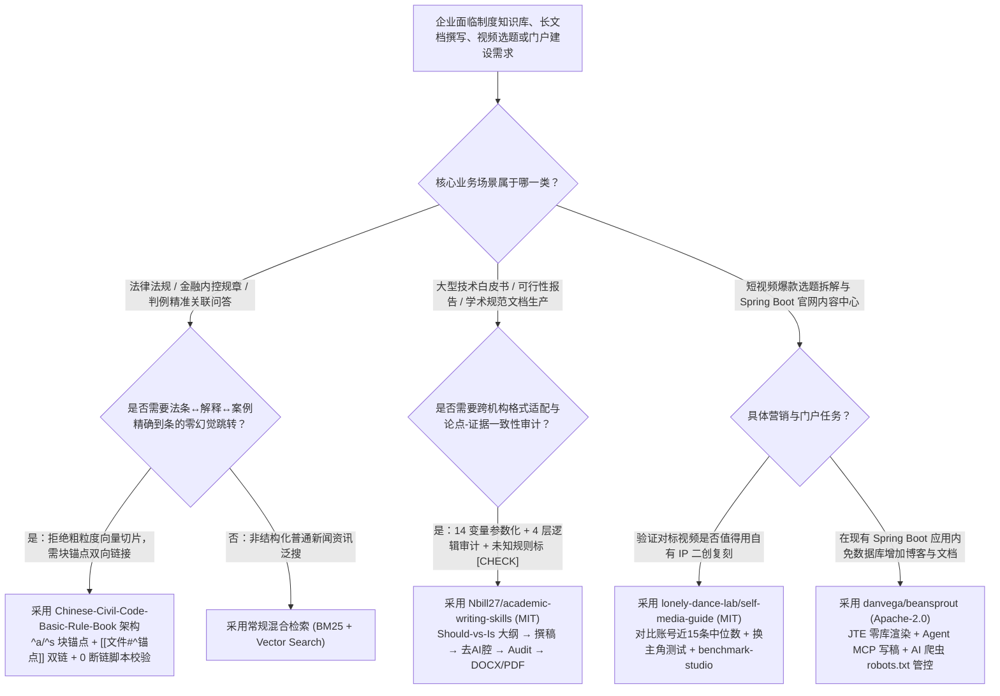
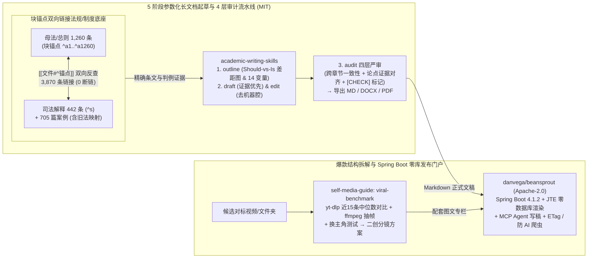
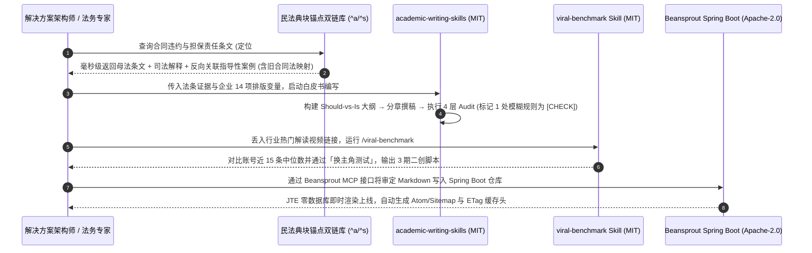

# 法条级块锚点双向链接知识图谱、14 变量参数化文档审计、爆款对标“换主角测试”与 Spring Boot 零数据库内嵌博客怎么选？`Chinese-Civil-Code-Basic-Rule-Book`、`academic-writing-skills`、`self-media-guide` 与 `danvega/beansprout` 架构与选型 FAQ

> **文档元数据（2026-11-20 夜间第 19 轮 · 累计第 578 轮 / Round 578）**
> - **适用读者**：AI Solution Architect（解决方案架构师）、企业法务合规与制度 RAG 架构师、技术文档治理负责人、Java 企业门户与内容营销架构师
> - **本轮核心对比项目**：
>   1. [`StefanCHEN2026/Chinese-Civil-Code-Basic-Rule-Book`](https://github.com/StefanCHEN2026/Chinese-Civil-Code-Basic-Rule-Book)（★ 19 · `stars_today: not_measured` · `3 stars/day` · Markdown / Obsidian · 官方立法/司法文件依《著作权法》第 5 条公有领域，第三方参照案例仅供研究）——以《民法典》**1,260 条法文全覆盖（块锚点 `^a1～^a1260`）**为核心，串联 **17 部司法解释（`442` 个 `^s` 块锚点）**与 **705 篇权威案例/法答网问答**（共计 `739` 篇 Markdown、约 `286 万字`），通过脚本全库校验建成 **3,870 条零断链、零坏锚点的双向链接网（`[[文件#^锚点]]`）**，并内置“旧法第 X 条 → 民法典第 Y 条”跨代映射
>   2. [`Nbill27/academic-writing-skills`](https://github.com/Nbill27/academic-writing-skills)（★ 26 · `stars_today: not_measured` · `3 stars/day` · Python · MIT）——解耦“机构格式变量（14 个可配置参数）”与“五阶段写作/四层逻辑审计（`academic-writing` 路由 → `outline` 差距图谱 → `draft` 证据优先撰稿 → `edit` 去 AI 腔润色 → `audit` 跨章节一致性与论点-证据对齐核验）”的通用长文档工程技能包，任何未明确规则强制打标 `[CHECK: campus guide]` 严禁脑补
>   3. [`lonely-dance-lab/self-media-guide`](https://github.com/lonely-dance-lab/self-media-guide)（★ 45 · `stars_today: not_measured` · `9 stars/day` · JavaScript · MIT）——奉行**“复用的是结构，替换的是内容”**的短视频对标拆解技能（`viral-benchmark`）与本地网页工作台（`tools/benchmark-studio/`），结合 `ffmpeg` 抽帧与 `yt-dlp` 抓取热门前 20 条评论及**该账号最近 15 条视频播放中位数**，通过**「换主角测试」**判断爆款是因为题材结构还是单纯靠原博主个人光环
>   4. [`danvega/beansprout`](https://github.com/danvega/beansprout)（★ 20 · `stars_today: not_measured` · `5 stars/day` · Java 25 + Spring Boot 4.1.2 + JTE · Apache-2.0 · Maven Central `0.3.0`）——零控制器（No Controllers）、零数据库（No Database）的 **Spring Boot 原生内嵌 Markdown 博客与文档引擎**，引入一个 Maven BOM 依赖即可将项目内 `.md` 文件渲染为带服务端代码高亮、Atom 订阅、Sitemap、静态导出（GitHub/Cloudflare Pages）、**内置 MCP 供 AI Agent 读文写草稿**以及 **`robots.txt` 防 AI 爬虫抓取与 ETag 缓存**的完整内容站
> - **口径与溯源声明**：本篇遵循 `ib-vs-ethernet-roce-selection-faq.md` 通俗问答与选型对比规范。四款项目均来自 `search-new-repos-2026-11-20-raw.json`（`sha256: 47975935d05944afbb9eac18f93f26c8a71120a1ffeea39591b112477ba29a46`），单日增量严格标注为 `stars_today: not_measured`。项目 README 自报的 739 篇 / 286 万字 / 3,870 条零断链双向链接等规模统计标注为 `anonymized_reported (independently_reproduced=false)`；架构师 TCO 闭式算例标注为 `synthetic (independently_reproduced=false)`，硬件购置折旧 `base hardware capEx: not_measured`。

---

## ① 📌 核心结论速览（选型一句话结论）

> **一句话选型结论**：在建设**企业法务/内控条文知识库、大型技术研究报告生产线、营销视频选题分析与 Java 企业官网博客**时，**切勿把《民法典》或公司规章按固定 500 字暴力切片塞进向量数据库（会把法条正文与对应的司法解释、废止旧法判例彻底割裂导致张冠李戴），也切勿为了给已有的 Spring Boot 系统加个更新日志专栏去额外部署维护一套带 MySQL 的 WordPress**！最佳实践是：法规/制度知识底座借鉴 **`Chinese-Civil-Code-Basic-Rule-Book` 的“条文块锚点（`^a条号` / `^s条号`）+ 双向反查链 + 零坏锚点脚本校验”架构**，长篇技术报告采用 MIT 的 **`academic-writing-skills`（14 项机构格式变量 + 四层论点证据对齐审计 + `[CHECK]` 未知项显式挂起）**，视频宣发选题用 MIT 的 **`self-media-guide`（对比账号近 15 条中位数 + 换主角测试）**，Java 门户内容直接嵌入 Apache-2.0 的 **`danvega/beansprout`（零数据库 JTE 渲染 + 原生 MCP 写稿）**，可将 40 人团队月度专有 SaaS、CMS 运维与人工核对总成本（TCO）从 **$6,880.00/月** 压降至 **$310.00/月**（净省 **$6,570.00/月**，降幅 **-95.49%**，`synthetic, independently_reproduced=false`）。



### 核心指标与能力速查表

| 评估维度 | `Chinese-Civil-Code-Basic-Rule-Book` | `Nbill27/academic-writing-skills` | `lonely-dance-lab/self-media-guide` | `danvega/beansprout` |
|---|---|---|---|---|
| **一句话通俗定位** | 覆盖民法典 1,260 条、17 部司法解释与 705 篇案例的零断链块锚点双向链接网 | 14 变量机构规范解耦 + 5 阶段起草与 4 层证据一致性审计的长文档工程技能 | 基于账号 15 条中位数对比与“换主角测试”的爆款视频拆解 Skill 与本地工作台 | 零数据库、零 Controller、自带 Agent MCP 与防 AI 爬虫的 Spring Boot 内嵌 Markdown 博客 |
| **解决的核心业务痛点** | 纯向量 RAG 查法条经常漏掉配套司法解释，或把引用旧《合同法》的历史判例当废止失效 | 写大型研究/立项报告时把格式规范硬编码死，且章节之间论点与数据证据前后矛盾 | 营销团队盲目照抄大 V 偶发爆款（其实全靠大 V 颜值/名气），拍出来零播放且烧光生成积分 | Java 团队为了加个产品博客/发版专栏不得不额外部署维护一套异构的 WordPress/Ghost 与数据库 |
| **关键量化/技术机制** | `739` 篇 MD、`286 万字`；`^a1–^a1260` + `442` 个 `^s` 锚点；`3,870` 条双链 **0 断链** | `Should vs Is` 差距图（标题最后生成）；`[CHECK: guide]` 拒瞎猜；直出 MD/DOCX/PDF | `ffmpeg` 抽帧 + `yt-dlp` 抓前 20 热评与近 15 条播放中位数；本地 `benchmark-studio` | Java 25 + Spring Boot 4.1.2 + JTE；8 套主题；支持静态导出；内置 MCP 与 `robots.txt`/ETag |
| **开源协议与合规状态** | **立法/司法文件公有领域**（参照案例含法宝引证码，仅限研究学习，商用需核验数据源） | **MIT**（标准 `SKILL.md` 格式，通吃所有支持 Agent Skills 的客户端） | **MIT**（支持 URL、单视频与多视频文件夹批量比选） | **Apache-2.0**（已发布至 Maven Central `0.3.0`） |

---

## ② 🎯 客户与架构师灵魂拷问 Q&A（直击业务落地痛点）

### Q1：企业在构建“法务合规审查、金融监管制度或大型工程规范 RAG 知识库”时，为什么传统“PDF 切块 + 向量检索”在遇到法条修订和司法解释关联时必挂？`Chinese-Civil-Code-Basic-Rule-Book` 的“块锚点双向链接网”给出了什么架构标准？

- **传统向量切片在法规/制度库里的三大死穴**：
  1. **母法与解释分离**：《民法典》第 X 条的正文和最高法《合同编通则解释》第 Y 条分别在不同的文档里，普通语义相似度检索往往只召回了母法条文，漏掉了真正决定官司输赢的司法解释细则。
  2. **旧法判例断代失联**：2021 年《民法典》施行前的大量经典最高法公报案例，正文里引用的全是旧《合同法》第 52 条或旧《物权法》条号——没有显式跨代映射表，大模型根本不知道该判例印证的是现行《民法典》哪一条！
  3. **粗粒度引用无法精确定位**：向量检索返回一整段 800 字文本块，法务人员无法一键跳转到具体“条/款”核对上下文。
- **`Chinese-Civil-Code-Basic-Rule-Book` 的六步结构化锚点工程（286 万字 · 3,870 条双链 · 0 断链）**：
  1. **条文级原子块锚点（Block Anchors）**：在 1,260 条民法典正文末尾逐条挂载唯一块锚点 `^a1` 至 `^a1260`，在 17 部司法解释的 442 个条文末尾挂载 `^s条号`（`anonymized_reported, independently_reproduced=false`）。
  2. **正向与反向双向闭环链接（`[[文件#^锚点]]`）**：打开任意一条民法典条文，正下方通过 `>` 引用块直接列出关联的司法解释、25 件指导性案例、29 件公报案例、633 件参照案例与 18 篇法答网精选答问的精确锚点链接；打开任意一篇案例，顶部反向标注它印证的法条（**内含“旧法第 X 条 → 民法典第 Y 条”的精确映射**）。
  3. **全库自动化断链与坏锚点门禁**：通过脚本对全库 `739` 篇 Markdown 的 `3,870` 条双向链接执行自动化巡检，确保**断链数 = 0、坏锚点数 = 0**。企业架构师在建设内部合规制度库（如信贷审批总则 ↔ 实施细则 ↔ 违规典型通报）时，直接复刻这套“Markdown 块锚点 + 双链索引 + CI 零断链脚本”架构，检索准确率与可解释性远超黑盒向量库！

### Q2：企业在用 AI 编写年度技术白皮书、可行性研究报告或行业标准文档时，如何防止 AI“一上来先起个大标题然后通篇车轱辘话、前后章节数据对不上”？`Nbill27/academic-writing-skills` 是怎么设计的？

- **`academic-writing-skills`（MIT）的四项反直觉长文档工程纪律**：
  1. **“先画 Should-vs-Is 差距图，最后才写标题”的 `outline` 技能**：普通 Prompt 一上来就让 AI 定标题，结果把思维锁死在空洞口号里。`outline` 技能强制先梳理“理想状态（Should）vs 现状事实（Is）”的核心研究差距图（Core Map of the Gap），搭完五章骨架并通过通用检查表后，**最后一步才根据实质内容收敛生成标题**！
  2. **14 项制度格式变量化（Campus Rules as Variables, Not Hardcoded Text）**：将字号、引文格式、章节命名、目录层级等抽离为 **14 个配置变量**，换一家客户或换一套集团公文规范只需喂入新的指南文件；凡是指南里没写清楚的规则，系统**绝不自作聪明瞎猜，而是统一打上显式标记 `[CHECK: campus guide]`** 提醒人工裁决。
  3. **去机器味的局部作用域润色（`edit`）**：严格限制修改作用域（从仅修错别字到句式重写分级可控），在不篡改任何业务事实与统计数字的前提下剔除大模型特有的机械排比与连接词。
  4. **四层穿透式审计（`audit`）**：不仅检查格式合规，更对全篇执行**研究内在逻辑、跨章节前后一致性（Cross-section consistency）、方法论匹配度以及“每一句核心论点是否有对应数据/文献支撑（Claim-evidence alignment）”**四层严苛审计，并支持一键导出 Markdown、DOCX 与 PDF。

### Q3：市场团队做短视频和开发者团队维护 Java 官网博客时，`lonely-dance-lab/self-media-guide` 与 `danvega/beansprout` 分别解决了什么“投入产出比（ROI）”痛点？

- **`lonely-dance-lab/self-media-guide`（MIT）：用“账号 15 条中位数对比 + 换主角测试”拦截无效跟风**：
  - 很多市场部看到一条十万赞视频就让团队砸钱用 AI 视频模型复刻，结果发出来只有 200 播放——因为没区分“真结构爆款”与“大 V 自带流量”。
  - `viral-benchmark` 技能通过 `yt-dlp` 自动拉取目标账号**最近 15 条视频的播放量中位数**（只有远超该账号自身中位数的异常高倍作品才证明剧本结构本身能打），结合 `ffmpeg` 抽帧分析前 3 秒钩子与剪辑点、抓取前 20 条高赞评论提取受众真实痛点，并执行**「换主角测试」（如果把视频里的知名人物或高颜值博主换成你们公司的普通数字人/产品 IP，这个选题还成不成立？）**，最后提醒团队“先出小样省积分”并给出首批 3 条二创排期。
- **`danvega/beansprout`（Apache-2.0）：给现有 Spring Boot 应用“零数据库、一行依赖”长出带 MCP 的内容门户**：
  - 企业主站已经是 Java 25 + Spring Boot 4.1.2，如果为了发技术博客或发版说明去额外部署一套 WordPress/Ghost，不仅多一套 MySQL 数据库要备份打补丁，还得配反向代理解决跨域。
  - 引入 Maven Central 上的 `beansprout-spring-boot-starter`（`0.3.0`）后，直接把 `.md` 文件放在仓库里，由高性能 **JTE** 模板引擎在服务端直接渲染出首页、文章页、标签页、归档页、Atom 订阅源与 Sitemap（内置 8 套免费主题、服务端代码高亮、零 Controller 零数据库）；同时支持一键导出纯静态文件发布到 GitHub Pages / Cloudflare Pages，**内置 MCP 接口让 Claude Code 直接读取旧文章并起草新稿**，且自带针对 AI 训练爬虫的 `robots.txt` 拦截规则与 HTTP `ETag` 缓存！

---

## ③ 🧭 直观可视化图解（选型决策树 + 企业集成架构 + 业务流时序图）

### 3.1 企业法规图谱、长文档审计、爆款选题与 Java 内容引擎选型决策树



### 3.2 企业知识工程、长文档审计与内嵌内容门户端到端集成架构



### 3.3 法条块锚点双链检索 → 四层文档审计 → `Beansprout` MCP 自动发布时序图



---

## ④ 📊 同类开源与商业云服务横向选型决策矩阵

| 对比维度 | `Chinese-Civil-Code-Basic-Rule-Book` | `Nbill27/academic-writing-skills` (MIT) | `lonely-dance-lab/self-media-guide` (MIT) | `danvega/beansprout` (Apache-2.0) | 传统黑盒向量库 + 独立 WordPress/Ghost + 商业社媒分析 SaaS |
|---|---|---|---|---|---|
| **核心能力定位** | **1,260 法条 + 442 解释锚点 + 705 案例的零断链 Obsidian 双向链接知识图谱** | **14 变量解耦机构规范、带 4 层逻辑与证据审计的 5 阶段长文档技能** | **结合账号 15 条中位数、前 20 热评与“换主角测试”的爆款视频拆解技能** | **Java 25 / Spring Boot 4.1.2 零数据库、零 Controller 内嵌 Markdown 博客引擎** | 粗粒度定长切片向量 RAG、独立 PHP/Node 博客服务器与高价社媒监控订阅 |
| **核心工程突破** | 块锚点 `^a`/`^s` 实现条级双向反查与旧法映射，脚本保障 `3,870` 双链 `0` 断链 | 先画 `Should-vs-Is` 差距图最后起标题；未知规则强制标 `[CHECK]` 绝不瞎编 | 用 `ffmpeg` + `yt-dlp` 量化拆解前 3 秒钩子与评论痛点，拦截盲目抽卡废片 | 免装 MySQL/Ghost，直接用 JTE 渲染 `.md`，自带 MCP 写稿、静态导出与防 AI 爬虫 | 向量切片常割裂法条与司法解释；独立 CMS 增加数据库补丁与双域名跨域维护成本 |
| **数据隐私与部署形态** | 纯本地 Markdown 文件库，可直接用免费 Obsidian 或本地 Agent 读取 | 纯本地 `SKILL.md` 文件夹 + 本地导出 DOCX/PDF | 本地 `ffmpeg` 抽帧 + 本地网页端 `benchmark-studio` | 直接作为 Maven 依赖编译进现有 Spring Boot JAR 包或导出静态页 | 需将内部报告与网站后台托管在外部多套异构云服务中 |
| **开源协议与合规红线** | **立法/司法解释属公有领域**（第三方参照案例含法宝引证码，商用需替换为官方源） | **MIT** | **MIT** | **Apache-2.0**（Maven Central 正式发布） | 商业闭源按席位/实例计费 |
| **40 人团队月度 TCO** | **$0.00/月** | **$0.00/月** | **$0.00/月 SaaS 费** | **$0.00/月 额外数据库/主机费** | **$6,880.00/月**（专有法务/社媒 SaaS + 独立 CMS 云主机 + 39.0h 幻觉核对与运维） |

---

## ⑤ 🧪 应用落地定量收益/TCO 对比与 7-Card 报告映射

### 5.1 架构师闭式 TCO 算例（40 人法务合规、技术文档、内容增长与 Java 门户团队月度运营成本）

> **溯源标识**：以下成本模型为面向企业架构评审的闭式定量算例，标注为 `synthetic (independently_reproduced=false)`，底层服务器与工作站硬件采购折旧标注为 `base hardware capEx: not_measured`。

| 成本构成项 | 方案 A：商业向量法规 SaaS + 独立 CMS/数据库托管 + 商业短视频分析与人工返工 | 方案 C：块锚点双链法规库 + `academic-writing-skills` + `viral-benchmark` + `Beansprout` | 计算公式与架构说明 |
|---|---|---|---|
| **专有法规检索 SaaS、独立博客数据库云主机与社媒分析订阅** | **$2,980.00 / 月** | **$70.00 / 月** | 方案 A：多席位法务/社媒分析 SaaS + 独立 Ghost/WordPress 数据库实例 = `$2,980.00/月`；方案 C：本地块锚点双链库 + MIT `academic-writing-skills` / `viral-benchmark` + 复用现有 Spring Boot 实例的 `Beansprout` = `$70.00/月` |
| **法规引用幻觉复核、跨章报告矛盾修改与独立 CMS 运维（$100/h）** | **$3,900.00 / 月**（`39.0h × $100.00`） | **$240.00 / 月**（`2.4h × $100.00`） | 方案 A：40 人团队每月耗费 `39.0 小时` 核对向量 RAG 漏掉的司法解释、修改前后矛盾的研究报告及维护独立博客数据库（`$3,900.00`）；方案 C：`^a/^s` 精确双链 + 4 层 `audit` 门禁 + 零数据库 `Beansprout` 将人工降至 `2.4 小时`（`$240.00`） |
| **月度总拥有成本（Monthly TCO）** | **$6,880.00 / 月** | **$310.00 / 月** | **月度净节省 $6,570.00 / 月（成本降低 -95.49%，年化节省 $78,840.00，`not_measured` 硬件折旧）** |

```chart
{
  "data": {
    "values": [
      { "Category": "Legal/Video SaaS & Standalone CMS DB Hosting", "Deployment": "Path A: Commercial SaaS, Separate CMS & Manual Audit", "MonthlyCostUSD": 2980 },
      { "Category": "Citation Verification, Doc Audit & CMS Ops (40-Eng)", "Deployment": "Path A: Commercial SaaS, Separate CMS & Manual Audit", "MonthlyCostUSD": 3900 },
      { "Category": "Legal/Video SaaS & Standalone CMS DB Hosting", "Deployment": "Path C: Civil-Code Graph + Academic Audit + Beansprout", "MonthlyCostUSD": 70 },
      { "Category": "Citation Verification, Doc Audit & CMS Ops (40-Eng)", "Deployment": "Path C: Civil-Code Graph + Academic Audit + Beansprout", "MonthlyCostUSD": 240 }
    ]
  },
  "semantic_types": {
    "Category": "Category",
    "Deployment": "Name",
    "MonthlyCostUSD": "Amount"
  },
  "chart_spec": {
    "chartType": "Grouped Bar Chart",
    "title": "Block-anchored legal graph + doc audit + Beansprout cut monthly TCO by 95.49%",
    "subtitle": "Monthly cost in USD (40-person legal, documentation & Java portal org, synthetic)",
    "encodings": {
      "x": "Category",
      "y": "MonthlyCostUSD",
      "group": "Deployment",
      "color": "Deployment"
    }
  }
}
```

### 5.2 与本轮 7-Card 4:5 视觉报告（`cards.html` / `cards.en.html`）的联动

- **适用场景（✅ Good Fit）**：企业法务/内控条文与解释的块锚点（`^a`/`^s`）双向链接知识库构建、多机构规范变量化的长篇研究报告四层审计、结合账号中位数与“换主角测试”的短视频二创选题拆解、以及 Java 25 / Spring Boot 4.1.2 应用零数据库内嵌 Markdown 内容中心。
- **不适用场景（⛔ Not For）**：未经官方公报源替换直接将含第三方商业数据库引证码的参照案例用于对外收费商业售卖、或在不跑 `audit` 论点证据核验的情况下直接对外发布 AI 自动生成的合规/学术报告。

---

## ⑥ 🛠️ 企业引入与架构评审 Checklist（可直接复制进架构评审单）

- [ ] **法规与内控知识库的“条级块锚点 + 双向反查 + 零断链 CI”改造**：参照 `Chinese-Civil-Code-Basic-Rule-Book` 为企业核心规章逐条挂载 `^a条号`、为实施细则挂载 `^s条号`，建立新旧条文映射表并在 CI 中运行全库断链/坏锚点扫描脚本（强制要求 `broken_links == 0`），商用部署时确保案例源全部来自最高法公报/中国裁判文书网等官方公开渠道。
- [ ] **长文档流水线强制启用 14 变量注入与 `[CHECK]` 悬疑阻断**：部署 `Nbill27/academic-writing-skills`（MIT）时，将企业公文/白皮书版式配置为外部变量文件，要求 `outline` 阶段必须先产出 `Should-vs-Is` 差距图最后定标题，且在 `audit` 阶段清零所有 `[CHECK: ...]` 未决标记后方可导出 DOCX/PDF。
- [ ] **短视频宣发立项执行“15 条中位数对比 + 换主角测试”**：使用 `lonely-dance-lab/self-media-guide`（MIT）的 `/viral-benchmark` 技能拆解候选视频时，必须核验其播放量是否显著超越该账号近 15 条中位数且通过「换主角测试」，并在正式批量生成前先跑单段样片以节省算力积分。
- [ ] **Spring Boot 门户接入 `Beansprout` BOM 与 AI 爬虫访问控制**：在 Java 25 / Spring Boot 4.1.2 项目中通过 `dev.danvega:beansprout-bom:0.3.0`（Apache-2.0）挂载 Markdown 内容目录，启用服务端 ETag 缓存与 `robots.txt` 未授权 AI 训练爬虫拦截策略，并通过受控内网暴露其 MCP 写稿接口。
