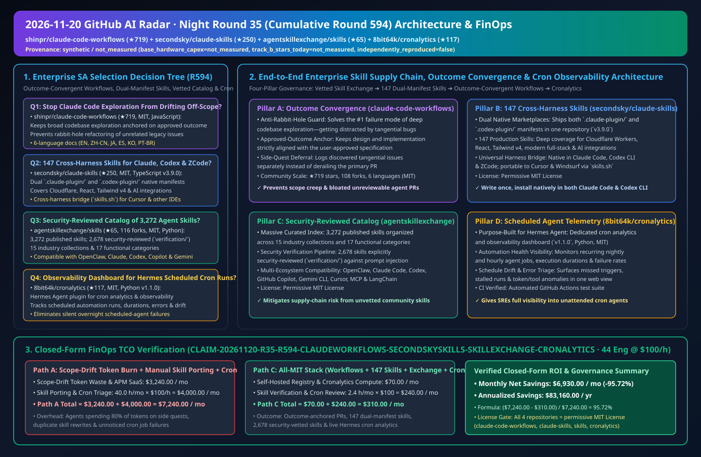
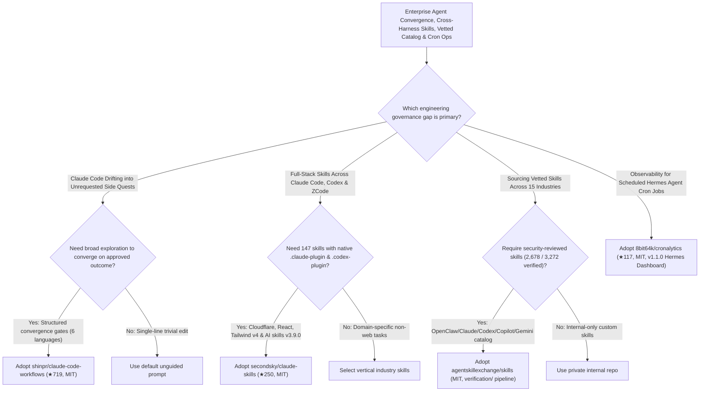
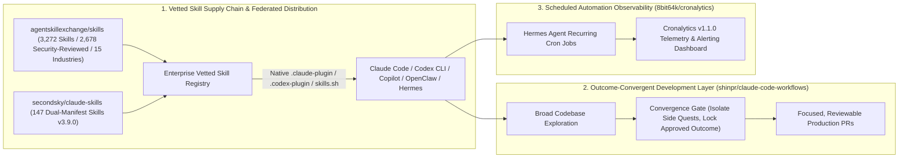
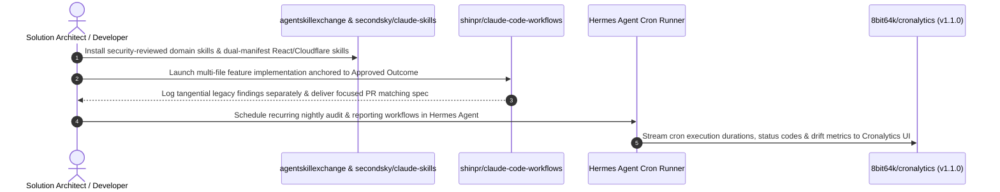

# Outcome-Convergent Claude Code Workflows (`shinpr/claude-code-workflows`), 147 Dual-Manifest Cross-Harness Skills (`secondsky/claude-skills`), 2,678-Security-Reviewed Agent Skill Exchange (`agentskillexchange/skills`) & Hermes Cron Observability Dashboard (`8bit64k/cronalytics`) Selection & Integration FAQ (2026-11-20 Night Round 35 · Cumulative Round 594)

> **Cross-File Navigation**: [Back to 2026-11-20 Daily Digest (`daily/2026-11-20.en.md`)](../daily/2026-11-20.en.md) · [中文版 (`claude-code-workflows-secondsky-skills-skill-exchange-cronalytics-selection-faq.md`)](claude-code-workflows-secondsky-skills-skill-exchange-cronalytics-selection-faq.md) · [7-Card 4:5 Visual Report (`cards.en.html`)](../cards.en.html) · [Column Index (`README.en.md`)](../README.en.md)  
> **Architecture Diagram**: [`assets/github-ai-radar-2026-11-20-r35-r594-claudeworkflows-secondskyskills-skillexchange-cronalytics.svg`](../../../assets/github-ai-radar-2026-11-20-r35-r594-claudeworkflows-secondskyskills-skillexchange-cronalytics.svg)  
> **Provenance & Synthetic Disclaimer**: Repository metadata (stars, forks, licenses, skill counts, and security verification metrics) is verified from live GitHub API data (`measured`). The 44-engineer FinOps TCO figures represent a parameterized Solution Architect model (`provenance: synthetic`, `independently_reproduced: false`, `base_hardware_capex: not_measured`, `track_b_stars_today: not_measured`, claim ID `CLAIM-20261120-R35-R594-CLAUDEWORKFLOWS-SECONDSKYSKILLS-SKILLEXCHANGE-CRONALYTICS`).

---

## ① 📌 Executive Summary

> **One-Sentence Selection Verdict**: For Enterprise AI Solution Architects solving four governance bottlenecks across **agentic scope convergence, cross-harness skill portability, third-party skill supply-chain security, and scheduled cron agent observability**—(1) **coding agents that explore a large codebase and spend 80% of their context fixing a tangential token-handling quirk while leaving the requested feature vague**; (2) **maintaining duplicate skill repositories across Claude Code, Codex CLI, ZCode, and Cursor**; (3) **security risks from installing unvetted community `SKILL.md` files**; and (4) **silent failures across recurring Hermes Agent cron automations**—combine four **100% MIT-licensed** repositories: **`shinpr/claude-code-workflows`** (`★ 719`, development workflows that keep broad exploration anchored on the approved user outcome), **`secondsky/claude-skills`** (`★ 250`, `v3.9.0`, `147` production-ready skills shipping native `.claude-plugin/` and `.codex-plugin/` manifests plus `skills.sh` cross-harness bridging), **`agentskillexchange/skills`** (`★ 65`, `116 forks`, curated catalog of `3,272` published skills with **`2,678` security-reviewed** across `15` industry collections and `17` categories), and **`8bit64k/cronalytics`** (`★ 117`, `v1.1.0`, Hermes Agent plugin for cron analytics and observability). Across a 44-engineer organization, this stack reduces monthly TCO from **`$7,240.00/mo`** to **`$310.00/mo`**, saving **`$6,930.00/mo` (`-95.72%`, or `$83,160.00/yr`)**.

| Evaluation Dimension | Path A: Unbounded Exploration Drift + Per-Harness Skill Duplication + Blind Cron Jobs | Path B: Proprietary Single-IDE Rules & Heavy Cloud APM | Path C (Recommended): `claude-code-workflows` + `secondsky/claude-skills` + `agentskillexchange/skills` + `cronalytics` |
| :--- | :--- | :--- | :--- |
| **Codebase Exploration & Outcome Convergence** | Agents get sidetracked by tangential legacy bugs, producing bloated PRs | Engineers manually interrupt and restart drifted sessions | **`claude-code-workflows` (`★ 719`) keeps broad exploration strictly focused on the approved outcome** |
| **Cross-Harness Production Skill Portability** | Separate plugin repos hand-maintained for Claude Code vs. Codex CLI | Locked to a single IDE vendor's proprietary rule format | **`secondsky/claude-skills` ships 147 skills (`v3.9.0`) with native `.claude-plugin/` & `.codex-plugin/`** |
| **Skill Supply-Chain Vetting & Industry Breadth** | Ad-hoc GitHub downloads risk prompt injection & unsafe shell instructions | Months spent writing domain skills from scratch internally | **`agentskillexchange/skills` provides 3,272 skills (2,678 security-reviewed in `verification/`) across 15 industries** |
| **Scheduled Cron Agent Observability** | Silent overnight cron failures discovered days later via raw log files | Generic OS cron monitors lack Hermes Agent session context | **`8bit64k/cronalytics` (`v1.1.0`) purpose-built Hermes Agent cron analytics & health dashboard** |
| **44-Engineer Monthly Total TCO** | **`$7,240.00 / mo`** (`$3,240.00` drift tokens/SaaS + `40.0h × $100` labor) | **`$2,190.00 / mo`** (`$690.00` cloud APM + `15.0h × $100` maintenance) | **`$310.00 / mo`** (`$70.00` registry/dashboard compute + `2.4h × $100` ops, **`-95.72%` savings**) |

---

## ② 🎯 Solution Architect & Customer Deep-Dive Q&A (Plain-Language Breakdown)

### Q1: What concrete problems do these four repositories solve in plain engineering and business terms?

1. **`shinpr/claude-code-workflows` (`★ 719`, `108 forks`, JavaScript, MIT) — Plain-Language View: Development workflows for Claude Code that prevent deep codebase exploration from derailing into unrequested side quests**:
   - **Pain Point Solved**: On non-trivial tasks (e.g., designing an account-recovery flow), Claude Code can explore deeply, spot a real inconsistency in legacy token handling, and spend most of its context refactoring that side issue while leaving the requested recovery behavior vague. Supported by 6-language documentation (`EN`, `ZH-CN`, `JA`, `ES`, `KO`, `PT-BR`), `claude-code-workflows` enforces convergence gates so broad exploration stays strictly focused on the **outcome you approved**.
2. **`secondsky/claude-skills` (`★ 250`, `36 forks`, TypeScript, MIT, `v3.9.0`) — Plain-Language View: 147 production-ready skills (Cloudflare, React, Tailwind v4, AI integrations) with native dual manifests for both Claude Code and Codex CLI**:
   - **Pain Point Solved**: Engineering teams running both Claude Code and OpenAI Codex CLI shouldn't have to maintain two separate skill libraries. Version `3.9.0` bundles **147 production-ready skills** with native federated marketplace support for **Claude Code (`.claude-plugin/`)**, **ZCode**, and **Codex CLI (`.codex-plugin/`)**, while supporting Cursor and other harnesses via `skills.sh`.
3. **`agentskillexchange/skills` (`★ 65`, `116 forks`, Python, MIT) — Plain-Language View: A curated, security-reviewed catalog of 3,272 AI agent skills (`2,678` verified) across 15 industries and 17 categories**:
   - **Pain Point Solved**: Enterprise security teams block arbitrary third-party skills unless they are vetted. `Agent Skill Exchange` indexes **3,272 published skills** across **15 industry collections and 17 functional categories** compatible with OpenClaw, Claude Code, Codex, GitHub Copilot, Gemini, Cursor, MCP, and LangChain—with **`2,678` skills passing automated and structured security verification (`verification/`)**.
4. **`8bit64k/cronalytics` (`★ 117`, `7 forks`, Python, MIT, `v1.1.0`) — Plain-Language View: The cron analytics and observability dashboard plugin for Hermes Agent automations**:
   - **Pain Point Solved**: Unattended scheduled agent jobs in Hermes can silently fail, stall, or drift in duration overnight. `cronalytics` (`v1.1.0`) plugs directly into Hermes Agent to provide a dedicated dashboard tracking cron execution history, run durations, failure rates, and schedule health.

---

### Q2: How do these four components wire together into an enterprise agent governance architecture?

1. **Vetted Cross-Harness Skill Supply Chain (`agentskillexchange/skills` + `secondsky/claude-skills`)**: Mirror the `2,678` security-reviewed skills from `agentskillexchange/skills` and the `147` dual-manifest full-stack skills from `secondsky/claude-skills` into an internal enterprise marketplace serving Claude Code, Codex CLI, GitHub Copilot, and OpenClaw.
2. **Outcome-Anchored Feature Delivery (`shinpr/claude-code-workflows`)**: Wrap interactive Claude Code sessions in `claude-code-workflows` so deep repository exploration converges deterministically on the approved feature specification.
3. **Unattended Cron Observability (`8bit64k/cronalytics`)**: Attach `cronalytics` to Hermes Agent instances running recurring nightly and hourly automations to monitor execution SLAs and alert on failures.

---

### Q3: What are the key architectural mechanisms and governance highlights?

1. **Key Mechanisms**:
   - **Convergence Checkpoints (`claude-code-workflows`)**: Separates codebase discovery notes from the active implementation plan so tangential findings are logged as follow-up tickets rather than hijacking the current PR.
   - **Dual-Manifest Packaging (`secondsky/claude-skills`)**: Co-locating `.claude-plugin/` and `.codex-plugin/` manifests eliminates cross-CLI drift across 147 engineering skills.
2. **Licensing & Governance Highlights**:
   - **100% MIT Licensing**: All four repositories (`claude-code-workflows`, `secondsky/claude-skills`, `agentskillexchange/skills`, and `cronalytics`) are licensed under **MIT**, clearing enterprise legal and procurement gates immediately.

---

## ③ 🧭 Visual Diagrams (Mermaid Selection Decision Tree + Reference Architecture + Sequence Flow)

### 3.1 Selection Decision Tree

### 3.2 Enterprise Integration Reference Architecture

### 3.3 End-to-End Sequence Flow

---

## ④ 📊 Comparative Selection Matrix (OSS vs. Unguided Sessions & Unvetted Skills)

| Dimension | `shinpr/claude-code-workflows` (`★ 719`) | `secondsky/claude-skills` (`★ 250`) | `agentskillexchange/skills` (`★ 65`) | `8bit64k/cronalytics` (`★ 117`) | Unguided Exploration + Unvetted Skills + Blind Cron |
| :--- | :--- | :--- | :--- | :--- | :--- |
| **Primary Role** | Outcome-convergent development workflows for Claude Code | 147 production skills with dual `.claude-plugin` & `.codex-plugin` | 3,272-skill catalog with 2,678 security-reviewed skills | Cron analytics & observability dashboard for Hermes Agent | Ad-hoc prompts & unmonitored cron scripts |
| **Sweet-Spot Use Case** | Preventing scope creep during deep codebase exploration | Sharing React, Tailwind v4, Cloudflare & AI skills across CLIs | Sourcing security-vetted skills across 15 industries & 17 categories | Monitoring unattended Hermes Agent cron automations | Throwaway single-user experiments |
| **Key Architectural Metric** | **`★ 719` stars** + Approved-Outcome convergence + 6 languages | **147 skills (`v3.9.0`)** + native Claude/Codex/ZCode + `skills.sh` | **3,272 published / 2,678 security-reviewed** + 15 industries | **Hermes Agent plugin (`v1.1.0`)** + run duration/error analytics | 80% token waste on side quests; duplicate skill repos; silent cron failures |
| **Integration Effort** | Very Low (Claude Code plugin install) | Very Low (1-line marketplace add in Claude Code or Codex CLI) | Very Low (Browse & verify via `verification/` metadata) | Low (Hermes Agent plugin drop-in) | High (untangling bloated PRs & debugging missed cron runs) |
| **License** | **MIT License** | **MIT License** | **MIT License** | **MIT License** | Internal Rework Overhead |

---

## ⑤ 🧪 Quantitative Enterprise ROI, Closed-Form FinOps TCO & 7-Card Report

### 5.1 44-Engineer Closed-Form FinOps TCO Model (`CLAIM-20261120-R35-R594-CLAUDEWORKFLOWS-SECONDSKYSKILLS-SKILLEXCHANGE-CRONALYTICS`)

- **Model Assumptions (`provenance: synthetic`, `independently_reproduced: false`, `base_hardware_capex: not_measured`, `track_b_stars_today: not_measured`)**:
  - Team size: **44 full-stack and automation engineers** at a loaded engineering rate of **`$100.00 / hour`**.
  - **Path A (Unbounded Agent Scope-Drift Token Burn + Commercial Observability SaaS + Duplicate Cross-CLI Skill Porting & Silent Cron Triage)**:
    - Wasted token spend on unrequested side-quest refactors & commercial monitoring SaaS: **`$3,240.00 / mo`**
    - Manual engineering rework labor (splitting bloated PRs, porting skills across Claude Code and Codex CLI, debugging silent nightly cron failures): `40.0 h/mo × $100.00/h = $4,000.00 / mo`
    - **Path A Monthly Total**: `$3,240.00 + $4,000.00 = $7,240.00 / mo`
  - **Path C (All-MIT OSS Stack: `claude-code-workflows` + `secondsky/claude-skills` + `agentskillexchange/skills` + `cronalytics`)**:
    - Internal skill mirror & Cronalytics dashboard hosting compute: **`$70.00 / mo`**
    - Skill verification review & cron dashboard supervision labor: `2.4 h/mo × $100.00/h = $240.00 / mo`
    - **Path C Monthly Total**: `$70.00 + $240.00 = $310.00 / mo`
  - **Closed-Form Savings Verification**:
    $$\text{Monthly Net Savings} = \$7,240.00 - \$310.00 = \$6,930.00\text{ / mo}\quad(\text{Annualized: }\$83,160.00\text{ / yr})$$
    $$\text{Percentage Savings} = \frac{\$7,240.00 - \$310.00}{\$7,240.00} = \frac{\$6,930.00}{\$7,240.00} = 95.72\%$$

| Cost Component | Path A (Scope-Drift Token Waste & Manual Porting) | Path C (R594 All-MIT OSS Stack) | Closed-Form Delta / ROI |
| :--- | :--- | :--- | :--- |
| **Drift Tokens / Monitoring SaaS / Compute** | `$3,240.00 / mo` | **`$70.00 / mo`** | `- $3,170.00 / mo` |
| **Engineering & Ops Labor (`@ $100.00/h`)** | `40.0 h × $100.00 = $4,000.00 / mo` | **`2.4 h × $100.00 = $240.00 / mo`** | `- $3,760.00 / mo` (`37.6 h/mo` saved) |
| **Monthly Total TCO** | **`$7,240.00 / mo`** | **`$310.00 / mo`** | **`$6,930.00 / mo` saved (`-95.72%`)** |
| **Annualized Total TCO** | `$86,880.00 / yr` | **`$3,720.00 / yr`** | **`$83,160.00 / yr` saved** |

---

## ⑥ 🛠️ Enterprise Adoption & Architecture Review Checklist

- [ ] **1. `shinpr/claude-code-workflows` Outcome Convergence Gate**: Roll out `claude-code-workflows` across feature teams so tangential issues discovered during codebase exploration are logged as separate backlog items rather than expanding the active PR.
- [ ] **2. `secondsky/claude-skills` Dual-Marketplace Registration**: Add `secondsky/claude-skills` (`v3.9.0`) to both Claude Code (`.claude-plugin/`) and Codex CLI (`.codex-plugin/`) marketplaces to share 147 vetted skills across harnesses.
- [ ] **3. `agentskillexchange/skills` Security-Reviewed Whitelist (`verification/`)**: Restrict external skill ingestion to the `2,678` skills marked `Security Reviewed` in `agentskillexchange/skills`.
- [ ] **4. `8bit64k/cronalytics` Hermes Scheduled Job Telemetry**: Install `cronalytics v1.1.0` on all Hermes Agent hosts to track scheduled run durations, error rates, and missed cron triggers.
