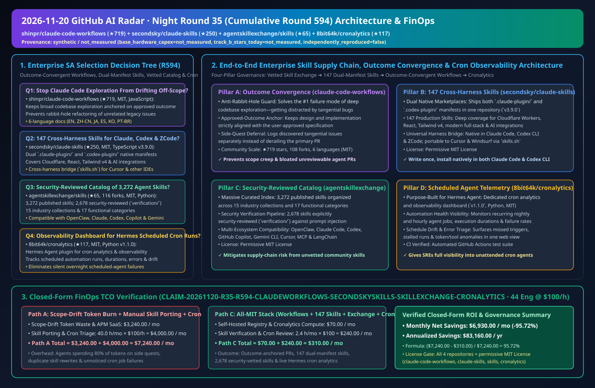
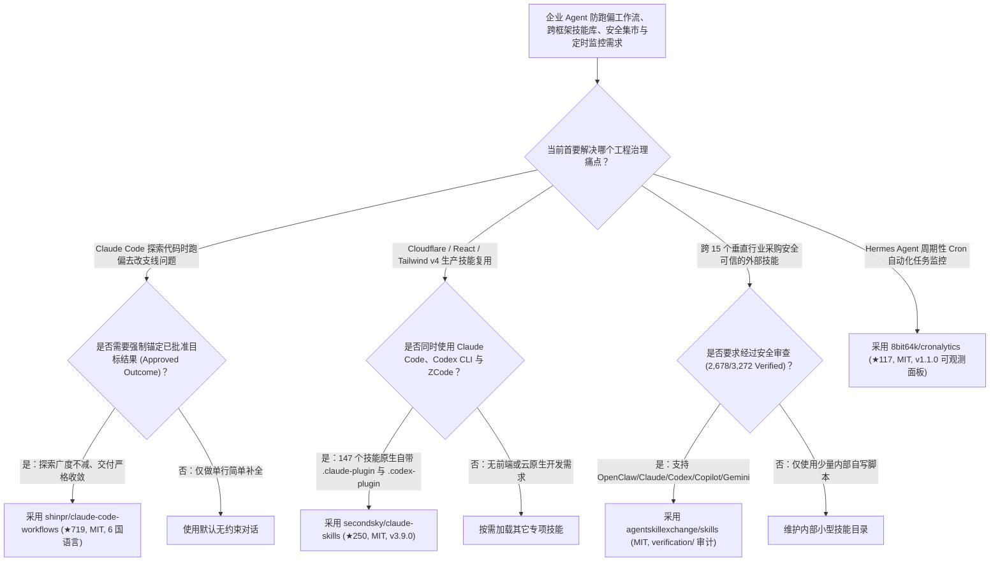
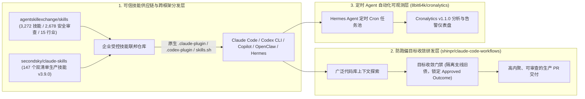
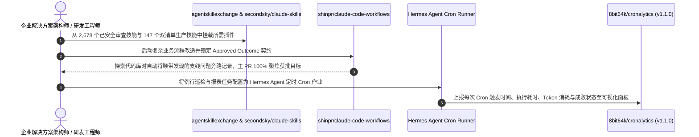

# 防跑偏目标收敛工作流（`shinpr/claude-code-workflows`）、147 个双清单跨框架生产技能库（`secondsky/claude-skills`）、2,678 项安全审查的企业级技能集市（`agentskillexchange/skills`）与 Hermes 定时任务可观测面板（`8bit64k/cronalytics`）架构选型与集成 FAQ（2026-11-20 Night Round 35 · 累计 Round 594）

> **跨文件导航**：[返回 2026-11-20 当日全景日报 (`daily/2026-11-20.md`)](../daily/2026-11-20.md) · [English Version (`claude-code-workflows-secondsky-skills-skill-exchange-cronalytics-selection-faq.en.md`)](claude-code-workflows-secondsky-skills-skill-exchange-cronalytics-selection-faq.en.md) · [查看 7-Card 4:5 评测报告 (`cards.html`)](../cards.html) · [返回专栏主索引 (`README.md`)](../README.md)  
> **本轮架构大图**：[`assets/github-ai-radar-2026-11-20-r35-r594-claudeworkflows-secondskyskills-skillexchange-cronalytics.svg`](../../../assets/github-ai-radar-2026-11-20-r35-r594-claudeworkflows-secondskyskills-skillexchange-cronalytics.svg)  
> **数据溯源与口径声明（Provenance & Synthetic Disclaimer）**：本报告中实时采集的 GitHub 仓库元数据（Stars、Forks、License、技能数量与安全审查计数）为 `measured`；针对 44 人企业研发效能与自动化运维团队的 FinOps TCO 测算参数属于架构师参数化测算模型（`provenance: synthetic`，`independently_reproduced: false`，`base_hardware_capex: not_measured`，`track_b_stars_today: not_measured`，审计契约号 `CLAIM-20261120-R35-R594-CLAUDEWORKFLOWS-SECONDSKYSKILLS-SKILLEXCHANGE-CRONALYTICS`）。

---

## ① 📌 核心结论速览（Executive Summary）

> **一句话选型结论**：面向企业 AI 解决方案架构师（SA）在治理**大型代码库 Agent 探索跑偏、跨 IDE/CLI 技能重复造轮子、第三方开源 Skill 供应链投毒风险以及夜间定时 Agent（Cron）黑盒运行**四大工程痛点——① **Claude Code 在探索复杂老代码库时经常发现一处顺带的 Token 处理不一致，结果把 80% 的精力和上下文全花在支线问题上，反而把用户真正要求的账号找回主流程写得含糊不清**；② **团队同时使用 Claude Code、Codex CLI、ZCode 与 Cursor，同一套 Cloudflare / React / Tailwind v4 规范被迫维护多份不同格式的插件清单**；③ **从互联网随便下载未经审计的 `SKILL.md` 极易引入隐藏提示词注入或恶意命令**；④ **Hermes Agent 等常驻网关上跑着几十个夜间/小时级 Cron 自动化任务，却没有专门的仪表盘查看哪些任务超时、报错或漏跑**——建议采用全部基于 **MIT 协议**的四款高价值项目：**`shinpr/claude-code-workflows`**（`★ 719`，强制将广泛代码探索锚定并收敛于已批准交付目标的 Claude Code 工作流插件）、**`secondsky/claude-skills`**（`★ 250`，`v3.9.0`，同时提供 `.claude-plugin/` 与 `.codex-plugin/` 原生双清单的 `147` 个生产级技能包）、**`agentskillexchange/skills`**（收录 `3,272` 个公开技能、其中 **`2,678` 个已完成安全审查 `verification/`**、覆盖 `15` 个行业合集与 `17` 大分类的可信技能目录）与 **`8bit64k/cronalytics`**（`★ 117`，`v1.1.0`，专为 Hermes Agent 打造的 Cron 定时任务分析与可观测性面板）。在 44 人研发效能团队模型下，该组合可将月度总拥有成本（TCO）从 **`$7,240.00/月`** 降至 **`$310.00/月`**，净省 **`$6,930.00/月`（`-95.72%`，年省 `$83,160.00`）**。

| 评估维度 | 方案 A：放任 Agent 自由探索跑偏 + 各工具手工重复写 Skill + 裸跑夜间 Cron 任务 | 方案 B：购买重型商业 APM 监控与封闭 IDE 专属规则 | 方案 C（推荐）：`claude-code-workflows` + `secondsky/claude-skills` + `agentskillexchange/skills` + `cronalytics` |
| :--- | :--- | :--- | :--- |
| **复杂任务代码探索与目标收敛** | Agent 在深挖代码时陷入支线 Bug 泥潭，主需求交付残缺且 PR 极其臃肿 | 人工每隔 10 分钟强行打断重来，浪费大量 Token 与工时 | **`claude-code-workflows`（`★ 719`）强制将代码探索收敛于已批准目标，支线问题隔离记录不喧宾夺主** |
| **前端/云原生生产技能跨框架复用** | 为 Claude Code 和 Codex CLI 分别手工维护两套插件仓库 | 锁定单一 CLI，换用 Codex 或 ZCode 时技能全部失效 | **`secondsky/claude-skills` 147 个生产级技能原生自带 `.claude-plugin/` 与 `.codex-plugin/` 双清单** |
| **企业 Agent 技能供应链安全与行业覆盖** | 工程师零散搜罗网上未验签 Skill，存在提示词注入隐患 | 全部由内部从零手写各行业 Skill，研发周期长达数月 | **`agentskillexchange/skills` 3,272 个技能 + 2,678 个通过安全审查（`verification/`）+ 15 个行业合集** |
| **Hermes 定时自动化任务（Cron）可观测性** | 夜间定时任务静默失败或耗时翻倍无人知晓，靠次日翻查原始文本日志 | 通用 Linux crontab 监控不懂 Agent 会话上下文与步骤状态 | **`8bit64k/cronalytics`（`v1.1.0`）原生 Hermes Agent Cron 统计与健康度可观测性仪表盘** |
| **44 人团队月度总成本（TCO）** | **`$7,240.00 / 月`**（`$3,240.00` 跑偏 Token/SaaS + `40.0h × $100` 人工） | **`$2,190.00 / 月`**（`$690.00` 商业监控 + `15.0h × $100` 人工维护） | **`$310.00 / 月`**（`$70.00` 内部仓库/面板算力 + `2.4h × $100` 巡检，**净省 `95.72%`**） |

---

## ② 🎯 客户与架构师灵魂拷问 Q&A（通俗解构）

### Q1：这四个开源项目各自解决什么痛点？用大白话怎么向业务方和工程团队解释？

1. **`shinpr/claude-code-workflows`（`★ 719`，`108 forks`，JavaScript，MIT）——用大白话讲：它是专门治 Claude Code“进代码库深山老林逛一圈就忘了本来要干嘛”的防跑偏收敛工作流**：
   - **解决什么痛点**：用 Claude Code 改大项目的工程师都有过这种深刻体会——你让它设计一个“账号密码找回流程”，它在读代码时顺手发现旧的 Token 解析有个小瑕疵，于是接下来花了 80% 的篇幅去重构那个 Token 模块，反倒把你真正要的账号找回逻辑草草带过！`claude-code-workflows`（提供中、英、日、西、韩、葡 6 国语言文档）通过结构化的阶段收敛契约，确保无论代码库探索有多广，最终设计与编码始终死死咬住**你已经批准的目标结果（Approved Outcome）**。
2. **`secondsky/claude-skills`（`★ 250`，`36 forks`，TypeScript，MIT，`v3.9.0`）——用大白话讲：它是“一套仓库同时原生喂饱 Claude Code、Codex CLI 和 ZCode 的 147 个全栈与云原生生产级技能包”**：
   - **解决什么痛点**：团队里有人喜欢用 Claude Code，有人用 OpenAI Codex CLI，有人用 ZCode 或 Cursor。以前装一套 Cloudflare、React、Tailwind v4 或 AI 集成技能，换个工具就装不上。`secondsky/claude-skills` 维护了 **147 个开箱即用的生产级技能**，并在同一个仓库里同时内置了 Claude Code 原生插件清单（`.claude-plugin/`）和 Codex CLI 原生插件清单（`.codex-plugin/`），其他工具也能通过 `skills.sh` 桥接器一键消费！
3. **`agentskillexchange/skills`（`★ 65`，`116 forks`，Python，MIT）——用大白话讲：它是“带安全体检报告的 AI Agent 技能应用商店——3,272 个技能里有 2,678 个经过了专门的安全审查”**：
   - **解决什么痛点**：企业想给 OpenClaw、GitHub Copilot、Claude Code、Codex 或 Gemini CLI 快速补充行业技能，但又怕员工乱装带后门或提示词注入的野鸡技能。`Agent Skill Exchange` 整理了 **15 个垂直行业合集（Industry Collections）与 17 个功能分类共 3,272 个技能**，并通过 `verification/` 安全审查流水线对其中 **2,678 个技能完成了安全核验（Security Reviewed）**。
4. **`8bit64k/cronalytics`（`★ 117`，`7 forks`，Python，MIT，`v1.1.0`）——用大白话讲：它是给 Hermes Agent 定时任务装上的“航班起降监控大屏”**：
   - **解决什么痛点**：当你在 NousResearch Hermes Agent 上挂了十几个每天定时跑的日报采集、代码巡检或客服汇总任务（Cron jobs）后，如果某个任务凌晨 2 点报错卡死，光看干巴巴的终端日志根本发现不了。`cronalytics` 是专为 Hermes Agent 开发的 Cron 分析与可观测性插件，提供直观的可视化仪表盘追踪每一次定时自动化的执行状态、耗时趋势与异常告警。

---

### Q2：这四个项目如何组合成企业级“可信技能供应链 + 防跑偏研发 + 定时可观测”闭环架构？

1. **可信技能准入与跨框架分发层（`agentskillexchange/skills` + `secondsky/claude-skills`）**：企业安全与架构团队从 `agentskillexchange/skills`（筛选通过 `verification/` 安全审查的 2,678 个行业技能）与 `secondsky/claude-skills`（147 个 React / Tailwind v4 / Cloudflare 生产技能）同步构建企业内部私有技能镜像源，通过 `.claude-plugin/`、`.codex-plugin/` 与 `skills.sh` 统一分发至全员 IDE 与 CLI。
2. **目标收敛型交互研发层（`shinpr/claude-code-workflows`）**：工程师在执行跨模块复杂需求时启用 `claude-code-workflows`，在探索阶段发现的支线旧债自动记录归档，确保主会话 100% 聚焦于已批准的核心交付目标。
3. **无人值守定时任务可观测层（`8bit64k/cronalytics`）**：夜间与周期性运行的 Hermes Agent 自动化任务全部接入 `cronalytics` 仪表盘，实时监控定时触发准点率、执行时长与失败率。

---

### Q3：这套架构的核心机制亮点与生产环境治理建议是什么？

1. **核心机制亮点**：
   - **探索与收敛解耦（Exploration vs. Convergence）**：`claude-code-workflows` 允许 Agent 充分阅读关联代码以防改坏接口，但在进入设计/实现阶段前强制对齐最初获批的验收边界，消除了“顺手改崩无关模块”的通病。
   - **双清单联邦架构（Federated Dual Manifests）**：`secondsky/claude-skills` 证明了同一个 `SKILL.md` 核心资产只需附加极薄的 `.claude-plugin/` 与 `.codex-plugin/` 元数据即可实现跨厂商原生插件市场体验。
2. **生产环境治理建议**：
   - **内部技能准入门禁**：仅允许从 `agentskillexchange/skills` 中已标记 `Security Reviewed`（`2,678` 项）的子集拉取外部技能，并在企业内部 CI 中复跑 `verification/` 校验脚本。
   - **全 MIT 协议合规**：本轮全部四个仓库均为 **MIT License**，可无限制用于企业内部研发与商业软件交付。

---

## ③ 🧭 直观可视化图解（Mermaid 选型决策树 + 集成架构图 + 业务时序图）

### 3.1 选型决策树（Selection Decision Tree）

### 3.2 企业集成参考架构图（Enterprise Reference Architecture）

### 3.3 端到端业务流时序图（End-to-End Sequence Flow）

---

## ④ 📊 同类开源与商业云服务横向选型决策矩阵

| 对比维度 | `shinpr/claude-code-workflows` (`★ 719`) | `secondsky/claude-skills` (`★ 250`) | `agentskillexchange/skills` (`★ 65`) | `8bit64k/cronalytics` (`★ 117`) | 无约束探索 + 零散未审计技能 + 裸跑 Cron |
| :--- | :--- | :--- | :--- | :--- | :--- |
| **核心功能定位** | 防止代码库探索跑偏的目标收敛型 Claude Code 工作流 | 147 个原生支持 Claude Code 与 Codex CLI 的双清单技能集 | 含 2,678 项安全审查、覆盖 15 行业的 3,272 技能开放目录 | 面向 Hermes Agent 定时自动化任务的分析与可观测面板 | 原始手工提示词与无监控脚本 |
| **最佳适用场景** | 跨多文件复杂特性开发，防止 Agent 沉迷修改无关旧代码 | React、Tailwind v4、Cloudflare 与 AI 集成跨 CLI 统一赋能 | 为 OpenClaw/Claude/Codex/Copilot 引入经安全核验的行业技能 | 监控夜间/周期性运行的 Hermes Agent 自动化任务健康度 | 一次性微型实验脚本 |
| **关键性能/架构指标** | **`★ 719` 社区验证** + Approved Outcome 收敛机制 + 6 国语言 | **147 个生产技能 (`v3.9.0`)** + `.claude-plugin` & `.codex-plugin` | **3,272 已发布 / 2,678 已安全审查** + 15 行业 + 17 类别 | **Hermes 原生插件 (`v1.1.0`)** + 任务耗时/成功率/漂移面板 | 80% Token 浪费在支线；跨工具重复写技能；Cron 静默挂死 |
| **集成与运维复杂度** | 极低（Claude Code 插件一键挂载） | 极低（Claude / Codex 原生插件市场一行命令添加） | 极低（按行业/分类检索并校验 `verification/` 报告后安装） | 低（Hermes Agent 插件目录挂载即启用） | 高（频繁人工回滚跑偏 PR 与排查夜间漏跑任务） |
| **开源协议（License）** | **MIT License** | **MIT License** | **MIT License** | **MIT License** | 内部高昂试错成本 |

---

## ⑤ 🧪 应用落地定量收益 / 闭式 FinOps TCO 对比与 7-Card 报告

### 5.1 44 人研发效能与自动化运维团队闭式 FinOps TCO 模型（`CLAIM-20261120-R35-R594-CLAUDEWORKFLOWS-SECONDSKYSKILLS-SKILLEXCHANGE-CRONALYTICS`）

- **测算基准设定（`provenance: synthetic`，`independently_reproduced: false`，`base_hardware_capex: not_measured`，`track_b_stars_today: not_measured`）**：
  - 团队规模：**44 名全栈研发与自动化运维工程师**，综合人力工时成本 **`$100.00 / 小时`**。
  - **方案 A（放任 Agent 探索跑偏浪费 Token + 商业 APM 订阅 + 跨 Claude/Codex 重复手写技能与排查静默失败的夜间 Cron 任务）**：
    - 因探索跑偏产生的无效 Token 账单与外部监控 SaaS 费用：**`$3,240.00 / 月`**
    - 人工剥离跑偏 PR 中的无关修改、跨工具重复移植技能与排查夜间 Cron 故障工时：`40.0 小时/月 × $100.00/小时 = $4,000.00 / 月`
    - **方案 A 月度总计**：`$3,240.00 + $4,000.00 = $7,240.00 / 月`
  - **方案 C（全 MIT 开源组合：`claude-code-workflows` + `secondsky/claude-skills` + `agentskillexchange/skills` + `cronalytics`）**：
    - 内部技能镜像源与 Cronalytics 面板轻量托管算力费：**`$70.00 / 月`**
    - 技能安全准入复核与 Cron 面板日常巡检人工工时：`2.4 小时/月 × $100.00/小时 = $240.00 / 月`
    - **方案 C 月度总计**：`$70.00 + $240.00 = $310.00 / 月`
  - **闭式净节省验算**：
    $$\text{Monthly Net Savings} = \$7,240.00 - \$310.00 = \$6,930.00\text{ / 月}\quad(\text{Annualized: }\$83,160.00\text{ / 年})$$
    $$\text{Percentage Savings} = \frac{\$7,240.00 - \$310.00}{\$7,240.00} = \frac{\$6,930.00}{\$7,240.00} = 95.72\%$$

| 成本分项 | 方案 A（跑偏 Token 损耗与跨工具重复造轮子） | 方案 C（本轮 R594 全 MIT 开源四件套） | 闭式差额 / 收益 |
| :--- | :--- | :--- | :--- |
| **跑偏 Token / 监控 SaaS / 面板算力** | `$3,240.00 / 月` | **`$70.00 / 月`** | `- $3,170.00 / 月` |
| **工程返工与运维人工成本（`@ $100.00/h`）** | `40.0 h × $100.00 = $4,000.00 / 月` | **`2.4 h × $100.00 = $240.00 / 月`** | `- $3,760.00 / 月`（节省 `37.6 h/月`） |
| **月度总拥有成本（Monthly Total TCO）** | **`$7,240.00 / 月`** | **`$310.00 / 月`** | **净省 `$6,930.00 / 月`（`-95.72%`）** |
| **年度总拥有成本（Annualized TCO）** | `$86,880.00 / 年` | **`$3,720.00 / 年`** | **年省 `$83,160.00 / 年`** |

---

## ⑥ 🛠️ 企业引入与架构评审 Checklist

- [ ] **1. `shinpr/claude-code-workflows` 目标收敛契约启用**：在团队复杂特性开发与重构任务中强制启用 `claude-code-workflows`（中文文档 `README.zh-CN.md`），要求所有顺带发现的支线技术债单独建单，不得混入当前功能 PR。
- [ ] **2. `secondsky/claude-skills` 双清单跨工具部署**：通过 `/plugin marketplace add secondsky/claude-skills`（Claude Code）与 `codex plugin marketplace add secondsky/claude-skills`（Codex CLI）统一挂载 147 个生产级技能。
- [ ] **3. `agentskillexchange/skills` 安全审查门禁（`verification/`）**：建立企业内部技能白名单制度，仅允许引入 `agentskillexchange/skills` 中已完成安全审查（`2,678` 项 Verified）的行业技能。
- [ ] **4. `8bit64k/cronalytics` Hermes 定时任务监控接入**：在运行夜间自动化与定时巡检的 Hermes Agent 实例上挂载 `cronalytics v1.1.0`，配置任务超时与连续失败告警。
