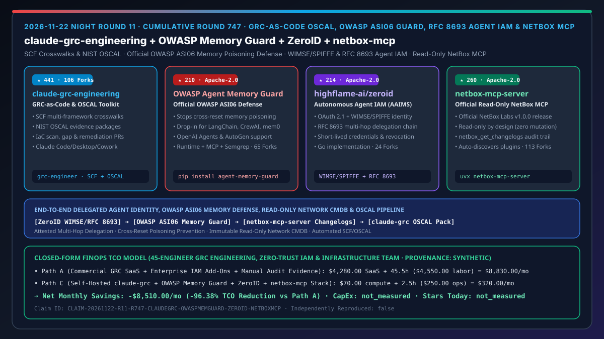
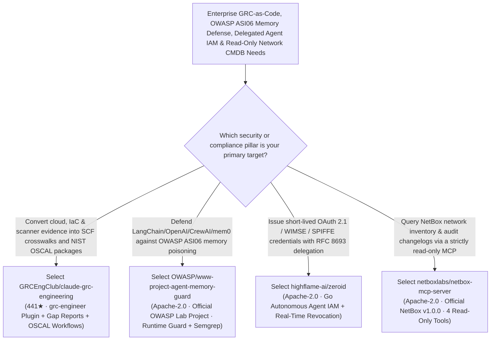
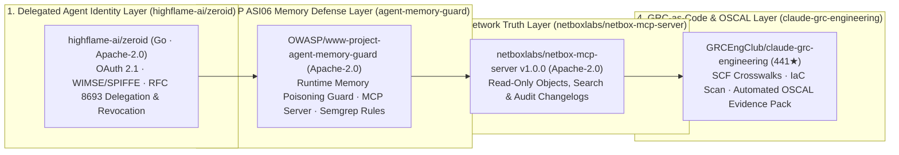

# GRC-as-Code OSCAL/SCF Toolkit (`GRCEngClub/claude-grc-engineering`), Official OWASP ASI06 Memory Poisoning Guard (`OWASP/www-project-agent-memory-guard`), WIMSE/SPIFFE & RFC 8693 Agent Identity (`highflame-ai/zeroid`) & Official Read-Only NetBox MCP (`netboxlabs/netbox-mcp-server`) Selection & Architecture FAQ

> **Document Type**: Enterprise AI Solution Architect Selection & Integration Guide (GitHub Trending AI Radar — 2026-11-22 Night Round 11 / Cumulative Round 747)
> **Covered Repositories**: [`GRCEngClub/claude-grc-engineering`](https://github.com/GRCEngClub/claude-grc-engineering) (`★ 441`, `106 forks`: open-source GRC Engineering plugin marketplace and runbook suite for Claude Code/Desktop/Cowork turning technical cloud/code/scanner evidence into SCF crosswalks, gap reports, and NIST OSCAL workflows) · [`OWASP/www-project-agent-memory-guard`](https://github.com/OWASP/www-project-agent-memory-guard) (`★ 210`, `65 forks`, `Apache-2.0`: official OWASP Lab Project and reference implementation for **ASI06: Memory & Context Poisoning** with drop-in runtime defenses for LangChain, OpenAI Agents, AutoGen, CrewAI, and mem0 plus an MCP server and Semgrep rules) · [`highflame-ai/zeroid`](https://github.com/highflame-ai/zeroid) (`★ 214`, `24 forks`, `Apache-2.0`: Go Autonomous Agent Identity Management System implementing OAuth 2.1, WIMSE/SPIFFE workload attestation, RFC 8693 multi-hop token delegation, and real-time revocation) · [`netboxlabs/netbox-mcp-server`](https://github.com/netboxlabs/netbox-mcp-server) (`★ 260`, `113 forks`, `Apache-2.0`: official NetBox Labs `v1.0.0` read-only MCP server exposing NetBox objects, search, and audit changelogs)
> **Core Scenario**: When enterprise CISO, GRC, and infrastructure engineering teams need to **replace shared service-account impersonation with cryptographically verifiable RFC 8693 agent delegation chains, block cross-session memory poisoning attacks (OWASP ASI06), give operations agents strictly read-only access to NetBox network source-of-truth and audit changelogs, and automate SCF crosswalks and NIST OSCAL compliance evidence packages**, how do you combine **`GRCEngClub/claude-grc-engineering` + `OWASP/www-project-agent-memory-guard` + `highflame-ai/zeroid` + `netboxlabs/netbox-mcp-server`** into a zero-trust compliance architecture?

---

## 1. 📌 Executive Summary (One-Line Selection Verdict)

1. **Need to turn raw technical evidence from cloud configs, IaC, and security scanners into SCF multi-framework crosswalks, gap assessments, remediation PRs, and NIST OSCAL evidence packages inside Claude Code?** ➔ Choose **[`GRCEngClub/claude-grc-engineering`](https://github.com/GRCEngClub/claude-grc-engineering) (`★ 441`, `106 forks`)**.
   - **Plain-English Mechanism**: Maintained by the GRC Engineering Club, its `grc-engineer` plugin and Markdown runbooks treat compliance as repeatable, versioned engineering work across SOC 2, ISO 27001, NIST, PCI-DSS, and SCF.
2. **Need the official OWASP reference defense against `ASI06: Memory & Context Poisoning` so attackers cannot plant persistent backdoors into your agent's long-term memory across context resets?** ➔ Choose **[`OWASP/www-project-agent-memory-guard`](https://github.com/OWASP/www-project-agent-memory-guard) (`★ 210`, `65 forks`, `Apache-2.0`)**.
   - **Plain-English Mechanism**: An official OWASP Lab Project (`agent-memory-guard` and `langchain-agent-memory-guard` on PyPI, 50,400+ combined downloads/clones, `anonymized_reported`) providing drop-in runtime memory guards for LangChain, OpenAI Agents, AutoGen, CrewAI, and mem0, alongside a dedicated `mcp-server/`, `scanner/`, and `semgrep/` ruleset.
3. **Need to answer *"Which agent did this, acting on whose authority, with what permissions?"* using OAuth 2.1, WIMSE/SPIFFE workload attestation, and RFC 8693 multi-hop delegation instead of shared static service accounts?** ➔ Choose **[`highflame-ai/zeroid`](https://github.com/highflame-ai/zeroid) (`★ 214`, `24 forks`, `Apache-2.0`)**.
   - **Plain-English Mechanism**: Implements the OpenID Foundation's Agentic AI Identity recommendations in Go: issues short-lived attested agent credentials, scopes down sub-agent permissions across multi-step workflows via **RFC 8693 token exchange**, logs every principal resolution to an audit feed, and supports real-time credential revocation.
4. **Need a vendor-official, read-only-by-design MCP server (`uvx netbox-mcp-server`) so infrastructure and compliance agents can query NetBox network objects and audit changelogs without any risk of mutating production network state?** ➔ Choose **[`netboxlabs/netbox-mcp-server`](https://github.com/netboxlabs/netbox-mcp-server) (`★ 260`, `113 forks`, `Apache-2.0`)**.
   - **Plain-English Mechanism**: Built by NetBox Labs (`v1.0.0`), it exposes four focused read-only tools—`netbox_get_objects`, `netbox_get_object_by_id`, `netbox_get_changelogs`, and `netbox_search_objects`—with automatic discovery of NetBox plugin object types.

---

## 2. 🎯 Architect & Customer Deep-Dive Q&A

### Q1: How do these four projects resolve the top three CISO blockers for autonomous agents in regulated enterprises?

- **Three CISO Blockers Resolved**:
  1. **Unattributable agent actions & privilege escalation across sub-agents ➔ `highflame-ai/zeroid`**: Replaces user/service-account impersonation with WIMSE/SPIFFE attestation and RFC 8693 delegation chains.
  2. **Cross-session memory poisoning (OWASP ASI06) ➔ `OWASP/www-project-agent-memory-guard`**: Inspects memory writes and recalls at runtime so poisoned external documents cannot hijack future sessions.
  3. **Unsafe infrastructure mutations & manual audit evidence gathering ➔ `netboxlabs/netbox-mcp-server` + `GRCEngClub/claude-grc-engineering`**: Restricts network CMDB queries to read-only MCP tools (`netbox_get_changelogs`) and compiles technical evidence directly into SCF/OSCAL compliance packages.
- **When to Choose Managed Cloud PaaS (Path B)?**
  - For Azure-native environments using **Microsoft Entra Agent ID + Microsoft Purview Compliance Manager + Azure AI Content Safety Prompt Shields**, use native cloud controls; for multi-cloud/on-prem WIMSE/SPIFFE + RFC 8693 delegation, open-source agent memory guarding, and NetBox/OSCAL automation, deploy this open-source stack (Path C).

### Q2: How do we wire `ZeroID`, `OWASP Agent Memory Guard`, `netbox-mcp-server`, and `claude-grc-engineering` into an end-to-end architecture?

1. **Delegated Agent Identity & Attestation Layer (`highflame-ai/zeroid`)**:
   - Issue short-lived WIMSE/SPIFFE + OAuth 2.1 tokens to orchestrator and worker agents with RFC 8693 delegation chains.
2. **Runtime Memory Poisoning Defense Layer (`OWASP/www-project-agent-memory-guard`)**:
   - Wrap LangChain/OpenAI/CrewAI/mem0 memory stores with `agent-memory-guard` and enforce `semgrep/` checks in CI.
3. **Read-Only Infrastructure Source-of-Truth Layer (`netboxlabs/netbox-mcp-server`)**:
   - Run `uvx netbox-mcp-server` with a read-only NetBox API token to query network inventory and `netbox_get_changelogs`.
4. **Automated SCF/OSCAL Compliance Engineering Layer (`GRCEngClub/claude-grc-engineering`)**:
   - Aggregate identity audit feeds, memory scan reports, and NetBox changelogs via `grc-engineer` into SCF crosswalks and NIST OSCAL deliverables.

### Q3: What are the key operational notes for production deployment?

- **NetBox MCP `v1.0.0` Entrypoint**:
  - Use `uvx netbox-mcp-server` or `uv run netbox-mcp-server` (replacing the legacy `v0.1.0` `uv run server.py` entrypoint).

---

## 3. 🧭 Visual Architecture & Workflow Diagrams (Mermaid)



### 3.1 Solution Architect Selection Decision Tree



### 3.2 End-to-End Enterprise Reference Architecture



### 3.3 End-to-End Delegated Attestation, Memory Guarding, Read-Only NetBox Audit & OSCAL Packaging Sequence Diagram

```mermaid
sequenceDiagram
    participant CISO as Security / GRC Architect
    participant Zid as highflame-ai/zeroid (RFC 8693 AAIMS)
    participant Omg as OWASP Agent Memory Guard (ASI06)
    participant Ntb as netboxlabs/netbox-mcp-server
    participant Grc as GRCEngClub/claude-grc-engineering

    CISO->>Zid: 1. Authorize compliance run; ZeroID issues short-lived WIMSE/SPIFFE token with RFC 8693 delegation
    Zid->>Omg: 2. Inspect agent memory reads/writes against OWASP ASI06 poisoning signatures
    Omg->>Ntb: 3. Query netbox_get_objects & netbox_get_changelogs using read-only NetBox token
    Ntb-->>Grc: 4. Feed attested delegation logs, memory scan status & NetBox changelogs into grc-engineer
    Grc-->>CISO: 5. Emit SCF multi-framework crosswalks, gap remediation PRs & NIST OSCAL evidence bundle
```

---

## 4. 📊 Peer Open-Source vs. Commercial Cloud Selection Matrix

| Dimension | `GRCEngClub/claude-grc-engineering` (`★ 441`) | `OWASP/www-project-agent-memory-guard` (`★ 210`) | `highflame-ai/zeroid` (`★ 214`) | `netboxlabs/netbox-mcp-server` (`★ 260`) | Commercial GRC SaaS + Enterprise IAM Add-Ons + Manual Audit Screenshots (Path A) | Manual Spreadsheets + Shared Static Service Keys + Unfiltered Agent Memory (Path B) |
| :--- | :--- | :--- | :--- | :--- | :--- | :--- |
| **Primary Role** | GRC-as-Code SCF/OSCAL automation suite | Official OWASP ASI06 runtime memory poisoning guard | Go OAuth 2.1 / SPIFFE / RFC 8693 agent identity | Official NetBox `v1.0.0` read-only network MCP | High-cost commercial GRC SaaS + manual audit prep | Manual Excel control matrices, shared `.env` keys, unguarded memory stores |
| **Key Differentiator** | **Generates SCF crosswalks, IaC remediations & NIST OSCAL** | **Blocks persistent cross-session ASI06 memory poisoning** | **RFC 8693 sub-agent delegation chains + real-time revocation** | **Read-only by design + audit changelog retrieval** | High annual GRC SaaS contracts; legacy IAM lacks sub-agent delegation chains | Shared keys fail audit attribution; poisoned memories persist across resets |
| **License** | Open-source GRC Club | `Apache-2.0` | `Apache-2.0` | `Apache-2.0` | Proprietary SaaS | High-risk manual workflow |
| **Monthly TCO (45-Eng Team)** | **`$320.00/mo` combined** (`$70.00` ZeroID/MCP containers + `2.5h` ops) | Included (`Apache-2.0` drop-in library) | Included (lightweight Go binary) | Included (`uvx` zero-clone execution) | **`$8,830.00/mo`** (`$4,280.00` commercial GRC/IAM SaaS + `45.5h` manual audit evidence labor) | ~`$3,200.00/mo` (manual screenshot collection & incident forensics labor) |

---

## 5. 🧪 Quantitative Enterprise ROI / FinOps TCO Model & 7-Card Report

> **📊 Provenance & Closed-Form Declaration**:
> - **provenance**: `synthetic` (45-engineer enterprise GRC engineering, zero-trust IAM, and network infrastructure operations team workload model: `independently_reproduced = false`; `base_hardware_capex = not_measured`; `track_b_stars_today = not_measured`).
> - **Closed-Form Equations**:
>   - **Path A (Commercial GRC Compliance SaaS + Commercial Workload Identity Add-Ons + Manual Cloud/Network Screenshot Collection & Manual Multi-Framework SCF/OSCAL Mapping)**: Monthly commercial GRC and security subscriptions **`$4,280.00`** + manual audit evidence collection, crosswalk mapping, and shared-key forensic labor **`45.5h × $100.00/h = $4,550.00`** = **`$8,830.00/mo`**.
>   - **Path C (Self-Hosted `GRCEngClub/claude-grc-engineering` + `OWASP/www-project-agent-memory-guard` + `highflame-ai/zeroid` + `netboxlabs/netbox-mcp-server` Stack)**: Shared container compute **`$70.00`** + delegation policy & SCF/OSCAL rule maintenance labor **`2.5h × $100.00/h = $250.00`** = **`$320.00/mo`**.
>   - **Net Monthly Savings vs. Path A**: **`-$8,510.00/mo`** (**`96.38%`** TCO reduction).

| Evaluation Path | GRC/IAM SaaS & Compute Cost | Audit Evidence & Forensics Labor (`$100/h`) | Total Monthly TCO | Net Savings vs. Path A | Architectural Delivery Impact |
| :--- | :---: | :---: | :---: | :---: | :--- |
| **Path A: Commercial GRC SaaS + Enterprise IAM + Manual Evidence** | `$4,280.00` | `45.5h` (`$4,550.00`) | **`$8,830.00`** | Baseline | Expensive annual GRC contracts; legacy IAM lacks RFC 8693 agent delegation |
| **Path B: Manual Spreadsheets + Shared Static Keys + Raw Memory** | `$1,550.00` | `16.5h` (`$1,650.00`) | **`$3,200.00`** | `-$5,630.00` (`-63.76%`) | Vulnerable to OWASP ASI06 memory poisoning; fails audit attribution |
| **Path C: `claude-grc` + `OWASP Guard` + `ZeroID` + `netbox`** | **`$70.00`** | **`2.5h` (`$250.00`)** | **`$320.00`** | **`-$8,510.00` (`-96.38%`)** | **OSCAL/SCF automation + ASI06 defense + RFC 8693 IAM + read-only CMDB** |

- 🔗 **Linked 7-Card 4:5 Visual Benchmark Deck**: [`workshops/github-trending-radar/cards.en.html`](../cards.en.html) · [`cards.html`](../cards.html)

---

## 6. 🛠️ Enterprise Adoption & Architecture Review Checklist

- [ ] **1. Deploy `highflame-ai/zeroid` for Delegated Agent Identity**: Replace shared static service accounts with short-lived WIMSE/SPIFFE + OAuth 2.1 credentials and RFC 8693 multi-hop delegation chains.
- [ ] **2. Protect Agent Memory Stores with `OWASP/www-project-agent-memory-guard`**: Enable runtime ASI06 poisoning checks across LangChain, OpenAI Agents, AutoGen, CrewAI, and mem0 plus CI Semgrep rules.
- [ ] **3. Mount Read-Only Network Truth via `netboxlabs/netbox-mcp-server`**: Run `uvx netbox-mcp-server` with a read-only token so agents inspect inventory and `netbox_get_changelogs` safely.
- [ ] **4. Automate SCF & OSCAL Evidence with `GRCEngClub/claude-grc-engineering`**: Use `grc-engineer` runbooks to compile technical evidence into multi-framework gap reports and NIST OSCAL packages.
