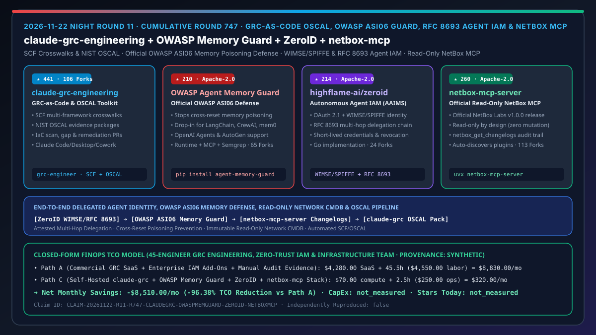
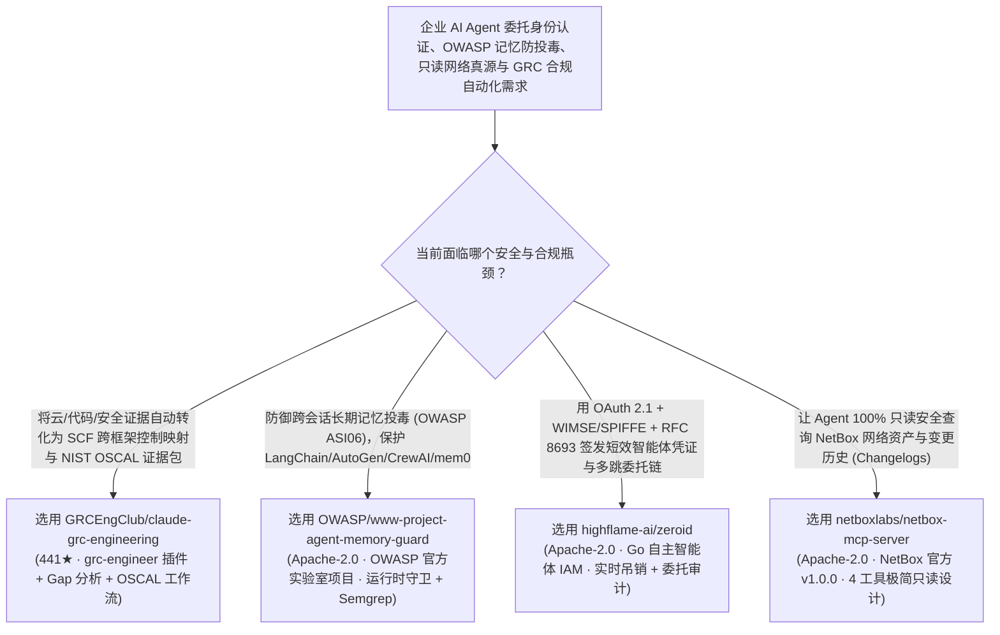
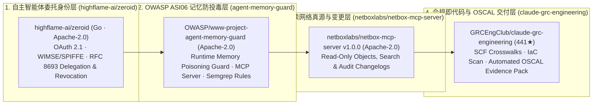
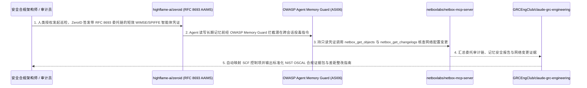

# 合规即代码 OSCAL/SCF 工程套件（`GRCEngClub/claude-grc-engineering`）、OWASP 官方 ASI06 记忆投毒运行时防御（`OWASP/www-project-agent-memory-guard`）、WIMSE/SPIFFE 与 RFC 8693 智能体委托身份底座（`highflame-ai/zeroid`）及 NetBox 官方只读网络真源 MCP（`netboxlabs/netbox-mcp-server`）选型与集成架构 FAQ

> **文档类型**：企业 AI 解决方案架构师（AI Solution Architect）选型决策指南（GitHub Trending AI 雷达 2026-11-22 Night Round 11 / 累计第 747 轮）
> **覆盖项目**：[`GRCEngClub/claude-grc-engineering`](https://github.com/GRCEngClub/claude-grc-engineering)（`★ 441`、`106 forks`，GRC Engineering Club 开源的合规即代码插件与技能库，支持跨框架 SCF 控制映射、OSCAL 证据包生成、IaC 扫描与差距评估）· [`OWASP/www-project-agent-memory-guard`](https://github.com/OWASP/www-project-agent-memory-guard)（`★ 210`、`65 forks`、`Apache-2.0`，**OWASP 官方实验室项目**，针对 **ASI06: Memory & Context Poisoning** 的运行时防御、MCP 服务与 Semgrep 规则，无缝嵌入 LangChain、OpenAI Agents、AutoGen、CrewAI 与 mem0）· [`highflame-ai/zeroid`](https://github.com/highflame-ai/zeroid)（`★ 214`、`24 forks`、`Apache-2.0`，基于 Go 实现的自主智能体身份管理系统 AAIMS，支持 OAuth 2.1、WIMSE/SPIFFE 工作负载身份、RFC 8693 多跳委托链与实时吊销）· [`netboxlabs/netbox-mcp-server`](https://github.com/netboxlabs/netbox-mcp-server)（`★ 260`、`113 forks`、`Apache-2.0`，NetBox Labs 官方 `v1.0.0` 只读网络架构真源与变更审计 MCP）
> **核心场景**：当金融机构、政企与大型云原生团队在推进 AI Agent 进入生产运维与合规审计时，面临**“子 Agent 借用人类高权限静态 Token 导致审计时分不清究竟是人还是哪个子 Agent 改了配置、黑客通过恶意网页或工单向 Agent 长期记忆注入跨会话投毒指令（OWASP ASI06）、AI 排障乱改网络设备缺乏只读 CMDB 真源约束、以及每年迎审 SOC 2 / ISO 27001 / NIST 时耗费数周手工整理证据截图”**四大痛点时，如何组合**`highflame-ai/zeroid` + `OWASP/www-project-agent-memory-guard` + `netboxlabs/netbox-mcp-server` + `GRCEngClub/claude-grc-engineering`** 构建零信任、抗投毒、合规自动化的企业 Agent 底座？

---

## 一、📌 核心结论速览（选型一句话结论）

1. **想把枯燥的手工合规迎审（SOC 2、ISO 27001、NIST、PCI-DSS）变成可版本化、可自动运行的“合规工程（GRC Engineering）”，让 Claude Code 直接把云配置、代码与扫描器结果转化为 SCF 跨框架映射表与 NIST OSCAL 标准证据包** ➔ 选 **[`GRCEngClub/claude-grc-engineering`](https://github.com/GRCEngClub/claude-grc-engineering)（`★ 441`，`106 forks`）**。
   - **通俗原理**：由 GRC Engineering Club 维护，核心插件 `grc-engineer` 将差距分析（Gap Assessment）、IaC 合规扫描、证据自动采集、整改代码生成、安全策略编写与多框架控制项对齐（SCF Crosswalks + OSCAL）封装为 Claude Code 插件与 Markdown Runbook。
2. **想防范攻击者通过间接提示词注入“污染 Agent 的长期记忆库（哪怕重置当前对话窗口，下次唤醒时恶意指令依然生效）”——即 OWASP Agentic Security Top 10 中的 `ASI06: Memory & Context Poisoning`** ➔ 选 **[`OWASP/www-project-agent-memory-guard`](https://github.com/OWASP/www-project-agent-memory-guard)（`★ 210`，`65 forks`，`Apache-2.0`）**。
   - **通俗原理**：这是 **OWASP 官方实验室参考实现（Official OWASP Lab Project）**，在 PyPI 上提供 `agent-memory-guard` 与 `langchain-agent-memory-guard`（累计下载与克隆超 5 万次，`anonymized_reported`）。它作为运行时拦截层挂载在 LangChain、OpenAI Agents、AutoGen、CrewAI 或 mem0 的记忆读写通道上，配合内置 `mcp-server/`、`scanner/` 与 `semgrep/` 规则，在恶意载荷写入或读出长期记忆前实时阻断。
3. **想彻底终结“Agent 冒用人类账号或共用长效 Service Account Key”的审计噩梦，用符合国际标准的 OAuth 2.1 + WIMSE/SPIFFE + RFC 8693 令牌交换协议清晰回答“究竟是哪个子 Agent、受哪位人类委托、在什么权限范围内执行了操作”** ➔ 选 **[`highflame-ai/zeroid`](https://github.com/highflame-ai/zeroid)（`★ 214`，`24 forks`，`Apache-2.0`）**。
   - **通俗原理**：直接落地 OpenID Foundation 智能体身份管理白皮书建议，用 Go 实现了专属于自主智能体的 IAM 底座（AAIMS）：签发短生命周期、带密码学证明（Attestation）的智能体凭证，当主 Agent 派生子 Agent 时通过 **RFC 8693 Delegation** 逐跳缩权并保留完整委托链，且支持毫秒级实时吊销（Real-Time Revocation）。
4. **想让运维与网络排障 Agent 安全查询企业数据中心 IPAM、机柜、VLAN 与变更历史（Changelog），且从架构上保证 Agent 100% 只读、绝不可能误删一条生产路由** ➔ 选 **[`netboxlabs/netbox-mcp-server`](https://github.com/netboxlabs/netbox-mcp-server)（`★ 260`，`113 forks`，`Apache-2.0`）**。
   - **通俗原理**：由 NetBox Labs 官方出品（`uvx netbox-mcp-server` 一行启动），刻意遵循“极简、默认只读、很难被误用”的安全哲学，暴露 `netbox_get_objects`、`netbox_get_object_by_id`、`netbox_get_changelogs`（审计追踪变更历史）与 `netbox_search_objects` 四个核心工具，并支持自动发现 NetBox 插件对象类型。

---

## 二、🎯 客户与架构师灵魂拷问 Q&A（深度架构拆解）

### Q1：在金融与大型企业安全架构评审（Security & GRC Review）中，CISO 最常否决 AI Agent 上线的三个理由是什么？这套组合如何逐一通关？

- **三大 CISO 否决项与满分答卷**：
  1. **“分不清是人干的还是 AI 干的，子 Agent 权限失控” ➔ `highflame-ai/zeroid`**：用 WIMSE/SPIFFE 标识 Agent 工作负载身份，用 RFC 8693 记录 `Human ➔ Orchestrator Agent ➔ Sub-Agent` 每一跳委托凭证。
  2. **“外部非受信数据会毒化长期记忆，形成跨会话持久化后门” ➔ `OWASP/www-project-agent-memory-guard`**：直接搬出 OWASP 官方 ASI06 参考实现，在记忆持久化与召回双侧做运行时过滤与 Semgrep 静态扫描。
  3. **“不敢让 AI 碰生产网络配置，且每年合规取证太累” ➔ `netboxlabs/netbox-mcp-server` + `GRCEngClub/claude-grc-engineering`**：用官方只读 NetBox MCP 查网络真源与 `changelogs`，用 `claude-grc-engineering` 自动汇聚证据生成 OSCAL 与 SCF 合规报告。
- **何时直接用云厂商托管方案（Path B）？**
  - 若企业 100% 运行在 Microsoft Entra Agent ID + Microsoft Purview Compliance Manager + Azure Prompt Shields 上，可优先使用微软云原生安全合规栈；若需跨云/本地混合部署 RFC 8693 委托链、防护开源 mem0/LangChain 记忆投毒或对接本地 NetBox 与 OSCAL 流水线，则采用本轮开源栈（Path C）。

### Q2：典型企业级“RFC 8693 委托身份 (`ZeroID`) + OWASP 记忆防投毒 (`Memory Guard`) + NetBox 只读真源 (`netbox-mcp`) + OSCAL 合规自动化 (`claude-grc`)”架构怎么搭？

1. **智能体身份签发与多跳委托层（`highflame-ai/zeroid`）**：
   - 所有 Agent 启动时通过 WIMSE/SPIFFE 获取短效身份，调用下游工具或派生子 Agent 时强制执行 RFC 8693 Token Exchange 并写入 `audit_feed.go`。
2. **长期记忆读写防投毒层（`OWASP/www-project-agent-memory-guard`）**：
   - 在 Agent 读写记忆库前接入 `agent-memory-guard` 运行时钩子，并在 CI 中运行内置 `semgrep/` 规则扫描记忆处理代码。
3. **只读基础设施真源与变更核验层（`netboxlabs/netbox-mcp-server`）**：
   - 使用只读 NetBox Token 启动 `uvx netbox-mcp-server`，供运维与合规 Agent 查询资产拓扑与 `netbox_get_changelogs` 变更记录。
4. **多框架 GRC 映射与 OSCAL 证据生成层（`GRCEngClub/claude-grc-engineering`）**：
   - 通过 `grc-engineer` 采集 ZeroID 委托审计流、OWASP 扫描结果与 NetBox 变更记录，自动生成 SCF 跨框架控制表与 OSCAL 迎审证据包。

### Q3：落地这套零信任与合规架构有哪些关键配置要点？

- **NetBox `v1.0.0` 升级注意**：
  - `netboxlabs/netbox-mcp-server` 在 `v1.0.0` 调整了入口命令，配置 Claude Code / Desktop 时请使用 `uv run netbox-mcp-server` 或 `uvx netbox-mcp-server`（不再是旧版的 `uv run server.py`）。

---

## 三、🧭 直观可视化图解（Mermaid 决策树 + 集成架构 + 时序图）

### 3.1 架构师选型决策树

### 3.2 企业端到端生产集成参考架构图

### 3.3 RFC 8693 委托凭证签发、OWASP ASI06 记忆校验、NetBox 只读变更核查与 OSCAL 证据生成时序图

---

## 四、📊 同类开源与商业云服务横向选型决策矩阵

| 对比维度 | `GRCEngClub/claude-grc-engineering` (`★ 441`) | `OWASP/www-project-agent-memory-guard` (`★ 210`) | `highflame-ai/zeroid` (`★ 214`) | `netboxlabs/netbox-mcp-server` (`★ 260`) | 商业 GRC 合规 SaaS + 商业 IAM 企业版 + 人工截图迎审 (Path A) | 手工填 Excel 控制表 + 共用静态 API Key + 裸读写记忆库 (Path B) |
| :--- | :--- | :--- | :--- | :--- | :--- | :--- |
| **核心能力定位** | 合规即代码 SCF/OSCAL 自动化套件 | OWASP 官方 ASI06 记忆防投毒守卫 | Go OAuth 2.1 / SPIFFE / RFC 8693 智能体 IAM | NetBox 官方只读网络真源与变更 MCP | 按年高价收费的商业合规平台（Vanta/Drata 等）与人工迎审咨询 | 手工维护合规表格、所有 Agent 共用静态密钥、无记忆过滤 |
| **核心技术突破** | **直接输出 NIST OSCAL 与 SCF 跨框架映射及整改代码** | **跨上下文重置持续拦截 ASI06 记忆投毒载荷** | **RFC 8693 多跳子智能体委托链与实时吊销** | **官方默认只读 + 自动发现插件对象 + 审计 Changelog** | 商业 GRC 平台年费数万美元起；传统 IAM 不支持子 Agent 多跳缩权委托 | 共用密钥无法审计追责；记忆库一旦被投毒将在后续所有会话长期潜伏 |
| **开源协议** | 开源社区套件 | `Apache-2.0` | `Apache-2.0` | `Apache-2.0` | 闭源商业 SaaS | 内部高风险操作 |
| **月度 TCO（45 人团队）** | **组合仅 `$320.00/月`**（`$70.00` ZeroID/MCP 容器 + `2.5h` 规则维护） | 同左（Apache-2.0 嵌入式守卫） | 同左（Go 单服务轻量部署） | 同左（`uvx` 零克隆直接运行） | **`$8,830.00/月`**（`$4,280.00` 商业 GRC/IAM 订阅 + `45.5h` 手工迎审取证与权限排查） | 约 `$3,200.00/月`（大量人工截图填 OSCAL 表格与排查越权事故工时） |

---

## 五、🧪 应用落地定量收益/TCO 对比与 7-Card 报告

> **📊 数据来源与闭式核算声明（Provenance & Closed-Form Schema）**：
> - **provenance**: `synthetic`（基于 45 人企业安全合规工程 GRC、零信任 IAM 与网络基础设施运维团队月度工作负载模型：`independently_reproduced = false`；硬件采购基线 `base_hardware_capex = not_measured`；Track B 单日增量 `track_b_stars_today = not_measured`）。
> - **核算公式**：
>   - **Path A（采购商业 GRC 合规自动化平台 + 商业工作负载身份附加包 + 安全与运维工程师手工收集云/网络变更截图、手工编写跨框架 SCF/OSCAL 映射及排查共享密钥调用归属）**：月度商业 GRC 与安全订阅 **`$4,280.00`** + 手工合规取证、跨框架映射与审计追责人工 **`45.5h × $100.00/h = $4,550.00`** = **`$8,830.00/月`**。
>   - **Path C（自建 `GRCEngClub/claude-grc-engineering` + `OWASP/www-project-agent-memory-guard` + `highflame-ai/zeroid` + `netboxlabs/netbox-mcp-server` 开源零信任合规栈）**：自托管 `ZeroID` 与 MCP 容器开销 **`$70.00`** + 委托策略与合规控制映射维护人工 **`2.5h × $100.00/h = $250.00`** = **`$320.00/月`**。
>   - **净节省（Net Savings vs Path A）**：**`-$8,510.00/月`**（成本降低 **`96.38%`**）。

| 评估方案 | GRC/IAM 订阅与算力成本 | 合规取证与审计排查人工（`$100/h`） | 月度总 TCO | 相对 Path A 净节省 | 关键架构交付指标 |
| :--- | :---: | :---: | :---: | :---: | :--- |
| **Path A：商业 GRC 平台 + 商业 IAM + 人工迎审截图** | `$4,280.00` | `45.5h` (`$4,550.00`) | **`$8,830.00`** | Baseline | 商业 GRC 订阅昂贵；传统 IAM 缺乏 RFC 8693 子 Agent 委托链 |
| **Path B：手工填 Excel 控制表 + 共用静态 Key + 裸记忆库** | `$1,550.00` | `16.5h` (`$1,650.00`) | **`$3,200.00`** | `-$5,630.00` (`-63.76%`) | 暴露于 OWASP ASI06 记忆投毒；共享 Key 无法通过合规审计 |
| **Path C：`claude-grc` + `OWASP Guard` + `ZeroID` + `netbox`** | **`$70.00`** | **`2.5h` (`$250.00`)** | **`$320.00`** | **`-$8,510.00` (`-96.38%`)** | **OSCAL/SCF 自动化 + ASI06 防投毒 + RFC 8693 委托 + 只读真源** |

- 🔗 **关联 7-Card 4:5 视觉评测报告**：[`workshops/github-trending-radar/cards.html`](../cards.html) · [`cards.en.html`](../cards.en.html)

---

## 六、🛠️ 企业引入与架构评审 Checklist

- [ ] **1. 部署 `highflame-ai/zeroid` 建立智能体专属委托身份底座**：用 OAuth 2.1 + WIMSE/SPIFFE + RFC 8693 替代共享静态密钥，实现子 Agent 逐跳缩权与实时吊销。
- [ ] **2. 在所有持久记忆通道接入 `OWASP/www-project-agent-memory-guard`**：对 LangChain、OpenAI Agents、AutoGen、CrewAI 与 mem0 启用 ASI06 运行时拦截与 Semgrep 静态扫描。
- [ ] **3. 使用 `uvx netbox-mcp-server` 挂载只读网络真源**：配置只读 NetBox API Token，通过 `netbox_get_changelogs` 等 4 工具安全赋能运维与审计 Agent。
- [ ] **4. 引入 `GRCEngClub/claude-grc-engineering` 实现合规即代码**：自动化执行多框架 SCF 映射、IaC 差距扫描与 NIST OSCAL 迎审证据包生成。
