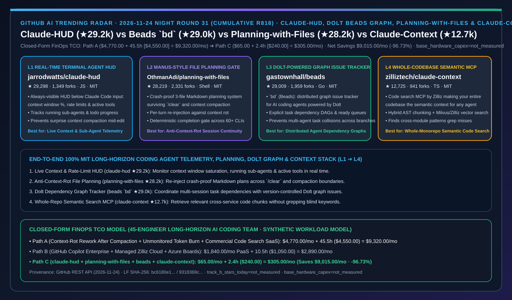
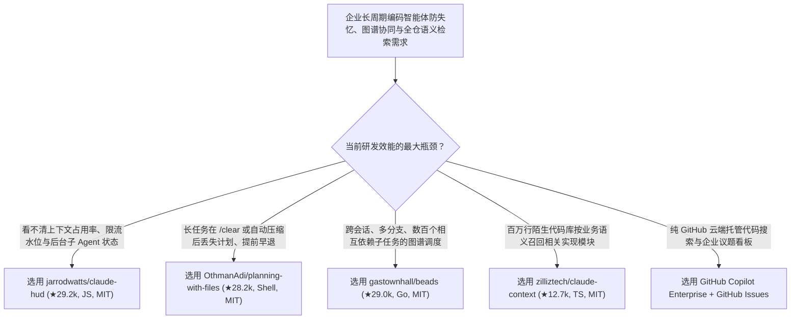
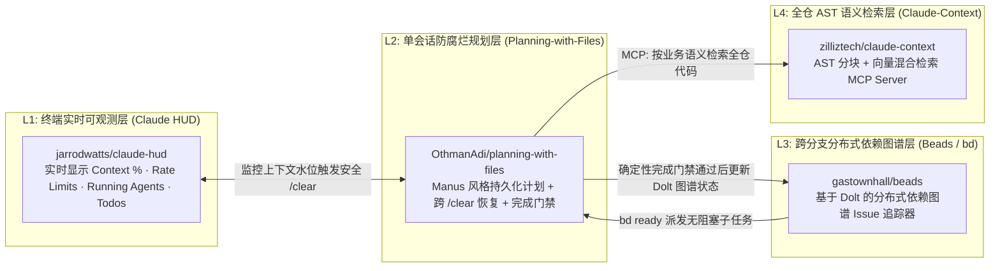
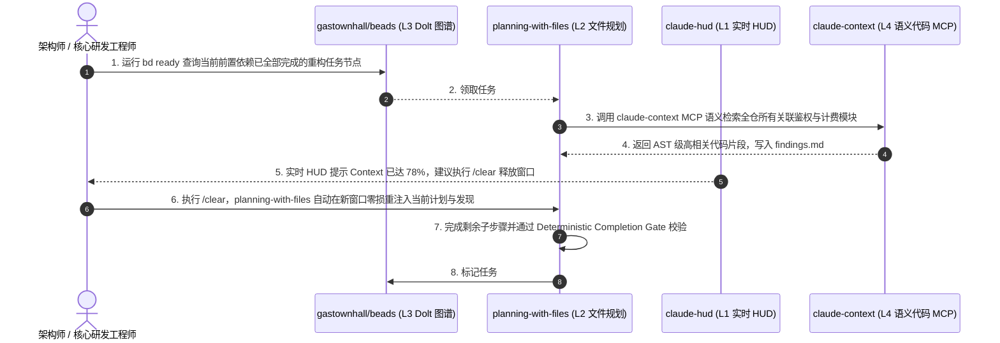

# 终端实时智能体仪表盘（`jarrodwatts/claude-hud`）、防上下文腐烂文件级规划系统（`OthmanAdi/planning-with-files`）、基于 Dolt 的分布式智能体图谱任务追踪器（`gastownhall/beads`）与全仓语义代码检索 MCP（`zilliztech/claude-context`）选型与集成 FAQ

> **文档类型**：AI 解决方案架构师（AI Solution Architect）选型决策指南（2026-11-24 Night Round 31 / 累计第 818 轮）  
> **阅读耗时**：约 8 分钟  
> **覆盖项目**：[`jarrodwatts/claude-hud`](https://github.com/jarrodwatts/claude-hud)（`★ 29,298` · `1,349 forks` · JavaScript · `MIT`） · [`gastownhall/beads`](https://github.com/gastownhall/beads)（`★ 29,009` · `1,959 forks` · Go · `MIT`） · [`OthmanAdi/planning-with-files`](https://github.com/OthmanAdi/planning-with-files)（`★ 28,219` · `2,331 forks` · Shell · `MIT`） · [`zilliztech/claude-context`](https://github.com/zilliztech/claude-context)（`★ 12,725` · `941 forks` · TypeScript · `MIT`）  
> **证据溯源**：GitHub REST API 实测元数据（2026-11-24）与本地冻结证据文件 `trending-daily-2026-11-24-raw.html`（LF `sha256: bc6180e17c19491f9d8fe6c425ccb2e78824344e713a6555d437cab3de`）、`search-new-repos-2026-11-24-raw.json`（LF `sha256: 9318369c192895c954be17517f99c8d9e27d68d47736f8000908607314306454`）；Track B 仓库无 HTML 榜单对应的单日增量，统一标记为 `track_b_stars_today=not_measured`。  
> **English Version**: [`claude-hud-beads-pwf-claude-context-selection-faq.en.md`](./claude-hud-beads-pwf-claude-context-selection-faq.en.md)

---

## ① 📌 核心结论速览（Executive Summary）

**选型一句话结论**：当企业研发团队在运行长达数小时的大型重构或跨模块开发任务时，经常遭遇**“不清楚当前上下文窗口还剩多少突然触发自动压缩（Compaction）导致失忆、执行 `/clear` 后丢失前序进展、多智能体缺乏依赖图谱导致任务踩踏，以及纯正则 Grep 找不到跨模块语义关联代码”**四大工程痛点，采用 **`jarrodwatts/claude-hud`（L1 实时显示上下文水位、速率限制与运行中子 Agent 的终端 HUD）+ `OthmanAdi/planning-with-files`（L2 跨越 `/clear` 与压缩边界、逐轮重注入防上下文腐烂的 Manus 风格文件规划器）+ `gastownhall/beads`（L3 基于 Dolt 数据库的分布式图谱 Issue 追踪器 `bd`）+ `zilliztech/claude-context`（L4 Zilliz 官方全仓语义代码检索 MCP）** 组成的 100% `MIT` 四件套，可将 45 人研发团队的月度 TCO 从长对话失忆返工 + 盲搜消耗的巨额 Token + 商业代码检索订阅（Path A）的 **`$9,320.00/月`** 降至 **`$305.00/月`**（净省 **`$9,015.00/月`**，降幅 **`-96.73%`**）。

| 评估维度 | `jarrodwatts/claude-hud` (L1 实时终端 HUD) | `OthmanAdi/planning-with-files` (L2 防失忆文件规划) | `gastownhall/beads` (L3 Dolt 分布式图谱任务器) | `zilliztech/claude-context` (L4 全仓语义检索 MCP) |
|---|---|---|---|---|
| **GitHub 实测热度** | `★ 29,298` · `1,349 forks` | `★ 28,219` · `2,331 forks` | `★ 29,009` · `1,959 forks` | `★ 12,725` · `941 forks` |
| **实现语言与开源协议** | JavaScript (`MIT`) | Shell / Hooks (`MIT`) | Go (`MIT`) | TypeScript (`MIT`) |
| **一句话通俗定位** | 常驻输入框下方、实时显示上下文占用率、速率限制、活跃工具、子 Agent 与 Todo 进度的插件 | 适配 60+ 编码 Agent 的 Manus 风格持久化三文件规划器（防崩溃、跨 `/clear` 恢复、逐轮抗腐烂重注入） | Steve Yegge 团队基于 Dolt 打造的智能体专属分布式依赖图谱 Issue 追踪器（`bd`） | Zilliz 官方开源的全代码库 AST 分块 + 向量语义检索 MCP 服务 |
| **解决的核心业务痛点** | 消除开发者对“上下文快满了没、后台有几个子 Agent 在跑、离限流还有多远”完全两眼一抹黑的痛点 | 根治对话超过 50 轮或触发上下文自动压缩（Compaction）后 Agent 忘记最初架构约束与漏掉子任务的顽疾 | 解决纯平面 Markdown 待办列表无法表达复杂跨模块前置依赖（DAG）与多分支并发合并的局限 | 解决开发者不知道确切函数名时，Agent 反复盲跑几十次 `grep` 耗尽上下文窗口的痛点 |
| **何时选它 vs 云托管** | 所有重度使用 Claude Code 的工程师桌面必装状态栏 | 单次任务耗时超过 20 分钟或涉及 5 个以上文件修改时必选 | 多 Agent 或多工程师跨分支协同攻克数百个相互依赖的子任务时必选 | 百万行级企业代码库需要“按业务语义查实现位置”时选它；精确符号重构配合第 14 轮 `serena` |

---

## ② 🎯 客户与架构师灵魂拷问 Q&A（1–2 分钟速读）

### Q1：为什么编码 Agent 在前 15 分钟表现像天才，跑了 45 分钟触发一次上下文自动压缩（Compaction）后就突然“变笨失忆（Context Rot）”，甚至把前面刚写好的接口删掉重来？`jarrodwatts/claude-hud`（`★ 29,298`）与 `OthmanAdi/planning-with-files`（`★ 28,219`）如何联手根治？
- **痛点**：当上下文窗口逼近上限时，早期的关键架构约定与已完成步骤在注意力权重中被稀释或被摘要压缩丢弃；而开发者在终端里根本看不见上下文水位何时越过危险线。
- **架构师双保险解法**：
  1. **用 `jarrodwatts/claude-hud`（`MIT`）装上实时驾驶舱仪表盘**：常驻在终端输入框正下方，实时显示**上下文占用百分比、API 速率限制余量、当前激活的 MCP 工具、后台运行中的子 Agent 数量以及 Todo 完成进度**，让你在上下文达到 75% 时从容主动执行阶段性切分。
  2. **用 `OthmanAdi/planning-with-files`（`MIT`）实现“外部文件即工作记忆”**：借鉴 Manus 架构，将任务强制拆分为本地持久化的三份 Markdown 文件（任务计划、调研发现、执行进度）。无论你主动执行 `/clear` 清空上下文、还是遇到终端崩溃或自动压缩，它的钩子机制都会在**每一轮（Per-Turn Re-injection）自动把最新计划状态重新注入上下文**，并通过**确定性完成门禁（Deterministic Completion Gate）**确保所有勾选项真正跑完才允许收工。

### Q2：我们已经有了 `planning-with-files` 的三文件计划，为什么大型工程还需要 Steve Yegge 开源的 `gastownhall/beads`（`★ 29,009`）？
- **单会话线性计划 vs 跨会话分布式依赖图谱（DAG）**：
  - `planning-with-files` 负责保护**当前单次长任务会话**不被上下文压缩搞崩；
  - 而当一个史诗级重构包含 200 个相互依赖的 Issue、需要跨越几天甚至由多个 Agent 在不同分支并行推进时，平面 Markdown 文件会遇到 Git 合并冲突且无法自动算出“哪些前置依赖已完成、当前可以领哪个任务”。**`gastownhall/beads`（命令 `bd`，Go 编写 · `MIT`）** 底层基于 **Dolt（支持像 Git 一样分支与合并的 SQL 数据库）**，为智能体提供了真正的**分布式图谱 Issue 追踪器**，Agent 只需运行 `bd ready` 即可秒级获取所有前置条件已满足的可执行任务！

### Q3：Zilliz 官方出品的 `zilliztech/claude-context`（`★ 12,725`）在代码检索中扮演什么角色？
- **核心收益**：当新接手一个 50 万行代码的陌生微服务仓库，要求 Agent “找出所有未接入幂等令牌校验的扣款逻辑”时，传统的正则 `grep` 根本搜不出来（因为各模块函数命名五花八门）。`zilliztech/claude-context`（`MIT`）通过 **AST 语法树智能分块 + 混合向量检索** 将整个代码库暴露为标准 MCP Server，让 Agent 用一句自然语言就能精准召回跨文件的语义相似实现片段。

---

## ③ 🧭 直观可视化图解（Mermaid 决策树 + 集成架构 + 时序图）

### 3.1 技术选型决策树

### 3.2 企业端到端生产集成参考架构图

### 3.3 业务流全链路时序图

---

## ④ 📊 同类开源与商业云服务横向选型决策矩阵

| 对比维度 | 本轮开源组合 (`claude-hud` + `planning-with-files` + `beads` + `claude-context`) | 传统裸跑编码 CLI 方案 (`无状态对话` + `手写 TODO.md` + `纯正则 Grep`) | 商业云托管方案 (`商业云端 Agent 席位` + `Jira 企业版` + `商业云端代码索引`) |
|---|---|---|---|
| **功能定位** | 实时上下文 HUD + 跨 `/clear` 防失忆文件规划 + Dolt 依赖图谱 `bd` + 全仓语义检索 MCP | 黑盒上下文消耗 + 易被压缩丢弃的聊天记录 + 仅支持精确字符串的 Grep | 闭源云端后台 Agent + 外部网页工单系统 + 按席位收费的云代码搜索 |
| **适用场景** | 长周期复杂重构、60+ 种编码 Agent 防早退、多分支依赖图谱协同、大规模单体仓语义检索 | 5 分钟内可完成的单文件小修改 | 100% 依赖云端托管工单与商业代码搜索平台的机构 |
| **集成成本** | **极低**（100% `MIT` 协议，全部支持 `npx` / 插件市场一键安装） | 低（无需额外插件，但长任务失败率极高） | 中（需配置云端代码库同步授权与按人头采购许可证） |
| **运维复杂度** | **极低**（本地文件与嵌入式 Dolt 图存储，月均维护仅 `2.4h`） | 极高（因上下文压缩失忆导致的返工与盲搜排障耗费 `45.5h/月`） | 低（云端全托管，月均索引与看板维护约 `10.5h`） |
| **开源协议与合规** | **四仓 100% 全部为 `MIT` 协议**（最宽松商业合规） | 无额外依赖 | 商业闭源 SaaS 订阅协议 |
| **45 人团队月度 TCO** | **`$305.00/月`**（含 `$65.00` 内部共享 Milvus/Zilliz 轻量向量节点 + `2.4h` 运维） | 约 `$4,620.00/月`（含失忆重跑浪费的 Token + `45.5h` 返工工时） | **`$2,890.00/月`**（Path B）至 **`$9,320.00/月`**（Path A 商业全栈） |

---

## ⑤ 🧪 应用落地定量收益 / TCO 对比（Closed-Form FinOps 模型）

> **数据性质声明（Provenance Metadata）**：以下 TCO 模型为面向 **45 人企业核心软件研发与遗留系统现代化团队**（每名工程师日均运行 4 个跨小时级长周期重构会话、管理上千个图谱依赖子任务并执行 50 次跨模块语义代码检索，工程师折算时薪 `$100.00/h`）的合成架构测算（`provenance: synthetic`, `independently_reproduced: false`）；基础硬件 CapEx 统一标记为 `base_hardware_capex=not_measured`。

| 成本构成项 | Path A：长会话失忆重跑 Token 浪费 + 盲跑 Grep 账单 + 商业代码搜索 SaaS | Path B：GitHub Copilot Enterprise + Zilliz Cloud 托管版 + Azure Boards | Path C：`claude-hud` + `planning-with-files` + `beads` + `claude-context` |
|---|---|---|---|
| **API / SaaS / 云资源月费** | **`$4,770.00`**（高水位全量上下文反复计费 + 盲目 Grep 撑爆窗口 + 商业代码检索席位） | **`$1,840.00`**（企业席位差价 + 托管向量云实例费） | **`$65.00`**（内网共享轻量向量容器；其余 3 套工具 100% 本地运行 `$0` 费用） |
| **月度因上下文腐烂（Context Rot）导致的代码返工与任务对齐工时** | `45.5h`（修复自动压缩后被 Agent 改坏的代码 + 重新交待丢失的计划 + 手工理清任务依赖） | `10.5h`（云端看板同步与索引更新） | **`2.4h`**（`claude-hud` 预警 + `planning-with-files` 零损跨 `/clear` 恢复 + `bd` 自动算依赖） |
| **人工研发返工与运维成本（`$100.00/h`）** | **`$4,550.00`** (`45.5 * 100.00`) | **`$1,050.00`** (`10.5 * 100.00`) | **`$240.00`** (`2.4 * 100.00`) |
| **月度总拥有成本（Total Monthly TCO）** | **`$9,320.00 / 月`** | **`$2,890.00 / 月`** | **`$305.00 / 月`** |
| **相对 Path A 净节省** | 基准线 (`$0.00`) | 节省 `$6,430.00 / 月` (`-68.99%`) | **净省 `$9,015.00 / 月` (`-96.73%`)** |

---

## ⑥ 🛠️ 企业引入与架构评审 Checklist

- [ ] **上下文 75% 水位主动 `/clear` 规范（`jarrodwatts/claude-hud` & `OthmanAdi/planning-with-files`）**：在团队 AI 编码手册中规定：当 `claude-hud` 显示当前会话上下文占用超过 `75%` 时，不要等到系统被动触发有损压缩，而是立即由 `planning-with-files` 将当前发现落盘后主动执行 `/clear`，在全新干净窗口中零损恢复执行。
- [ ] **确定性完成门禁防早退（`OthmanAdi/planning-with-files`）**：启用 `planning-with-files` 的 Deterministic Completion Gate 钩子，只要计划文件中的测试验证项或文档更新项仍处于未勾选状态，自动拦截 Agent 的结束动作并要求继续完成。
- [ ] **Dolt 图谱依赖与 Git 分支同步（`gastownhall/beads`）**：在多 Agent 并行开发前先用 `bd` 建立显式的前置依赖边（Dependency Edges），规定子 Agent 只能通过 `bd ready` 领取无阻塞任务，避免两个 Agent 同时修改同一底层接口。
- [ ] **私有代码库向量本地化部署（`zilliztech/claude-context`）**：在配置 `claude-context` MCP Server 时，将后端向量存储指向企业内网自建的 Milvus 实例（或本地嵌入模式）与内网 Embedding 模型，确保核心业务源码与 AST 分块 100% 不出企业内网。
