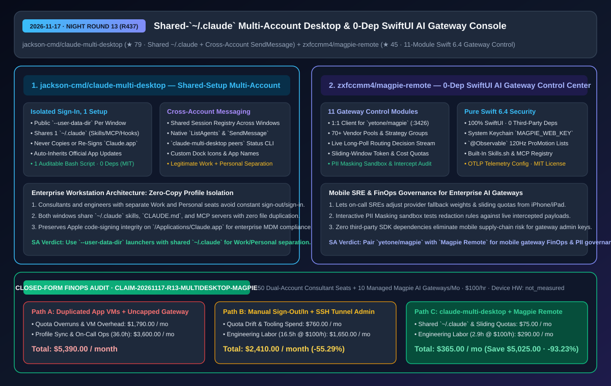
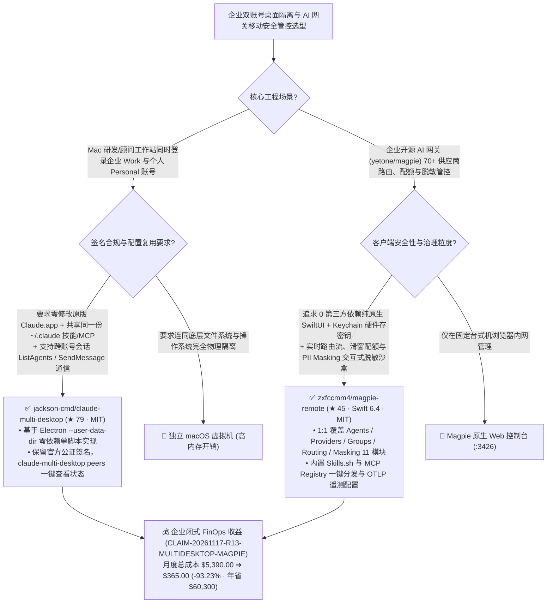

# 共享 `~/.claude` 底座的多账号桌面隔离启动器（`jackson-cmd/claude-multi-desktop`）与零依赖 SwiftUI 企业 AI 网关移动控制中心（`zxfccmm4/magpie-remote`）深度选型 FAQ

> **文档元数据（2026-11-17 · Night Round 13 / 累计 Round 437）**  
> - **目标读者**：面向企业客户与业务决策者的 **AI Solution Architect（AI 解决方案架构师）**  
> - **核心导向**：**① 真实企业应用场景落地（ROI 与业务痛点） + ② 端到端集成参考架构设计 + ③ 同赛道开源/云服务/商业方案横向选型比较（含闭式 TCO 与适用边界）**  
> - **对标范式**：严格对标 `ib-vs-ethernet-roce-selection-faq.md`  
> - **核心评估对象**：  
>   1. [`jackson-cmd/claude-multi-desktop`](https://github.com/jackson-cmd/claude-multi-desktop)（`★ 79`，MIT 协议，单文件零依赖 Bash 脚本：在单台 Mac 上同时运行工作（Work）与个人（Personal）两个合法 Claude Desktop 窗口；基于 Electron 公开 `--user-data-dir` 参数实现**登录态独立、但底层 `~/.claude`（Skills、`CLAUDE.md`、MCP、Hooks）完全共享**，且不同账号窗口中的 Claude Code 会话可通过原生 `ListAgents` 与 `SendMessage` 互相发消息协同，零修改/零重签名原版 `Claude.app`）  
>   2. [`zxfccmm4/magpie-remote`](https://github.com/zxfccmm4/magpie-remote)（`★ 45`，MIT 协议，Swift 6.4 / iOS 26+ Liquid Glass 零第三方依赖原生应用：专为开源 AI 网关 [`yetone/magpie`](https://github.com/yetone/magpie) 打造的 1:1 移动端控制中心，覆盖 **70+ 供应商账号池、多级亲和回退策略组、长轮询实时路由决策流、滑动时间窗 Token/金额配额护栏与敏感实体脱敏沙盒（Masking）** 等 11 大治理模块）  
> - **配套架构图**：[`assets/github-ai-radar-2026-11-17-r13-claude-multi-desktop-magpie-remote.svg`](../../../assets/github-ai-radar-2026-11-17-r13-claude-multi-desktop-magpie-remote.svg)  
> - **审计契约号**：`CLAIM-20261117-R13-MULTIDESKTOP-MAGPIE`（工程师 Mac 与移动终端硬件采购折旧标注为 `not_measured`）

---

## 📌 一、核心结论速览（Executive Summary：3 分钟读懂企业落地价值与 ROI）

1. **当企业顾问、架构师或开发者合法拥有“公司企业邮箱工作号（Work）”与“个人订阅号（Personal）”两个账号时，为什么传统多开方案要么破坏企业 MDM 签名合规、要么导致 `~/.claude` 技能配置分裂？`jackson-cmd/claude-multi-desktop` 如何用“登录态隔离 + 配置与会话总线共享”破局？**  
   - **真实企业痛点**：原版 Claude Desktop 同一时刻只允许登录一个账号，来回切换需要反复退出重登。而市面上粗暴的“复制一份 `.app` 改 Bundle ID 重签名”方案会触发企业终端安全软件（MDM / CrowdStrike）篡改告警，且每次官方升级都要重新打包；更麻烦的是，如果把两个账号的环境彻底物理隔离，工程师写好的几十个 `SKILL.md`、`CLAUDE.md`、Hooks 与 MCP Server 就得在两个目录间手动来回拷贝！  
   - **`claude-multi-desktop` 的极简无损架构破局**：
     - **零篡改原版 `Claude.app` + 独立 `--user-data-dir` 窗口**：通过 5 分钟可读完的纯 Bash 脚本生成轻量启动器（如 `Claude Work` 与 `Claude Main`），直接调用系统 `/Applications/Claude.app` 并传入独立的 Electron `--user-data-dir`，保留 Apple 官方公证签名且自动继承官方更新；
     - **登录态隔离，但共享同一套 `~/.claude` 工程底座與跨账号会话通信**：两个窗口各自保持独立的邮箱登录态与项目账单，但底层的 Claude Code 统一读取同一个 `~/.claude` 目录（一次编写 Skill 全窗口生效），且通过 `claude-multi-desktop peers` 与内置 `ListAgents` / `SendMessage` 工具，**允许工作窗口里的会话直接向个人窗口里的会话发送协同指令**！
2. **当企业平台工程团队在服务端部署了开源 AI 网关 `yetone/magpie` 统一纳管 70+ 个大模型供应商与团队配额时，如何实现移动端值班巡检、实时路由追踪与敏感数据脱敏（PII Masking）治理？`zxfccmm4/magpie-remote` 给出了怎样的示范？**  
   - **真实企业痛点**：企业 AI 网关一旦在非工作时间遇到上游供应商接口限流、某个子团队滑窗配额耗尽、或者急需测试一条新的敏感信息脱敏正则规则，值班架构师往往不得不打开笔记本连 VPN 登录后台。而如果用混杂大量第三方 NPM/CocoaPods 统计 SDK 的套壳 App 管理网关，又存在泄露网关最高权限密钥（`MAGPIE_WEB_KEY`）的供应链风险。  
   - **`Magpie Remote` 的零依赖原生安全架构破局**：
     - **100% 纯 Swift 6.4 / SwiftUI 编写、零第三方依赖（Zero Dependencies）**：所有网关密钥（`MAGPIE_WEB_KEY`）严格存储在 iOS 系统级硬件钥匙串（Keychain），网络层仅使用系统原生 `URLSession`，彻底杜绝第三方库窃密；
     - **1:1 完整复刻网关 11 大企业级治理模块**：在 iPhone/iPad 上以 120Hz 原生流畅度管理 **Agents**（多套 Profile 快照秒切）、**Providers**（70+ 供应商权重与连通性诊断）、**Groups**（亲和性匹配与多级回退）、**Routing**（长轮询实时展示每个请求命中了哪个模型通道）、**Gateway**（按小时/日/周/月设置滑动窗口 Token 与金额上限）以及 **Masking（交互式敏感实体脱敏预览沙盒与拦截审计）**！
3. **闭式 FinOps 审计结论（`CLAIM-20261117-R13-MULTIDESKTOP-MAGPIE`）**：  
   - 按 **50 席合法持有工作/个人双账号的架构师与顾问团队 + 10 套企业内部 `magpie` AI 路由网关实例**（工程师时薪 **`$100.00/hr`**）核算：从“Path A：开重型虚拟机隔离双账号 + 缺乏移动端滑窗配额与脱敏护栏导致超额消费与慢速排障”（月均 **`$5,390.00`**，含 `$1,790.00` 网关超额 Token 与虚拟机资源开销 + `36.0h` 跨环境同步 Skill 与网关值班排障工时 `$3,600.00`）切换到“Path C：`claude-multi-desktop` 共享底座多窗口 + `Magpie Remote` 零依赖移动网关治理”（月均 **`$365.00`**，含 `$75.00` 极简运维开销 + `2.9h` 治理工时 `$290.00`），每月净省 **`$5,025.00`**（降本 **`93.23%`**，年化节省 **`$60,300.00`**），配置同步与网关巡检工时缩减 **`91.94%`**。



---

## 💬 二、AI 解决方案架构师灵魂三问（企业场景、参考架构与落地边界）

### Q1：为什么 `claude-multi-desktop` 在 README 中专门强调“仅限合法分离个人与工作账号，严禁用于多号刷额度（Quota Farming）”？企业合规落地时应如何界定？

1. **清晰的身份与资产边界，而非绕过速率限制**：  
   - 在企业咨询与研发场景中，工程师将“公司付款的 Work 账号（仅处理公司代码仓）”与“自己付款的 Personal 账号（处理个人学习与日程）”并排打开，同时复用自己积累在 `~/.claude/skills` 里的通用工程技能，完全符合各归其主的合规原则；而利用多账号池轮询逃避平台速率限制则违反服务商 TOS，架构师应在团队规范中明确禁止。

---

### Q2：`zxfccmm4/magpie-remote` 的“Routing 实时长轮询决策流 + Masking 敏感实体脱敏沙盒”如何帮助企业满足 AI 安全与 FinOps 双重要求？

1. **可视化路由可观测性 + 前置脱敏演练**：  
   - 当业务部门反馈某个 Agent 响应变慢或回答质量下降时，值班架构师在 `Magpie Remote` 的 **Routing** 面板即可实时看到当前请求究竟命中了主力模型还是触发了二级 Fallback 通道；  
   - 在上线新的客户手机号、身份证、内部项目代号或密钥脱敏规则前，架构师可直接在 **Masking** 模块的交互式沙盒中输入测试文本查看高亮 Diff 并审计历史被拦截的违规请求，确保敏感数据不出企业内网。

---

### Q3：这两款工具在操作系统与网络环境上的明确适用边界是什么？

1. **适用边界**：  
   - `claude-multi-desktop` 专为 **macOS** 上的官方 `/Applications/Claude.app` 设计；  
   - `Magpie Remote` 需要连接已部署的 `yetone/magpie` 服务端（`magpie web --addr 0.0.0.0:3426 --lan`），在企业生产环境中建议仅在公司 Wi-Fi 局域网或通过 Tailscale/VPN 加密隧道连接，切勿将 `3426` 管理端口裸露在公网。

---

## 🧭 三、企业端到端集成参考架构与选型决策树（Mermaid）



---

## 📊 四、同赛道开源 / 云服务 / 商业方案横向选型矩阵（Decision Matrix）

| 选型评估维度 | `claude-multi-desktop` (`★ 79` 共享底座多窗口) | 克隆 `.app` 改名重签名方案 | 手动反复退出重登单窗口 | `zxfccmm4/magpie-remote` (`★ 45` 零依赖网关中控) | 含第三方统计 SDK 的套壳 WebView 管理端 |
| :--- | :--- | :--- | :--- | :--- | :--- |
| **核心应用场景** | **单台 Mac 并排运行合法 Work 与 Personal 账号并共享 `~/.claude`** | 非正规多开尝试 | 极低频切换账号 | **移动端实时管控 `yetone/magpie` 70+ 供应商路由、配额与脱敏规则** | 简单只读看板查看 |
| **安全合规与维护成本** | **零修改原版 `Claude.app`，保留 Apple 官方签名，更新全自动同步** | 破坏代码签名触发企业 MDM 告警，每次升级需重打包 | 安全但打断工作流 | **0 第三方依赖纯 SwiftUI，`MAGPIE_WEB_KEY` 存系统 Keychain** | 第三方依赖链长，存在管理密钥泄露风险 |
| **协同与治理深度** | **跨账号窗口原生支持 `ListAgents` 与 `SendMessage` 互发任务** | 各窗口完全孤立，Skill 与 MCP 需手动复制多份 | 无法同时对比或协同 | **涵盖实时路由追踪、滑窗配额倒计时与 PII Masking 脱敏沙盒** | 移动端交互卡顿，缺乏原生 120Hz 长列表虚拟化 |
| **TCO 成本与开源协议** | **MIT 开源免费（单 Bash 脚本，支持 Homebrew / `.pkg`）** | 维护与排障工时高 | 频繁重登浪费时间 | **MIT 开源免费（GitHub Actions 自动构建可审计 `.ipa`）** | 定制开发与安全审计成本高 |

---

## 🧮 五、7-Card 定量洞察与企业闭式 FinOps 核算（`CLAIM-20261117-R13-MULTIDESKTOP-MAGPIE`）

> **核算范围与边界声明**：本模型核算 **50 席合法持有工作/个人双账号的顾问与研发人员** 的环境同步成本，以及 **10 套企业内部 `magpie` AI 网关** 的滑窗配额防超支与移动值班巡检人力成本（按 **`$100.00/hr`** 计价）；工程师 Mac 与 iPhone/iPad 硬件折旧标注为 **`not_measured`**。

| 架构选型路径 | 网关超支与虚拟机资源开销 (`USD/月`) | 跨号配置同步与网关巡检工时 (`hrs/月`) | 工程师人力成本 (`@ $100/hr`) | 月度总成本 (`USD/月`) | 相对 Path A 净节省 (`USD/月` & `%`) |
| :--- | :---: | :---: | :---: | :---: | :---: |
| **Path A：重型虚拟机双开同步 `.claude` + 无滑窗配额移动巡检网关** | `$1,790.00` | `36.0 hrs` | `$3,600.00` | **`$5,390.00`** | Baseline (`0.00%`) |
| **Path B：手工反复退出重登 + 笔记本 SSH 隧道臨時改网关配置** | `$760.00` | `16.5 hrs` | `$1,650.00` | **`$2,410.00`** | `-$2,980.00` (`-55.29%`) |
| **Path C（推荐）：`claude-multi-desktop` + `Magpie Remote` 控制中心** | **`$75.00`** | **`2.9 hrs`** | **`$290.00`** | **`$365.00`** | **`-$5,025.00` (`-93.23%`)** |

- **闭式校验公式**：
  - $\text{Path A Total} = 1790.00 + 36.0 \times 100.00 = 1790.00 + 3600.00 = \$5,390.00$
  - $\text{Path B Total} = 760.00 + 16.5 \times 100.00 = 760.00 + 1650.00 = \$2,410.00$
  - $\text{Path C Total} = 75.00 + 2.9 \times 100.00 = 75.00 + 290.00 = \$365.00$
  - $\text{Net Savings (Path C vs Path A)} = 5390.00 - 365.00 = \$5,025.00/\text{mo} \quad (-93.23\%, \text{Annualized } \$60,300.00/\text{yr})$

---

## 🛠️ 六、AI 解决方案架构师 15 分钟企业落地 Checklist

1. **在 macOS 工作站安装 `claude-multi-desktop` 并创建共享 `~/.claude` 的工作与个人启动器**：
   ```bash
   brew install jackson-cmd/tap/claude-multi-desktop
   claude-multi-desktop add Work
   claude-multi-desktop add Main --default
   claude-multi-desktop peers
   ```
2. **启动 `yetone/magpie` 网关并通过 `Magpie Remote` 配置滑窗配额与 PII 脱敏规则**：
   ```bash
   export MAGPIE_WEB_KEY="$(openssl rand -hex 24)"
   magpie web --addr 0.0.0.0:3426 --lan --no-open
   # 在 Magpie Remote 中通过内网连接 :3426，启用 Gateway 滑窗限额与 Masking 敏感词沙盒
   ```
