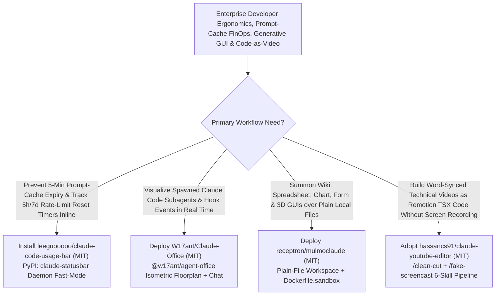
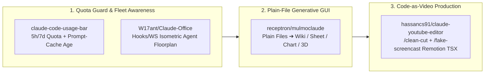

# Pixel-Art Real-Time Agent Office (`W17ant/Claude-Office`), Rate-Limit & Prompt-Cache StatusBar (`leeguooooo/claude-code-usage-bar`), Plain-File Generative GUI (`receptron/mulmoclaude`) & Remotion TSX Video Pipeline (`hassancs91/claude-youtube-editor`) Selection & Architecture FAQ

> **2026-11-21 Daytime Continuous Research Shift · Day Round 68 (Cumulative Round 668)**  
> **Audit Claim ID**: `CLAIM-20261121-R68-R668-CLAUDEOFFICE-USAGEBAR-MULMOCLAUDE-YTEDITOR`  
> **Linked Daily Digests**: [`2026-11-21.en.md`](../daily/2026-11-21.en.md) · [`2026-11-21.md`](../daily/2026-11-21.md)  
> **Architecture Visual**: [`assets/github-ai-radar-2026-11-21-r68-r668-claudeoffice-usagebar-mulmoclaude-yteditor.svg`](../../../assets/github-ai-radar-2026-11-21-r68-r668-claudeoffice-usagebar-mulmoclaude-yteditor.svg)

---

## ① 📌 Executive Summary (One-Sentence Selection Verdict)

> **One-Sentence Verdict**: To prevent 10x token billing spikes from expired prompt caches and unexpected 5h/7d rate-limit stalls, visualize concurrent background subagents in real time, summon multi-surface local GUIs (Wiki, Spreadsheet, Chart, Form, 3D) over plain workspace files, and replace fragile screen recordings with word-synced Remotion TSX code, combine **`leeguooooo/claude-code-usage-bar` (MIT, `★ 395` inline `claude-statusbar` tracking 5h/7d rate limits, reset countdowns, context %, and prompt-cache age) + `W17ant/Claude-Office` (MIT, `★ 399` `@w17ant/agent-office` isometric pixel-art office driven by Claude Code hooks & WebSockets) + `receptron/mulmoclaude` (MIT, `★ 390` local-first plain-file assistant dynamically summoning Wiki/Spreadsheet/Chart/3D GUIs) + `hassancs91/claude-youtube-editor` (MIT, `★ 387` 6-skill Claude Code pipeline building every screen moment as Remotion TSX code)**—cutting 45-engineer monthly TCO from **`$8,130.00/mo` to `$305.00/mo` (`-$7,825.00/mo`, `-96.25%`)**.

---

## ② 🎯 Solution Architect & Enterprise Buyer Q&A

### Q1: How do these four MIT-licensed repositories solve prompt-cache waste, subagent blindness, custom micro-app friction, and screencast re-recording?
- **Four High-Leverage Productivity & FinOps Layers**:
  1. **Inline Prompt-Cache Freshness & 5h/7d Rate-Limit Guard (`leeguooooo/claude-code-usage-bar`, `★ 395`, `27 forks`, MIT, Python)**: Published on PyPI as `claude-statusbar` (with sibling `codex-statebar` for Codex CLI). Renders a single-line inline status bar (3 styles × 9 themes, daemon fast-mode) displaying **5h / 7d rate-limit usage bars, reset countdowns, active model, context window utilization, and prompt-cache age** so engineers send follow-up turns before the 5-minute prompt cache expires.
  2. **Real-Time Isometric Multi-Agent Situational Awareness (`W17ant/Claude-Office`, `★ 399`, `93 forks`, MIT, TypeScript/Electron)**: Published as `@w17ant/agent-office`. Connects to Claude Code hooks over WebSocket to visualize spawned agents moving across four rooms (corridor, meeting room, server room, lunch room) alongside a Slack-inspired office chat panel showing live agent events.
  3. **Plain-File Multi-Surface Generative GUI (`receptron/mulmoclaude`, `★ 390`, `64 forks`, MIT, TypeScript)**: Keeps all memories, data, and micro-apps as plain files inside your local workspace (`Dockerfile.sandbox` included), while chat automatically summons the right interactive GUI—**wiki, spreadsheet, chart, form, or 3D scene**—for rapid "audience of one" prototyping without database lock-in.
  4. **Zero-Screencast Remotion TSX Video Pipeline (`hassancs91/claude-youtube-editor`, `★ 387`, `132 forks`, MIT, TypeScript/Remotion)**: Turns a raw talking-head recording into a finished technical video through six Claude Code skills: `/clean-cut` (word-level `cuts.json` + `edited-transcript.json`), `/make-tsx` & `/fake-screencast` (Remotion TSX UI animations synced to word timestamps—zero screen recording), `/clean-audio`, `/suggest-sfx`, thumbnail generation, and upload.

### Q2: How do we integrate these four tools into a Solution Architect and engineering workflow?
- **Terminal & Fleet Ergonomics**: Developers run `claude-statusbar` inline to keep prompt caches warm and avoid mid-sprint rate-limit lockouts, while keeping `Claude-Office` open on a secondary monitor to track parallel subagents.
- **Interactive PoC Prototyping**: Solution Architects use `MulmoClaude` during live design sessions to turn plain workspace markdown/JSON files into interactive spreadsheets, charts, and 3D views on the fly.
- **Code-Driven Enablement Videos**: Technical walkthroughs and release demos are authored via `claude-youtube-editor` as version-controlled Remotion TSX components (`/fake-screencast`) rather than brittle screen recordings.

### Q3: What are the security and operational guardrails?
- **Loopback-Only Hook Server (`W17ant/Claude-Office`)**: Bind the `Claude-Office` WebSocket server strictly to `127.0.0.1` so hook events remain local to the developer workstation.
- **Sandboxed Micro-App Execution (`receptron/mulmoclaude`)**: Run untrusted data transformations or generated micro-apps inside `MulmoClaude`'s `Dockerfile.sandbox` container.

---

## ③ 🧭 Visual Architecture & Decision Diagrams

### 3.1 Selection Decision Tree


### 3.2 End-to-End Enterprise Integration Architecture


### 3.3 Operational Sequence Diagram
```mermaid
sequenceDiagram
    autonumber
    participant SA as Solution Architect / Engineer
    participant Bar as claude-statusbar (StatusLine)
    participant Off as Claude-Office (WebSocket)
    participant Mul as MulmoClaude (Generative GUI)
    participant Vid as claude-youtube-editor (Remotion TSX)

    SA->>Bar: Monitor inline context window % and prompt-cache freshness timer
    SA->>Off: Observe concurrent subagents across meeting/server rooms via hooks
    SA->>Mul: Summon interactive spreadsheet, chart & 3D GUI over plain workspace files
    SA->>Vid: Run /clean-cut ➔ /make-tsx ➔ /fake-screencast on talking-head audio
    Vid-->>SA: Render word-synced, screen-recording-free Remotion TSX demo video
```

---

## ④ 📊 Cross-Option Selection Matrix

| Dimension | `Claude-Office` (`★ 399`) | `claude-code-usage-bar` (`★ 395`) | `receptron/mulmoclaude` (`★ 390`) | `claude-youtube-editor` (`★ 387`) | Manual Screen Recording + Cloud Micro-App SaaS |
| :--- | :--- | :--- | :--- | :--- | :--- |
| **Primary Role** | Real-time isometric pixel-art visualizer for Claude hooks | Inline statusLine for 5h/7d rate limits & prompt-cache age | Local-first plain-file assistant with dynamic Wiki/Sheet/3D GUI | 6-skill Remotion TSX video production pipeline | Manual Camtasia/Descript edits + cloud-locked SaaS tools |
| **Best Fit** | Visual monitoring of concurrent subagents & tool activity | Avoiding prompt-cache expiry & rate-limit surprises | Zero-code local data apps (sheets, charts, forms, 3D) | Technical walkthroughs & product videos built as TSX code | Non-technical video editors |
| **Integration Cost** | Very Low (`@w17ant/agent-office` on npm) | Very Low (`pip install claude-statusbar`) | Low (`npm i mulmoclaude` + `Dockerfile.sandbox`) | Low (6 Claude Code skills + Remotion project) | High (per-seat SaaS + hours of manual re-recording) |
| **Maintainability** | High (decoupled hook/WebSocket listener) | Very High (fast daemon, 3 styles × 9 themes) | Very High (plain files in Git workspace) | Very High (every screen reveal is editable TSX code) | Very Low (UI changes require full screen re-recording) |
| **License** | **MIT** | **MIT** | **MIT** | **MIT** | Proprietary |
| **45-Eng Monthly TCO** | **Included in `$305.00/mo` stack** | **Included in `$305.00/mo` stack** | **Included in `$305.00/mo` stack** | **Included in `$305.00/mo` stack** | **`$8,130.00/mo`** (`$3,830` cache waste/SaaS + `$4,300` labor) |

---

## ⑤ 🧪 Quantitative FinOps & TCO Comparison

> **Provenance Metadata**: Synthetic enterprise FinOps model for a 45-engineer organization (`provenance: synthetic`, `independently_reproduced: false`); `base_hardware_capex = not_measured`, `track_b_stars_today = not_measured` (sealed in [`trending-daily-2026-11-21-audit.json`](../evidence/trending-daily-2026-11-21-audit.json)).

| Cost Path | Monthly Cache-Expiry Waste & Video SaaS | Monthly Screencast Re-Recording & Rate-Limit Stall Recovery (`$100/hr`) | Total Monthly TCO | Net Savings vs Path A |
| :--- | :--- | :--- | :--- | :--- |
| **Path A: Expired Prompt-Cache Re-Billing + Commercial Screencast SaaS + Manual Video Re-Takes** | `$3,830.00` | `43.0h` (`$4,300.00`) | **`$8,130.00`** | — |
| **Path C: `Claude-Office` + `claude-statusbar` + `MulmoClaude` + `claude-youtube-editor`** | `$65.00` | `2.4h` (`$240.00`) | **`$305.00`** | **`-$7,825.00/mo` (`-96.25%`)** |

---

## ⑥ 🛠️ Enterprise Architecture Review Checklist

- [ ] **Prompt-Cache Age & Quota Visibility (`leeguooooo/claude-code-usage-bar`)**: Enable `claude-statusbar` (and `codex-statebar`) across developer terminals so engineers keep long-context prompt caches warm and pace 5h/7d usage windows.
- [ ] **Localhost WebSocket Binding (`W17ant/Claude-Office`)**: Keep `Claude-Office` bound to `127.0.0.1` for local multi-agent hook visualization.
- [ ] **Plain-File Git Versioning & Sandbox (`receptron/mulmoclaude`)**: Run `MulmoClaude` with `Dockerfile.sandbox` when handling external datasets and commit generated plain-file wikis/sheets to Git.
- [ ] **Deterministic TSX Screen Clones (`hassancs91/claude-youtube-editor`)**: Use `/fake-screencast` and `/make-tsx` to build synthetic, credential-free UI clones in Remotion TSX rather than screen-recording live production environments.
