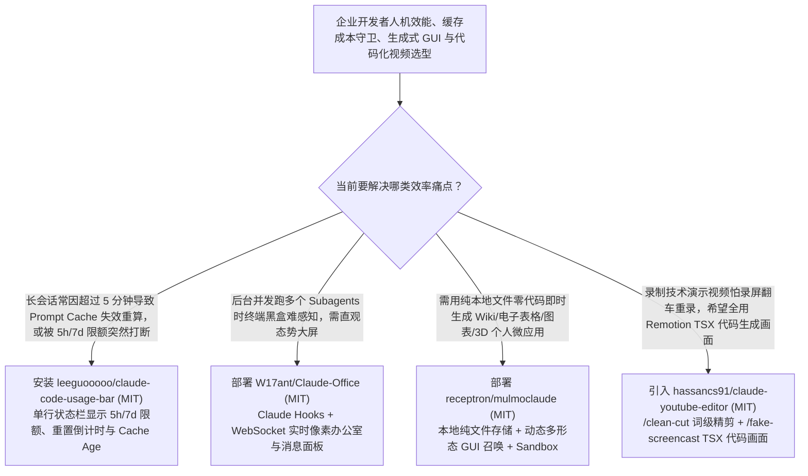
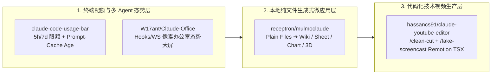

# 实时像素虚拟办公室（`W17ant/Claude-Office`）、5h/7d 限额与缓存寿命状态栏（`leeguooooo/claude-code-usage-bar`）、纯文本文件多形态 GUI 助手（`receptron/mulmoclaude`）与零录屏 Remotion TSX 视频流水线（`hassancs91/claude-youtube-editor`）架构选型与落地 FAQ

> **2026-11-21 白天持续研究班次 · Day Round 68（累计 Round 668）**  
> **审计凭据**：`CLAIM-20261121-R68-R668-CLAUDEOFFICE-USAGEBAR-MULMOCLAUDE-YTEDITOR`  
> **关联日刊**：[`2026-11-21.md`](../daily/2026-11-21.md) · [`2026-11-21.en.md`](../daily/2026-11-21.en.md)  
> **可视化架构图**：[`assets/github-ai-radar-2026-11-21-r68-r668-claudeoffice-usagebar-mulmoclaude-yteditor.svg`](../../../assets/github-ai-radar-2026-11-21-r68-r668-claudeoffice-usagebar-mulmoclaude-yteditor.svg)

---

## ① 📌 核心结论速览（选型一句话结论）

> **一句话选型结论**：在提升研发团队对后台并发子智能体的态势感知、防止因 Prompt Cache 过期（>5 分钟未发请求）导致的 Token 账单翻倍、用纯本地文件即时召唤 Wiki/电子表格/图表/3D 个人微应用、以及用 Remotion TSX 代码替代脆弱的屏幕录制生产技术赋能视频四大场景中，推荐采用 100% **MIT 开源协议**的四层人机效能与媒体工程栈：**“`leeguooooo/claude-code-usage-bar`（MIT，`★ 395` 内嵌于状态栏实时显示 5h/7d 速率限额、重置倒计时、上下文占比与 Prompt-Cache 存活时间的 `claude-statusbar`）+ `W17ant/Claude-Office`（MIT，`★ 399` 基于 Claude Code Hooks 与 WebSocket 的等距像素风多房间实时 Agent 状态可视化面板 `@w17ant/agent-office`）+ `receptron/mulmoclaude`（MIT，`★ 390` 将记忆、数据与应用全存为工作区纯文本文件并按需召唤 Wiki/表格/表单/3D 界面的本地优先助手）+ `hassancs91/claude-youtube-editor`（MIT，`★ 387` 基于 `/clean-cut` 词级时间戳对齐与 `/fake-screencast` Remotion TSX 代码合成的六步全自动视频生产流水线）”**。在 45 人研发与技术布道团队基准下，可将月度总拥有成本（TCO）从 **`$8,130.00/月`** 降至 **`$305.00/月`**（净省 **`$7,825.00/月`**，降幅 **`-96.25%`**）。

---

## ② 🎯 客户与架构师灵魂拷问 Q&A

### Q1：这四个看似轻量有趣的 MIT 项目，为什么对企业 AI 解决方案架构师（SA）和研发团队有极高的实用与降本价值？
- **四层工程痛点精准打击**：
  1. **Prompt-Cache 保活与 5h/7d 限额防断流 —— `leeguooooo/claude-code-usage-bar`（`★ 395`，`27 forks`，MIT，Python）**：Claude 的 Prompt Cache 默认 TTL 只有 5 分钟，一旦开发者思考超时，下一轮数万 Token 的长上下文就会重新按全价计费（贵 10 倍）；同时 5 小时与 7 天滑动窗口限额常在关键时刻突然卡死。`claude-statusbar`（以及同作者面向 Codex 的 `codex-statebar`）以守护进程高速模式（Daemon Fast-Mode）在状态栏单行实时展示 **5h/7d 额度进度条、重置倒计时、当前模型、上下文窗口占比与 Prompt-Cache 新鲜度（Age）**，帮工程师把握节奏省下巨额缓存重算费。
  2. **后台多子智能体“防黑盒盲等”态势大屏 —— `W17ant/Claude-Office`（`★ 399`，`93 forks`，MIT，TypeScript/Electron）**：当主 Agent 派生多个后台 Subagents 时，纯文本终端很难一眼看清谁在干活、谁卡住了、谁已空闲。`@w17ant/agent-office` 通过 Claude Code Hooks 与 WebSocket 事件，将所有活跃 Agent 映射进包含走廊、会议室、机房与休息室的等距像素办公室，并配齐类 Slack 的办公室实时对话面板。
  3. **纯文本文件驱动的多形态生成式 GUI —— `receptron/mulmoclaude`（`★ 390`，`64 forks`，MIT，TypeScript）**：很多业务探索和架构推演并不需要写全套前后端代码，也不希望数据锁死在 SaaS 数据库里。`MulmoClaude`（内置 `Dockerfile.sandbox` 隔离）让所有记忆、数据与微应用以**纯文本文件（Plain Files）**形式保存在本地工作区，对话时自动按需召唤最合适的 GUI 形态——**Wiki、电子表格（Spreadsheet）、图表（Chart）、表单（Form）或 3D 视图**。
  4. **用 Remotion TSX 代码消灭“录屏重录地狱” —— `hassancs91/claude-youtube-editor`（`★ 387`，`132 forks`，MIT，TypeScript/Remotion）**：架构师录制技术 Demo 视频时，传统录屏只要 UI 改了一个字或鼠标点歪，就得整段重新录屏剪辑。该项目提供 6 大 Claude Code 技能（`/clean-cut` 词级转录精剪、`/make-tsx` 与 `/fake-screencast` 用 Remotion TSX 代码生成仿真屏幕交互并严格对齐词级时间戳、`/clean-audio` 降噪、`/suggest-sfx` 音效、封面与发布），**全程零屏幕录制，改视频就像改 React 组件一样精准可控**。

### Q2：如何把这四个工具串联进 AI Solution Architect 的日常工作流？
- **日常编码与成本守卫**：在终端开启 `claude-statusbar` 盯紧 Prompt Cache 倒计时与 5h/7d 配额，副屏挂起 `Claude-Office` 观察并发 Subagents 的生命周期与工具消息。
- **客户方案交互原型（Audience of One）**：在客户需求沟通会现场，使用 `MulmoClaude` 基于纯本地 Markdown/JSON 文件即时唤出可交互的报表、电子表格或 3D 拓扑，零代码完成概念验证（PoC）。
- **高质量技术方案演示视频交付**：录制一段干声讲解后，运行 `claude-youtube-editor` 的 `/clean-cut` 与 `/fake-screencast`，由 Claude Code 自动编写与语音逐词同步的 Remotion TSX 界面动画并合成最终 MP4。

### Q3：架构师在团队内部推广时需要注意哪些边界？
- **守护进程只读本地状态（`claude-code-usage-bar`）**：确认状态栏守护进程仅读取本地会话元数据计算配额与缓存寿命，不向外部第三方服务器上传任何代码内容。
- **微应用沙箱隔离（`receptron/mulmoclaude`）**：当使用 `MulmoClaude` 渲染外部导入的数据或动态生成微应用时，优先使用仓库自带的 `Dockerfile.sandbox` / `sandbox-entrypoint.sh` 容器隔离运行。

---

## ③ 🧭 直观可视化图解（Mermaid 选型决策树 + 企业集成架构 + 业务流时序图）

### 3.1 选型决策树


### 3.2 企业集成参考架构图


### 3.3 业务流时序图
```mermaid
sequenceDiagram
    autonumber
    participant SA as 解决方案架构师 (SA)
    participant Bar as claude-statusbar (StatusLine)
    participant Off as Claude-Office (WebSocket)
    participant Mul as MulmoClaude (Generative GUI)
    participant Vid as claude-youtube-editor (Remotion TSX)

    SA->>Bar: 监控当前上下文窗口占比与 Prompt-Cache 剩余保活秒数
    SA->>Off: 在像素办公室观察并发子智能体在机房/会议室的执行状态与对话
    SA->>Mul: 基于本地纯文件即时召唤交互式电子表格、图表与 3D 视图验证方案
    SA->>Vid: 导入讲解录音，执行 /clean-cut ➔ /make-tsx ➔ /fake-screencast
    Vid-->>SA: 输出词级时间戳同步、零录屏伪影的 Remotion TSX 高清演示视频
```

---

## ④ 📊 同类开源与商业云服务横向选型决策矩阵

| 维度 | `Claude-Office` (`★ 399`) | `claude-code-usage-bar` (`★ 395`) | `receptron/mulmoclaude` (`★ 390`) | `claude-youtube-editor` (`★ 387`) | 传统录屏剪辑软件 + 黑盒云端低代码 SaaS |
| :--- | :--- | :--- | :--- | :--- | :--- |
| **核心定位** | 基于 Hooks 与 WebSocket 的实时像素多 Agent 办公室 | 内嵌状态栏的 5h/7d 限额与 Prompt-Cache 寿命监控器 | 纯文本文件驱动的本地多形态 GUI（Wiki/表格/3D）助手 | 基于 Remotion TSX 代码替代录屏的六步视频生产流 | 人工反复录屏重剪 + 数据锁死云端的商业工具 |
| **适用场景** | 多 Subagents 并发协作态势感知、团队趣味可视化大屏 | 高频长上下文研发防 Cache 过期、配额规划 | 个人与小团队免编程构建本地数据看板、表格与 3D 原型 | 架构师技术布道视频、产品发布演示与自动化剪辑 | 纯人工视频后期团队 |
| **集成成本** | 极低（`npx @w17ant/agent-office` 自动配置 Hooks） | 极低（`pip install claude-statusbar` 一键写入状态栏） | 低（`npm i mulmoclaude` 或 `Dockerfile.sandbox`） | 低（6 个标准 `/skill` 命令 + Remotion 工程） | 高（Camtasia/Descript 商业席位 + 大量重录工时） |
| **可维护性** | 高（事件驱动解耦，零侵入业务代码） | 极高（轻量守护进程，提供 3 种样式 × 9 套主题） | 极高（所有记忆与数据均为 Git 可读纯文本文件） | 极高（每个屏幕画面都是可 Git 版本控制的 TSX 代码） | 极低（录屏 MP4 无法局部修改 UI 文字） |
| **开源许可** | **MIT** | **MIT** | **MIT** | **MIT** | 商业专有 |
| **45 人团队月均 TCO** | **包含于 `$305.00/月` 联合栈** | **包含于 `$305.00/月` 联合栈** | **包含于 `$305.00/月` 联合栈** | **包含于 `$305.00/月` 联合栈** | **`$8,130.00/月`**（`$3,830` 缓存浪费/SaaS + `$4,300` 人工） |

---

## ⑤ 🧪 应用落地定量收益 / TCO 对比与 7-Card 报告锚点

> **数据来源说明（Provenance Metadata）**：以下 TCO 模型为面向 45 人规模研发与解决方案架构师团队的合成架构测算（`provenance: synthetic`, `independently_reproduced: false`）；硬件资本开支 `base_hardware_capex = not_measured`，单日热榜增量 `track_b_stars_today = not_measured`（审计账本锚定于 [`trending-daily-2026-11-21-audit.json`](../evidence/trending-daily-2026-11-21-audit.json)）。

| 成本路径 | 月度过期缓存重算浪费 / 视频 SaaS 费 | 人工反复重录技术演示视频与被配额限流打断工时 (`$100/h`) | 月度总成本 (Total Monthly TCO) | 相对 Path A 净节省 |
| :--- | :--- | :--- | :--- | :--- |
| **Path A：Prompt Cache 频繁超时重算 + 商业录屏剪辑 SaaS + 手工重录返工** | `$3,830.00` | `43.0h` (`$4,300.00`) | **`$8,130.00`** | — |
| **Path C：`Claude-Office` + `claude-statusbar` + `MulmoClaude` + `claude-youtube-editor`** | `$65.00` | `2.4h` (`$240.00`) | **`$305.00`** | **`-$7,825.00/月` (`-96.25%`)** |

---

## ⑥ 🛠️ 企业引入与架构评审 Checklist

- [ ] **Prompt Cache 5 分钟保活与配额监控（`leeguooooo/claude-code-usage-bar`）**：为全员 Claude Code 终端启用 `claude-statusbar`（Codex 用户同步启用 `codex-statebar`），在大型代码库重构时参考 `prompt-cache age` 指标保持缓存热命中。
- [ ] **本地回环 WebSocket 绑定（`W17ant/Claude-Office`）**：确认 `Claude-Office` 的事件接收服务仅绑定在 `127.0.0.1` 本地回环地址，防止局域网其他主机嗅探开发者的 Hook 事件流。
- [ ] **微应用沙箱容器化运行（`receptron/mulmoclaude`）**：使用 `MulmoClaude` 构建数据处理微应用时，启用 `Dockerfile.sandbox` 隔离文件读写边界，并将生成的纯文本数据纳入 Git 版本管理。
- [ ] **技术演示视频 TSX 组件化复审（`hassancs91/claude-youtube-editor`）**：在使用 `/fake-screencast` 生成产品界面演示代码时，确保脱敏所有示例 API Key 与客户名称，并将 Remotion TSX 组件沉淀为团队可复用视觉资产。
