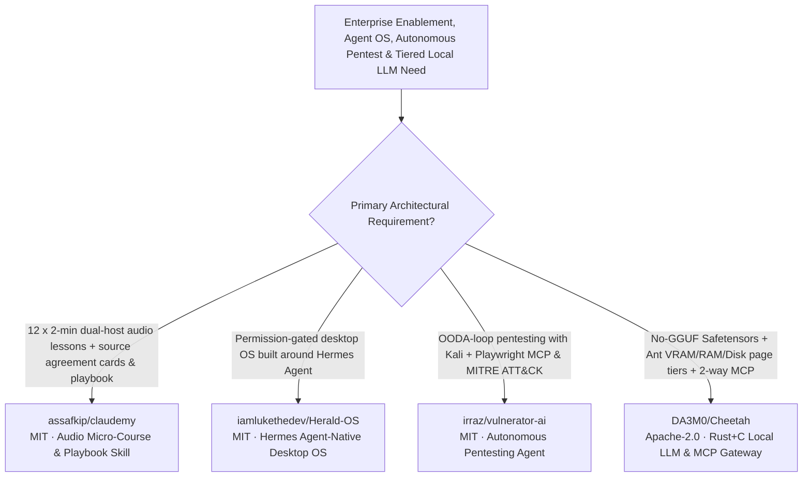
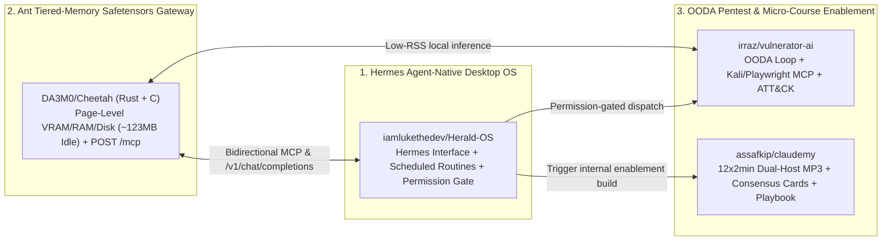
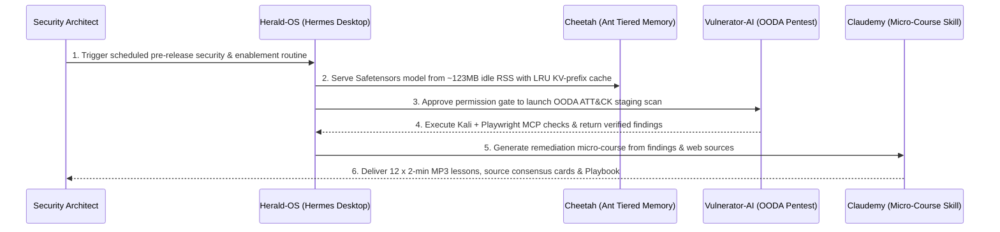

# 2-Minute Audio Micro-Course Skill, Hermes Agent-Native Desktop OS, OODA Pentesting Agent & Ant Tiered-Memory Safetensors Gateway Selection Guide: Claudemy vs Herald-OS vs Vulnerator-AI vs Cheetah

> **2026-11-23 Night Round 38 (🏆 Cumulative Round 825 Milestone!)** · Enterprise AI Solution Architect Practical Selection, End-to-End Integration Architecture & FinOps TCO Guide
> **Companion Architecture Diagram**: [`assets/github-ai-radar-2026-11-23-r38-r825-claudemy-heraldos-vulneratorai-cheetah.svg`](../../../assets/github-ai-radar-2026-11-23-r38-r825-claudemy-heraldos-vulneratorai-cheetah.svg)

---

## 1. 📌 Executive Summary

Across rapid engineering enablement, agent-native desktop operating systems, autonomous OODA-loop security verification, and page-level tiered-memory local LLM serving, **`assafkip/claudemy`**, **`iamlukethedev/Herald-OS`**, **`irraz/vulnerator-ai`**, and **`DA3M0/Cheetah`** deliver a complete enterprise stack:

1. **Source-Grounded 2-Minute Audio Micro-Course & Playbook Skill (`assafkip/claudemy`)**: (`★ 715`, `83 forks`, Python, `MIT`). An open-source Claude Code skill alternative to bloated 40-hour courses: give it any topic and it researches the web to build ~12 two-minute dual-host conversational MP3 lessons, each paired with a card (3-line core idea, how many sources agree vs. disagree, 1 timed practice exercise, and source links) plus a consolidated rule playbook.
2. **Hermes Agent-Native Desktop Operating System (`iamlukethedev/Herald-OS`)**: (`★ 665`, `112 forks`, TypeScript, `MIT`). Built around Nous Research's `Hermes Agent` as the primary desktop interface—talk or type to open apps, organize files, monitor processes, run scheduled routines, and build software while every state-mutating action passes through a user-controlled permission gate.
3. **Autonomous OODA-Loop Pentesting Agent (`irraz/vulnerator-ai`)**: (`★ 293`, `69 forks`, Python, `MIT`). Combines a Hermes reasoning core, Kali Linux + Playwright tools over MCP, and MITRE ATT&CK tactic mapping to run continuous Observe-Orient-Decide-Act security assessments against authorized staging environments.
4. **Rust + C Safetensors Gateway with Ant Tiered Memory & Bidirectional MCP (`DA3M0/Cheetah`)**: (`★ 51`, `5 forks`, Rust, `Apache-2.0`). Runs Safetensors decoder models directly (`cheetah init`, no GGUF conversion) across AVX2 SIMD CPU and Candle-free Vulkan backends with **Ant tiered memory** (real page-level VRAM/RAM/Disk residency scaling idle RSS on a 0.5B model down to `~123 MB` vs. `2.5 GB` untiered), LRU KV-prefix caching, `/v1/chat/completions`, and bidirectional MCP (`POST /mcp` server + `--mcp-server` client).
5. **FinOps Quantitative Takeaway**: Migrating from legacy corporate L&D course seats, proprietary desktop agent subscriptions, automated pentest SaaS, and cloud inference APIs (Path A: `$9,520.00/mo`) to this self-hosted open-source stack (Path C: `$305.00/mo`) saves **`$9,215.00/mo`** (**`-96.80%`**).

---

## 2. 🎯 Architect & Customer Key Q&A

### Q1: Why do enterprise engineering teams abandon 40-hour video courses, and how does `Claudemy` solve internal knowledge transfer?
- **The Problem**: Static 40-hour courses are outdated upon release and lack source-level debate or immediate practice.
- **The `Claudemy` Architecture**: Compresses any technical or business topic into **12 × 2-minute dual-host MP3 lessons**, explicitly quantifying **source agreement vs. dissent**, assigning **one timed practice task per lesson**, and compiling a single-page operational playbook.

### Q2: How do these four components integrate into an enterprise SecOps & developer enablement architecture?
1. **Desktop Agent Control Plane (`Herald-OS`)**: Engineers interact with `Hermes Agent` across files, processes, and scheduled jobs under explicit OS permission gates;
2. **Page-Tiered Local LLM & MCP Backbone (`Cheetah`)**: `cheetah serve` hosts local Safetensors models with Ant VRAM/RAM/Disk page residency (`~123 MB` idle RSS baseline), LRU KV-prefix caching, and `POST /mcp` tool exposure;
3. **Authorized Pre-Release Pentesting (`Vulnerator-AI`)**: Runs OODA-loop security checks using Kali + Playwright MCP tools mapped to MITRE ATT&CK;
4. **Just-in-Time Remediation Micro-Courses (`Claudemy`)**: Converts newly discovered security findings or architecture standards into 2-minute audio lessons and team playbooks.

### Q3: What are the key operational and compliance boundaries?
- **`claudemy`**, **`Herald-OS`**, and **`vulnerator-ai`**: All **`MIT`** licensed; restrict **`vulnerator-ai`** strictly to authorized staging/sandbox targets with signed rules of engagement.
- **`Cheetah`**: **`Apache-2.0`** licensed; eliminates GGUF quantization drift by preparing native Safetensors directories (`cheetah init`) with declarative per-family registries.

---

## 3. 🧭 Visual Architecture & Decision Diagrams (Mermaid)

### 3.1 Selection Decision Tree

### 3.2 End-to-End Enterprise Reference Architecture

### 3.3 Runtime Execution Sequence

---

## 4. 📊 Comparative Selection Matrix

| Dimension | `assafkip/claudemy` | `iamlukethedev/Herald-OS` | `irraz/vulnerator-ai` | `DA3M0/Cheetah` | Commercial Cloud & SaaS Stack (Path A) |
| :--- | :--- | :--- | :--- | :--- | :--- |
| **Primary Role** | 12×2-min dual-host audio course & playbook generator skill | Agent-native desktop OS interface powered by `Hermes Agent` | Autonomous OODA-loop pentesting agent over Kali + Playwright MCP | Rust + C Safetensors CLI, OpenAI gateway & bidirectional MCP | Corporate MOOC seats + proprietary agent OS + pentest SaaS + cloud APIs |
| **Key Technical Metric** | Source agreement/dissent cards + 1 timed practice per 2-min lesson | System-wide file, process & cron control behind permission gates | Hermes brain + MITRE ATT&CK + Kali & Playwright MCP tools | Ant page-level VRAM/RAM/Disk residency (`~123 MB` idle vs. `2.5 GB`) | Low completion rates on 40h courses & high idle RAM for local LLMs |
| **License** | `MIT` | `MIT` | `MIT` | `Apache-2.0` | Proprietary per-seat / per-scan SaaS |
| **Monthly TCO (45-Eng Team)** | **Combined `$305.00/mo`** (`$65.00` compute + `$240.00` ops labor) | Included in combined stack | Included in combined stack | Included in combined stack | **`$9,520.00/mo`** (`$5,020.00` SaaS/API + `$4,500.00` labor) |

---

## 5. 🧪 Quantitative FinOps TCO Comparison (Closed-Form Audit)

> **Audit Note**: Modeled for a 45-engineer enterprise engineering and security organization producing custom internal micro-courses, operating Hermes-driven developer desktops, running weekly pre-release OODA staging security validations, and hosting local Safetensors models. Repository metadata is verified via the GitHub REST API; live runtime p99 latency is marked `not_measured`.

| Cost Component | Path A: Corporate L&D Seats + Commercial Pentest SaaS + Cloud LLM APIs | Path C: Self-Hosted `claudemy` + `Herald-OS` + `vulnerator-ai` + `Cheetah` | Net Savings / Delta |
| :--- | :--- | :--- | :--- |
| **API / SaaS Subscriptions & Compute** | `$5,020.00 / mo` | `$65.00 / mo` | `-$4,955.00 / mo` |
| **Course Authoring, Manual Pentest Triage & Desktop Ops Labor** | `$4,500.00 / mo` (`45.0 hrs × $100/hr`) | `$240.00 / mo` (`2.4 hrs × $100/hr`) | `-$4,260.00 / mo` |
| **Total Monthly TCO** | **`$9,520.00 / mo`** | **`$305.00 / mo`** | **`$9,215.00 / mo` (`-96.80%`)** |

---

## 6. 🛠️ Enterprise Architecture Review Checklist

- [ ] **Source-Consensus Enablement Cards (`claudemy`)**: Require every internal onboarding micro-course generated by `claudemy` to preserve source links and explicit consensus/dissent counts.
- [ ] **OS Mutation Permission Policy (`Herald-OS`)**: Configure `Herald-OS` so all destructive file, process, and scheduled routine actions require explicit human confirmation.
- [ ] **Isolated Staging Scope (`vulnerator-ai`)**: Restrict `vulnerator-ai`'s Kali and Playwright MCP servers to isolated staging VPCs with MITRE ATT&CK audit logging.
- [ ] **Ant Tiered-Memory Profiling (`Cheetah`)**: Prepare Safetensors weights with `cheetah init`, tune VRAM/RAM/Disk residency budgets to keep idle RSS near the `~123 MB` class on edge/workstation nodes, and enable `CHEETAH_PREFILL_CHUNK` + LRU KV-prefix caching.
