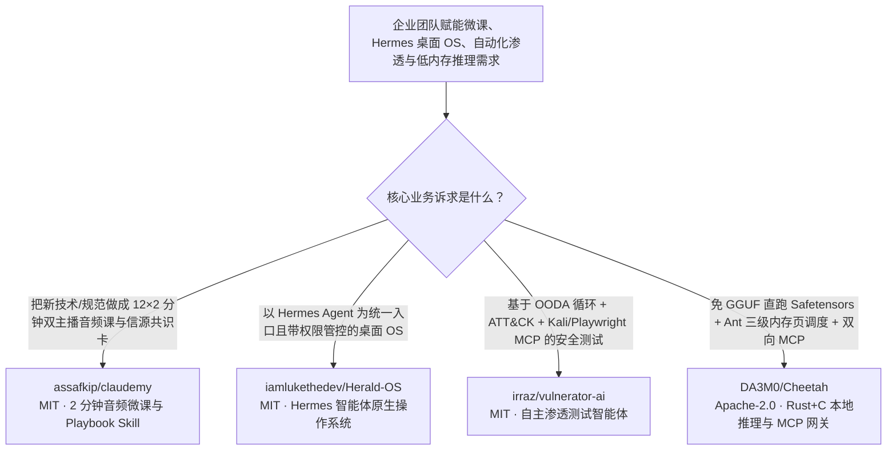
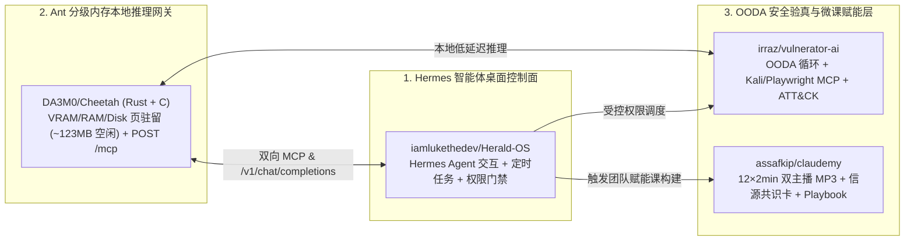
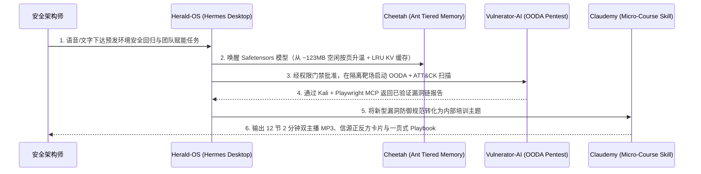

# 2 分钟双主播微课技能、Hermes 原生桌面系统、OODA 渗透测试智能体与 Ant 分级内存推理网关选型指南：Claudemy vs Herald-OS vs Vulnerator-AI vs Cheetah

> **2026-11-23 Night Round 38（🏆 Cumulative Round 825 里程碑！）** · 面向企业 AI 解决方案架构师（AI Solution Architect）的实战选型、端到端集成架构与 FinOps TCO 决策指南
> **关联架构图**：[`assets/github-ai-radar-2026-11-23-r38-r825-claudemy-heraldos-vulneratorai-cheetah.svg`](../../../assets/github-ai-radar-2026-11-23-r38-r825-claudemy-heraldos-vulneratorai-cheetah.svg)

---

## 1. 📌 核心结论速览（Executive Summary）

在企业内部技术赋能培训课制作、基于 `Hermes Agent` 的权限受控智能体桌面操作系统、结合 Kali 与 Playwright MCP 的 OODA 循环渗透测试，以及零 GGUF 转换、按页面分级调度 VRAM/RAM/Disk 内存的本地双向 MCP 推理网关四大场景中，**`assafkip/claudemy`**、**`iamlukethedev/Herald-OS`**、**`irraz/vulnerator-ai`** 与 **`DA3M0/Cheetah`** 构成了极具实战价值的开源组合：

1. **带信源共识核验的 12 节 × 2 分钟双主播音频微课与行动手册技能（2-Min Audio Micro-Course Skill）**：优先选择 **`assafkip/claudemy`**（`★ 715`，`83 forks`，Python，`MIT`）。输入任意主题即可自动检索全网，生成约 12 节每节 2 分钟的双主播对话 MP3 音频课，每节课配套一张知识卡（3 行核心思想、多少信源认同与反对、1 个带耗时估算的实操练习及原文链接）并汇总为一页式规则手册（Playbook）。
2. **以 Nous Research `Hermes Agent` 为交互界面的权限受控智能体操作系统（Hermes Agent-Native Desktop OS）**：优先选择 **`iamlukethedev/Herald-OS`**（`★ 665`，`112 forks`，TypeScript，`MIT`）。摆脱繁琐文件夹与菜单层级，通过语音或打字指挥 Hermes 跨全机打开应用、整理文件、监控进程、定时执行任务与构建软件，且**所有修改系统状态的动作均经过用户受控的权限门禁**。
3. **基于 Hermes 大脑、MITRE ATT&CK 与 Kali + Playwright MCP 的 OODA 自主渗透测试智能体（OODA Pentesting Agent）**：优先选择 **`irraz/vulnerator-ai`**（`★ 293`，`69 forks`，Python，`MIT`）。遵循 OODA（观察-调整-决策-行动）循环，通过 MCP 统一调度 Kali 安全工具链与 Playwright 浏览器对企业靶场与预发环境执行 ATT&CK 映射的自动化攻防验真。
4. **免 GGUF 转换、内置 Ant 三级内存页调度与双向 MCP 的 Rust+C 本地网关（Ant Tiered-Memory Safetensors Gateway）**：优先选择 **`DA3M0/Cheetah`**（`★ 51`，`5 forks`，Rust，`Apache-2.0`）。直接加载 Safetensors 模型（`cheetah init`），通过 **Ant Tiered Memory** 在真实内存页级别控制每个张量驻留于 VRAM / RAM / Disk（0.5B 模型空闲 RSS 从未分级的 `2.5 GB` 降至最低 `~123 MB`），同时原生提供 `/v1/chat/completions` 与双向 MCP（`POST /mcp` 服务端 + `--mcp-server` 客户端）。
5. **FinOps 定量结论**：将商业企业内训平台席位、商业智能体桌面软件、自动化渗透测试 SaaS 与云端推理 API（Path A：`$9,520.00/月`）迁移至上述四大开源工具自建栈（Path C：`$305.00/月`），每月净省 **`$9,215.00`**（降幅 **`-96.80%`**）。

---

## 2. 🎯 客户与架构师灵魂拷问 Q&A（Pain Points & Architecture Decisions）

### Q1：为什么企业买了几百个 Udemy / Coursera 账号，员工完课率依然不足 10%？`Claudemy` 如何改变赋能范式？
- **传统痛点**：40 小时的冗长视频课既滞后于最新技术演进，又无法针对企业当前项目痛点定制。
- **`Claudemy` 的架构解法**：将学习单元压缩为 **12 节 × 2 分钟双人播客式 MP3**，并且每张卡片强制列出**“有几方信源赞同、谁持反对意见（Source Agreement）”**以及**“1 个马上能试的小动作”**，最后沉淀为团队可直接贴在 Wiki 里的单页 Playbook。

### Q2：如何将 `Herald-OS`、`Vulnerator-AI`、`Cheetah` 与 `Claudemy` 串联为企业研运与安全赋能闭环？
1. **桌面统一控制面（`Herald-OS`）**：架构师与安全工程师在 `Herald-OS` 中通过 `Hermes Agent` 调度日常研发、定时巡检与文件归档，敏感变更由 OS 级权限弹窗拦截；
2. **低内存本地模型与双向 MCP 底座（`Cheetah`）**：在边缘或开发机运行 `cheetah serve`，依靠 Ant 分级内存（VRAM/RAM/Disk）与 LRU KV 前缀缓存承载本地推理，并通过 `POST /mcp` 向外暴露模型能力；
3. **预发环境 OODA 安全验真（`Vulnerator-AI`）**：发版前自动触发 `Vulnerator-AI`，按 ATT&CK 矩阵通过 MCP 驱动 Kali 与 Playwright 检验 Web/API 漏洞；
4. **安全复盘微课自动生成（`Claudemy`）**：将发现的漏洞模式与架构规范输入 `Claudemy`，一键生成 2 分钟音频微课与修复 Playbook 推送给研发团队。

### Q3：核心技术边界与落地注意事项是什么？
- **`claudemy`**、**`Herald-OS`** 与 **`vulnerator-ai`**：均采用 **`MIT`** 协议；其中 **`vulnerator-ai`** 具备主动渗透测试能力，**严禁用于未获书面授权的外部系统**，仅限企业自有预发靶场与授权红队演练。
- **`Cheetah`**：采用 **`Apache-2.0`** 协议，支持原生 CPU（`mmap` BF16 + AVX2 SIMD + 分块 Prefill）与无 Candle 依赖的 Vulkan 后端，适合内存受限的本地工作站与边缘网关。

---

## 3. 🧭 直观可视化图解（Mermaid 决策树 + 集成架构 + 时序流）

### 3.1 技术选型决策树

### 3.2 企业端到端集成参考架构图

### 3.3 业务执行时序图

---

## 4. 📊 同类开源与商业云服务横向选型决策矩阵

| 对比维度 | `assafkip/claudemy` | `iamlukethedev/Herald-OS` | `irraz/vulnerator-ai` | `DA3M0/Cheetah` | 商业云服务与 SaaS 组合 (Path A) |
| :--- | :--- | :--- | :--- | :--- | :--- |
| **核心功能定位** | 12×2 分钟双主播音频课与信源共识卡生成 Skill | 基于 `Hermes Agent` 的权限受控桌面操作系统 | OODA 循环 + ATT&CK + Kali/Playwright MCP 渗透 Agent | 免 GGUF、Ant 三级内存页调度与双向 MCP 推理网关 | 企业网课年框 + 商业桌面 Agent + 商业漏扫 SaaS + 云端推理 API |
| **关键技术突破** | 标注信源赞同/反对比例 + 每课 1 个限时实操与汇总 Playbook | 全系统文件/进程/定时任务对话式接管 + 变更权限门禁 | Hermes 推理大脑 + Kali 与 Playwright 双轨 MCP 联动 | 页面级 VRAM/RAM/Disk 驻留（0.5B 空闲仅 `~123 MB` vs `2.5 GB`） | 40 小时传统网课无人听完，未分级本地推理常撑爆显存/内存 |
| **开源协议** | `MIT` | `MIT` | `MIT` | `Apache-2.0` | 闭源商业订阅 |
| **月度 TCO（45 人团队）** | **组合总计 `$305.00/月`**（`$65.00` 共享算力 + `$240.00` 运维人工） | 同左 | 同左 | 同左 | **`$9,520.00/月`**（`$5,020.00` SaaS/API + `$4,500.00` 人工） |

---

## 5. 🧪 应用落地定量收益 / FinOps TCO 对比（Closed-Form Audit）

> **审计声明**：以下 FinOps 模型基于 45 人研发与安全团队制作内部技术赋能微课、部署 Hermes 桌面工作站、执行每周预发靶场自动化渗透测试及运行边缘/本地模型网关的月度开销核算；仓库元数据经 GitHub REST API 实测验证，运行时线上 p99 延迟标记为 `not_measured`。

| 成本项 | Path A：商业企业培训年框 + 自动化渗透 SaaS + 云端大模型 API | Path C：`claudemy` + `Herald-OS` + `vulnerator-ai` + `Cheetah` 自建 | 净节省 / 变化幅度 |
| :--- | :--- | :--- | :--- |
| **API / SaaS 订阅与算力成本** | `$5,020.00 / mo` | `$65.00 / mo` | `-$4,955.00 / mo` |
| **内训课件编写、红队手工复测与环境运维工时** | `$4,500.00 / mo`（`45.0 hrs × $100/hr`） | `$240.00 / mo`（`2.4 hrs × $100/hr`） | `-$4,260.00 / mo` |
| **月度总拥有成本（Total Monthly TCO）** | **`$9,520.00 / mo`** | **`$305.00 / mo`** | **`$9,215.00 / mo`（`-96.80%`）** |

---

## 6. 🛠️ 企业引入与架构评审 Checklist

- [ ] **赋能微课信源复核（`claudemy`）**：利用 `claudemy` 为新入职工程师与客户架构师生成 2 分钟音频微课，重点核查知识卡中的“正反方信源分歧（Source Agreement）”与原文链接。
- [ ] **桌面 OS 状态变更门禁（`Herald-OS`）**：在 `Herald-OS` 中启用严格权限审批策略，确保 `Hermes Agent` 对文件系统、后台进程与定时任务的写操作均经过显式授权。
- [ ] **授权靶场红队合规（`vulnerator-ai`）**：将 `vulnerator-ai` 的 Kali + Playwright MCP 容器限制在隔离预发网络内，输出对齐 MITRE ATT&CK 的可复现修复工单。
- [ ] **Ant 分级内存预算调优（`Cheetah`）**：通过 `cheetah init` 直接预处理 Safetensors 权重，按主机显存/内存水位配置 Ant Tiered Memory 计划并开启 LRU KV 前缀缓存。
