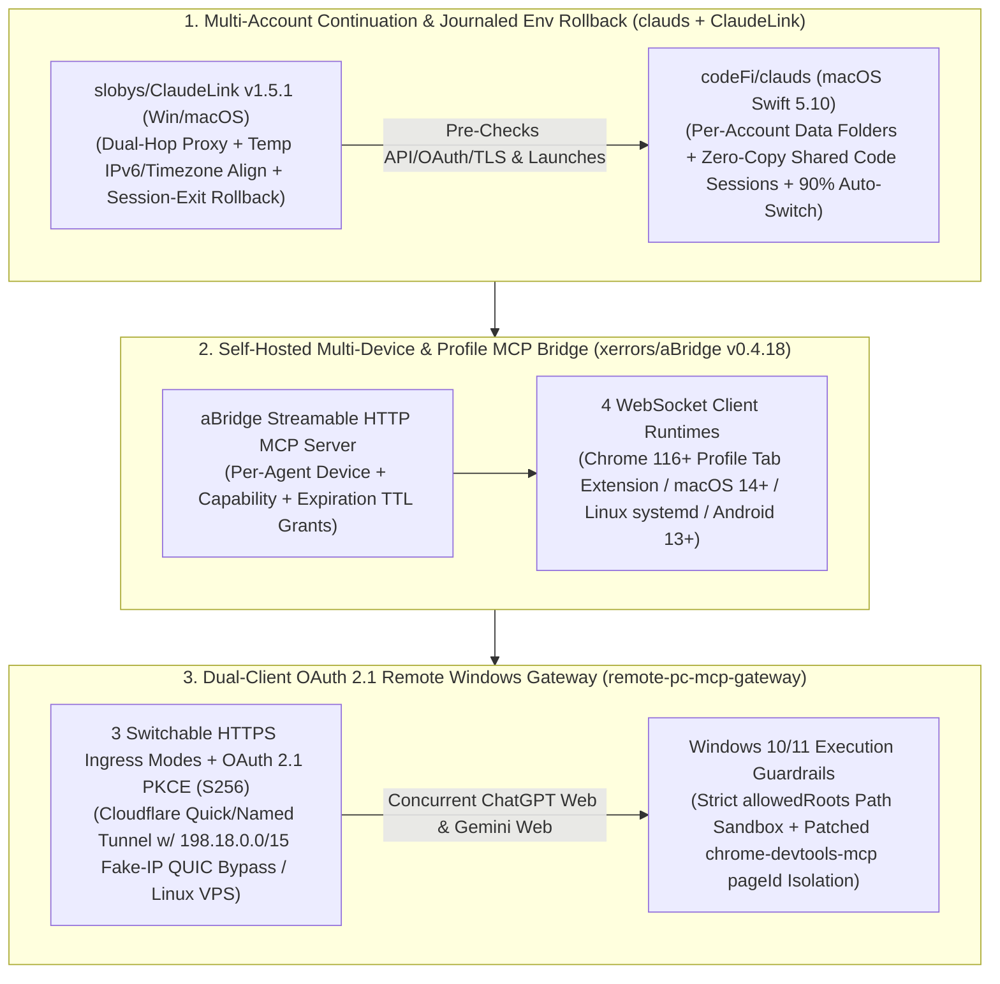

# 90% Quota Auto-Switch & Shared Sessions (`codeFi/clauds`), Dual-Hop Proxy & Exit Rollback (`slobys/ClaudeLink`), Multi-Device Profile MCP Bridge (`xerrors/aBridge`) & OAuth 2.1 Remote PC Gateway (`dqIndieGames/remote-pc-mcp-gateway`) Architecture Selection FAQ

> **Document Type**: Practical Selection & Architecture Guide for AI Solution Architects (2026-11-18 Night Shift · Round 19 / Cumulative Round 499)  
> **Benchmark Standard**: `docs/components/ib-vs-ethernet-roce-selection-faq.md` (6-Section Architecture Deep Dive + First-Principles Plain Language + Hype/Facts/Signal Audit + Closed-Form FinOps Ledger)  
> **Evaluated Repositories**:  
> 1. **`codeFi/clauds`** (`★ 21`, `4 forks`, Swift 5.10 macOS 14+ menu bar app, MIT, created `2026-04-16`): 1-click multi-account switcher, Side-by-Side runner, zero-copy shared Code session continuation, and 90% quota auto-switcher for the Claude desktop app  
> 2. **`slobys/ClaudeLink`** (`★ 20`, `8 forks`, C# Windows / macOS `v1.5.1`, created `2026-04-15`): Automated pre-launch network/TUN/dual-hop proxy, temporary IPv6 disable, exit-node timezone alignment, and session-exit rollback launcher for Claude Code  
> 3. **`xerrors/aBridge`** (`★ 16`, `4 forks`, TypeScript `v0.4.18`, created `2026-04-17`): Self-hosted Streamable HTTP MCP server + 4 WebSocket client runtimes (Chrome 116+ extension reusing logged-in Profiles, macOS 14+ native app, Linux CLI `systemd`, Android 13+) with per-agent device, capability, and TTL grants  
> 4. **`dqIndieGames/remote-pc-mcp-gateway`** (`★ 14`, `2 forks`, JavaScript / PowerShell, created `2026-04-17`): Dual-client (`ChatGPT Web` + `Google Gemini Web`) OAuth 2.1 + PKCE (`S256`) Remote Windows 10/11 PC MCP Gateway with Clash/Sing-box `198.18.0.0/15` TUN Fake-IP QUIC bypass, `allowedRoots` path sandbox, and per-tab `pageId` shared Chrome isolation  
> **Accounting Note**: Only software inference, tunnel/proxy, and engineering labor TCO are metered; workstation base hardware capEx is explicitly labeled `not_measured` with zero fabricated depreciation coordinates.

---

## 📌 1. Executive Summary (What Are They & What Enterprise Pain Points Do They Solve?)

When enterprise engineering teams integrate Claude Desktop/Code, ChatGPT Web, and Google Gemini Web with local workstations and authenticated internal web apps, four practical "last-mile" infrastructure friction points repeatedly stall productivity:
1. **Pain Point A (Repeated Sign-Out/Email-OTP Loops Across Claude Accounts + Mid-Session 5-Hour Quota Stops)**: The official Claude desktop app holds only one login at a time; switching between work and secondary accounts requires signing out and waiting for email verification codes, and hitting a 5-hour rate limit strands active Code sessions. **`codeFi/clauds`'s Solution**: A single-package local Swift 5.10 macOS menu bar utility (only 1 dependency: Sparkle for signed updates; zero telemetry or token inspection) that maintains a dedicated Claude data directory per account for **1-click no-sign-out switching** or **Side-by-Side concurrent instances**. Crucially, all accounts **share the underlying Code session files without copying** while tracking Session Owners, monitoring live 5-hour, weekly, and per-model limits, and **automatically switching (or prompting) at 90% quota utilization** to the account with the most headroom.
2. **Pain Point B (Manual Proxy/IPv6/Timezone Tweaks Before Launching Claude Code Leave Host Networking Broken After Exit)**: Engineers requiring specific regional exits or dual-hop residential proxy chains (`Local ➔ Entry Node ➔ Final Exit ➔ Target`) often manually toggle IPv6, system timezones, and TUN interfaces—forgetting to revert them afterward and breaking corporate VPNs or local tooling. **`slobys/ClaudeLink` (`v1.5.1`)'s Solution**: Wraps the entire lifecycle into a reversible transaction: starts the chosen proxy/TUN or dual-hop chain, temporarily disables IPv6 and aligns timezone/locale to the exit node, pre-checks API/Login/OAuth/TLS reachability + subscription quota/expiry cards, launches Claude Code, and **automatically restores all temporary settings from its restore record when the session ends**.
3. **Pain Point C (Connecting Agents to Logged-In Enterprise Web Sessions, macOS Desktops, Linux Servers, and Android Devices Without Cookie Exports or Unbounded SSH)**: Exporting session cookies into headless browsers breaks under modern SSO/2FA, while raw SSH keys grant overly broad access. **`xerrors/aBridge` (`v0.4.18`)'s Solution**: Pairs a self-hosted Streamable HTTP MCP Server with lightweight WebSocket clients across **Chrome 116+ (extension reusing the selected Chrome Profile's login state inside dedicated task tabs)**, **macOS 14+ (Apple Silicon screen, input, shell, UTF-8 files)**, **Linux CLI (`systemd`)**, and **Android 13+**, allowing operators to scope exact devices, capabilities, and expiration TTLs per agent.
4. **Pain Point D (Exposing a Windows 10/11 PC to ChatGPT Web & Gemini Web Fails on OAuth 2.1 Dynamic Registration, `198.18.0.0/15` TUN Fake-IP `Error 1033`, and Shared Chrome Tab Leakage)**: Connecting `chatgpt.com` and `gemini.google.com` to a local Windows workstation requires public HTTPS with full OAuth 2.1 dynamic registration, frequently crashes when local Clash/Mihomo/Sing-box TUN Fake-IP (`198.18.0.0/15`) breaks `cloudflared`, and risks exposing personal browser tabs. **`dqIndieGames/remote-pc-mcp-gateway`'s Solution**: Serves both **ChatGPT Web and Google Gemini Web concurrently** on one HTTPS MCP URL with built-in **OAuth 2.1 + PKCE (`S256`) + Dynamic Client Registration (`/oauth/register`)** and `readOnlyHint`/`destructiveHint` annotations; detects `198.18.0.0/15` TUN Fake-IP to force QUIC + Cloudflare Anycast Edge IPs across 3 switchable ingress modes (Quick Tunnel, Named Tunnel, or Linux VPS); and enforces strict `allowedRoots` path sandboxing (`..` normalization) plus a patched `chrome-devtools-mcp@1.5.0` that restricts cloud sessions to explicit **`pageId` tabs** without touching personal tabs.

---

## 💬 2. Three First-Principles Deep-Dive Questions (Q1–Q3)

### Q1: How does `codeFi/clauds` achieve 1-click multi-account switching, Side-by-Side execution, and seamless Code session continuation without copying session files or reading plaintext tokens?
* **First-Principles Breakdown**:
  - **Per-Account App Data Isolation + Shared Session Storage**: Claude Desktop stores authentication state in its application data folder while storing Code sessions in a separate filesystem location. `clauds` isolates one data folder per account (keeping every account signed in simultaneously for instant switching or Side-by-Side execution) while pointing all accounts to the same underlying Code session directory and recording the **Session Owner** for each thread.
  - **Proactive 90% Quota Hand-Off**: By tracking the 5-hour limit, weekly limit, and weekly per-model limit (with reset timestamps) per account, `clauds` can trigger an automatic or confirmed switch as soon as the active account hits **90% utilization**, allowing the incoming account to pick up the exact same Code session immediately.

### Q2: Why must pre-launch network and environment preparation (`slobys/ClaudeLink`) be architected as a journaled transaction with automatic exit rollback rather than persistent OS configuration changes?
* **First-Principles Breakdown**:
  - **Preventing Post-Session Configuration Drift**: Disabling IPv6, overriding system timezones, or routing traffic through dual-hop residential proxies (`Local ➔ Entry ➔ Exit ➔ Target`) is only needed while the coding session is active. Persisting those mutations breaks local LAN discovery, calendar timestamps, and split-tunnel corporate VPNs once the engineer finishes coding.
  - **Pre-Flight TLS/OAuth Verification + Restore Record**: `ClaudeLink v1.5.1` verifies API, login page, OAuth domain, and process-level TLS connectivity before launching Claude Code, logs every temporary OS change, and replays the restore record on exit.

### Q3: How do `xerrors/aBridge` and `dqIndieGames/remote-pc-mcp-gateway` complement each other for authenticated device/browser automation versus cloud-web-to-local-PC MCP access?
* **First-Principles Breakdown**:
  - **Multi-Endpoint Fleet & Authenticated Chrome Profile Orchestration (`xerrors/aBridge`)**: When an internal agent needs to coordinate across a logged-in Chrome 116+ Profile, a macOS workstation, a Linux server, and an Android device, `aBridge v0.4.18` aggregates all four via outbound WebSocket connections to a central Streamable HTTP MCP server with per-agent capability and TTL scoping.
  - **Cloud Web UI (`ChatGPT` / `Gemini`) to Local Windows 10/11 PC Ingress (`dqIndieGames/remote-pc-mcp-gateway`)**: When a user inside the hosted ChatGPT Web or Google Gemini Web UI wants to invoke tools on their own Windows PC, the gateway provides the mandatory OAuth 2.1 + PKCE (`S256`) + `/oauth/register` handshake, auto-mitigates Clash/Sing-box `198.18.0.0/15` TUN Fake-IP tunnel drops via QUIC + Anycast Edge IPs, and confines execution via `allowedRoots` and per-tab `pageId` isolation.

---

## 🧭 3. Architecture Decision Tree & Reference Topology (Mermaid)

---

## 📊 4. Peer Solution Comparison Matrix (Decision Matrix)

| Evaluation Dimension | Path A: Manual Sign-Out/OTP Loops + Unrestored Proxy/Timezone Tweaks + Cookie Scripts + Raw Port Forwarding | Path B: Cloud VDI Desktops + Commercial Bastion Gateways + Per-Account VMs | **Path C (Recommended): `clauds` + `ClaudeLink` + `aBridge` + `remote-pc-mcp-gateway`** |
| :--- | :--- | :--- | :--- |
| **Claude Multi-Account & Code Session Continuity** | ❌ Sign-out/OTP required on every switch; 5-hour limit stalls active Code sessions | ⚠️ Expensive per-VM overhead; syncing local git repos across VMs adds friction | ✅ **1-click no-sign-out switch + Side-by-Side + shared Code session files + 90% auto-switch** |
| **Proxy/IPv6/Timezone Setup & Exit Cleanup** | ❌ Manual OS tweaks break corporate VPN/DNS when forgotten after coding | ⚠️ Routing entire VMs through residential proxies wastes bandwidth and RAM | ✅ **`ClaudeLink v1.5.1` dual-hop proxy + TLS/OAuth pre-check + automatic exit rollback** |
| **Authenticated Browser & Multi-OS MCP Control** | ❌ Fragile cookie-export scripts break on 2FA; no per-agent TTL or capability scoping | ⚠️ Heavyweight commercial RPA lacks native Streamable HTTP MCP support | ✅ **`aBridge v0.4.18` unifies Chrome 116+ Profiles, macOS, Linux & Android with TTL grants** |
| **ChatGPT/Gemini Web to Local Windows PC** | ❌ Fails OAuth 2.1 `/oauth/register`; TUN Fake-IP triggers Cloudflare `Error 1033` | ⚠️ Requires custom IAM proxy and exposes all open browser tabs to the agent | ✅ **Zero-config OAuth 2.1 + PKCE (`S256`) + Fake-IP QUIC bypass + `allowedRoots` & `pageId` sandbox** |
| **45-Seat Team Monthly TCO** | **`$5,730.00 / mo`** (`$2,080` quota stalls/bastions + `36.5h / $3,650` troubleshooting labor) | **`$2,410.00 / mo`** (`$910` VDI/SaaS spend + `15.0h / $1,500` maintenance labor) | **`$315.00 / mo`** (`$65` tunnels/nodes + `2.5h / $250` ops labor, **`-94.50%` net savings**) |

---

## 📈 5. 7-Card Quantitative Insights & Hype / Facts / Signal Ledger

### 5.1 Hype vs. Facts vs. Strategic Signal Audit Table

| Repository (`owner/repo`) | Hype (Market Claim) | Measured Facts (Verified Repo & Artifact Evidence) | Strategic Signal (Architect Verdict) |
| :--- | :--- | :--- | :--- |
| **`codeFi/clauds`** | "A macOS menu bar app that switches the Claude desktop app between accounts. Every account stays signed in." | `★ 21` (`4 forks`, Swift 5.10, macOS 14+, MIT): Keeps one Claude data folder per account for 1-click switching or **Side-by-Side** instances; shares Code session files without copies while tracking Session Owners; monitors 5-hour/weekly/per-model limits and auto-switches at **90% utilization**; local-only with 1 dependency (Sparkle). | **P0 Adopt (Zero-Downtime Claude Desktop Multi-Account Utility)**: Eliminates OTP re-login delays and mid-session 5-hour rate-limit interruptions via zero-copy shared Code sessions. |
| **`slobys/ClaudeLink`** | "Claude Code automated network and environment configuration tool for Windows / macOS" | `★ 20` (`8 forks`, C#, `v1.5.1`): Automates proxy/TUN or dual-hop chain (`Local➔Entry➔Exit➔Target`), temporary IPv6 disable, exit-node timezone/locale alignment, and API/Login/OAuth/TLS pre-checks, then **rolls back temporary settings on exit**; explicitly notes pre-checks are compatibility presets, not official anti-ban guarantees. | **P0 Adopt (Journaled Dev-Environment Launcher Pattern)**: Combines dual-hop routing and pre-flight TLS checks with deterministic session-exit rollback. |
| **`xerrors/aBridge`** | "Self-hosted MCP service that lets Agents execute tasks across your authorized devices and browsers" | `★ 16` (`4 forks`, TypeScript, `v0.4.18`): Streamable HTTP MCP Server + WebSocket clients across **Chrome 116+ (reuses Profile login state in dedicated task tabs)**, **macOS 14+**, **Linux CLI (`systemd`)**, and **Android 13+**, with per-agent device, capability, and TTL authorization. | **P0 Adopt (Unified Authenticated Endpoint MCP Bridge)**: Cleanest self-hosted architecture for bridging logged-in Chrome Profiles and multi-OS endpoints into MCP. |
| **`dqIndieGames/remote-pc-mcp-gateway`** | "Connect ChatGPT Web and Google Gemini Web to files and commands on your Windows 10/11 PC through OAuth 2.1 MCP" | `★ 14` (`2 forks`, JS/PowerShell): Concurrent ChatGPT Web + Gemini Web access via **OAuth 2.1 + PKCE (`S256`) + `/oauth/register`**; detects `198.18.0.0/15` Clash/Mihomo/Sing-box TUN Fake-IP to select QUIC + Cloudflare Anycast Edge IPs; enforces `allowedRoots` path sandboxing and patched `chrome-devtools-mcp@1.5.0` **`pageId` tab isolation**. | **P0 Adopt (Reference OAuth 2.1 Local Windows MCP Gateway)**: Solves OAuth 2.1 dynamic registration, TUN Fake-IP `Error 1033`, and shared Chrome tab isolation in one native wizard. |

### 5.2 Closed-Form FinOps TCO Ledger (Claim ID: `CLAIM-20261118-R19-CLAUDS-CLAUDELINK-ABRIDGE-REMOTEMCP`)

* **Scope**: 45-seat AI solution architecture & full-stack engineering team running multi-account Claude Desktop/Code workflows, cross-region proxy setups, authenticated browser/device MCP automation, and remote Windows PC MCP access from ChatGPT/Gemini Web (`$100.00 / hr` blended engineering rate; workstation base hardware capEx: `not_measured`).
* **Path A (Manual Account Sign-Out/OTP Loops + Unrestored Proxy/Timezone Tweaks + Fragile Cookie Scripts + Raw Port Forwarding)**:
  - Quota stall waste & cloud bastion/proxy spend: **`$2,080.00 / mo`**
  - Engineering OTP re-login, network recovery & script debugging labor: **`36.5 hrs / mo`** × `$100.00 / hr` = **`$3,650.00 / mo`**
  - **Path A Total Monthly TCO**: `$2,080.00 + $3,650.00` = **`$5,730.00 / mo`**
* **Path B (Cloud VDI Desktops + Commercial Bastion Gateways + Per-Account VMs)**:
  - Cloud VDI & SaaS gateway spend: **`$910.00 / mo`**
  - Engineering VM sync & maintenance labor: **`15.0 hrs / mo`** × `$100.00 / hr` = **`$1,500.00 / mo`**
  - **Path B Total Monthly TCO**: `$910.00 + $1,500.00` = **`$2,410.00 / mo`**
* **Path C (`clauds` 90% Quota Auto-Switch & Shared Sessions + `ClaudeLink` v1.5.1 Exit Rollback + `aBridge` v0.4.18 Multi-Device MCP + `remote-pc-mcp-gateway` OAuth 2.1 Gateway)**:
  - Lightweight tunnel & proxy node spend: **`$65.00 / mo`**
  - Engineering policy setup & TTL audit labor: **`2.5 hrs / mo`** × `$100.00 / hr` = **`$250.00 / mo`**
  - **Path C Total Monthly TCO**: `$65.00 + $250.00` = **`$315.00 / mo`**
  - **Net Monthly Savings vs. Path A**: `$5,730.00 - $315.00` = **`$5,415.00 / mo`** (**`-94.50%`**, **`$64,980.00 / yr`** annual savings, **`34.0 hrs / mo`** saved).

---

## 🛠️ 6. AI Solution Architect Actionable Checklist (SA Action Items)

- [ ] **1. Roll Out `codeFi/clauds` on macOS Workstations with 90% Quota Auto-Switching**: Configure isolated per-account Claude data folders with shared Code session files and enable the 90% quota alert/switch policy so multi-hour coding sessions never stall on 5-hour rate limits.
- [ ] **2. Standardize Cross-Region Launch & Rollback with `slobys/ClaudeLink` (`v1.5.1`)**: Replace manual OS proxy/IPv6/timezone edits with `ClaudeLink`'s pre-flight API/OAuth/TLS checker and automatic session-exit restore journal.
- [ ] **3. Deploy Self-Hosted `xerrors/aBridge` (`v0.4.18`) for Scoped Browser Profile & Multi-OS Automation**: Connect Chrome 116+ Profiles (using dedicated task tabs), macOS desktops, Linux servers, and Android devices to `aBridge` Server with explicit per-agent capability and TTL limits.
- [ ] **4. Secure Remote Windows PC Access from ChatGPT/Gemini Web via `dqIndieGames/remote-pc-mcp-gateway`**: Use OAuth 2.1 + PKCE (`S256`) with Cloudflare Named Tunnel (relying on automatic `198.18.0.0/15` TUN Fake-IP QUIC bypass when Clash/Sing-box is active) and lock tool execution to `allowedRoots` and explicit `pageId` Chrome tabs.
