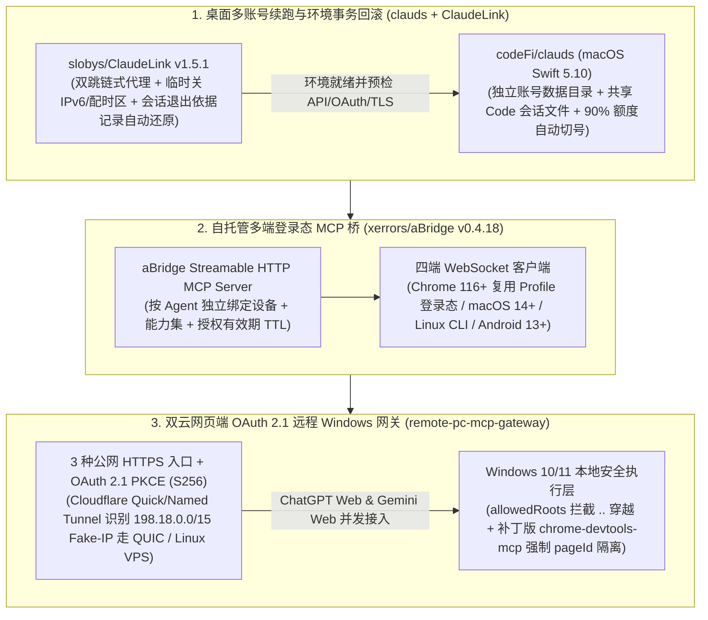

# 90% 额度自动切号与共享会话（`codeFi/clauds`）、双跳代理与退出自动还原（`slobys/ClaudeLink`）、多端登录态 MCP 桥（`xerrors/aBridge`）与 OAuth 2.1 远程 PC 网关（`dqIndieGames/remote-pc-mcp-gateway`）架构选型 FAQ

> **文档类型**：AI Solution Architect（AI 解决方案架构师）实战选型与架构内功指南（2026-11-18 Night Shift · Round 19 / 累计第 499 轮）  
> **对标标杆**：`docs/components/ib-vs-ethernet-roce-selection-faq.md`（六段式架构拆解 + 第一性原理大白话 + Hype/Facts/Signal 审计 + 闭式 TCO 账本）  
> **本轮评估对象**：  
> 1. **`codeFi/clauds`**（`★ 21`, `4 forks`, Swift 5.10 macOS 14+ 菜单栏应用, MIT, `2026-04-16` 新建）：Claude 桌面端多账号免退登一键切换、Side-by-Side 多开、跨账号续接同一 Code 会话与 90% 额度水位自动切号工具  
> 2. **`slobys/ClaudeLink`**（`★ 20`, `8 forks`, C# Windows / macOS `v1.5.1`, `2026-04-15` 新建）：Claude Code 启动前网络/双跳链式代理/IPv6 临时关闭/出口时区匹配与会话结束后自动回滚还原启动器  
> 3. **`xerrors/aBridge`**（`★ 16`, `4 forks`, TypeScript `v0.4.18`, `2026-04-17` 新建）：自托管 Streamable HTTP MCP 服务端 + 四端 WebSocket 客户端（Chrome 116+ 扩展复用 Profile 登录态、macOS 原生桌面、Linux CLI systemd、Android 13+），支持按 Agent 独立授权设备、能力与有效期  
> 4. **`dqIndieGames/remote-pc-mcp-gateway`**（`★ 14`, `2 forks`, JavaScript / PowerShell, `2026-04-17` 新建）：面向 ChatGPT Web 与 Google Gemini Web 双客户端并发接入的 Windows 10/11 OAuth 2.1 + PKCE (`S256`) 远程 PC MCP 网关（内置 Clash/Sing-box `198.18.0.0/15` Fake-IP 自动绕行、`allowedRoots` 路径沙箱与 `pageId` 标签页隔离）  
> **审计折算说明**：本报告仅计量开发运维与软件推理/人力 TCO，底层开发机硬件采购（base hardware capEx）标注为 `not_measured`，严禁虚构硬件折旧坐标。

---

## 📌 一、核心结论速览（Executive Summary：它到底是什么？解决什么业务痛点？）

当企业研发团队在日常高强度使用 Claude Desktop/Code、ChatGPT Web 与 Gemini Web 联动本机代码库与已登录内网业务系统时，常常卡在四个极具代表性的“最后一公里”工程障碍上：
1. **痛点 A（工作号与个人号在 Claude Desktop 切换必须反复退登收邮件验证码 + 5 小时额度耗尽导致 Code 会话被迫中断）**：Claude 官方桌面端一次只能保持一个登录态，多账号切换不仅繁琐，而且当主账号触及 5 小时限流时，正在进行的 Code 会话无法无缝交给备用账号继续跑。**`codeFi/clauds` 的破局之道**：用单包 Swift 5.10 菜单栏应用（仅依赖 Sparkle 签名更新，零遥测、不读取密码或 Token）为每个账号维护独立的数据目录，实现**免退登一键切号**与 **Side-by-Side 多账号同时多开**；更关键的是，它让各账号**直接共享底层 Code 会话文件（无拷贝）** 并记录会话归属人（Session Owners），配合实时监控 5 小时/周度/单模型额度与重置倒计时，在当前账号达到 **90% 额度水位时自动（或弹窗确认）切往剩余空间最大的账号**无缝续跑同一任务。
2. **痛点 B（启动 Claude Code 前手动改代理、关 IPv6、调时区极易遗漏，且退出后忘记还原导致本机日常办公网络瘫痪）**：跨国研发团队需要特定出口节点或双跳住宅代理（`本机 → 入口节点 → 最终出口 → 目标网站`），但手动修改系统 IPv6 与时区后一旦忘记恢复，会导致企业内网与日常软件断网。**`slobys/ClaudeLink` (`v1.5.1`) 的破局之道**：将“启动所选节点/双跳代理 ➔ 临时关闭 IPv6 并匹配出口时区与终端语言 ➔ 预检 API/登录页/OAuth 域名与进程 TLS 连通性 ➔ 启动 Claude Code ➔ **结束会话后依据恢复记录自动还原全部临时设置**”收口为一次幂等启动事务，并提供订阅流量/到期颜色提醒与节点一键 HTTP 延迟测速。
3. **痛点 C（想让云端或本地 Agent 操作已登录的 CRM/ERP 网页、macOS 桌面、Linux 服务器与 Android 手机，却缺少统一细粒度授权网关）**：用无头浏览器重新登录内网系统常被 SSO/2FA 拦截，而直接开放 SSH 又缺乏能力级与有效期管控。**`xerrors/aBridge` (`v0.4.18`) 的破局之道**：采用“中心 Streamable HTTP MCP Server + 按需安装的 WebSocket 客户端”架构，支持 **Chrome 116+ 浏览器扩展（直接复用所选 Profile 登录态并开辟独立任务标签页）**、**macOS 14+ 原生客户端**、**Linux CLI (`systemd`)** 与 **Android 13+ 客户端**，管理员可为每个 Agent 单独绑定可访问的设备、能力集与授权有效期（TTL）。
4. **痛点 D（想在网页版 ChatGPT 与 Google Gemini 里直接读写家里或公司的 Windows 10/11 电脑文件并操控浏览器，但卡在 OAuth 2.1 动态注册、TUN Fake-IP 断流与私人标签页防误触）**：ChatGPT Web 与 Gemini Web 要求严格的 HTTPS + OAuth 2.1 动态客户端注册，且当 Windows 开启 Clash/Mihomo/Sing-box TUN 模式（`198.18.0.0/15` Fake-IP）时，`cloudflared` 极易报 `Error 1033` 断连。**`dqIndieGames/remote-pc-mcp-gateway` 的破局之道**：提供原生中英双语向导与系统托盘，用同一个 HTTPS MCP 地址同时服务 **ChatGPT Web + Google Gemini Web**（内置完整 **OAuth 2.1 + PKCE `S256` + `/oauth/register` 动态注册**与 `readOnlyHint`/`destructiveHint` 安全注解）；支持 Cloudflare Quick/Named Tunnel 与 Linux VPS 三种入口随时切换，自动检测 `198.18.0.0/15` TUN Fake-IP 并强制走 QUIC + Cloudflare Anycast Edge IP 规避 `Error 1033`；本地执行层通过 `allowedRoots` 严格拦截 `..` 路径穿越，并打补丁增强 `chrome-devtools-mcp@1.5.0` 实现**按显式 `pageId` 隔离操控共享 Chrome 标签页**，绝不触碰用户个人标签页。

---

## 💬 二、三大灵魂拷问（Q1–Q3 First-Principles Deep Dive）

### Q1：`codeFi/clauds` 是如何在不复制会话文件、不读取用户明文 Token 的前提下，实现 Claude Desktop 跨账号续跑同一 Code 会话与 90% 额度自动切换的？
* **第一性原理剖析**：
  - **数据目录隔离 + 会话文件原位共享**：Claude 桌面端将登录态存储在应用数据目录中，而本地 Code 会话存储在独立的会话文件目录中。`clauds` 为每个账号维护独立的 Claude 数据目录（因此切换时无需注销、所有账号保持在线，甚至可以 Side-by-Side 同时运行多个 Claude 副本），同时让不同账号指向同一份本地 Code 会话文件并记录每个会话的创建者（Session Owner）——在单实例切换模式下，新账号可直接打开刚才未完成的 Code 会话继续编码；在 Side-by-Side 模式下则默认隔离显示各自会话以防并发写冲突。
  - **90% 额度水位预警切换**：实时展示每个账号的 5 小时限额、周限额与单模型周限额及重置时间；当主账号消耗达 **90%** 时，可自动或弹窗提示切换到当前剩余额度最充裕的账号，彻底消除“写代码到一半被 5 小时限流卡停”的断档。

### Q2：为什么跨区域开发环境的代理与系统参数调整（`slobys/ClaudeLink`）必须设计成“带恢复日志（Restore Journal）的会话级生命周期事务”，而不是永久修改系统设置？
* **第一性原理剖析**：
  - **环境漂移是开发机断网的头号元凶**：为了通过特定区域或双跳住宅代理连接开发环境而关闭 IPv6、修改系统时区或挂载 TUN 虚拟网卡，如果在会话结束后残留，会导致本机企业 VPN、域控认证或本地服务异常。
  - **启动前 4 项连通性核验 + 退出回滚**：`ClaudeLink v1.5.1` 在启动前先独立校验 API、登录页、登录跳转、OAuth 域名及当前检测进程的 TLS 握手，将本次修改的 IPv6、时区、语言与代理解析写入恢复记录，并在 Claude Code 会话关闭时自动逆向还原，保证开发机环境“用完即净”。

### Q3：同样是让大模型操作本地设备与浏览器，`xerrors/aBridge` 与 `dqIndieGames/remote-pc-mcp-gateway` 分别解决了哪两类截然不同的企业安全接入场景？
* **第一性原理剖析**：
  - **场景一：内网多端与已登录业务系统编排（选 `xerrors/aBridge`）**：当 Agent 需要同时跨 **Chrome 116+ 已登录 Profile、macOS 桌面、Linux 服务器与 Android 手机**协同作业时，`aBridge v0.4.18` 让各端作为轻量 WebSocket 客户端主动连向自托管的 Streamable HTTP MCP Server，并在 Chrome Profile 内为 Agent 开辟独立任务标签页，按 Agent 粒度管控可用设备、能力与 TTL。
  - **场景二：网页版 ChatGPT / Gemini 远程安全接入单台 Windows 工作站（选 `dqIndieGames/remote-pc-mcp-gateway`）**：当用户在外出时希望直接从 `chatgpt.com` 或 `gemini.google.com` 网页端调用家中/办公室 Windows 10/11 电脑上的文件、Git 与 Chrome 时，必须满足公网 HTTPS + OAuth 2.1 动态注册规范。该网关不仅内置零配置 OAuth 2.1 + PKCE (`S256`)，还专门攻克了中国及跨国开发者常见的 Clash/Sing-box `198.18.0.0/15` TUN Fake-IP 导致 Cloudflare Tunnel 断连难题，并用 `allowedRoots` 路径沙箱 + `pageId` 标签页白名单确保云端大模型只能触碰授权目录与指定标签页。

---

## 🧭 三、架构选型决策树与端到端参考架构图（Mermaid）

---

## 📊 四、同类方案横向选型对比矩阵（Decision Matrix）

| 评估维度 | 路径 A：手动退登收验证码 + 手改系统代理/时区不还原 + 裸脚本导 Cookie + 裸端口映射 | 路径 B：云端多开远程桌面 (VDI) + 商业堡垒机 + 独立虚拟机隔离 | **路径 C（推荐）：`clauds` + `ClaudeLink` + `aBridge` + `remote-pc-mcp-gateway`** |
| :--- | :--- | :--- | :--- |
| **Claude 多账号切换与 Code 会话连续性** | ❌ 每次切换需退登重发邮件验证码；5 小时限流后原 Code 会话中断 | ⚠️ 多台云桌面成本高昂，本地代码库与会话文件同步繁琐 | ✅ **独立账号目录免退登秒切 + Side-by-Side 多开 + 共享底层 Code 会话 + 90% 额度自动切号** |
| **网络代理、IPv6/时区对齐与退出清理** | ❌ 手动改系统设置极易漏项；退出后忘记恢复导致本机日常断网 | ⚠️ 虚拟机整体走代理，浪费宿主机内存与磁盘 I/O | ✅ **`ClaudeLink v1.5.1` 支持双跳链式代理、预检 TLS/OAuth 并在结束会话后自动回滚临时设置** |
| **跨设备与已登录浏览器 MCP 编排** | ❌ 手写 Playwright 导出 Cookie 极易失效且触发风控；无 TTL 授权管理 | ⚠️ 商业 RPA 昂贵且不支持标准 Streamable HTTP MCP 协议 | ✅ **`aBridge v0.4.18` 统一接入 Chrome Profile 扩展、macOS、Linux 与 Android 并按 Agent 管控 TTL** |
| **ChatGPT/Gemini 网页端连本地 Windows PC** | ❌ 缺少 OAuth 2.1 `/oauth/register` 无法接入；TUN Fake-IP 触发 `Error 1033` | ⚠️ 需自建复杂反向代理与 IAM 网关，且无法按 `pageId` 隔离 Chrome 标签页 | ✅ **内置 OAuth 2.1 + PKCE (`S256`) + Fake-IP 自动切 QUIC + `allowedRoots` 与 `pageId` 隔离** |
| **45 人团队月度综合 TCO** | **`$5,730.00 / 月`**（额度浪费与中转费 `$2,080` + 排障切号人力 `36.5h / $3,650`） | **`$2,410.00 / 月`**（云桌面与堡垒机 `$910` + 运维人力 `15.0h / $1,500`） | **`$315.00 / 月`**（轻量隧道与节点 `$65` + 运维人力 `2.5h / $250`，**净省 `-94.50%`**） |

---

## 📈 五、7-Card 定量洞察与 Hype / Facts / Signal 审计账本

### 5.1 Hype vs. Facts vs. Strategic Signal 审计表

| 仓库 (`owner/repo`) | Hype（市场宣传口径） | Measured Facts（代码库与文档实测事实） | Strategic Signal（架构师选型信号） |
| :--- | :--- | :--- | :--- |
| **`codeFi/clauds`** | “macOS 菜单栏一键切换 Claude 桌面端账号，所有账号保持在线” | `★ 21`（`4 forks`，Swift 5.10，macOS 14+，MIT）：为每个账号维护独立 Claude 数据目录，支持一键重启切换与 **Side-by-Side 多开**；无拷贝共享底层 Code 会话文件并记录 Session Owner；实时显示 5 小时/周度/单模型限额，支持 **90% 额度自动切号**；单 Swift 包仅依赖 Sparkle。 | **P0 采纳（重度 Claude 研发团队必备提效工具）**：“独立登录态目录 + 原位共享 Code 会话文件 + 90% 水位自动切号”完美消除了多账号团队的限流停工时间。 |
| **`slobys/ClaudeLink`** | “Claude Code 网络环境自动配置工具（Windows / macOS）” | `★ 20`（`8 forks`，C#，`v1.5.1`）：自动完成节点/双跳链式代理（`本机→入口→出口→目标`）启动、临时关闭 IPv6、匹配出口时区与语言、预检 API/登录页/OAuth/TLS 连通性，并在**会话结束后按恢复记录还原临时设置**；文档诚实声明“严格预检非官方防封要求，不保证账户安全”。 | **P0 采纳（跨区域开发环境幂等启动器范本）**：“预检 + 临时变更日志 + 退出自动回滚”及诚实边界声明非常值得企业内部开发工具借鉴。 |
| **`xerrors/aBridge`** | “自托管的 MCP 服务，让 Agent 在你授权的设备和浏览器中执行任务” | `★ 16`（`4 forks`，TypeScript，`v0.4.18`）：Streamable HTTP MCP Server + WebSocket 客户端，覆盖 **Chrome 116+ 扩展（复用所选 Profile 登录态并建独立标签页）**、**macOS 14+ App**、**Linux CLI (`systemd`)** 与 **Android 13+**，支持按 Agent 指定设备、能力与有效期。 | **P0 采纳（多端与内网登录态 MCP 统一桥接层）**：无需导出敏感 Cookie 即可让 Agent 在受控 Chrome Profile 标签页与多端操作系统中安全执行任务。 |
| **`dqIndieGames/remote-pc-mcp-gateway`** | “通过 OAuth 2.1 认证的 MCP 网关将 ChatGPT Web 与 Google Gemini Web 连接到你的 Windows PC” | `★ 14`（`2 forks`，JS/PowerShell）：同一 HTTPS MCP 端点同时支持 ChatGPT Web 与 Gemini Web 并发接入（完整 **OAuth 2.1 + PKCE `S256` + `/oauth/register`**）；识别 `198.18.0.0/15` TUN Fake-IP 自动选用 QUIC + Cloudflare Anycast Edge IP；强制 `allowedRoots` 沙箱与 `chrome-devtools-mcp@1.5.0` 的 **`pageId` 标签页隔离**。 | **P0 采纳（Web 端大模型连接本地 Windows 的安全网关标杆）**：解决了 OAuth 2.1 动态注册、TUN Fake-IP 冲突与共享 Chrome 个人标签页隔离三大实操痛点。 |

### 5.2 闭式 FinOps TCO 核算账本（Claim ID：`CLAIM-20261118-R19-CLAUDS-CLAUDELINK-ABRIDGE-REMOTEMCP`）

* **核算范围**：45 人 AI 解决方案架构与全栈研发团队（多账号 Claude Desktop/Code 连续开发、跨区域代理环境管理、跨设备/浏览器登录态 MCP 自动化及 ChatGPT/Gemini Web 远程连接 Windows 工作站；工程师综合时薪 `$100.00 / hr`；底层开发机硬件采购成本 `base hardware capEx: not_measured`）。
* **路径 A（手动退登切号中断会话 + 手改网络/时区遗忘还原 + 脆弱脚本导 Cookie + 裸端口暴露）**：
  - 限流断档浪费与公网中转算力支出：**`$2,080.00 / 月`**
  - 工程切号重登、网络故障恢复与脚本维护耗时：**`36.5 小时 / 月`** × `$100.00 / hr` = **`$3,650.00 / 月`**
  - **路径 A 月度总成本**：`$2,080.00 + $3,650.00` = **`$5,730.00 / 月`**
* **路径 B（云端多开虚拟桌面 VDI + 商业堡垒机网关 + 独立虚拟机隔离）**：
  - 云桌面与 SaaS 网关支出：**`$910.00 / 月`**
  - 工程环境同步与维护人力：**`15.0 小时 / 月`** × `$100.00 / hr` = **`$1,500.00 / 月`**
  - **路径 B 月度总成本**：`$910.00 + $1,500.00` = **`$2,410.00 / 月`**
* **路径 C（`clauds` 90% 额度自动切号与共享会话 + `ClaudeLink` 双跳与退出还原 + `aBridge` 四端登录态 MCP + `remote-pc-mcp-gateway` OAuth 2.1 远程网关）**：
  - 轻量隧道与节点开销：**`$65.00 / 月`**
  - 工程策略配置与授权巡检耗时：**`2.5 小时 / 月`** × `$100.00 / hr` = **`$250.00 / 月`**
  - **路径 C 月度总成本**：`$65.00 + $250.00` = **`$315.00 / 月`**
  - **月度净节省（对比路径 A）**：`$5,730.00 - $315.00` = **`$5,415.00 / 月`**（降幅 **`-94.50%`**，年度净省 **`$64,980.00 / 年`**，每月释放工程师工时 **`34.0 小时`**）。

---

## 🛠️ 六、AI 解决方案架构师实战上手 Checklist（SA Action Items）

- [ ] **1. 在 macOS 研发工作站部署 `codeFi/clauds` 开启 90% 额度自动切号**：为团队成员配置工作号与备用号的独立 Claude 数据目录，开启底层 Code 会话文件共享（单实例切换模式）与 **90% 额度阈值切换提醒**，确保长程重构任务在触及 5 小时限额前无缝切号续跑。
- [ ] **2. 用 `slobys/ClaudeLink` (`v1.5.1`) 标准化跨区域代理启动与退出回滚**：告别手动修改系统 IPv6 与时区；通过 `ClaudeLink` 配置单跳或双跳代理链路，开启启动前 API/OAuth/TLS 连通性预检，并验证会话退出后恢复日志（Restore Journal）100% 还原宿主机网络状态。
- [ ] **3. 部署自托管 `xerrors/aBridge` (`v0.4.18`) 纳管浏览器 Profile 与多端设备**：在内网部署 `aBridge` Streamable HTTP MCP Server，在需自动化的业务浏览器 Profile 中安装 Chrome 116+ 扩展（自动在独立标签页执行任务），并为不同 Agent 设定严格的设备白名单、能力范围与 TTL 有效期。
- [ ] **4. 用 `dqIndieGames/remote-pc-mcp-gateway` 打通 ChatGPT/Gemini Web 到 Windows 工作站的零信任通道**：在 Windows 10/11 主机启动双语向导，开启 OAuth 2.1 + PKCE (`S256`) 动态注册与 Cloudflare Named Tunnel（若本机开启 Clash/Sing-box TUN Fake-IP `198.18.0.0/15` 则自动启用 QUIC + Anycast Edge IP），并将 `allowedRoots` 锁定在指定项目目录、强制开启共享 Chrome 的 `pageId` 标签页隔离。
