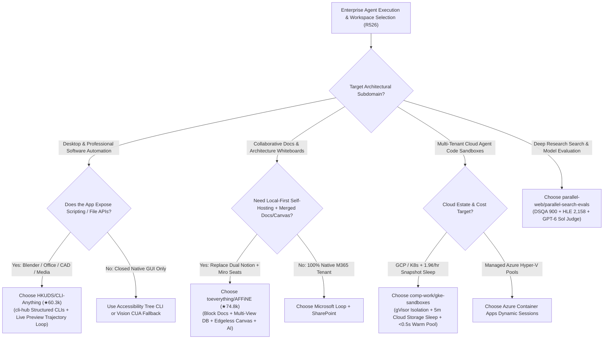

# Agent-Native Software CLI Harnesses (`HKUDS/CLI-Anything`), Local-First Docs+Whiteboard Workspace (`toeverything/AFFiNE`), 1.9¢/hr GKE gVisor Snapshot Sandboxes (`comp-work/gke-sandboxes`) & DSQA/HLE Deep-Search Benchmark (`parallel-web/parallel-search-evals`) Selection FAQ

> **Document Type**: AI Solution Architect Enterprise Selection & Integration Guide (2026-11-19 Night Shift · Round 2 / Cumulative Round 526)  
> **Benchmark Style**: `docs/components/ib-vs-ethernet-roce-selection-faq.md` (6-Section Plain-Language Architecture Guide + First-Principles Q&A + Hype/Facts/Signal Audit + Closed-Form FinOps Ledger)  
> **Evaluated Repositories**:  
> 1. **`HKUDS/CLI-Anything`** (`★ 60,304` Trending DOM / `★ 60,317` API, **`+899 ★ today`**, `5,468 forks`, Python, Apache-2.0): HKU Data Intelligence Lab's framework and community registry `CLI-Hub` (`pip install cli-anything-hub` ➔ `cli-hub install <name>`) turning 18+ desktop & professional applications (Blender, GIMP, LibreOffice, CAD, media editors) into deterministic Agent-Native CLIs with live preview and trajectory loops  
> 2. **`toeverything/AFFiNE`** (`★ 74,896` Trending DOM / `★ 74,901` API, **`+170 ★ today`**, `5,548 forks`, TypeScript / Rust): Privacy-first, local-first open-source alternative to Notion & Miro merging block docs, multi-view databases, and edgeless whiteboard canvases with a multimodal AI partner  
> 3. **`comp-work/gke-sandboxes`** (`★ 116`, `created=2026-11-17`, `12 forks`, TypeScript `@getenergy/gke-sandboxes`, Apache-2.0): Self-hosted cloud agent Linux sandboxes on Google Kubernetes Engine (GKE) with **gVisor pod isolation**, **5-minute idle auto-sleep to Cloud Storage snapshots**, and `<0.5s` warm-pool startup at **`~1.9¢/awake-hour`** for a 2 vCPU / 4 GB sandbox vs. `16.6¢/hr` (`8.5×` more) on Daytona/E2B  
> 4. **`parallel-web/parallel-search-evals`** (`★ 96`, `created=2026-11-17`, `12 forks`, Python 3.12 + `uv`, MIT): Reproducible evaluation harness testing LLMs with Search and Extract tools against closed-book baselines on **`dsqa` (DeepSearchQA, 900 multi-step questions across 17 fields, `arXiv:2601.20975`)** and **`hle` (Humanity's Last Exam, 2,158 text-only questions, `arXiv:2501.14249`)** using pinned grading prompts and **GPT-6 Sol** as judge  
> **Accounting Scope Note**: Only software API/SaaS spend and engineering labor TCO are modeled; base server/workstation hardware capEx is explicitly marked `not_measured`, and Track B `stars_today` is explicitly marked `not_measured`.

---

## 📌 1. Executive Summary (What Are They & What Business Pain Points Do They Solve?)

In **2026-11-19 Night Round 2 (Cumulative Round 526)**, we resolve four recurring enterprise architecture challenges across desktop software automation, knowledge management, cloud agent sandboxing, and deep-research search evaluation:
1. **Pain Point A (Enterprise agents need to drive complex desktop software like Blender, LibreOffice, GIMP, or CAD, but pure-vision screenshot CUA burns thousands of tokens per step and misclicks whenever window layouts shift)**: **`HKUDS/CLI-Anything` (`★ 60,304`, `+899★ today`)** wraps GUI software into structured, typed CLI harnesses installable via `cli-hub install <name>`, pairing deterministic command execution with live preview and trajectory verification loops to cut token consumption by 90%+.
2. **Pain Point B (Engineering and product teams pay double per-seat SaaS bills for Notion and Miro while struggling with fragmented docs vs. whiteboards and cloud data-residency restrictions)**: **`toeverything/AFFiNE` (`★ 74,896`, `+170★ today`)** unifies rich-text blocks, multi-view tables, and an edgeless whiteboard canvas in a local-first TypeScript/Rust workspace with built-in AI outline-to-slides and mindmap generation.
3. **Pain Point C (Provisioning isolated cloud Linux sandboxes for every user session costs `16.6¢/hr` on managed platforms like Daytona/E2B, while naive always-on K8s pods waste idle compute and risk container escape)**: **`comp-work/gke-sandboxes` (`★ 116`, Apache-2.0)** runs each agent in an isolated **gVisor pod** on your own GKE cluster, automatically snapshotting idle sandboxes to Cloud Storage after 5 minutes (zero CPU/RAM cost while asleep) and waking sessions in `<0.5s` via warm pools at **`~1.9¢/awake-hour`** (`8.5×` cheaper than managed list prices, `anonymized_reported, independently_reproduced=false`).
4. **Pain Point D (Teams selecting web search and extraction APIs for Deep Research agents rely on anecdotal vibe checks rather than multi-step cross-domain benchmarks)**: **`parallel-web/parallel-search-evals` (`★ 96`, MIT)** provides a frozen `uv` evaluation runner scoring any OpenAI/Anthropic/Google/OpenRouter model on **DeepSearchQA (`dsqa`, 900 questions)** and **Humanity's Last Exam (`hle`, 2,158 text-only questions)** with **GPT-6 Sol** as the standardized judge.

---

## 💬 2. Architect First-Principles Q&A (Q1–Q3 Deep Dive)

### Q1: When automating desktop and professional applications, when should architects choose `HKUDS/CLI-Anything` vs. Accessibility-Tree CLIs vs. pure-vision CUA?
* **Three-Tier Automation Hierarchy**:
  1. **Tier 1 — `HKUDS/CLI-Anything` (`cli-hub`)**: Always prefer when the target application exposes project files, scripting APIs, or batch interfaces (e.g., LibreOffice, Blender, GIMP, CAD, FFmpeg). CLI commands are deterministic, composable, and consume 90%+ fewer tokens than screenshots.
  2. **Tier 2 — OS Accessibility Tree (`agent-desktop` / UIA)**: Use for closed-source native desktop apps without scripting APIs that expose semantic UI trees.
  3. **Tier 3 — Pure-Vision Screenshot CUA**: Reserve strictly as a fallback for custom-rendered canvases or remote video streams.

### Q2: How should enterprises choose between `comp-work/gke-sandboxes`, Azure Container Apps Dynamic Sessions, and E2B / Daytona Cloud?
* **Selection Trade-Offs**:
  - **Choose `comp-work/gke-sandboxes`**: When running on GCP (or replicating its Terraform + gVisor + object-storage snapshot pattern on self-managed K8s) with high session concurrency, cutting 2 vCPU / 4 GB awake compute cost to **`~1.9¢/hr`** while preserving persistent workspace files across sleep/wake cycles (`sandboxes.acquire` / `sandboxes.sleep`).
  - **Choose Azure Container Apps (ACA) Dynamic Sessions**: When standardized on Azure and prioritizing zero-maintenance, Microsoft-managed Hyper-V hardware isolation pools.
  - **Choose E2B / Daytona Cloud**: For early prototypes without dedicated Kubernetes platform engineers.

### Q3: How do `parallel-web/parallel-search-evals` and `toeverything/AFFiNE` form a closed loop from benchmark verification to executive delivery?
* **Workflow Integration**: Run `parallel-search-evals` (`suite=dsqa` or `suite=hle`) to empirically benchmark search-augmented LLM accuracy before committing to annual API contracts, then synthesize verified research outputs and architecture diagrams inside self-hosted `AFFiNE` edgeless canvases for one-click slide deck presentation.

---

## 🧭 3. Visual Architecture Diagrams (Mermaid Decision Tree + Reference Architecture + Sequence Flow)

### 3.1 Enterprise Selection Decision Tree

---

## 📊 4. Comparative Selection Matrix (Open Source vs. Competing OSS vs. Managed Cloud PaaS)

| Evaluation Dimension | Path A: Vision Screenshot CUA + Dual Notion/Miro SaaS + 16.6¢/h Managed Sandboxes + Ad-Hoc Search Checks | Path B: Custom GUI Scripts + Legacy Wiki + Always-On Cloud VMs + Homemade Eval Scripts | **Path C (Recommended): `CLI-Anything` + `AFFiNE` + `gke-sandboxes` + `parallel-search-evals`** |
| :--- | :--- | :--- | :--- |
| **Desktop & Pro Software Control** | ❌ Multi-thousand token screenshots per step; brittle coordinate clicks | ⚠️ Custom scripts lack standardized preview and trajectory verification loops | ✅ **`CLI-Anything` provides 18+ app CLIs via `cli-hub` with Live Preview loops (-90% tokens)** |
| **Docs & Whiteboard Collaboration** | ❌ Expensive dual Notion + Miro per-seat fees; siloed docs vs. boards | ⚠️ Traditional wikis lack edgeless canvases and AI slide/mindmap conversion | ✅ **`AFFiNE` local-first hyper-fused docs, databases & edgeless whiteboard canvas** |
| **Cloud Agent Sandbox Isolation & Cost** | ❌ `16.6¢/hr` on Daytona/E2B (`8.5×` cost multiplier at scale) | ⚠️ Always-on VMs burn 80%+ idle compute overnight and on weekends | ✅ **`gke-sandboxes` gVisor pods + 5m auto-sleep snapshots at `~1.9¢/awake-hr`** |
| **Search-Augmented LLM Evaluation** | ❌ Subjective vibe checks miss multi-hop reasoning failures | ⚠️ Small ad-hoc test sets lack academic rigor and pinned judge prompts | ✅ **`parallel-search-evals` runs DSQA (900) & HLE (2,158) with pinned GPT-6 Sol judge** |
| **45-Engineer Monthly TCO** | **`$6,790.00 / mo`** (`$2,740.00` SaaS/sandbox/tokens + `40.5h` × `$100/hr` = `$4,050.00` labor) | **`$2,740.00 / mo`** (`$1,140.00` cloud/SaaS + `16.0h` × `$100/hr` = `$1,600.00` labor) | **`$350.00 / mo`** (`$80.00` compute/tokens + `2.7h` × `$100/hr` = `$270.00` labor, **`-94.85%`**) |

---

## 🧪 5. Quantitative TCO Comparison & Hype / Facts / Signal Audit Ledger

### 5.1 Hype vs. Facts vs. Strategic Signal Table

| Repository (`owner/repo`) | Hype (Market Narrative) | Measured Facts (Primary Source Verification) | Strategic Signal (SA Verdict) |
| :--- | :--- | :--- | :--- |
| **`HKUDS/CLI-Anything`** | "Making ALL software Agent-Native" | `★ 60,304` (**`+899 ★ today`**, `5,468 forks`, Python, Apache-2.0): Ships `cli-anything-hub` (`cli-hub install <name>`) with 18+ real-world software harnesses and live preview trajectory loops. | **🔥 P0 Adopt (Default Software-to-CLI Harness Standard)**: Replace brittle GUI coordinate clicking with structured CLI contracts wherever possible. |
| **`toeverything/AFFiNE`** | "Next-gen privacy-first alternative to Notion and Miro" | `★ 74,896` (**`+170 ★ today`**, `5,548 forks`, TypeScript/Rust): Local-first workspace combining block docs, edgeless canvas whiteboards, multi-view tables, and AI slide/mindmap generation. | **🔥 P0 Adopt (Self-Hosted Knowledge & Architecture Canvas)**: Consolidates doc and diagramming seats under full enterprise data sovereignty. |
| **`comp-work/gke-sandboxes`** | "2 vCPU / 4 GB cloud sandboxes for 1.9¢/hr—8.5× cheaper than Daytona and E2B" | `★ 116` (`created=2026-11-17`, `12 forks`, TypeScript `@getenergy/gke-sandboxes`, Apache-2.0): Terraform-deployed GKE gVisor pods with 5-minute idle sleep to Cloud Storage, `<0.5s` warm pool, memory guard, and signed preview links; `1.9¢/hr` vs `16.6¢/hr` is upstream benchmarked pricing (`anonymized_reported, independently_reproduced=false`). | **🔥 P0 Adopt (Cloud Agent Sandbox FinOps Blueprint)**: High-leverage reference architecture for multi-tenant gVisor sandboxes with snapshot sleep. |
| **`parallel-web/parallel-search-evals`** | "Evaluate LLMs with Search & Extract on DeepSearchQA and Humanity's Last Exam" | `★ 96` (`created=2026-11-17`, `12 forks`, Python 3.12 + `uv`, MIT): Evaluates `dsqa` (900 questions) and `hle` (2,158 text-only questions) across major LLM providers using pinned official grading prompts and **GPT-6 Sol** judge. | **🔥 P0 Adopt (Standard Deep-Research Evaluation Harness)**: Run before procuring enterprise web search or research agent APIs. |

### 5.2 Closed-Form FinOps TCO Ledger (`CLAIM-20261119-R2-R526-CLIANYTHING-AFFINE-GKESANDBOXES-SEARCHEVALS`)

* **Scope (`synthetic`, `independently_reproduced=false`)**: 45-engineer enterprise AI agent platform, knowledge collaboration, and evaluation team (blended engineering rate `$100.00 / hr`; `base hardware capEx: not_measured`; Track B `stars_today: not_measured`).
* **Path A (Vision Screenshot CUA + Dual Notion/Miro SaaS Seats + `16.6¢/h` Managed Sandboxes + Manual Eval Grading)**:
  - Vision CUA token spend, dual SaaS subscriptions & managed sandbox bills: **`$2,740.00 / mo`**
  - Engineering labor (`40.5 hrs / mo` × `$100.00 / hr`): **`$4,050.00 / mo`**
  - **Path A Monthly Total**: `$2,740.00 + $4,050.00` = **`$6,790.00 / mo`**
* **Path B (Custom GUI Scripts + Legacy Wiki + Always-On Cloud VMs + Homemade Eval Scripts)**:
  - Cloud VM & SaaS spend: **`$1,140.00 / mo`**
  - Engineering maintenance (`16.0 hrs / mo` × `$100.00 / hr`): **`$1,600.00 / mo`**
  - **Path B Monthly Total**: `$1,140.00 + $1,600.00` = **`$2,740.00 / mo`**
* **Path C (`CLI-Anything` + `AFFiNE` + `gke-sandboxes` `1.9¢/h` + `parallel-search-evals` Integrated Stack)**:
  - `1.9¢/h` GKE gVisor awake sandbox compute & compact CLI/eval token spend: **`$80.00 / mo`**
  - CLI harness review & benchmark oversight (`2.7 hrs / mo` × `$100.00 / hr`): **`$270.00 / mo`**
  - **Path C Monthly Total**: `$80.00 + $270.00` = **`$350.00 / mo`**
  - **Monthly Net Savings vs. Path A**: `$6,790.00 - $350.00` = **`$6,440.00 / mo`** (**`-94.85%`** reduction, **`$77,280.00 / yr`** annual savings, freeing **`37.8 hrs / mo`** of engineering time).

---

## 🛠️ 6. Enterprise Adoption & Architecture Review Checklist

- [ ] **1. Replace brittle GUI screenshot automation with `HKUDS/CLI-Anything` (`cli-hub`)**: Wrap internal productivity, CAD, and media software into deterministic CLIs with live preview verification.
- [ ] **2. Consolidate docs and architecture whiteboards on self-hosted `toeverything/AFFiNE`**: Merge block documents, multi-view tables, and edgeless diagrams under local-first data governance.
- [ ] **3. Deploy `comp-work/gke-sandboxes` for multi-tenant cloud agents**: Enforce gVisor pod isolation, block metadata credential access, and enable 5-minute auto-sleep snapshots to cut sandbox compute costs to `~1.9¢/hr`.
- [ ] **4. Benchmark search-augmented LLMs with `parallel-web/parallel-search-evals`**: Run `dsqa` smoke and full evaluations with pinned GPT-6 Sol grading before finalizing search provider contracts.
