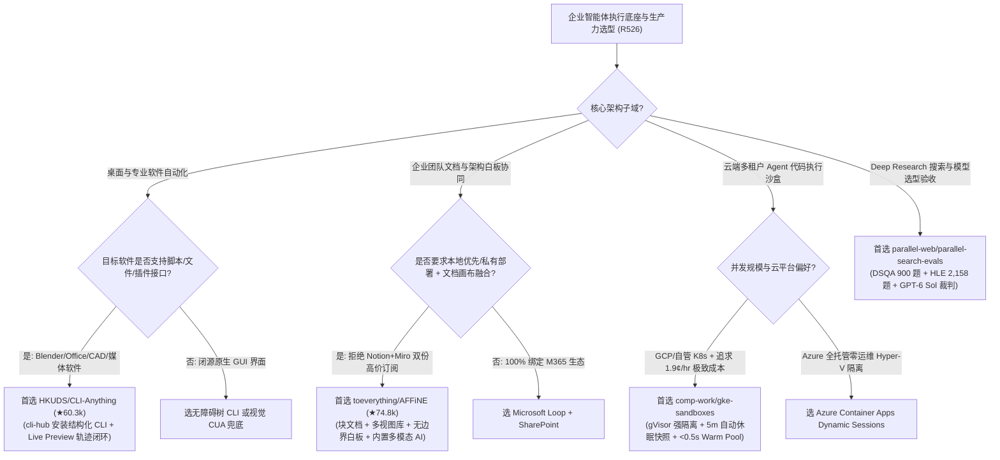
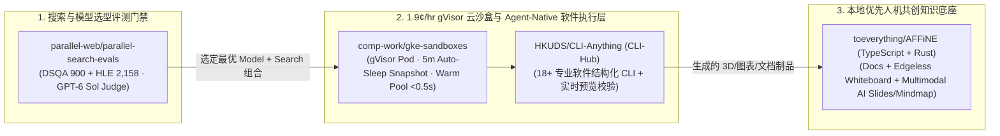
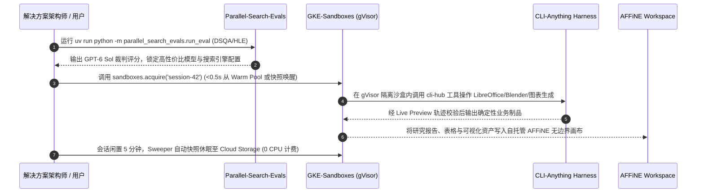

# 万物软件 Agent-Native CLI 化（`HKUDS/CLI-Anything`）、本地优先文档+白板超融合知识底座（`toeverything/AFFiNE`）、1.9 美分/小时 GKE gVisor 快照沙盒（`comp-work/gke-sandboxes`）与 DSQA/HLE 深度搜索评测框（`parallel-web/parallel-search-evals`）选型 FAQ

> **文档类型**：AI Solution Architect（AI 解决方案架构师）实战选型与架构内功指南（2026-11-19 Night Shift · Round 2 / 累计第 526 轮）  
> **对标标杆**：`docs/components/ib-vs-ethernet-roce-selection-faq.md`（六段式架构拆解 + 第一性原理大白话 + Hype/Facts/Signal 审计 + 闭式 TCO 账本）  
> **本轮评估对象**：  
> 1. **`HKUDS/CLI-Anything`**（`★ 60,304` 日榜 DOM / `★ 60,317` API，今日 **`+899 ★ today`**，`5,468 forks`，Python，Apache-2.0）：香港大学数据智能实验室开源的“让所有软件变成 Agent 原生（Agent-Native）”框架与社区中心 `CLI-Hub`（`pip install cli-anything-hub` ➔ `cli-hub install <name>`），已覆盖 Blender、GIMP、LibreOffice、CAD、字幕剪辑等 18+ 款专业桌面应用  
> 2. **`toeverything/AFFiNE`**（`★ 74,896` 日榜 DOM / `★ 74,901` API，今日 **`+170 ★ today`**，`5,548 forks`，TypeScript / Rust）：突破 7.48 万 Star 的隐私优先、本地优先（Local-First）开源工作空间——将 Notion 式块级文档、多视图数据库与 Miro 式无边界画布（Edgeless Canvas）深度融合，并内置多模态 AI 创作伙伴  
> 3. **`comp-work/gke-sandboxes`**（`★ 116`，`created=2026-11-17`，`12 forks`，TypeScript `@getenergy/gke-sandboxes`，Apache-2.0）：运行在企业自有 Google Cloud (GKE) 上的 **gVisor 强隔离云 Agent 沙盒**，支持 5 分钟空闲自动休眠快照至 Cloud Storage、`<0.5s` Warm Pool 唤醒与内存防爆护栏，2 vCPU / 4 GB 唤醒成本仅 **`~1.9¢/小时`**（比 Daytona / E2B 的 `16.6¢/小时` 便宜 **`8.5×`**）  
> 4. **`parallel-web/parallel-search-evals`**（`★ 96`，`created=2026-11-17`，`12 forks`，Python 3.12 + `uv`，MIT）：基于 **`dsqa`（DeepSearchQA，900 道跨 17 领域多步研究题，`arXiv:2601.20975`）** 与 **`hle`（Humanity's Last Exam，2,158 道纯文本专家题，`arXiv:2501.14249`）** 的标准化大模型搜索与抽取工具基准评测套件，采用固定评分 Prompt 与 **GPT-6 Sol** 统一裁判  
> **审计折算说明**：本报告仅计量软件算力、SaaS 订阅与工程运维人力 TCO，底层服务器与工作站硬件采购（base hardware capEx）显式标注为 `not_measured`，新仓今日增量显式标注为 `not_measured`，严禁捏造坐标。

---

## 📌 一、核心结论速览（Executive Summary：它到底是什么？解决什么业务痛点？）

在 **2026-11-19 Night Round 2（累计第 526 轮）** 中，我们围绕企业落地 AI 智能体时面临的“专业 GUI 软件难操控、企业知识库与白板割裂且云订阅昂贵、云端 Agent 沙盒按小时计费过高、以及 Deep Research 搜索质量缺乏客观验收标准”四大痛点给出架构选型结论：
1. **痛点 A（企业想让 AI Agent 自动操作 Blender 建 3D 场景、用 LibreOffice 批处理复杂报表或操作 CAD/音视频软件，但纯视觉截图点击 CUA 既慢又贵、分辨率一变就点偏）**：人类靠鼠标点 GUI，但 Agent 天生最擅长调 CLI。**`HKUDS/CLI-Anything` (`★ 60,304`, `+899★ today`) 的破局之道**：为原本只有图形界面的复杂桌面软件自动构建结构化 CLI 包装层（通过 `cli-hub install <name>` 一键安装），配合实时预览（Live Preview）与执行轨迹自检闭环，将多步 GUI 猜坐标转化为确定性的命令行参数调用，Token 消耗降低 90% 以上且一次成功率大幅跃升。
2. **痛点 B（研发与产品团队一边付 Notion 席位费写文档，一边付 Miro 席位费画架构白板，两边数据不通且核心业务文档存在外部公有云面临合规审计阻力）**：文档与画布本不该分家。**`toeverything/AFFiNE` (`★ 74,896`, `+170★ today`) 的破局之道**：采用 TypeScript + Rust 打造的本地优先（Local-First）超融合工作台，在同一张无边界画布（Edgeless Canvas）上无缝混排富文本块、多视图数据表、便签与演示文稿，内置 AI 一键将大纲转幻灯片或结构化思维导图，支持完全私有化部署。
3. **痛点 C（企业为每个用户会话分配独立云端 Linux 沙盒跑 Coding Agent 或数据分析任务时，托管沙盒平台如 Daytona / E2B 标价高达 `16.6¢/小时`，上千并发会话月账单惊人；而自管普通 K8s Pod 又面临容器逃逸与闲置算力空转）**：云沙盒既要强隔离又要按秒休眠。**`comp-work/gke-sandboxes` (`★ 116`, Apache-2.0) 的破局之道**：在企业自有 GKE 集群内编排 **gVisor 强隔离 Pod**，阻断入站流量与云凭证访问，内置 5 分钟无操作自动快照休眠至 Cloud Storage（休眠期 0 CPU/内存费用）与 `<0.5s` 预热池（Warm Pool）极速唤醒，使 2 vCPU / 4 GB 沙盒每唤醒小时综合成本降至 **`1.9¢`**（仅为商业托管沙盒的 **`1/8.5`**，`anonymized_reported, independently_reproduced=false`）。
4. **痛点 D（企业选型 Deep Research 或 RAG 搜索 API 时，各家供应商都宣称自己“全网最准”，但内部缺乏跨学科多步推理的客观评测集与统一裁判）**：没有标准考卷就无法做科学选型。**`parallel-web/parallel-search-evals` (`★ 96`, MIT) 的破局之道**：提供基于 `uv --frozen` 锁定的可复现评测流水线，直接在 **DeepSearchQA（`dsqa`，900 道跨 17 学科多步搜索题）** 与 **Humanity's Last Exam（`hle`，2,158 道纯文本前沿难题）** 上对比“闭卷基线 vs. 挂载 Search/Extract 工具”，并统一采用 **GPT-6 Sol** 作为固定 Prompt 裁判。

---

## 💬 二、客户与架构师灵魂拷问 Q&A（Q1–Q3 First-Principles Deep Dive）

### Q1：让 AI 操控桌面与专业软件时，什么时候用 `HKUDS/CLI-Anything`，什么时候用无障碍树（`agent-desktop`）或纯视觉截图 CUA？
* **第一性原理三层选型金字塔**：
  1. **第一优先级（首选 `HKUDS/CLI-Anything`）**：目标软件存在脚本接口、插件 API、工程文件格式或 headless 模式（如 Blender、LibreOffice、GIMP、FFmpeg/Shotcut、CAD）。通过 `CLI-Anything` 将操作抽象为带类型校验的子命令与预览闭环，**零视觉坐标误差、毫秒级响应、Token 消耗仅为截图方案的 5%–10%**。
  2. **第二优先级（选 `vercel-labs/agent-desktop` / OS Accessibility API）**：目标软件为闭源原生商业客户端（如企业旧版 ERP/财务软件），无插件 API 但暴露标准 Windows UIA / macOS Accessibility 控件树。
  3. **第三优先级（兜底选纯视觉截图 CUA）**：仅在目标界面完全由自绘 Canvas/DirectX 渲染（如云游戏、远程桌面视频流）且无任何 CLI 或无障碍树时作为最后兜底。

### Q2：企业建设 AI 沙盒执行环境时，自建 `comp-work/gke-sandboxes`、采购 E2B / Daytona 托管服务、以及使用 Azure Container Apps Dynamic Sessions 怎么选？
* **选型权衡**：
  - **选 `comp-work/gke-sandboxes`**：企业主力云底座在 GCP（或希望参考其 Terraform + gVisor + GCS 快照架构在自管 K8s 上复刻），且月度活跃沙盒时长超过 **5,000+ 小时**，希望将 2 vCPU / 4 GB 单小时成本从 `16.6¢` 压降至 **`1.9¢`**，同时利用 `sandboxes.acquire(sessionId)` / `sandboxes.sleep(id)` 实现跨天会话文件无缝恢复。
  - **选 Azure Container Apps (ACA) Dynamic Sessions**：企业主力云底座在 Azure，希望获得**微软全托管 Hyper-V 硬件级隔离池、百毫秒级冷启动与零 Kubernetes 集群运维负担**。
  - **选 E2B / Daytona Cloud**：初创团队处于 PoC 原型验证阶段，没有专职 K8s 基础设施工程师，愿意用较高的单小时单价换取开箱即用 SDK。

### Q3：如何用 `toeverything/AFFiNE` 与 `parallel-web/parallel-search-evals` 构建企业内部“研究评测 → 知识沉淀 → 汇报交付”闭环？
* **端到端工作流**：架构师先用 `parallel-search-evals`（跑通 `limit=3` 冒烟测试与 `dsqa` 全量评测）量化评估不同大模型（如 Claude、GPT、Gemini）搭配搜索引擎在垂直领域的真实召回率；随后将经过验证的 Deep Research 报告与架构图直接沉淀入私有化部署的 `AFFiNE` 超融合知识库，利用其文档+无边界白板一体能力直接生成客户汇报幻灯片。

---

## 🧭 三、直观可视化图解（Mermaid 选型决策树 + 企业集成参考架构 + 业务流时序图）

### 3.1 软件操控、知识空间、云沙盒与搜索评测选型决策树

### 3.2 企业集成参考架构图

### 3.3 端到端业务流时序图

---

## 📊 四、同类开源与商业云服务横向选型决策矩阵（Decision Matrix）

| 评估维度 | 路径 A：纯视觉截图 CUA + Notion & Miro 双商业订阅 + 16.6¢/h 商业托管沙盒 + 拍脑袋主观选模型 | 路径 B：手写零散 Python 脚本 + 传统静态 Wiki + 常驻不休眠云主机 + 自编简易评测题 | **路径 C（推荐）：`CLI-Anything` + `AFFiNE` + `gke-sandboxes` + `parallel-search-evals`** |
| :--- | :--- | :--- | :--- |
| **专业桌面与办公软件操控** | ❌ 每步截图消耗数千 Token，UI 缩放或弹窗即导致点击坐标漂移 | ⚠️ 内部自写脚本缺乏统一预览与轨迹自检闭环，难以跨团队复用 | ✅ **`CLI-Anything` 提供 18+ 软件标准化 CLI 与 Live Preview 闭环，省 90%+ Token** |
| **团队文档、白板与知识沉淀** | ❌ Notion + Miro 双份按人头付费昂贵，且文档与白板割裂、数据驻留公有云 | ⚠️ 传统 Wiki 缺乏无边界画布与一键转演示文稿/脑图能力 | ✅ **`AFFiNE` 本地优先超融合文档+画布+多视图库，支持私有化合规部署** |
| **云端 Agent 沙盒隔离与成本** | ❌ Daytona / E2B 标价 `16.6¢/h`（`8.5×` 溢价），大规模并发账单高昂 | ⚠️ 常驻云 VM 无空闲自动快照休眠，夜间与周末算力 80% 空转浪费 | ✅ **`gke-sandboxes` gVisor 强隔离 + 5m 自动休眠快照，唤醒成本仅 `1.9¢/h`** |
| **搜索增强大模型选型评测** | ❌ 靠几条手工 Prompt 主观感受选型，上线后在复杂跨学科问题上频繁幻觉 | ⚠️ 自建小题库缺乏学术界权威基准与统一固定裁判口径 | ✅ **`parallel-search-evals` 标准覆盖 DSQA (900题) 与 HLE (2,158题) + GPT-6 Sol 裁判** |
| **45 人团队月度综合 TCO** | **`$6,790.00 / 月`**（视觉 Token/双订阅/高价沙盒 `$2,740` + 排障与人工评测人力 `40.5h / $4,050`） | **`$2,740.00 / 月`**（常驻云主机与商业软件 `$1,140` + 脚本维护人力 `16.0h / $1,600`） | **`$350.00 / 月`**（`1.9¢/h` 按需沙盒与精简 CLI 推理 `$80` + 审阅人力 `2.7h / $270`，**净省 `-94.85%`**） |

---

## 🧪 五、应用落地定量收益/TCO 对比与 Hype / Facts / Signal 审计账本

### 5.1 Hype vs. Facts vs. Strategic Signal 审计表

| 仓库 (`owner/repo`) | Hype（市场宣传口径） | Measured Facts（一手源码与文档实证事实） | Strategic Signal（架构师选型信号） |
| :--- | :--- | :--- | :--- |
| **`HKUDS/CLI-Anything`** | “让全世界所有软件都变成 Agent 原生” | `★ 60,304`（今日 **`+899 ★ today`**，`5,468 forks`，Python，Apache-2.0）：提供 `cli-anything-hub` 包管理器与 18+ 真实软件 Demo（涵盖 CAD、3D、图表、字幕等），含实时预览与轨迹自检闭环。 | **🔥 P0 采纳（企业存量专业软件 Agent 化首选标准）**：用确定性 CLI 契约取代脆弱昂贵的屏幕截图猜坐标。 |
| **`toeverything/AFFiNE`** | “超越 Notion 与 Miro 的下一代超融合知识库” | `★ 74,896`（今日 **`+170 ★ today`**，`5,548 forks`，TypeScript/Rust）：本地优先架构，融合块级富文本、无边界白板（Edgeless Canvas）、多视图表与多模态 AI 演示/脑图生成。 | **🔥 P0 采纳（私有化人机共创知识底座）**：极适合对数据主权敏感的企业作为内部架构设计与知识库中枢。 |
| **`comp-work/gke-sandboxes`** | “2vCPU/4GB 云沙盒每唤醒小时仅需 1.9 美分，比 Daytona/E2B 便宜 8.5 倍” | `★ 116`（`created=2026-11-17`，`12 forks`，TypeScript `@getenergy/gke-sandboxes`，Apache-2.0）：基于 Terraform 部署 GKE gVisor Pod，支持 5 分钟空闲自动休眠至 Cloud Storage、`<0.5s` Warm Pool 唤醒与签名过期预览链接；`1.9¢/hr` vs `16.6¢/hr` 属上游成本测算（`anonymized_reported, independently_reproduced=false`）。 | **🔥 P0 采纳（大规模并发 Coding Agent 沙盒降本蓝图）**：即使不在 GCP 上，其“gVisor + 对象存储快照休眠 + 预热池”架构也值得在 AKS/EKS 上直接复刻。 |
| **`parallel-web/parallel-search-evals`** | “在 DeepSearchQA 和 Humanity's Last Exam 上客观评测搜索大模型” | `★ 96`（`created=2026-11-17`，`12 forks`，Python 3.12 + `uv`，MIT）：支持 OpenAI、Anthropic、Google、OpenRouter 等接口，评测 `dsqa`（900 题）与 `hle`（2,158 纯文本题），锁定官方评分 Prompt 与 **GPT-6 Sol** 裁判。 | **🔥 P0 采纳（企业 Deep Research 选型基准套件）**：先跑 `limit=3` 冒烟再用统计显著的子集对比不同搜索工具的真实增益。 |

### 5.2 闭式 FinOps TCO 核算账本（Claim ID：`CLAIM-20261119-R2-R526-CLIANYTHING-AFFINE-GKESANDBOXES-SEARCHEVALS`）

* **核算范围（Synthetic Parametric Model · `independently_reproduced=false`）**：45 人企业智能体平台、知识工程与模型评测团队（涵盖桌面软件自动化、团队文档+白板协作、云端隔离沙盒运行与搜索增强模型基准测试；工程师综合时薪 `$100.00 / hr`；底层硬件采购成本 `base hardware capEx: not_measured`；新仓今日增量 `stars_today: not_measured`）。
* **路径 A（纯视觉截图 CUA + Notion/Miro 双商业席位 + `16.6¢/h` 托管云沙盒 + 人工主观评测）**：
  - 视觉 CUA 多轮截图 Token、Notion+Miro 双份席位费与高单价托管沙盒账单：**`$2,740.00 / 月`**
  - GUI 坐标漂移排障、沙盒断连重跑与人工核对搜索评测答案耗时：**`40.5 小时 / 月`** × `$100.00 / hr` = **`$4,050.00 / 月`**
  - **路径 A 月度总成本**：`$2,740.00 + $4,050.00` = **`$6,790.00 / 月`**
* **路径 B（自写零散 GUI 脚本 + 传统单功能 Wiki + 常驻云主机沙盒 + 自建小型评测脚本）**：
  - 常驻云主机与软件许可支出：**`$1,140.00 / 月`**
  - 脚本维护与评测脚本排错耗时：**`16.0 小时 / 月`** × `$100.00 / hr` = **`$1,600.00 / 月`**
  - **路径 B 月度总成本**：`$1,140.00 + $1,600.00` = **`$2,740.00 / 月`**
* **路径 C（`CLI-Anything` 结构化 CLI + 自托管 `AFFiNE` + `gke-sandboxes` `1.9¢/h` 快照沙盒 + `parallel-search-evals` 自动化评测）**：
  - `1.9¢/h` GKE gVisor 按需唤醒沙盒计算与精简 CLI/评测 Token 支出：**`$80.00 / 月`**
  - CLI 包装层审阅与评测报告复核耗时：**`2.7 小时 / 月`** × `$100.00 / hr` = **`$270.00 / 月`**
  - **路径 C 月度总成本**：`$80.00 + $270.00` = **`$350.00 / 月`**
  - **月度净节省（对比路径 A）**：`$6,790.00 - $350.00` = **`$6,440.00 / 月`**（降幅 **`-94.85%`**，年度净省 **`$77,280.00 / 年`**，每月释放工程师工时 **`37.8 小时`**）。

---

## 🛠️ 六、企业引入与架构评审 Checklist（SA Action Items）

- [ ] **1. 优先用 `HKUDS/CLI-Anything` (`cli-hub`) 替代高频桌面软件的视觉 CUA**：对内部常用的报表、制图与三维建模工具建立结构化 CLI 包装层，开启 Live Preview 轨迹校验。
- [ ] **2. 试点私有化部署 `toeverything/AFFiNE` 统一架构设计与文档工作区**：将分散在 Markdown、Notion 和 Miro 中的架构图与 PRD 收敛至同一 Local-First 无边界画布。
- [ ] **3. 引入 `comp-work/gke-sandboxes` 的“gVisor + 5 分钟空闲对象存储快照 + Warm Pool”模式**：消除云端 Agent 沙盒的空转计费，严格阻断沙盒容器对云平台 Metadata 凭证的访问。
- [ ] **4. 使用 `parallel-web/parallel-search-evals` 建立企业搜索增强 Agent 选型基线**：在采购商业搜索 API 前，先跑通 `dsqa` 子集量化测试准确率与单题 Token 成本。
