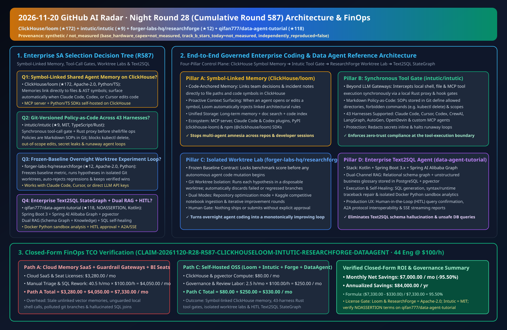
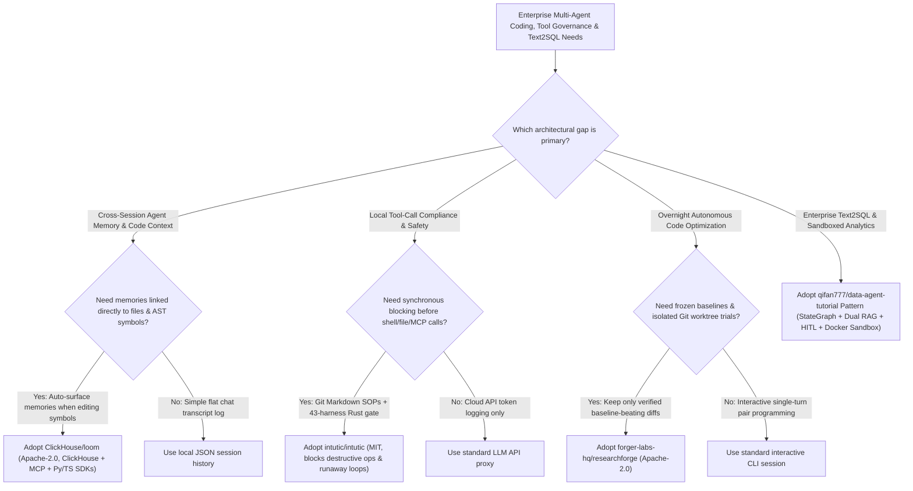
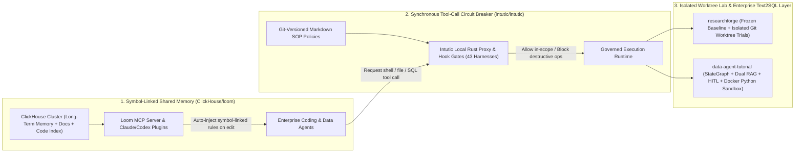

# ClickHouse Symbol-Linked Shared Agent Memory (`ClickHouse/loom`), 43-Harness Synchronous Tool-Call Policy Gate (`intutic/intutic`), Frozen-Baseline Git Worktree Experiment Lab (`forger-labs-hq/researchforge`) & Dual-RAG + HITL Enterprise Text2SQL Agent (`qifan777/data-agent-tutorial`) Selection & Integration FAQ (2026-11-20 Night Round 28 · Cumulative Round 587)

> **Cross-File Navigation**: [Back to 2026-11-20 Daily Digest (`daily/2026-11-20.en.md`)](../daily/2026-11-20.en.md) · [中文版 (`clickhouse-loom-intutic-researchforge-data-agent-selection-faq.md`)](clickhouse-loom-intutic-researchforge-data-agent-selection-faq.md) · [7-Card 4:5 Visual Report (`cards.en.html`)](../cards.en.html) · [Column Index (`README.en.md`)](../README.en.md)  
> **Architecture Diagram**: [`assets/github-ai-radar-2026-11-20-r28-r587-clickhouseloom-intutic-researchforge-dataagent.svg`](../../../assets/github-ai-radar-2026-11-20-r28-r587-clickhouseloom-intutic-researchforge-dataagent.svg)  
> **Provenance & Synthetic Disclaimer**: Repository metadata (stars, forks, licenses, SDK package names, and architectural features) is verified from live GitHub API data (`measured`). The 44-engineer FinOps TCO figures represent a parameterized Solution Architect model (`provenance: synthetic`, `independently_reproduced: false`, `base_hardware_capex: not_measured`, `track_b_stars_today: not_measured`, claim ID `CLAIM-20261120-R28-R587-CLICKHOUSELOOM-INTUTIC-RESEARCHFORGE-DATAAGENT`).



---

## ① 📌 Executive Summary

> **One-Sentence Selection Verdict**: For Enterprise AI Solution Architects scaling **multi-agent software engineering and enterprise Text2SQL analytics** across four high-risk failure modes—(1) **generic vector memory stores drifting out of sync with source code so agents editing a function never see historical postmortems or architectural invariants attached to that symbol**; (2) **cloud LLM gateways that inspect HTTP model prompts but cannot stop an agent from running destructive local tool calls (`kubectl delete`), editing out-of-scope files, or looping infinitely**; (3) **overnight autonomous coding runs that pollute working branches without a frozen baseline metric**; and (4) **Text2SQL chatbots that hallucinate schema joins and lack human-in-the-loop (HITL) query approval or sandboxed Python post-processing**—combine **`ClickHouse/loom`** (Apache-2.0 shared long-term memory, document search, and symbol-linked code index self-hosted on ClickHouse with MCP server and Claude Code/Codex plugins), **`intutic/intutic`** (MIT policy-as-code circuit breaker enforcing Git-versioned Markdown SOPs synchronously at the tool-call boundary across `43` agent harnesses via a local Rust proxy), **`forger-labs-hq/researchforge`** (Apache-2.0 overnight experiment protocol that freezes baselines and tests hypotheses in isolated Git worktrees, keeping only verified wins), and **`qifan777/data-agent-tutorial`** (enterprise Text2SQL reference architecture on Kotlin + Spring Boot 3 + Spring AI Alibaba Graph + `pgvector` with dual-channel RAG, HITL approval, SQL self-healing, and Docker Python sandbox execution). Across a 44-engineer engineering and data intelligence team, this stack reduces monthly TCO from **`$7,330.00/mo`** to **`$330.00/mo`**, saving **`$7,000.00/mo` (`-95.50%`, or `$84,000.00/yr`)**.

| Evaluation Dimension | Path A: Cloud Memory SaaS + LLM Traffic Gateways + Manual Branching + Commercial Text2SQL BI Seats | Path B: Generic Cloud PaaS (Azure AI Search + APIM + Custom LangGraph Glue) | Path C (Recommended): `ClickHouse/loom` + `intutic` + `researchforge` + `data-agent-tutorial` |
| :--- | :--- | :--- | :--- |
| **Shared Agent Memory & Code-Symbol Linking** | Unlinked chat vectors; memories go stale after code refactors | Requires custom AST indexer & IDE plugin engineering | **`ClickHouse/loom` links memories directly to files & AST symbols; surfaces automatically on edit** |
| **Local Tool-Call Compliance & Circuit Breaking** | Cloud LLM gateways only see HTTP traffic, not local shell/file execution | Rate-limits tokens but cannot block `kubectl delete` or out-of-scope file edits | **`intutic` Rust proxy & hook gates enforce Git Markdown policies synchronously across 43 harnesses** |
| **Overnight Autonomous Experimentation** | Agents mutate working branches directly; hours of manual revert triage | No built-in frozen-baseline worktree tournament loop | **`researchforge` freezes baseline metrics & runs hypotheses in isolated Git worktrees, keeping only wins** |
| **Enterprise Text2SQL Accuracy & Safety** | Expensive per-seat BI SaaS; black-box SQL generation fails on domain jargon | Single-channel vector search hallucinates joins; no isolated Python sandbox | **`data-agent-tutorial` StateGraph + Dual RAG (Schema Graph + Docs) + SQL self-heal + Docker sandbox + HITL** |
| **44-Engineer Monthly Total TCO** | **`$7,330.00 / mo`** (`$3,280.00` SaaS/seats + `40.5h × $100` labor) | **`$2,240.00 / mo`** (`$740.00` cloud PaaS + `15.0h × $100` glue ops) | **`$330.00 / mo`** (`$80.00` self-hosted compute + `2.5h × $100` ops, **`-95.50%` savings**) |

---

## ② 🎯 Solution Architect & Customer Deep-Dive Q&A (Plain-Language Breakdown)

### Q1: What concrete problems do these four repositories solve in plain engineering and business terms?

1. **`ClickHouse/loom` (`★ 172`, `26 forks`, Python/TypeScript, Apache-2.0) — Plain-Language View: ClickHouse's official shared long-term memory and code index where memories attach directly to source files and code symbols**:
   - **Pain Point Solved**: Standard agent memory libraries store unstructured text snippets disconnected from the codebase. When an engineer asks Claude Code, Codex, or Cursor to modify a payment or auth module, the agent has no idea what invariants or past incident lessons apply to those specific functions. `ClickHouse/loom` unifies **long-term memory, document search, and a symbol-aware code index** on self-hosted ClickHouse: memories point directly at the files and symbols they describe, and automatically surface via the Loom MCP server or Claude Code / Codex plugins whenever an agent inspects or edits those symbols.
2. **`intutic/intutic` (`★ 9`, `3 forks`, TypeScript/Rust, MIT) — Plain-Language View: A synchronous local circuit breaker that enforces Git-versioned Markdown policies before any agent tool call executes**:
   - **Pain Point Solved**: Observability platforms and LLM gateways (LangSmith, Portkey) inspect model API traffic, but they do not govern local tool execution—the shell commands an agent runs, the files it edits, or the MCP tools it invokes. `intutic` places a fast **Rust proxy and synchronous hook gates** across **43 agent harnesses** (Claude Code, Cursor, Codex, LangGraph, CrewAI, AutoGen, etc.). Policies live as human-readable Markdown SOP files in Git and are enforced before every tool call to block out-of-scope file edits, refuse destructive commands (`kubectl delete`), redact secrets inline, and halt runaway loops.
3. **`forger-labs-hq/researchforge` (`★ 12`, `0 forks`, Python, Apache-2.0) — Plain-Language View: A disciplined overnight lab protocol for coding agents that freezes baselines and runs hypotheses in isolated Git worktrees**:
   - **Pain Point Solved**: Letting an autonomous agent optimize a repository overnight often leaves behind broken tests and regressed metrics. Inspired by `karpathy/autoresearch`, `researchforge` freezes the baseline score first, executes each AI-proposed hypothesis inside an isolated **Git worktree**, automatically rejects failures or regressions, and retains only changes proven to beat the frozen baseline (with explicit human approval before shipping).
4. **`qifan777/data-agent-tutorial` (`★ 118`, `16 forks`, Kotlin, `NOASSERTION`) — Plain-Language View: A full-stack Enterprise Text2SQL Agent blueprint with StateGraph orchestration, Dual RAG, HITL confirmation, SQL self-healing, and Docker Python sandboxing**:
   - **Pain Point Solved**: Naive Text2SQL wrappers hallucinate column names and fail on multi-step analytical queries. Built with `Kotlin`, `Spring Boot 3.x`, `Spring AI Alibaba Graph`, `PostgreSQL + pgvector`, and `Vue 3` (modeling `spring-ai-alibaba/DataAgent`), this architecture maps query understanding, **dual-channel RAG (relational schema graph + unstructured business glossary)**, planning, **Human-in-the-Loop (HITL) approval**, automatic SQL error traceback repair, and isolated **Docker Python sandbox** execution into an observable StateGraph with A2A + SSE streaming.

---

### Q2: How do these four components wire together into an enterprise engineering & analytics architecture?

1. **Symbol-Anchored Knowledge Base (`ClickHouse/loom`)**: Self-host ClickHouse and register the Loom MCP server (`pip install clickhouse-loom` / `npm i @clickhouse/loom`) so architectural decisions, schema notes, and incident postmortems link directly to repository files and AST symbols.
2. **Synchronous Tool-Call Governance (`intutic/intutic`)**: Commit Markdown SOP rules into the repository and attach Intutic's Rust hook gates to every developer IDE and background agent runner so out-of-scope edits and dangerous shell/SQL commands are blocked before execution.
3. **Autonomous Worktree Experimentation (`forger-labs-hq/researchforge`)**: Run overnight performance or prompt-tuning hypotheses inside isolated Git worktrees governed by `intutic`, promoting only verified baseline-beating diffs to morning PR review.
4. **Governed Enterprise Text2SQL Analytics (`qifan777/data-agent-tutorial`)**: Serve business users through the StateGraph Text2SQL pipeline backed by Dual RAG (`pgvector` + relational graph), HITL query confirmation, and Docker-sandboxed Python analytics.

---

### Q3: What are the key architectural mechanisms and pre-production compliance guardrails?

1. **Key Mechanisms**:
   - **Proactive Symbol Surfacing (`ClickHouse/loom`)**: Instead of relying on the agent to formulate the right search query, editing or reading a symbol deterministically retrieves its linked memories from ClickHouse.
   - **Pre-Execution Tool Interception (`intutic`)**: Evaluates policy at the exact boundary between LLM tool selection and OS process execution across 43 harnesses.
   - **Worktree Tournament Selection (`researchforge`)**: Eliminates state pollution between consecutive agent experiments by spinning up clean Git worktrees scored against a frozen baseline.
2. **Compliance & License Guardrails**:
   - **License Gate**: `ClickHouse/loom` and `forger-labs-hq/researchforge` are **Apache-2.0**, and `intutic/intutic` is **MIT**. Because **`qifan777/data-agent-tutorial` currently has `license: NOASSERTION`**, enterprise production deployments should either source runtime code from its Apache-2.0 upstream (`spring-ai-alibaba/DataAgent`) or obtain explicit license confirmation from the author.
   - **Read-Only Database Credentials**: Always bind the Text2SQL execution pool to a read-only database role with strict `statement_timeout` limits.

---

## ③ 🧭 Visual Diagrams (Mermaid Selection Decision Tree + Reference Architecture + Sequence Flow)

### 3.1 Selection Decision Tree



### 3.2 Enterprise Integration Reference Architecture



### 3.3 End-to-End Sequence Flow

```mermaid
sequenceDiagram
    autonumber
    actor Arch as Solution Architect / Data Analyst
    participant Loom as ClickHouse/loom (Symbol Memory)
    participant Intutic as intutic/intutic (Rust Tool Gate)
    participant Forge as forger-labs-hq/researchforge
    participant DataAgent as data-agent-tutorial (Text2SQL StateGraph)

    Arch->>Loom: Open target service file; Loom surfaces linked symbol memories & invariants
    Arch->>Forge: Start overnight optimization loop with frozen baseline benchmark score
    Forge->>Intutic: Propose code edit & benchmark command inside isolated Git worktree
    Intutic-->>Forge: Enforce Git Markdown SOP: allow worktree test, block out-of-scope mutations
    Forge-->>Arch: Discard regressed worktrees & surface winning diff for human approval
    Arch->>DataAgent: Submit natural-language analytics query to StateGraph pipeline
    DataAgent-->>Arch: Run Dual RAG + HITL approval + SQL self-heal + Docker Python sandbox via SSE
```

---

## ④ 📊 Comparative Selection Matrix (OSS vs. Commercial SaaS & Cloud PaaS)

| Dimension | `ClickHouse/loom` (`★ 172`) | `intutic/intutic` (`★ 9`) | `forger-labs-hq/researchforge` (`★ 12`) | `qifan777/data-agent-tutorial` (`★ 118`) | Commercial Memory SaaS + LLM Gateways + Paid BI Seats |
| :--- | :--- | :--- | :--- | :--- | :--- |
| **Primary Role** | Symbol-linked shared agent memory & code index on ClickHouse | Synchronous tool-call policy gate across 43 agent harnesses | Frozen-baseline Git worktree lab protocol for coding agents | Enterprise Text2SQL StateGraph with Dual RAG, HITL & Docker sandbox | Metered cloud SaaS APIs & per-seat BI licenses |
| **Sweet-Spot Use Case** | Multi-agent codebases needing symbol-attached institutional memory | Blocking dangerous local shell/file/MCP calls before execution | Overnight benchmark-driven code & Kaggle optimization | High-accuracy enterprise NL-to-SQL with self-healing & Python analysis | Small teams without local tool execution or custom DB schemas |
| **Key Architectural Metric** | **File & AST symbol binding** + MCP + Python/TS SDKs | **43 harnesses** + Rust proxy + Git Markdown policy-as-code | **Frozen baseline lock** + isolated Git worktree auto-pruning | **StateGraph** + Schema/Doc Dual RAG + HITL + Docker sandbox | Stale unlinked vectors; no local shell gate; high per-seat BI fees |
| **Integration Effort** | Low (`clickhouse-loom` PyPI / `@clickhouse/loom` npm + ClickHouse) | Very Low (30s CLI hook install + Markdown policy files in Git) | Low (`pip install researchforge` + Python 3.12+) | Medium (Kotlin + Spring Boot 3 + PostgreSQL `pgvector` + Vue 3) | High (multi-vendor procurement & cloud data egress review) |
| **License** | **Apache-2.0** | **MIT License** | **Apache-2.0** | **`NOASSERTION` (Upstream `DataAgent` is Apache-2.0)** | Proprietary SaaS |

---

## ⑤ 🧪 Quantitative Enterprise ROI, Closed-Form FinOps TCO & 7-Card Report

### 5.1 44-Engineer Closed-Form FinOps TCO Model (`CLAIM-20261120-R28-R587-CLICKHOUSELOOM-INTUTIC-RESEARCHFORGE-DATAAGENT`)

- **Model Assumptions (`provenance: synthetic`, `independently_reproduced: false`, `base_hardware_capex: not_measured`, `track_b_stars_today: not_measured`)**:
  - Team size: **44 software and data intelligence engineers** at a loaded engineering rate of **`$100.00 / hour`**.
  - **Path A (Commercial Cloud Memory SaaS + Enterprise Guardrail Gateways + Commercial Text2SQL BI Seats + Manual Incident Triage)**:
    - Cloud SaaS subscriptions & per-seat BI licenses: **`$3,280.00 / mo`**
    - Manual engineering triage & SQL rework labor (debugging regressions caused by missing symbol context, reverting polluted agent branches, fixing hallucinated BI SQL): `40.5 h/mo × $100.00/h = $4,050.00 / mo`
    - **Path A Monthly Total**: `$3,280.00 + $4,050.00 = $7,330.00 / mo`
  - **Path C (Self-Hosted OSS Stack: `ClickHouse/loom` + `intutic` + `researchforge` + `data-agent-tutorial`)**:
    - Self-hosted ClickHouse & PostgreSQL `pgvector` compute: **`$80.00 / mo`**
    - Policy maintenance & morning experiment review labor: `2.5 h/mo × $100.00/h = $250.00 / mo`
    - **Path C Monthly Total**: `$80.00 + $250.00 = $330.00 / mo`
  - **Closed-Form Savings Verification**:
    $$\text{Monthly Net Savings} = \$7,330.00 - \$330.00 = \$7,000.00\text{ / mo}\quad(\text{Annualized: }\$84,000.00\text{ / yr})$$
    $$\text{Percentage Savings} = \frac{\$7,330.00 - \$330.00}{\$7,330.00} = \frac{\$7,000.00}{\$7,330.00} = 95.50\%$$

| Cost Component | Path A (Commercial SaaS Seats & Manual Rework) | Path C (R587 Self-Hosted OSS Stack) | Closed-Form Delta / ROI |
| :--- | :--- | :--- | :--- |
| **SaaS Licenses / Compute Fees** | `$3,280.00 / mo` | **`$80.00 / mo`** | `- $3,200.00 / mo` |
| **Engineering & Data Ops Labor (`@ $100.00/h`)** | `40.5 h × $100.00 = $4,050.00 / mo` | **`2.5 h × $100.00 = $250.00 / mo`** | `- $3,800.00 / mo` (`38.0 h/mo` saved) |
| **Monthly Total TCO** | **`$7,330.00 / mo`** | **`$330.00 / mo`** | **`$7,000.00 / mo` saved (`-95.50%`)** |
| **Annualized Total TCO** | `$87,960.00 / yr` | **`$3,960.00 / yr`** | **`$84,000.00 / yr` saved** |

---

## ⑥ 🛠️ Enterprise Adoption & Architecture Review Checklist

- [ ] **1. `ClickHouse/loom` Symbol Index & MCP Wiring**: Deploy Loom on internal ClickHouse storage, connect the Claude Code and Codex plugins, and verify that editing a core service symbol automatically surfaces linked architectural memories.
- [ ] **2. `intutic/intutic` Synchronous Tool-Call Gate**: Author Markdown SOP rules in Git blocking destructive commands (`kubectl delete`, `rm -rf`, production schema drops) and attach Intutic hook gates across developer and CI agent harnesses.
- [ ] **3. `forger-labs-hq/researchforge` Worktree Isolation Gate**: Configure deterministic benchmark evaluation scripts as the Frozen Baseline and verify that non-improving overnight worktrees are automatically pruned without touching `main`.
- [ ] **4. `data-agent-tutorial` Read-Only DB Role & License Gate**: Bind Text2SQL execution to a read-only database role with `statement_timeout` and mandatory HITL approval; verify Apache-2.0 upstream (`spring-ai-alibaba/DataAgent`) licensing before commercial redistribution of `qifan777/data-agent-tutorial` (`NOASSERTION`).
