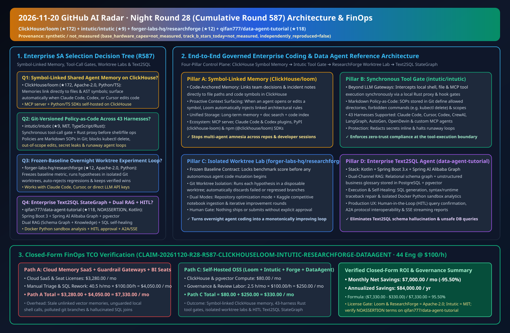
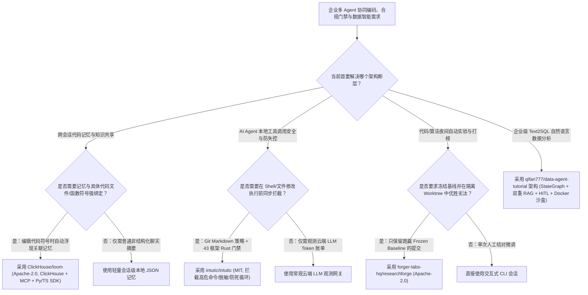
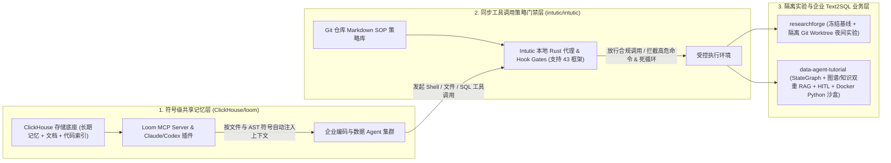
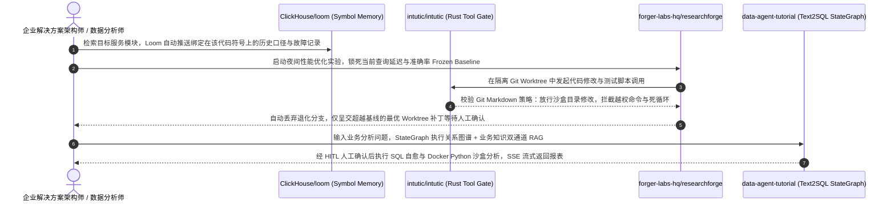

# ClickHouse 符号级共享 Agent 记忆库（`ClickHouse/loom`）、43 框架同步工具调用策略熔断器（`intutic/intutic`）、冻结基线 Git Worktree 夜间实验引擎（`forger-labs-hq/researchforge`）与双通道 RAG + HITL 企业级 Text2SQL 智能体（`qifan777/data-agent-tutorial`）架构选型与集成 FAQ（2026-11-20 Night Round 28 · 累计 Round 587）

> **跨文件导航**：[返回 2026-11-20 当日全景日报 (`daily/2026-11-20.md`)](../daily/2026-11-20.md) · [English Version (`clickhouse-loom-intutic-researchforge-data-agent-selection-faq.en.md`)](clickhouse-loom-intutic-researchforge-data-agent-selection-faq.en.md) · [查看 7-Card 4:5 评测报告 (`cards.html`)](../cards.html) · [返回专栏主索引 (`README.md`)](../README.md)  
> **本轮架构大图**：[`assets/github-ai-radar-2026-11-20-r28-r587-clickhouseloom-intutic-researchforge-dataagent.svg`](../../../assets/github-ai-radar-2026-11-20-r28-r587-clickhouseloom-intutic-researchforge-dataagent.svg)  
> **数据溯源与口径声明（Provenance & Synthetic Disclaimer）**：本报告中仓库 Stars、Forks、License、SDK 包名与架构特性为实时校验数据（`measured`）；针对 44 人企业研发与数据智能团队的 FinOps TCO 测算参数属于架构师参数化测算模型（`provenance: synthetic`，`independently_reproduced: false`，`base_hardware_capex: not_measured`，`track_b_stars_today: not_measured`，审计契约号 `CLAIM-20261120-R28-R587-CLICKHOUSELOOM-INTUTIC-RESEARCHFORGE-DATAAGENT`）。

---

## ① 📌 核心结论速览（Executive Summary）

> **一句话选型结论**：面向企业 AI 解决方案架构师（SA）在规模化落地**多 Agent 协同编码与企业数据智能（Text2SQL）**时面临的四大核心工程痛点——① **通用向量记忆库与代码库脱节，Agent 修改某个函数时根本不知道团队此前在该符号（Symbol）上踩过的坑与架构约束**；② **传统大模型网关（如 Portkey/LangSmith）只能拦截云端 API 流量，管不住本地 Agent 直接执行高危 Shell 命令（如 `kubectl delete`）、越权改文件或死循环烧光配额**；③ **让 Agent 夜间自动优化代码或算法时容易污染主分支且缺乏严格的基线（Baseline）对比**；④ **企业 Text2SQL 直接让大模型写 SQL 极易因表结构歧义产生幻觉且缺乏高危查询人工确认（HITL）与沙盒自愈**——建议采用 **`ClickHouse/loom`**（ClickHouse 官方开源的 Apache-2.0 共享长期记忆与代码符号索引库，将记忆直接绑定到代码文件与 AST 符号并在 Claude Code/Codex/Cursor 编辑时自动浮现）、**`intutic/intutic`**（MIT 协议的 AI Agent 策略即代码熔断器，用 Git 中的 Markdown SOP + 本地 Rust 代理在 43 种 Agent 框架的工具调用点执行同步拦截、脱敏与死循环阻断）、**`forger-labs-hq/researchforge`**（Apache-2.0 协议的编码 Agent 实验协议，冻结基线并在隔离 Git Worktree 中运行假设实验、自动丢弃退化修改）与 **`qifan777/data-agent-tutorial`**（基于 Kotlin + Spring Boot 3 + Spring AI Alibaba Graph + `pgvector` 的企业级 Text2SQL 智能体蓝本，内置关系图谱+业务知识双通道 RAG、HITL 人工确认、SQL 自我纠错与 Docker Python 沙盒）。在 44 人研发与数据智能团队模型下，该组合可将月度总拥有成本（TCO）从 **`$7,330.00/月`** 降至 **`$330.00/月`**，净省 **`$7,000.00/月`（`-95.50%`，年省 `$84,000.00`）**。

| 评估维度 | 方案 A：商业云端记忆 SaaS + 传统 API 网关 + 手工分支实验 + 商业 Text2SQL BI 席位 | 方案 B：云原生托管 PaaS（Azure AI Search + Azure APIM + 裸写 LangGraph） | 方案 C（推荐）：`ClickHouse/loom` + `intutic` + `researchforge` + `data-agent-tutorial` |
| :--- | :--- | :--- | :--- |
| **跨会话共享记忆与代码符号联动** | 纯文本向量检索，代码重构后记忆沦为过期噪音 | 需自行开发 AST 解析器与向量库联动插件 | **`ClickHouse/loom` 记忆直接绑定代码文件与符号（Symbol），Agent 编辑该符号时自动触发注入** |
| **本地工具调用安全与合规熔断** | 云端 API 网关看不到本地 `bash`/`edit`/MCP 工具调用 | 仅能限制云端 Token 速率，无法阻断本地 `kubectl delete` | **`intutic` 本地 Rust 代理 + Git Markdown 策略，跨 43 种框架在工具调用瞬间同步拦截越权操作** |
| **夜间自主优化与实验防回退** | Agent 直接在工作分支乱改，次日人工耗费数小时回滚 | 无内置冻结基线（Frozen Baseline）与 Worktree 自动淘汰机制 | **`researchforge` 冻结基线指标 + 隔离 Git Worktree 实验，仅保留真正超越基线的提交** |
| **企业级 Text2SQL 准确率与可控性** | 商业 BI 问答按席位高价收费，黑盒生成 SQL 难以定制业务黑话 | 单路向量检索易混淆同名字段，缺乏 Docker Python 二次分析沙盒 | **`data-agent-tutorial` 双通道 RAG（图谱+知识库）+ SQL 自动纠错 + Docker 沙盒 + HITL 人工确认** |
| **44 人团队月度总成本（TCO）** | **`$7,330.00 / 月`**（`$3,280.00` SaaS/席位费 + `40.5h × $100` 人工） | **`$2,240.00 / 月`**（`$740.00` 云服务 + `15.0h × $100` 人工胶水开发） | **`$330.00 / 月`**（`$80.00` 自建算力 + `2.5h × $100` 运维，**净省 `95.50%`**） |

---

## ② 🎯 客户与架构师灵魂拷问 Q&A（通俗解构）

### Q1：这四个开源项目各自解决什么痛点？用大白话怎么向业务方和工程团队解释？

1. **`ClickHouse/loom`（`★ 172`，`26 forks`，Python/TypeScript，Apache-2.0）——用大白话讲：它是 ClickHouse 官方出品的“挂在具体代码函数和文件上的多 Agent 共享长期记忆库”**：
   - **解决什么痛点**：像 Mem0 或普通向量库存的记忆只是松散的聊天记录，当第二个工程师用 Claude Code 或 Codex 去改 `BillingService.calculateTax()` 时，Agent 根本不知道上周五线上刚因为这个函数的汇率取整出过故障。`ClickHouse/loom` 基于自托管 ClickHouse 把**长期记忆（Long-term Memory）、文档搜索（Document Search）和代码符号索引（Code Index）**合三为一：每条记忆直接指向它所关联的代码文件与函数符号（Symbols），只要任何 Agent 准备读取或修改该文件/符号，Loom 的 MCP Server 与 Claude Code / Codex 插件就会自动把关联的架构决策与历史教训推送到上下文里！
2. **`intutic/intutic`（`★ 9`，`3 forks`，TypeScript/Rust，MIT）——用大白话讲：它是“管住 AI Agent 双手的本地策略断路器——把团队安全规范写成 Git 里的 Markdown 文件，在 Agent 敲下危险命令前 1 毫秒当场拦住”**：
   - **解决什么痛点**：LangSmith 或 Portkey 这类 LLM 网关管的是发往大模型的 HTTP 请求，但管不住 Claude Code、Cursor 或 LangGraph 在本地机器上调 Shell 工具执行 `kubectl delete`、修改职责范围外的配置文件、或者陷入死循环疯狂重试。`intutic` 提供了一个极速 **Rust 本地代理与 Hook 门禁**，支持 **43 种主流 Agent 框架（Claude Code、Cursor、Codex、LangGraph、CrewAI 等）**，团队直接用 Git 里的 Markdown 文件定义 SOP 策略，在每一次本地工具调用（Tool Call）真正执行前同步完成越权目录拦截、高危命令拒绝、密钥自动脱敏与死循环熔断。
3. **`forger-labs-hq/researchforge`（`★ 12`，`0 forks`，Python，Apache-2.0）——用大白话讲：它是受 Karpathy `autoresearch` 启发打造的“代码夜间自动进化实验室——先锁死基线分数，每个新想法在独立 Git Worktree 里跑分，只有跑赢基线的代码才留下来”**：
   - **解决什么痛点**：很多团队想让 Coding Agent 晚上自动做性能优化、算法调参或打榜，但痛点是 Agent 改了十几个版本后把原本能跑的代码改崩了。`researchforge` 制定了严格的实验室协议：① 先运行测试锁定**冻结基线（Frozen Baseline）**；② 每一个 AI 提出的优化假设都在独立的 **Git Worktree** 中隔离执行并跑评测；③ 凡是未超越基线或破坏测试的分支自动淘汰，只有经证实提分的修改才会保留并等待人工最终确认（Nothing ships without your yes）。
4. **`qifan777/data-agent-tutorial`（`★ 118`，`16 forks`，Kotlin，`NOASSERTION`）——用大白话讲：它是基于 `spring-ai-alibaba/DataAgent` 深度拆解的“企业级 Text2SQL 智能体全栈可运行样板间”**：
   - **解决什么痛点**：很多企业做 Text2SQL Demo 很简单，一上生产全翻车——因为只靠表名猜意思会写错 Join，生成的 SQL 报错就卡死，或者误执行慢查询拖垮业务库。该项目用 `Kotlin` + `Spring Boot 3.x` + `Spring AI Alibaba Graph` + `PostgreSQL (pgvector)` 搭建了完整的 **StateGraph 状态图链路**：通过**结构化关系图谱 + 非结构化业务知识库的双通道 RAG** 消除业务口径歧义，在关键节点插入 **HITL（Human-in-the-Loop）人工确认**，对执行失败的 SQL 自动回溯修复，并把复杂统计分析丢进隔离的 **Python Docker 沙盒** 中执行，最后通过 **A2A 协议与 SSE 流式**输出分析报告。

---

### Q2：这四个项目怎么在企业研发与数据智能平台里组装成端到端架构？

1. **记忆与上下文底座层（`ClickHouse/loom`）**：在企业内网部署 ClickHouse 与 `clickhouse-loom` MCP Server，将架构 ADR 文档、数据库 Schema 变更记录与线上故障复盘绑定到具体代码路径与 AST 符号上，供全团队的 Claude Code、Codex 与自研 Agent 共享。
2. **工具调用同步合规门禁层（`intutic/intutic`）**：在所有开发机与 CI Agent 容器中挂载 `intutic` Rust 代理与 Hook Gate，通过 Git 仓库中的 Markdown 策略文件强制约束：禁止修改生产迁移脚本目录、禁止执行破坏性 `DROP/DELETE/kubectl delete` 命令、自动脱敏环境变量密钥。
3. **夜间自主优化与评测验证层（`forger-labs-hq/researchforge`）**：针对核心查询延迟或模型准确率指标，夜间启动 `researchforge` 冻结基线，在受 `intutic` 保护的隔离 Git Worktree 中并行验证多项优化假设，次日早晨向架构师呈交唯一跑赢基线的 PR。
4. **面向业务方的受控 Text2SQL 服务层（`qifan777/data-agent-tutorial`）**：业务分析师通过 Vue 3 前端发起自然语言数据查询，后端 `Spring AI Alibaba Graph` 执行双通道 RAG 召回、弹出 HITL 确认框、执行 SQL 自愈与 Docker Python 沙盒绘图，流式返回可追溯的数据洞察。

---

### Q3：这套架构的核心技术机制与落地上线前必须注意的合规/边界坑点是什么？

1. **核心机制亮点**：
   - **`ClickHouse/loom` 的“符号级反向触发（Symbol-Triggered Surfacing）”**：不是等 Agent 想起来去搜记忆，而是当 Agent 触碰某个代码符号时由索引层主动把相关记忆推到眼前。
   - **`intutic` 的“工具边界同步阻断（Synchronous Tool-Call Enforcement）”**：在 LLM 已经决定调用工具、但操作系统尚未执行该命令的微妙窗口内完成確定性规则校验，延迟仅亚毫秒级。
   - **`data-agent-tutorial` 的“SQL 生成与 Python 沙盒职责分离”**：用 SQL 负责高并发确定性聚合，用隔离的 Docker Python 容器负责复杂统计检验与可视化，避免写出上百行难以维护的嵌套 SQL。
2. **上线前必须规避的边界与合规风险**：
   - **开源许可证门禁（License Gate）**：`ClickHouse/loom` 与 `forger-labs-hq/researchforge` 采用 **Apache-2.0**，`intutic/intutic` 采用 **MIT**，三者均可直接用于企业商业生产；但 **`qifan777/data-agent-tutorial` 当前仓库未声明开源许可证（`license: NOASSERTION`）**，其上游参考项目 `spring-ai-alibaba/DataAgent` 为 Apache-2.0——企业在生产系统直接复用代码前，应优先引用上游 Apache-2.0 组件或向教程作者确认授权。
   - **Text2SQL 数据库只读账号隔离**：即使有 `intutic` 与 HITL 确认，`data-agent-tutorial` 连接企业数据仓库时仍必须使用**严格只读（Read-Only）且带查询超时上限（`statement_timeout`）**的数据库账号。

---

## ③ 🧭 直观可视化图解（Mermaid 选型决策树 + 集成架构图 + 业务时序图）

### 3.1 选型决策树（Selection Decision Tree）

### 3.2 企业集成参考架构图（Enterprise Reference Architecture）

### 3.3 端到端业务流时序图（End-to-End Sequence Flow）

---

## ④ 📊 同类开源与商业云服务横向选型决策矩阵

| 对比维度 | `ClickHouse/loom` (`★ 172`) | `intutic/intutic` (`★ 9`) | `forger-labs-hq/researchforge` (`★ 12`) | `qifan777/data-agent-tutorial` (`★ 118`) | 商业云端记忆 SaaS + 传统 LLM 网关 + 商业 BI 问答 |
| :--- | :--- | :--- | :--- | :--- | :--- |
| **核心功能定位** | 基于 ClickHouse 的代码符号绑定长期记忆与文档/代码索引 | 支持 43 种 Agent 框架的本地工具调用同步策略熔断器 | 冻结基线 + 隔离 Git Worktree 的编码 Agent 自动实验协议 | 基于 Spring AI Alibaba Graph 的双通道 RAG + HITL Text2SQL 智能体 | 按调用/席位计费的云端托管服务组合 |
| **最佳适用场景** | 多人多 Agent 跨仓库协作，需在改代码时自动获知历史约束 | 防止本地或容器内 Agent 误删资源、泄露密钥或陷入死循环 | 夜间无人值守优化代码性能、提示词或 Kaggle 竞赛方案 | 企业高准确度自然语言查库、自动纠错与 Python 沙盒深度分析 | 无需本地工具管控或深层代码符号联动的小型轻量应用 |
| **关键性能/架构指标** | **记忆直连文件与 AST 符号** + MCP Server + Python/TS SDK | **43 框架同步拦截** + Rust 代理 + Git Markdown SOP 策略 | **Frozen Baseline 刚性对比** + 独立 Worktree 自动淘汰回滚 | **StateGraph 编排** + 关系图谱/知识库双 RAG + Docker 沙盒 + A2A/SSE | 记忆与代码脱节；云网关管不住本地 Shell；BI 问答按席位高价收费 |
| **集成与运维复杂度** | 低（`pip install clickhouse-loom` / `npm i @clickhouse/loom` + ClickHouse） | 极低（30 秒挂载本地 Hook Gate + 提交 Markdown 规则至 Git） | 低（`pip install researchforge` + Python 3.12+） | 中（Kotlin + Spring Boot 3 + PostgreSQL `pgvector` + Vue 3） | 高（多供应商采购审批、数据出境合规风险高） |
| **开源协议（License）** | **Apache-2.0** | **MIT License** | **Apache-2.0** | **`NOASSERTION`（参考上游 Apache-2.0 `DataAgent`）** | 商业专有协议 |

---

## ⑤ 🧪 应用落地定量收益 / 闭式 FinOps TCO 对比与 7-Card 报告

### 5.1 44 人研发与数据智能团队闭式 FinOps TCO 模型（`CLAIM-20261120-R28-R587-CLICKHOUSELOOM-INTUTIC-RESEARCHFORGE-DATAAGENT`）

- **测算基准设定（`provenance: synthetic`，`independently_reproduced: false`，`base_hardware_capex: not_measured`，`track_b_stars_today: not_measured`）**：
  - 团队规模：**44 名企业研发与数据智能工程师**，综合人力工时成本 **`$100.00 / 小时`**。
  - **方案 A（商业云端记忆 SaaS + 商业安全护栏网关 + 商业 Text2SQL BI 席位 + 人工回滚排障）**：
    - 商业云端订阅与席位费：**`$3,280.00 / 月`**
    - 工程师人工排障与返工工时（排查因缺乏历史符号记忆引发的重复 Bug、清理 Agent 夜间污染分支、人工修正幻觉 SQL）：`40.5 小时/月 × $100.00/小时 = $4,050.00 / 月`
    - **方案 A 月度总计**：`$3,280.00 + $4,050.00 = $7,330.00 / 月`
  - **方案 C（自托管开源组合：`ClickHouse/loom` + `intutic` + `researchforge` + `data-agent-tutorial`）**：
    - 自托管 ClickHouse 与 PostgreSQL `pgvector` 容器算力费：**`$80.00 / 月`**
    - 策略维护与实验复核人工工时：`2.5 小时/月 × $100.00/小时 = $250.00 / 月`
    - **方案 C 月度总计**：`$80.00 + $250.00 = $330.00 / 月`
  - **闭式净节省验算**：
    $$\text{Monthly Net Savings} = \$7,330.00 - \$330.00 = \$7,000.00\text{ / 月}\quad(\text{Annualized: }\$84,000.00\text{ / 年})$$
    $$\text{Percentage Savings} = \frac{\$7,330.00 - \$330.00}{\$7,330.00} = \frac{\$7,000.00}{\$7,330.00} = 95.50\%$$

| 成本分项 | 方案 A（商业 SaaS 席位与人工排障） | 方案 C（本轮 R587 开源四件套） | 闭式差额 / 收益 |
| :--- | :--- | :--- | :--- |
| **SaaS 席位 / 容器算力费用** | `$3,280.00 / 月` | **`$80.00 / 月`** | `- $3,200.00 / 月` |
| **工程与数据分析人工成本（`@ $100.00/h`）** | `40.5 h × $100.00 = $4,050.00 / 月` | **`2.5 h × $100.00 = $250.00 / 月`** | `- $3,800.00 / 月`（节省 `38.0 h/月`） |
| **月度总拥有成本（Monthly Total TCO）** | **`$7,330.00 / 月`** | **`$330.00 / 月`** | **净省 `$7,000.00 / 月`（`-95.50%`）** |
| **年度总拥有成本（Annualized TCO）** | `$87,960.00 / 年` | **`$3,960.00 / 年`** | **年省 `$84,000.00 / 年`** |

---

## ⑥ 🛠️ 企业引入与架构评审 Checklist

- [ ] **1. `ClickHouse/loom` 代码符号索引与 MCP 接入**：在内网 ClickHouse 集群初始化 Loom schema，在团队 Claude Code 与 Codex 环境配置 Loom MCP Server，验证修改核心业务类时关联历史记忆自动浮现。
- [ ] **2. `intutic/intutic` 工具调用同步门禁落地**：将团队安全红线（禁止 `kubectl delete`、禁止访问 `.env` 私钥、限制单会话最大连续工具调用次数）编写为 Git 仓库内的 Markdown SOP，并在开发机启用 Intutic Hook Gate。
- [ ] **3. `forger-labs-hq/researchforge` 夜间 Worktree 实验隔离验证**：配置基准评测脚本（Frozen Baseline），验证所有未超越基线的实验分支在夜间运行结束后自动清理，不污染 `main` 分支。
- [ ] **4. `data-agent-tutorial` 只读账号隔离与许可证合规确认**：为 Text2SQL 智能体配置带 `statement_timeout` 的只读数据库账号并强制开启高危查询 HITL 确认；鉴于 `qifan777/data-agent-tutorial` 仓库当前为 `NOASSERTION`，生产商业分发优先基于上游 Apache-2.0 的 `spring-ai-alibaba/DataAgent` 构建或取得作者明确授权。
