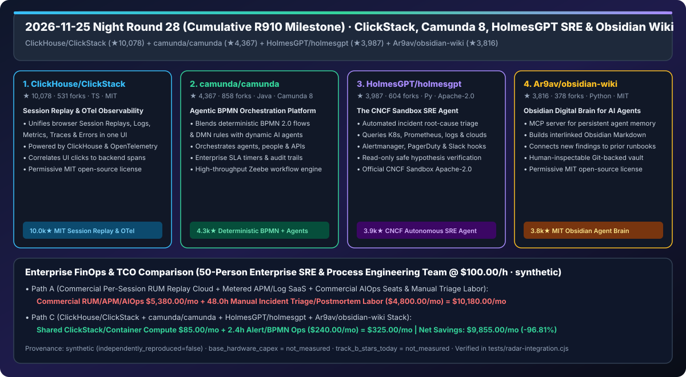
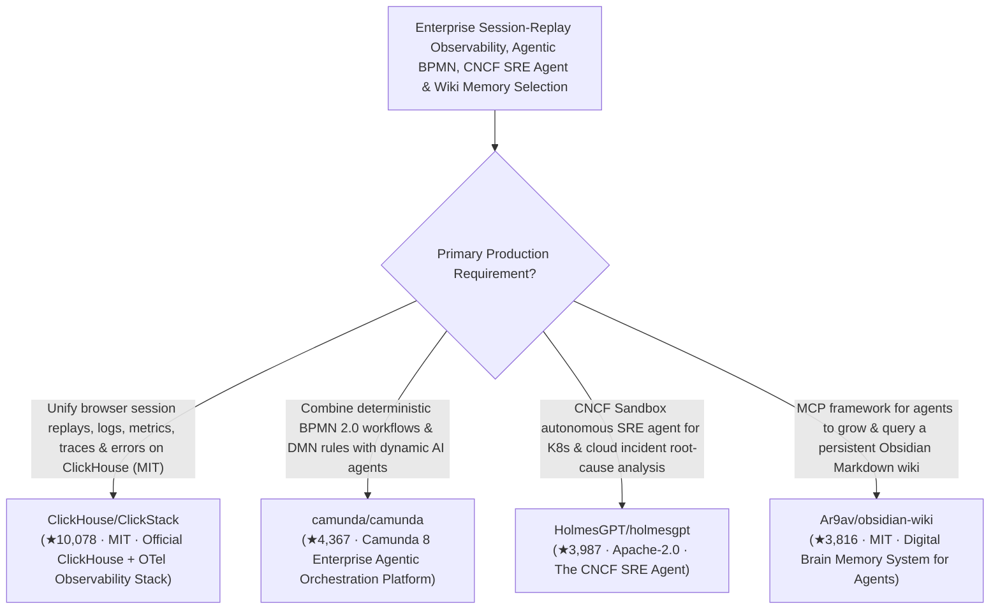
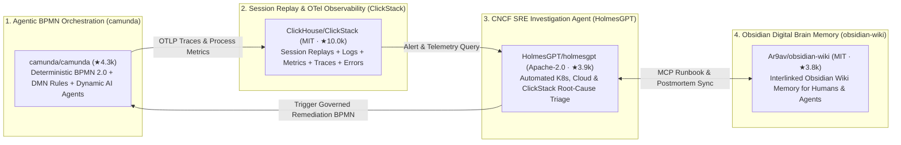

# ClickHouse Session-Replay & OTel Observability (`ClickHouse/ClickStack`), Agentic BPMN Orchestration (`camunda/camunda`), CNCF SRE Incident Agent (`HolmesGPT/holmesgpt`) & Obsidian Digital-Brain Agent Memory (`Ar9av/obsidian-wiki`) Selection & Integration Architecture FAQ

> **Document Type**: Enterprise AI Solution Architect Selection Decision Guide (GitHub Trending AI Radar — 2026-11-25 Night Round 28 / Cumulative Round 910 Milestone)
> **Covered Repositories**: [`ClickHouse/ClickStack`](https://github.com/ClickHouse/ClickStack) (`★ 10,078`, `531 forks`, `MIT`, TypeScript: ClickHouse's official open-source observability platform unifying browser session replays, logs, metrics, traces, and errors on ClickHouse and OpenTelemetry) · [`camunda/camunda`](https://github.com/camunda/camunda) (`★ 4,367`, `858 forks`, Java: Camunda 8 enterprise agentic orchestration platform combining deterministic BPMN workflows and DMN decision tables with dynamic AI agent steps) · [`HolmesGPT/holmesgpt`](https://github.com/HolmesGPT/holmesgpt) (`★ 3,987`, `604 forks`, `Apache-2.0`, Python: CNCF Sandbox open-source SRE agent for investigating production incidents and finding root causes across Kubernetes, clouds, databases, and observability stacks) · [`Ar9av/obsidian-wiki`](https://github.com/Ar9av/obsidian-wiki) (`★ 3,816`, `378 forks`, `MIT`, Python: MCP framework for AI agents to build and maintain a unified, interlinked digital brain through an Obsidian wiki)
> **Core Enterprise Scenario**: Building an **Enterprise Agentic Process Orchestration, Full-Stack Session-Replay Observability & Autonomous SRE Operations Loop**—combining deterministic BPMN + dynamic agent workflows (`camunda`), `MIT`-licensed ClickHouse session replays + OTel logs/traces (`ClickStack`), CNCF autonomous root-cause investigation (`HolmesGPT`), and persistent Obsidian wiki runbook memory (`obsidian-wiki`).

---

## 1. 📌 Executive Summary (One-Line Selection Verdict)

1. **Need an `MIT`-licensed observability platform powered by ClickHouse and OpenTelemetry that unifies frontend browser Session Replays, backend logs, metrics, distributed traces, and errors in one fast interface** ➔ Choose **[`ClickHouse/ClickStack`](https://github.com/ClickHouse/ClickStack) (`★ 10,078`, `531 forks`, `MIT`)**.
   - **Plain-English Mechanism**: Correlates exact browser session video replays with backend OpenTelemetry traces and ClickHouse logs on a single timeline so engineers resolve production issues in minutes without expensive commercial RUM/APM bills.
2. **Need to orchestrate AI agents inside mission-critical enterprise processes where regulatory compliance requires combining deterministic BPMN 2.0 workflows and DMN decision rules with dynamic AI agent reasoning** ➔ Choose **[`camunda/camunda`](https://github.com/camunda/camunda) (`★ 4,367`, `858 forks`, Camunda 8)**.
   - **Plain-English Mechanism**: Embeds dynamic AI agent tasks directly inside auditable BPMN state machines so high-stakes workflows retain strict SLA timers, DMN policy gates, and human approval steps.
3. **Need a CNCF Sandbox (`Apache-2.0`) autonomous SRE agent that automatically investigates Prometheus, Alertmanager, PagerDuty, and Kubernetes incidents to surface verified root causes** ➔ Choose **[`HolmesGPT/holmesgpt`](https://github.com/HolmesGPT/holmesgpt) (`★ 3,987`, `604 forks`, `Apache-2.0`)**.
   - **Plain-English Mechanism**: Queries live Kubernetes clusters, metrics, logs, and traces in read-only mode to test hypotheses and deliver evidence-backed root-cause reports the moment an alert fires.
4. **Need an `MIT`-licensed MCP memory framework where AI agents build, interlink, and maintain a persistent Obsidian Markdown wiki ("digital brain") of runbooks, postmortems, and architectural knowledge** ➔ Choose **[`Ar9av/obsidian-wiki`](https://github.com/Ar9av/obsidian-wiki) (`★ 3,816`, `378 forks`, `MIT`)**.
   - **Plain-English Mechanism**: Turns transient agent troubleshooting sessions into structured, bidirectionally linked Obsidian wiki pages that both human engineers and agents reuse across future incidents.

---

## 2. 🎯 Architect & Customer Deep-Dive Q&A

### Q1: Why do regulated enterprises pair `Camunda 8` (BPMN + Agents) with `ClickStack`, `HolmesGPT`, and `obsidian-wiki` instead of relying on black-box commercial AIOps & RUM clouds?

- **Four-Layer Enterprise Operations & Agentic Process Loop (Path C)**:
  1. **L1 Deterministic BPMN + Dynamic Agent Orchestration ➔ `camunda/camunda`**: Governs end-to-end business processes and remediation workflows with BPMN/DMN compliance guardrails.
  2. **L2 Unified Session Replay & OTel Observability Store ➔ `ClickHouse/ClickStack`**: Captures frontend session replays, backend traces, metrics, and logs on high-compression ClickHouse storage under an `MIT` license.
  3. **L3 CNCF Autonomous SRE Root-Cause Investigator ➔ `HolmesGPT/holmesgpt`**: Investigates production alerts across K8s and `ClickStack` telemetry automatically.
  4. **L4 Persistent Obsidian Runbook & Postmortem Brain ➔ `Ar9av/obsidian-wiki`**: Synthesizes resolved incidents into an interlinked Markdown wiki via MCP.
- **When to choose Commercial RUM + AIOps SaaS vs. Path C?**
  - Choose **Commercial SaaS** for small teams with low session/log volumes.
  - Choose **Path C** when commercial per-session replay and per-GB APM costs become prohibitive (`ClickStack` `MIT`), regulated workflows require deterministic BPMN envelopes (`Camunda`), and SRE teams want `Apache-2.0` CNCF incident triage (`HolmesGPT`) backed by a local Git/Obsidian knowledge base (`obsidian-wiki`).

### Q2: How do these four systems interact during a live production incident?

1. **Full-Stack Alert to Root-Cause Diagnosis (`ClickStack` → `HolmesGPT` ↔ `obsidian-wiki`)**:
   - When an error spike occurs, `ClickStack` links the user's browser Session Replay to the failing backend OTel trace and triggers `HolmesGPT`. `HolmesGPT` inspects K8s pods, queries `ClickStack` logs, and checks historical runbooks in `obsidian-wiki`.
2. **Governed Remediation & Knowledge Consolidation (`HolmesGPT` → `Camunda` → `obsidian-wiki`)**:
   - `HolmesGPT` initiates a `Camunda` BPMN remediation workflow (with DMN policy checks and human on-call approval) and writes the verified postmortem back into `obsidian-wiki`.

### Q3: What are the key security and compliance guardrails?

- **Architect Redlines**:
  1. **Enable DOM input masking in `ClickStack` Session Replays**: Redact PII, credentials, and payment fields in the browser before telemetry leaves the client.
  2. **Scope `HolmesGPT` to read-only cluster/observability permissions**: Keep root-cause investigation read-only while routing any mutating remediation actions through `Camunda`'s audited BPMN approval steps.

---

## 3. 🧭 Visual Architecture Diagrams (Mermaid Decision Tree + Architecture + Sequence)



### 3.1 Architect Selection Decision Tree



### 3.2 End-to-End Enterprise Integration Architecture



### 3.3 End-to-End Execution Sequence

```mermaid
sequenceDiagram
    participant SRE as On-Call SRE / Process Owner
    participant CStk as ClickHouse/ClickStack (MIT)
    participant Holm as HolmesGPT (CNCF SRE Agent)
    participant ObsW as Ar9av/obsidian-wiki (MCP Brain)
    participant Cam as camunda/camunda (BPMN Engine)

    CStk->>Holm: 1. Detect frontend session error & P99 backend trace spike; trigger alert
    Holm->>CStk: 2. Correlate browser Session Replay trace_id with ClickHouse logs & K8s events
    Holm->>ObsW: 3. Query obsidian-wiki MCP for matching historical postmortems & runbooks
    Holm->>Cam: 4. Deliver root-cause report & start Camunda BPMN remediation workflow
    SRE->>Cam: 5. Approve governed rollback/scale step in Camunda BPMN task
    Holm->>ObsW: 6. Append verified incident resolution & new links into Obsidian digital brain
```

---

## 4. 📊 Horizontal Selection Matrix

| Dimension | `ClickHouse/ClickStack` (`★ 10,078`) | `camunda/camunda` (`★ 4,367`) | `HolmesGPT/holmesgpt` (`★ 3,987`) | `Ar9av/obsidian-wiki` (`★ 3,816`) | Commercial RUM Session Replay + Commercial APM/AIOps SaaS (Path A) | Disconnected Logs + Unconstrained Agent Scripts + Tribal Knowledge (Path B) |
| :--- | :--- | :--- | :--- | :--- | :--- | :--- |
| **Primary Role** | `MIT` ClickHouse session-replay & OTel platform | Enterprise BPMN + dynamic agent orchestrator | `Apache-2.0` CNCF autonomous SRE agent | `MIT` Obsidian wiki memory system for agents | Metered per-session RUM & per-GB APM/AIOps cloud | Raw log files & unrecorded chat troubleshooting |
| **Key Differentiator** | **Unifies Session Replays + Logs + Metrics + Traces on ClickHouse (`MIT`)** | **Blends deterministic BPMN/DMN compliance with dynamic AI agents** | **CNCF Sandbox SRE agent across K8s, Prometheus & logs** | **Grows a human-readable, interlinked Obsidian wiki via MCP** | Hosted SaaS, but steep per-session replay & log ingestion overages | Cannot reproduce frontend bugs; unguarded agents risk compliance violations |
| **License** | **`MIT`** | Open-Source Core / Self-Hostable | **`Apache-2.0`** | **`MIT`** | Proprietary SaaS | Unstandardized |
| **Monthly TCO (50-Eng Team)** | **`$325.00/mo` combined** (`$85.00` ClickStack/container compute + `2.4h` ops) | Included in `$325.00/mo` stack | Included in `$325.00/mo` stack | Included in `$325.00/mo` stack | **`$10,180.00/mo`** (`$5,380.00` commercial RUM/APM/AIOps bills + `48.0h` manual on-call triage) | `~$3,780.00/mo` (hours wasted reproducing UI bugs & repeating past outages) |

---

## 5. 🧪 Quantitative FinOps & TCO Comparison (50-Person Enterprise SRE & Process Engineering Team)

> **📊 Provenance & Closed-Form Schema**:
> - **provenance**: `synthetic` (`independently_reproduced = false`; `base_hardware_capex = not_measured`; `track_b_stars_today = not_measured`).
> - **Closed-Form Formula**:
>   - **Path A (Commercial Per-Session RUM Replay Cloud + Metered Commercial APM/Log SaaS + Commercial AIOps Seats & Manual On-Call Incident Triage Labor)**: **`$5,380.00`** monthly RUM, APM, and AIOps SaaS bills + **`48.0h × $100.00/h = $4,800.00`** manual root-cause hunting and postmortem documentation labor = **`$10,180.00/mo`**.
>   - **Path C (`ClickHouse/ClickStack` + `camunda/camunda` + `HolmesGPT/holmesgpt` + `Ar9av/obsidian-wiki` Stack)**: **`$85.00`** shared `ClickStack` columnar storage and container compute + **`2.4h × $100.00/h = $240.00`** alert rule and BPMN workflow maintenance = **`$325.00/mo`**.
>   - **Net Savings vs. Path A**: **`-$9,855.00/mo`** (**`96.81%`** TCO reduction).

| Evaluation Path | Commercial RUM / APM / AIOps & Compute | On-Call Triage, UI Repro & Postmortem (`$100/h`) | Monthly Total TCO | Net Savings vs. Path A | Key Architectural Outcome |
| :--- | :---: | :---: | :---: | :---: | :--- |
| **Path A: Commercial RUM Replay Cloud + Metered APM + Commercial AIOps** | `$5,380.00` | `48.0h` (`$4,800.00`) | **`$10,180.00`** | Baseline | Expensive session-replay & log billing; siloed postmortem docs |
| **Path B: Raw Logs Without Session Replay + Manual K8s Triage** | `$1,580.00` | `22.0h` (`$2,200.00`) | **`$3,780.00`** | `-$6,400.00` (`-62.87%`) | High MTTR on frontend-to-backend bugs; lost institutional knowledge |
| **Path C: `ClickStack` + `camunda` + `HolmesGPT` + `obsidian-wiki`** | **`$85.00`** | **`2.4h` (`$240.00`)** | **`$325.00`** | **`-$9,855.00` (`-96.81%`)** | **`MIT` session replay + BPMN agent governance + CNCF SRE agent + wiki brain** |

- 🔗 **7-Card 4:5 Visual Benchmark Deck**: [`workshops/github-trending-radar/cards.en.html`](../cards.en.html) · [`cards.html`](../cards.html)

---

## 6. 🛠️ Enterprise Adoption & Architecture Review Checklist

- [ ] **Deploy `ClickHouse/ClickStack` with PII Input Masking Enabled**: Correlate browser session replays with backend OpenTelemetry traces while masking sensitive DOM inputs.
- [ ] **Wrap Regulated AI Agent Actions Inside `Camunda 8` BPMN Processes**: Use DMN decision tables and human task gates to enforce compliance boundaries.
- [ ] **Connect `HolmesGPT` to Alertmanager/PagerDuty with Read-Only RBAC**: Automate root-cause investigation without granting direct destructive cluster permissions.
- [ ] **Mount `Ar9av/obsidian-wiki` MCP for Continuous Runbook Evolution**: Automatically link incident postmortems and architectural insights into a versioned Obsidian knowledge graph.
