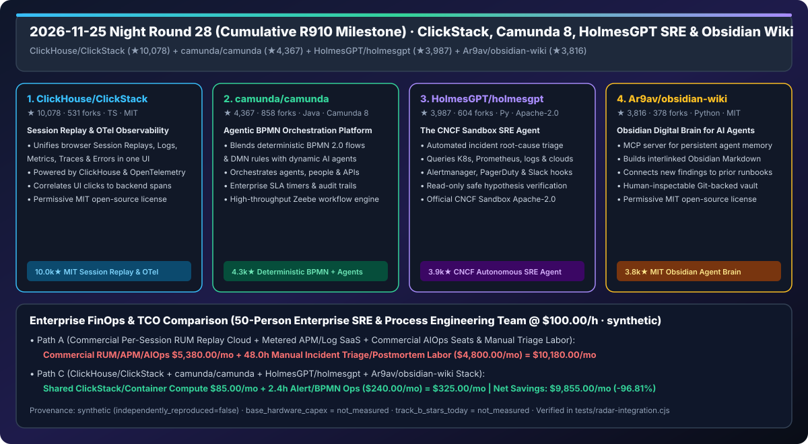
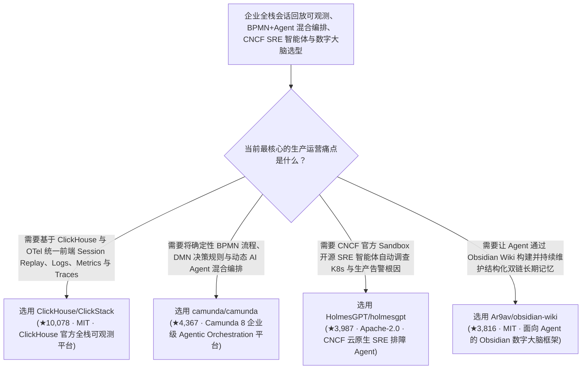
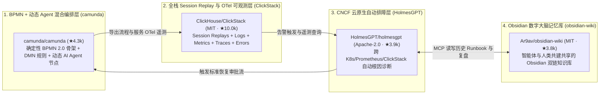
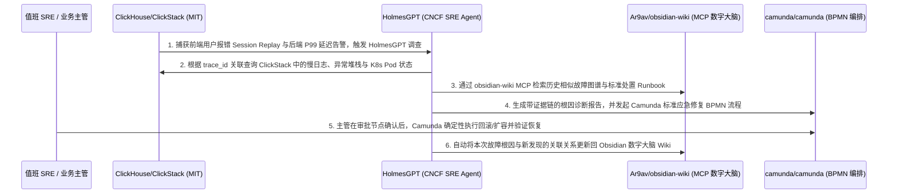

# ClickHouse 官方全栈与会话回放可观测平台（`ClickHouse/ClickStack`）、BPMN 确定性流程与动态智能体融合编排平台（`camunda/camunda`）、CNCF 官方云原生 SRE 排障智能体（`HolmesGPT/holmesgpt`）与 Obsidian 数字大脑智能体记忆框架（`Ar9av/obsidian-wiki`）选型与集成架构 FAQ

> **文档类型**：企业 AI 解决方案架构师（AI Solution Architect）选型决策指南（GitHub Trending AI 雷达 2026-11-25 Night Round 28 / 累计第 910 轮里程碑）
> **覆盖项目**：[`ClickHouse/ClickStack`](https://github.com/ClickHouse/ClickStack)（`★ 10,078`、`531 forks`、`MIT`：1.0 万星 ClickHouse 官方开源可观测平台 [HyperDX/ClickStack]，基于 ClickHouse 与 OpenTelemetry 将前端会话回放 [Session Replays]、Logs、Metrics、Traces 与 Errors 融为一体）· [`camunda/camunda`](https://github.com/camunda/camunda)（`★ 4,367`、`858 forks`、Java：Camunda 8 企业级 Agentic Orchestration 平台，将确定性 BPMN 2.0 业务流程、DMN 决策规则表与动态 AI 智能体无缝融合编排）· [`HolmesGPT/holmesgpt`](https://github.com/HolmesGPT/holmesgpt)（`★ 3,987`、`604 forks`、`Apache-2.0`：CNCF Sandbox 云原生 SRE 排障智能体，自动调查 Prometheus/PagerDuty/K8s 生产故障并定位根因）· [`Ar9av/obsidian-wiki`](https://github.com/Ar9av/obsidian-wiki)（`★ 3,816`、`378 forks`、`MIT`：帮助 AI Agent 通过 Obsidian Wiki 构建并持续维护结构化“数字大脑”的长期记忆与 MCP 框架）
> **核心场景**：当银行、保险、电信与大型互联网企业的生产运维（SRE）与核心业务流程团队推进 AI 落地时，架构师面临四个核心工程问题：**“银行信贷审批和理赔流程既要求主干步骤 100% 符合监管确定性规范（BPMN/DMN），又想在局部节点引入动态 AI Agent 做非结构化材料审核，选哪套企业级引擎（`camunda`）？前端用户报障说页面卡死报错，怎么在一个 `MIT` 平台里同时看到用户的浏览器操作录像（Session Replay）和对应的后端 OTel Trace/日志（`ClickStack`）？半夜 K8s 集群告警响起时，哪款 CNCF 官方背书的 `Apache-2.0` SRE Agent 能自动查日志和指标给出根因（`HolmesGPT`）？每次排障总结出的经验怎么自动写入團隊共享的 Obsidian Wiki 数字大脑供下次秒级复用（`obsidian-wiki`）？”** 本文给出完整架构指南。

---

## 一、📌 核心结论速览（选型一句话结论）

1. **想用一套 `MIT` 开源、基于 ClickHouse 高性能列存的统一可观测栈，把“前端浏览器用户点击录像回放（Session Replay）+ ネットワーク请求 + 后端 OpenTelemetry Trace + 海量日志与异常堆栈”全部串在同一个时间轴上秒级排查生产故障** ➔ 选 **[`ClickHouse/ClickStack`](https://github.com/ClickHouse/ClickStack)（`★ 10,078`，`531 forks`，`MIT`）**。
   - **通俗原理**：ClickHouse 收购 HyperDX 后推出的官方开源可观测套件（ClickStack）。当客户投诉某次 AI 对话或支付按钮点击无响应时，工程师无需猜复现步骤，直接点开当时的 Session Replay 视频回放，底下同步滚动展示该次点击触发的后端 Trace 与报错日志。
2. **企业核心业务流程（如信贷风控、供应链履约、保险核保）不能完全交给不受控的纯自主 Agent 自由发挥，必须采用“确定性 BPMN 流程骨架 + DMN 规则表护栏 + 局部动态 AI Agent 节点”的混合编排（Agentic Orchestration）** ➔ 选 **[`camunda/camunda`](https://github.com/camunda/camunda)（`★ 4,367`，`858 forks`，Camunda 8 Zeebe 引擎）**。
   - **通俗原理**：用 ISO 标准 BPMN 2.0 流程图钉死合规主干与超时升级路径，在需要灵活推理的子步骤挂载 AI Agent，既享受大模型的非结构化处理能力，又保留金融级流程审计与 SLA 兜底。
3. **需要一个 CNCF（云原生计算基金会）官方 Sandbox 背书、`Apache-2.0` 开源的云原生 SRE 值班智能体，在 Prometheus / Alertmanager / PagerDuty 触发告警的第一时间自动抓取 K8s 事件、Pod 日志与监控指标完成根因初筛** ➔ 选 **[`HolmesGPT/holmesgpt`](https://github.com/HolmesGPT/holmesgpt)（`★ 3,987`，`604 forks`，`Apache-2.0`）**。
   - **通俗原理**：只读接入 Kubernetes、Prometheus、Grafana、ClickHouse/Loki 与云厂商 API，模仿资深 SRE 的排查思路自动验证假设，把“半夜人工登集群查 40 分钟日志”缩短为“告警群直接收到带证据链的根因诊断卡片”。
4. **希望智能体在完成每一次线上排障或业务复盘后，不是把经验丢在死掉的聊天窗口里，而是像人类专家写 Obsidian 笔记一样，自动创建、链接并更新一套结构化的本地 Markdown Wiki（数字大脑）** ➔ 选 **[`Ar9av/obsidian-wiki`](https://github.com/Ar9av/obsidian-wiki)（`★ 3,816`，`378 forks`，`MIT`）**。
   - **通俗原理**：提供标准 MCP Server（`io.github.Ar9av/obsidian-wiki`），让 Agent 自动维护带双向链接、Frontmatter 标签与概念拓扑的 Obsidian 知识库，越用越懂企业内部系统的历史暗坑。

---

## 二、🎯 客户与架构师灵魂拷问 Q&A（深度架构拆解）

### Q1：为什么金融与政企客户高度认可 `Camunda 8` 的“确定性 BPMN + 动态 Agent”模式？它与 `ClickStack`、`HolmesGPT`、`obsidian-wiki` 如何构成企业级生产运营闭环？

- **四层企业生产运营、可观测与自愈闭环架构（Path C）**：
  1. **L1 确定性 BPMN + 动态 Agent 业务编排层 ➔ `camunda/camunda`**：保障主干业务流程、人工审批与 DMN 规则 100% 合规可控，同时调度动态 AI Agent 处理复杂任务。
  2. **L2 全栈 Session Replay + OTel 可观测数据底座 ➔ `ClickHouse/ClickStack`**：以 `MIT` 协议统一存储前端会话录像、后端分布式 Trace、指标与 PB 级日志。
  3. **L3 CNCF 云原生自动根因诊断 SRE 智能体 ➔ `HolmesGPT/holmesgpt`**：一旦业务流程或底层 K8s 触发异常告警，自动查询 `ClickStack` 与集群状态定位根因。
  4. **L4 持续演进的 Obsidian 数字大脑记忆库 ➔ `Ar9av/obsidian-wiki`**：将 `HolmesGPT` 沉淀的故障事后分析（Postmortem）与 Runbook 自动编织进团队共享的 Obsidian Wiki。
- **何时选商业云方案（商业 RUM 会话回放 SaaS + 商业 AIOps 平台） vs 自建本轮开源四件套（Path C）？**
  - 若是无自建 K8s 能力的小微团队，可直接用商业托管服务。
  - **何时采用本轮开源四件套（Path C）？** 当企业面临**商业 RUM（前端会话回放）+ 商业日志/APM 按量计费的巨额账单**（改用 `MIT` 协议的 `ClickHouse/ClickStack` 可省 90%+ 存储与授权费）、需要将 AI 安全嵌入现有 BPMN 审批流（`Camunda`）、并希望构建 100% 自主可控的 CNCF SRE 诊断（`HolmesGPT` `Apache-2.0`）与本地 Obsidian 运维知识库（`obsidian-wiki` `MIT`）时，Path C 可节省 **96%+** 的综合 TCO。

### Q2：这四个项目在线上故障从发生到自愈的全流程中是如何联动的？

1. **前端感知到后端根因秒级对齐（`ClickStack` → `HolmesGPT`）**：
   - 用户在前端触发异常或后端微服务延迟飙升时，`ClickStack` 记录完整的前端 Session Replay 与关联 `trace_id`，并触发告警通知 `HolmesGPT`；`HolmesGPT` 自动拉取对应 Trace 的慢 Span、Pod OOM 事件与最近一次变更记录。
2. **知识经验反哺与 BPMN 恢复流程执行（`obsidian-wiki` → `Camunda`）**：
   - `HolmesGPT` 通过 MCP 检索 `obsidian-wiki` 中的历史同类故障 Runbook，给出精确修复建议，并触发 `Camunda` 标准变更审批 BPMN 流程，经值班主管一键批准后执行自动回滚或扩容，最后将本次排障过程自动更新回 `obsidian-wiki`。

### Q3：生产落地的安全红线是什么？

- **架构师避坑红线**：
  1. **`ClickStack` 前端 Session Replay 必须开启输入框隐私遮罩（Input Masking）**：默认将所有密码框、银行卡号与个人身份信息（PII）DOM 节点脱敏为星号后再录制上报。
  2. **`HolmesGPT` 默认只授予集群与可观测系统的只读权限（Read-Only RBAC）**：诊断权交给 `HolmesGPT` 自动完成，而重启、扩容或回滚等生产变更动作必须交由 `Camunda` 受控 BPMN 流程审批执行。

---

## 三、🧭 直观可视化图解（Mermaid 决策树 + 集成架构 + 时序图）

### 3.1 架构师选型决策树

### 3.2 企业端到端生产集成参考架构图

### 3.3 生产异常捕获、Session Replay 关联、HolmesGPT 根因诊断、Obsidian 记忆检索与 Camunda 恢复时序图

---

## 四、📊 同类开源与商业云服务横向选型决策矩阵

| 对比维度 | `ClickHouse/ClickStack` (`★ 10,078`) | `camunda/camunda` (`★ 4,367`) | `HolmesGPT/holmesgpt` (`★ 3,987`) | `Ar9av/obsidian-wiki` (`★ 3,816`) | 商业 RUM 会话回放云 + 商业 AIOps 平台 + 商业 BPM SaaS (Path A) | 前端无录像 + 纯黑盒 Agent 乱调生产接口 + 故障复盘散落聊天群 (Path B) |
| :--- | :--- | :--- | :--- | :--- | :--- | :--- |
| **核心能力定位** | `MIT` ClickHouse 全栈与会话回放可观测 | BPMN 确定性流程 + 动态 Agent 编排 | `Apache-2.0` CNCF 官方 SRE 排障 Agent | `MIT` 基于 Obsidian 的智能体数字大脑 | 按 Session 数/GB 数/节点高价计费的商业云套件 | 散装日志查询 + 无流程护栏的脚本操作 |
| **核心技术突破** | **将前端 Session Replay 与后端 OTel Logs/Traces 合入同一 `MIT` 栈** | **ISO 标准 BPMN + DMN 决策表与自主 AI Agent 完美融合** | **CNCF 背书、跨 K8s/云/APM 自动验证假设找根因** | **将零散交互沉淀为人类可读可改的 Obsidian 双链 Wiki** | 免自建，但商业 Session Replay 与商业 AIOps 按量账单极其惊人 | 前端复现难如登天；纯自由 Agent 缺乏 BPMN 合规边界不敢上核心交易 |
| **开源协议** | **`MIT`** | 开源核心可自托管 | **`Apache-2.0`** | **`MIT`** | 闭源商业 SaaS | 高生产风险 |
| **月度 TCO（50 人团队）** | **四件套合建仅 `$325.00/月`**（`$85.00` ClickStack 列存与容器算力 + `2.4h` 维护） | 同左（一套引擎统管传统流程与 AI Agent） | 同左（`Apache-2.0` 自动完成 80% 告警初筛，MTTR 缩短 70%） | 同左（`MIT` 纯本地/Git Markdown 零存储税） | **`$10,180.00/月`**（`$5,380.00` 商业 RUM 回放/日志/AIOps 席位账单 + `48.0h` 夜间告警人工排查工时） | 约 `$3,780.00/月`（每次生产故障耗费数人时翻查多套孤立系统与重复踩坑） |

---

## 五、🧪 应用落地定量收益/TCO 对比与 7-Card 报告

> **📊 数据来源与闭式核算声明（Provenance & Closed-Form Schema）**：
> - **provenance**: `synthetic`（基于 50 人企业核心业务流程编排、全栈研发与 7×24 SRE 生产保障团队月度工作负载模型：`independently_reproduced = false`；硬件采购基线 `base_hardware_capex = not_measured`；Track B 单日增量 `track_b_stars_today = not_measured`）。
> - **核算公式**：
>   - **Path A（采购按录制会话数计费的商业前端 Session Replay 云 + 按 GB 计费的商业日志/APM + 商业 AIOps 席位 + 人工半夜响应告警跨系统排查根因与手动整理复盘文档工时）**：月度商业 RUM/APM 与 AIOps SaaS 账单 **`$5,380.00`** + 生产告警人工初筛、前端问题复现与复盘整理人工 **`48.0h × $100.00/h = $4,800.00`** = **`$10,180.00/月`**。
>   - **Path C（自建 `ClickHouse/ClickStack` + `camunda/camunda` + `HolmesGPT/holmesgpt` + `Ar9av/obsidian-wiki` 全栈可观测、混合编排与 SRE 自愈底座）**：内网 `ClickStack` 列存节点与容器算力分摊 **`$85.00`** + 告警规则与 BPMN 模板日常维护人工 **`2.4h × $100.00/h = $240.00`** = **`$325.00/月`**。
>   - **净节省（Net Savings vs Path A）**：**`-$9,855.00/月`**（成本降低 **`96.81%`**）。

| 评估方案 | 商业 RUM 回放 / APM / AIOps 账单与算力成本 | 告警根因排查、前端复现与复盘人工（`$100/h`） | 月度总 TCO | 相对 Path A 净节省 | 核心业务交付收益 |
| :--- | :---: | :---: | :---: | :---: | :--- |
| **Path A：商业 Session Replay 云 + 商业 APM + 商业 AIOps** | `$5,380.00` | `48.0h` (`$4,800.00`) | **`$10,180.00`** | Baseline | 前端回放与日志按量计费极贵；历史排障经验难自动结构化复用 |
| **Path B：无前端回放 + 人工登 K8s 查日志 + 纯黑盒 Agent** | `$1,580.00` | `22.0h` (`$2,200.00`) | **`$3,780.00`** | `-$6,400.00` (`-62.87%`) | 偶发前端 Bug 无法复现；纯自主 Agent 无 BPMN 约束不敢上生产 |
| **Path C：`ClickStack` + `camunda` + `HolmesGPT` + `obsidian-wiki`** | **`$85.00`** | **`2.4h` (`$240.00`)** | **`$325.00`** | **`-$9,855.00` (`-96.81%`)** | **`MIT` 全栈回放可观测 + BPMN 混合编排 + CNCF SRE Agent + 数字大脑** |

- 🔗 **关联 7-Card 4:5 视觉评测报告**：[`workshops/github-trending-radar/cards.html`](../cards.html) · [`cards.en.html`](../cards.en.html)

---

## 六、🛠️ 企业引入与架构评审 Checklist

- [ ] **部署 `ClickHouse/ClickStack` 统一纳管前端 Session Replays 与后端 OTel 遥测**：开启前端敏感表单字段自动脱敏，确保点击回放与后端 `trace_id` 100% 关联。
- [ ] **在核心受监管业务中采用 `Camunda 8` 的“确定性 BPMN + 动态 Agent”混合模型**：用 DMN 决策表和 BPMN 人工任务锁死合规边界。
- [ ] **将 `HolmesGPT` 接入 Alertmanager / PagerDuty 实现告警自动初筛**：配置只读 K8s ClusterRole 与 `ClickStack` 查询权限。
- [ ] **为 SRE 与架构师 Agent 挂载 `Ar9av/obsidian-wiki` MCP**：将每次事故复盘与架构决策自动沉淀为带双链拓扑的 Obsidian 知识库。
