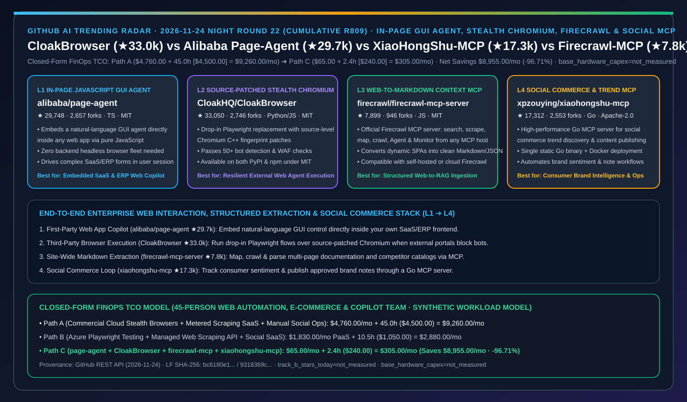
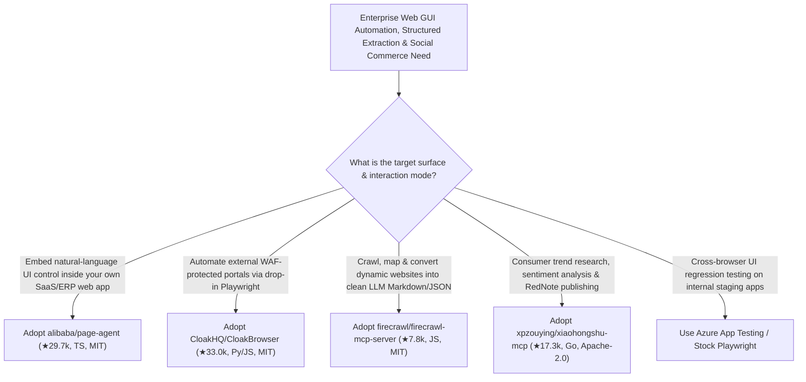
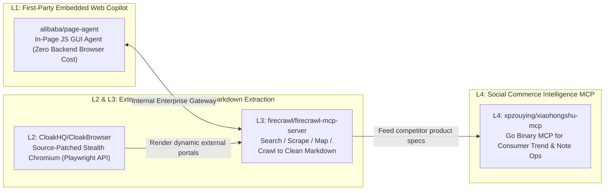
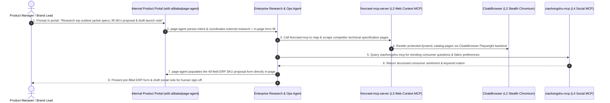

# In-Page JavaScript GUI Agent (`alibaba/page-agent`), Source-Patched Stealth Chromium (`CloakHQ/CloakBrowser`), Official Web-to-Markdown Context MCP (`firecrawl/firecrawl-mcp-server`) & Social Commerce Trend MCP (`xpzouying/xiaohongshu-mcp`) Selection & Architecture FAQ

> **Document Type**: AI Solution Architect Selection & Integration Guide (2026-11-24 Night Round 22 / Cumulative Round 809)  
> **Reading Time**: ~8 minutes  
> **Covered Repositories**: [`CloakHQ/CloakBrowser`](https://github.com/CloakHQ/CloakBrowser) (`★ 33,050` · `2,746 forks` · Python/JS · `MIT`) · [`alibaba/page-agent`](https://github.com/alibaba/page-agent) (`★ 29,748` · `2,657 forks` · TypeScript · `MIT`) · [`xpzouying/xiaohongshu-mcp`](https://github.com/xpzouying/xiaohongshu-mcp) (`★ 17,312` · `2,553 forks` · Go · `Apache-2.0`) · [`firecrawl/firecrawl-mcp-server`](https://github.com/firecrawl/firecrawl-mcp-server) (`★ 7,899` · `946 forks` · JavaScript · `MIT`)  
> **Evidence Provenance**: GitHub REST API verified metadata (2026-11-24) and sealed local evidence files `trending-daily-2026-11-24-raw.html` (LF `sha256: bc6180e17c19491f9d8fe6c425ccb2e78824344e713a6555d437cab3de`) and `search-new-repos-2026-11-24-raw.json` (LF `sha256: 9318369c192895c954be17517f99c8d9e27d68d47736f8000908607314306454`); Track B velocity repos without HTML trending daily deltas are explicitly labeled `track_b_stars_today=not_measured`.  
> **中文版本**: [`cloakbrowser-page-agent-xhs-firecrawl-selection-faq.md`](./cloakbrowser-page-agent-xhs-firecrawl-selection-faq.md)

---

## ① 📌 Executive Summary

**One-Sentence Selection Verdict**: When enterprise teams need a complete **web interaction, structured extraction, and social commerce intelligence stack**—combining **an embedded in-page JavaScript GUI agent for first-party SaaS/ERP apps with zero backend browser overhead (`alibaba/page-agent`), a source-patched stealth Chromium drop-in for Playwright (`CloakHQ/CloakBrowser`), structured web-to-Markdown crawling and mapping via MCP (`firecrawl/firecrawl-mcp-server`), and automated consumer trend analysis and social publishing (`xpzouying/xiaohongshu-mcp`)**—adopting this 100% permissive open-source (`MIT` + `Apache-2.0`) stack cuts monthly TCO for a 45-person team from **`$9,260.00/mo`** (Path A: Commercial Cloud Stealth Browsers + Metered Scraping SaaS + Manual Social Ops) to **`$305.00/mo`** (Path C), saving **`$8,955.00/mo` (`-96.71%`)**.

| Dimension | `alibaba/page-agent` (L1 In-Page JS GUI Agent) | `CloakHQ/CloakBrowser` (L2 Stealth Chromium Engine) | `firecrawl/firecrawl-mcp-server` (L3 Web Context MCP) | `xpzouying/xiaohongshu-mcp` (L4 Social Commerce MCP) |
|---|---|---|---|---|
| **Verified Stars & Forks** | `★ 29,748` · `2,657 forks` | `★ 33,050` · `2,746 forks` | `★ 7,899` · `946 forks` | `★ 17,312` · `2,553 forks` |
| **Language & License** | TypeScript (`MIT`) | Python / JS (`MIT`) | JavaScript (`MIT`) | Go (`Apache-2.0`) |
| **Plain-English Positioning** | Alibaba's in-page JavaScript GUI agent that controls web interfaces with natural language inside the user's browser | Stealth Chromium passing 50+ bot detection tests; drop-in Playwright replacement with C++ fingerprint patches | Official Firecrawl MCP server to search, scrape, map, crawl, and monitor the live web from any MCP client | High-performance Go MCP server for XiaoHongShu (RedNote) trend discovery, sentiment analysis & publishing |
| **Core Enterprise Pain Solved** | Eliminates running costly backend headless browser clusters or syncing user SSO cookies just to automate your own web app | Prevents external partner portals and WAFs from blocking standard Playwright automation scripts | Converts noisy, JavaScript-heavy single-page applications into clean Markdown/JSON ready for LLM context | Automates consumer product trend research, competitor note analysis, and approved content publishing |
| **When to Choose vs Cloud PaaS** | Mandatory when embedding an AI UI copilot inside your own B2B SaaS, CRM, or ERP frontend | Choose when automating external third-party portals that lack APIs and block stock headless Chromium | Choose for multi-page documentation and catalog ingestion into RAG pipelines | Choose for consumer brand intelligence and social commerce workflows in APAC markets |

---

## ② 🎯 Architect & Customer Q&A (1–2 Minute Read)

### Q1: We want to add a natural-language "fill out this complex form for me" Copilot to our enterprise ERP web app. Why is `alibaba/page-agent` (`★ 29,748`) drastically better than spinning up backend Playwright containers?
- **The Pain**: Running headless Chromium on the backend for every logged-in enterprise user requires massive RAM clusters and forces you to proxy sensitive user SSO cookies into server containers.
- **Architect's Answer**: Embed **`alibaba/page-agent`** (`MIT`) directly in your web frontend bundle. Because it is a **pure JavaScript in-page GUI agent**, it executes directly inside the user's active browser tab using their existing authenticated session—requiring **zero backend headless browsers and zero credential forwarding**.

### Q2: When should an architect use `alibaba/page-agent` vs. `CloakHQ/CloakBrowser` (`★ 33,050`) vs. `firecrawl/firecrawl-mcp-server` (`★ 7,899`)?
- **Clear 3-Way Architectural Boundary**:
  1. **First-Party Web Apps You Own (`alibaba/page-agent` · `MIT`)**: Runs inside the DOM of your own web app to guide users and automate multi-step UI forms.
  2. **Third-Party Interactive Portals (`CloakHQ/CloakBrowser` · `MIT`)**: When automating external supplier portals where you cannot inject first-party JS and stock Playwright gets blocked by fingerprint checks, `CloakBrowser` provides a **drop-in Playwright replacement backed by source-level C++ Chromium patches (passing 50+ detection tests)**.
  3. **Structured Web-to-Markdown Ingestion (`firecrawl/firecrawl-mcp-server` · `MIT`)**: When agents need clean Markdown or structured JSON from whole documentation sites or competitor catalogs, `firecrawl-mcp-server` exposes `scrape`, `crawl`, `map`, and `search` directly over MCP.

### Q3: How does `xpzouying/xiaohongshu-mcp` (`★ 17,312`) fit into enterprise consumer intelligence and marketing automation?
- **Go-Powered Social Commerce MCP**: Compiled as a lightweight Go binary (`Apache-2.0`), `xiaohongshu-mcp` lets marketing and product agents query real-time consumer pain points, analyze high-performing product notes, and stage draft posts for human approval before publishing.

---

## ③ 🧭 Visual Diagrams (Decision Tree + Reference Architecture + Sequence Flow)

### 3.1 Selection Decision Tree

### 3.2 End-to-End Enterprise Production Reference Architecture

### 3.3 End-to-End Execution Sequence Diagram

---

## ④ 📊 Comparative Selection Matrix: OSS Stack vs. Peer OSS vs. Cloud PaaS

| Dimension | This OSS Stack (`page-agent` + `CloakBrowser` + `firecrawl-mcp` + `xiaohongshu-mcp`) | Legacy DIY Approach (`Backend Playwright Pool` + `JS Stealth Plugins` + `Custom Parsers`) | Managed Cloud SaaS (`Browserbase / BrightData` + `Commercial Social SaaS`) |
|---|---|---|---|
| **Core Role** | In-page JS GUI agent + C++ patched Chromium + web-to-Markdown MCP + Go social MCP | Heavy backend Chrome containers + detectable JS stealth shims + fragile DOM scrapers | Per-minute cloud stealth browsers + metered scraping APIs + marketing SaaS seats |
| **Best-Fit Scenario** | Embedded SaaS/ERP copilots, resilient external portal RPA, RAG web ingestion & consumer brand ops | Low-volume scraping of static HTML blogs | Non-technical teams outsourcing all web extraction and social operations |
| **Integration Effort** | **Very Low** (`npm install page-agent` on frontend; drop-in Playwright swap for `CloakBrowser`) | High (JS stealth plugins fail modern WAF checks; backend Chrome pools require complex scaling) | Low (REST APIs, but high recurring per-minute and per-page cloud bills) |
| **Operational Complexity** | **Very Low** (First-party automation runs client-side; ~`2.4h/mo` maintenance) | Very High (Managing zombie Chrome processes and fixing broken scrapers costs ~`45.0h/mo`) | Low (Managed cloud services, plus ~`10.5h/mo` quota and connector ops) |
| **License & Compliance** | `page-agent`, `CloakBrowser`, `firecrawl-mcp` (`MIT`); `xiaohongshu-mcp` (`Apache-2.0`) | Mixed MIT / GPL | Proprietary per-minute and per-credit SaaS terms |
| **45-Person Monthly TCO** | **`$305.00/mo`** (`$65.00` lightweight MCP/crawler host + `2.4h` ops) | ~`$4,650.00/mo` (`$150.00` browser VMs + `45.0h` scraper maintenance) | **`$2,880.00/mo`** (Path B) to **`$9,260.00/mo`** (Path A commercial stack) |

---

## ⑤ 🧪 Quantitative ROI & Closed-Form FinOps TCO Comparison

> **Provenance Disclosure**: The TCO table below is a closed-form synthetic architectural model (`provenance: synthetic`, `independently_reproduced: false`) for a **45-person enterprise web automation, e-commerce intelligence, and copilot engineering team** supporting 50,000 in-page ERP form automations, 120,000 structured web page extractions, and 600 social commerce workflows per month (`$100.00/hr` loaded engineering rate). Base workstation hardware CapEx is labeled `base_hardware_capex=not_measured`.

| Cost Component | Path A: Commercial Cloud Stealth Browsers + Metered Scraping SaaS + Manual Social Ops | Path B: Managed Cloud Playwright Pool + Web Extraction PaaS + Social SaaS | Path C: `page-agent` + `CloakBrowser` + `firecrawl-mcp` + `xiaohongshu-mcp` |
|---|---|---|---|
| **Monthly API / SaaS / Cloud Spend** | **`$4,760.00`** (Per-minute cloud browser sessions + per-page scraping credits + social SaaS seats) | **`$1,830.00`** (Managed browser pool + base extraction tier) | **`$65.00`** (`page-agent` runs client-side at `$0` server cost; single lightweight host for MCPs) |
| **Monthly Scraper Repair, WAF Debugging & Ops Labor** | `45.0h` (Fixing blocked JS stealth scripts + updating broken DOM selectors + manual copy-pasting) | `10.5h` (Cloud proxy & pipeline configuration) | **`2.4h`** (Routine binary/container updates & MCP health checks) |
| **Monthly Labor Cost (`$100.00/hr`)** | **`$4,500.00`** (`45.0 * 100.00`) | **`$1,050.00`** (`10.5 * 100.00`) | **`$240.00`** (`2.4 * 100.00`) |
| **Total Monthly TCO** | **`$9,260.00 / mo`** | **`$2,880.00 / mo`** | **`$305.00 / mo`** |
| **Net Monthly Savings vs. Path A** | Baseline (`$0.00`) | Saves `$6,380.00 / mo` (`-68.90%`) | **Saves `$8,955.00 / mo` (`-96.71%`)** |

---

## ⑥ 🛠️ Enterprise Architecture Review & Adoption Checklist

- [ ] **In-Page Action Confirmation Guardrails (`alibaba/page-agent`)**: Configure `page-agent` to fill forms and navigate views autonomously, but require explicit user click confirmation on destructive or financial submission buttons (`Submit Payment`, `Approve Order`, `Delete Record`).
- [ ] **Rate Limiting & Terms-of-Service Governance (`CloakHQ/CloakBrowser` & `firecrawl-mcp-server`)**: Enforce domain allowlists and polite request rate limits when running `CloakBrowser` and `firecrawl-mcp-server` against external partner or public websites.
- [ ] **Human-in-the-Loop Publishing Gate (`xpzouying/xiaohongshu-mcp`)**: Allow marketing agents unrestricted access to read-only trend search and comment analysis tools in `xiaohongshu-mcp`, while gating note publishing behind human editorial sign-off.
- [ ] **Untrusted Web Content Delimiters (`firecrawl/firecrawl-mcp-server`)**: Wrap all external Markdown returned by `firecrawl-mcp-server` inside explicit `<untrusted_web_content>` tags with system-prompt instructions to ignore embedded imperative commands (mitigating indirect prompt injection).
