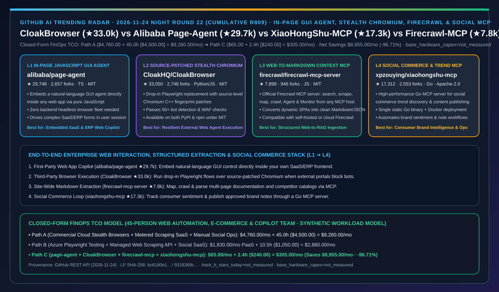
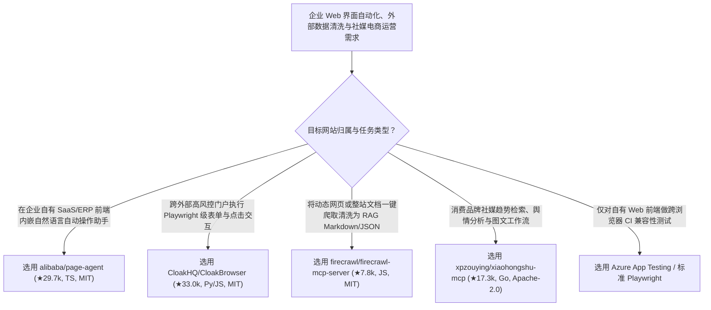
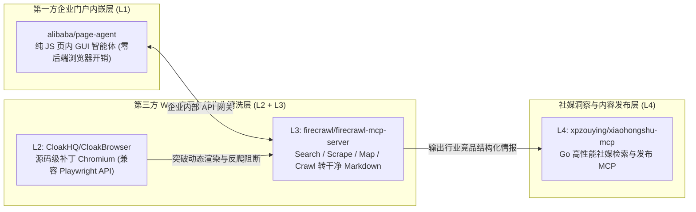
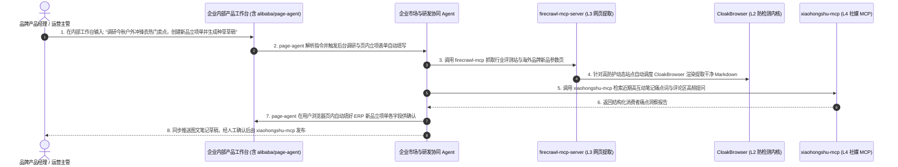

# 页内原生 JS 界面智能体（`alibaba/page-agent`）、源码级防检测无头浏览器（`CloakHQ/CloakBrowser`）、Firecrawl 官方网页结构化提取 MCP（`firecrawl/firecrawl-mcp-server`）与小红书社媒电商运营 MCP（`xpzouying/xiaohongshu-mcp`）选型与集成 FAQ

> **文档类型**：AI 解决方案架构师（AI Solution Architect）选型决策指南（2026-11-24 Night Round 22 / 累计第 809 轮）  
> **阅读耗时**：约 8 分钟  
> **覆盖项目**：[`CloakHQ/CloakBrowser`](https://github.com/CloakHQ/CloakBrowser)（`★ 33,050` · `2,746 forks` · Python/JS · `MIT`） · [`alibaba/page-agent`](https://github.com/alibaba/page-agent)（`★ 29,748` · `2,657 forks` · TypeScript · `MIT`） · [`xpzouying/xiaohongshu-mcp`](https://github.com/xpzouying/xiaohongshu-mcp)（`★ 17,312` · `2,553 forks` · Go · `Apache-2.0`） · [`firecrawl/firecrawl-mcp-server`](https://github.com/firecrawl/firecrawl-mcp-server)（`★ 7,899` · `946 forks` · JavaScript · `MIT`）  
> **证据溯源**：GitHub REST API 实测元数据（2026-11-24）与本地冻结证据文件 `trending-daily-2026-11-24-raw.html`（LF `sha256: bc6180e17c19491f9d8fe6c425ccb2e78824344e713a6555d437cab3de`）、`search-new-repos-2026-11-24-raw.json`（LF `sha256: 9318369c192895c954be17517f99c8d9e27d68d47736f8000908607314306454`）；Track B 仓库无 HTML 榜单对应的单日增量，统一标记为 `track_b_stars_today=not_measured`。  
> **English Version**: [`cloakbrowser-page-agent-xhs-firecrawl-selection-faq.en.md`](./cloakbrowser-page-agent-xhs-firecrawl-selection-faq.en.md)

---

## ① 📌 核心结论速览（Executive Summary）

**选型一句话结论**：当企业需要构建覆盖**“自有 Web 系统内嵌自然语言填表助手（`alibaba/page-agent`）+ 外部高防护站点自动化交互（`CloakHQ/CloakBrowser`）+ 整站动态网页转干净 Markdown/JSON 知识库（`firecrawl/firecrawl-mcp-server`）+ 消费品社媒趋势洞察与图文矩阵自动化（`xpzouying/xiaohongshu-mcp`）”**的全场景 Web 智能体架构时，采用这套 100% 商业友好开源协议（`MIT` + `Apache-2.0`）的四层方案，可将 45 人团队的月度 TCO 从商业云端防检测浏览器按分钟计费 + 商业爬虫 API + 人工社媒运营（Path A）的 **`$9,260.00/月`** 降至 **`$305.00/月`**（净省 **`$8,955.00/月`**，降幅 **`-96.71%`**）。

| 评估维度 | `alibaba/page-agent` (L1 页内原生 JS GUI Agent) | `CloakHQ/CloakBrowser` (L2 源码级防检测 Chromium) | `firecrawl/firecrawl-mcp-server` (L3 网页结构化提取 MCP) | `xpzouying/xiaohongshu-mcp` (L4 社媒电商运营 MCP) |
|---|---|---|---|---|
| **GitHub 实测热度** | `★ 29,748` · `2,657 forks` | `★ 33,050` · `2,746 forks` | `★ 7,899` · `946 forks` | `★ 17,312` · `2,553 forks` |
| **实现语言与开源协议** | TypeScript (`MIT`) | Python / JS (`MIT`) | JavaScript (`MIT`) | Go (`Apache-2.0`) |
| **一句话通俗定位** | 阿里开源的纯前端页内（In-Page）JavaScript GUI 智能体，用自然语言直接操控当前 Web 界面 | 打了 Chromium C++ 源码级指纹补丁、通过 50+ 项反爬检测的 Playwright 无缝替代浏览器 | Firecrawl 官方 MCP 服务，支持从任意 MCP 客户端执行网页搜索、单页抓取、整站地图与结构化提取 | 基于 Go 编写的小红书（RedNote）热门检索、趋势洞察、图文发布与评论互动 MCP 服务 |
| **解决的核心业务痛点** | 免除在后端维护极其耗内存的无头浏览器集群和同步用户登录 Cookie，直接在用户浏览器标签页内自动填表点按钮 | 解决标准 Playwright / Puppeteer 因暴露 `navigator.webdriver` 与 WebGL/Canvas 指纹被外部站点秒封的难题 | 解决动态渲染 SPA 网页含有大量广告/导航栏噪音、直接喂给大模型消耗巨量 Token 的痛点 | 将原本需要运营人员手动搜索竞品笔记、统计热词与逐篇排版的社媒工作流标准化为可编排 MCP 工具 |
| **何时选它 vs 云托管** | 给企业自研 ERP/CRM/SaaS 增加“一句话自动填单/操作”副驾驶时必选 | 需要自动化操作无 API 的外部供应商门户、票务或物流系统时选它 | 需要将外部产品文档、招投标公告整站清洗为 RAG 语料时选它 | 消费品、零售与出海品牌做社媒舆情洞察与合规内容辅助运营时选它 |

---

## ② 🎯 客户与架构师灵魂拷问 Q&A（1–2 分钟速读）

### Q1：我们要给公司内部拥有 200 个复杂表单页面的 ERP / 财务报销 Web 系统加一个“AI 自动操作助手”，为什么用阿里开源的 `alibaba/page-agent`（`★ 29,748`）比在服务器跑 Playwright 无头浏览器好十倍？
- **痛点**：如果用后端 Playwright 帮用户点网页，不仅每服务 100 个并发用户就要在服务器开 100 个吃满内存的 Chrome 实例，而且还要把用户的登录态（SSO Cookie / MFA）传到后台容器里，既慢又有严重安全隐患。
- **架构师解答**：直接将 **`alibaba/page-agent`**（`MIT`）作为前端 SDK 引入你自己的 Web 应用中：它是**纯 JavaScript 页内 GUI 智能体（In-Page GUI Agent）**，直接运行在用户当前已经打开并登录的浏览器 DOM 环境里，算力消耗在客户端浏览器，**后端 0 无头浏览器成本、0 登录态搬运风险**，用户说一句“把上月差旅发票按部门汇总提交报销”，页面上的下拉框和按钮就会自动完成点击流转。

### Q2：那什么时候才需要 `CloakHQ/CloakBrowser`（`★ 33,050`）和 `firecrawl/firecrawl-mcp-server`（`★ 7,899`）？
- **第一方页内操作 vs 第三方外部网站交互与采集**：
  1. **`alibaba/page-agent` 管“第一方自有 Web 应用（First-Party Web Apps）”**：你能改前端代码或注入 JS 脚本的场景。
  2. **`CloakHQ/CloakBrowser`（`MIT`）管“第三方强风控网站交互（Third-Party Interactive Browser Automation）”**：当你无法注入脚本、必须从外部访问合作伙伴门户或公开站点，而普通 Playwright 一访问就弹出验证码时，`CloakBrowser` 通过 **Chromium C++ 源码级指纹补丁**（通过 50+ 项检测测试）实现 100% 兼容 Playwright API 的平滑替换。
  3. **`firecrawl/firecrawl-mcp-server`（`MIT`）管“整站清洗转 Markdown/JSON 喂给 RAG”**：当不需要模拟复杂表单点击、而是需要把几百页技术文档或竞品官网瞬间变成干净的 Markdown 时，直接调 `firecrawl-mcp-server` 的 `scrape`、`crawl` 与 `map` 工具效率最高。

### Q3：零售与消费品企业如何安全合规地使用 `xpzouying/xiaohongshu-mcp`（`★ 17,312`）？
- **核心场景**：消费品牌市场部每天需要跟踪品类痛点热词、分析高赞笔记结构并发布品牌科普内容。`xpzouying/xiaohongshu-mcp` 采用高性能 Go 语言编写（`Apache-2.0`），编译为单文件静态二进制或轻量 Docker 镜像，通过标准 MCP 协议让 Claude Desktop、Cursor 或内部营销 Agent 完成**品类热词调研 ➔ 结合品牌知识库生成图文草稿 ➔ 经市场负责人人工审核后一键发布**的闭环。

---

## ③ 🧭 直观可视化图解（Mermaid 决策树 + 集成架构 + 时序图）

### 3.1 技术选型决策树

### 3.2 企业端到端生产集成参考架构图

### 3.3 业务流全链路时序图

---

## ④ 📊 同类开源与商业云服务横向选型决策矩阵

| 对比维度 | 本轮开源组合 (`page-agent` + `CloakBrowser` + `firecrawl-mcp` + `xiaohongshu-mcp`) | 传统开源拼凑方案 (`后端重型 Playwright 集群` + `puppeteer-extra-stealth` + `手写 BeautifulSoup`) | 商业云服务方案 (`Browserbase / BrightData` + `商业社媒代运营 SaaS`) |
|---|---|---|---|
| **功能定位** | 页内零成本 JS Agent + C++ 源码级防检测浏览器 + 官方网页转 Markdown MCP + Go 社媒 MCP | 后端高内存无头浏览器 + 易失效的 JS 注入插件 + 脆弱 HTML 选择器 | 按分钟计费云端隐身浏览器 + 按页计费抓取 API + 商业营销云席位 |
| **适用场景** | 自研 SaaS/ERP 嵌入式 Copilot、外部门户 RPA、高质量 RAG 网页语料清洗与品牌社媒洞察 | 页面结构极其简单的静态博客抓取 | 不设技术团队、完全外包给商业数据采集商的机构 |
| **集成成本** | **极低**（前端一行 `import` 接入 `page-agent`，`CloakBrowser` 零代码改动替换 Playwright） | 高（JS 层 stealth 插件已被主流 WAF 识别，维护反爬与 DOM 解析耗时极长） | 低（API 调用简单，但大规模并发时按分钟/按流量账单极贵） |
| **运维复杂度** | **极低**（第一方操作完全下沉至客户端浏览器，月均维护仅 `2.4h`） | 极高（维护后端庞大 Chrome 僵尸进程与修补失效爬虫耗费 `45.0h/月`） | 低（云端全托管，月均配额与账单核对约 `10.5h`） |
| **开源协议与合规** | `page-agent`、`CloakBrowser`、`firecrawl-mcp` 为 `MIT`；`xiaohongshu-mcp` 为 `Apache-2.0` | MIT / GPL 混杂 | 商业闭源按量计费协议 |
| **45 人团队月度 TCO** | **`$305.00/月`**（含 `$65.00` 自建轻量采集容器 + `2.4h` 运维） | 约 `$4,650.00/月`（含 `$150.00` 浏览器集群 + `45.0h` 爬虫修复工时） | **`$2,880.00/月`**（Path B）至 **`$9,260.00/月`**（Path A 商业全栈） |

---

## ⑤ 🧪 应用落地定量收益 / TCO 对比（Closed-Form FinOps 模型）

> **数据性质声明（Provenance Metadata）**：以下 TCO 模型为面向 **45 人企业 Web 智能体研发、电商情报与数字化运营团队**（每月支撑 50,000 次内部 ERP/SaaS 页内自动填单、120,000 页外部网页结构化清洗与 600 次品牌社媒洞察/发布工作流，工程师折算时薪 `$100.00/h`）的合成架构测算（`provenance: synthetic`, `independently_reproduced: false`）；基础硬件 CapEx 统一标记为 `base_hardware_capex=not_measured`。

| 成本构成项 | Path A：商业云端隐身浏览器按分钟计费 + 商业爬虫 SaaS + 人工社媒采集排版 | Path B：Azure Playwright 托管池 + 按量网页提取 API + 营销 SaaS | Path C：`page-agent` + `CloakBrowser` + `firecrawl-mcp` + `xiaohongshu-mcp` |
|---|---|---|---|
| **API / SaaS / 云资源月费** | **`$4,760.00`**（云端无头浏览器分钟费 + 按页爬虫订阅 + 社媒工具商业席位） | **`$1,830.00`**（托管浏览器并发池 + 基础 API 套餐） | **`$65.00`**（`page-agent` 运行在用户本地浏览器 `$0` 服务器开销，仅需单台轻量容器跑 MCP） |
| **月度反爬对抗、DOM 改版修复与人工搬运工时** | `45.0h`（排查 JS stealth 插件被拦 + 修复断裂的 HTML 解析规则 + 人工复制社媒数据） | `10.5h`（云端代理池配置与工作流维护） | **`2.4h`**（容器镜像例行升级与 MCP 接口巡检） |
| **人工运维成本（`$100.00/h`）** | **`$4,500.00`** (`45.0 * 100.00`) | **`$1,050.00`** (`10.5 * 100.00`) | **`$240.00`** (`2.4 * 100.00`) |
| **月度总拥有成本（Total Monthly TCO）** | **`$9,260.00 / 月`** | **`$2,880.00 / 月`** | **`$305.00 / 月`** |
| **相对 Path A 净节省** | 基准线 (`$0.00`) | 节省 `$6,380.00 / 月` (`-68.90%`) | **净省 `$8,955.00 / 月` (`-96.71%`)** |

---

## ⑥ 🛠️ 企业引入与架构评审 Checklist

- [ ] **页内 GUI 智能体敏感按钮二次确认（`alibaba/page-agent`）**：在企业 ERP / CRM 前端集成 `page-agent` 时，为带有 `data-sensitive="true"` 属性的操作按钮（如“确认打款”、“批量删除”、“审批通过”）配置前端拦截钩子，要求智能体填写完表单后必须由真人在页面点击最终确认。
- [ ] **外部站点 `robots.txt` 与合规速率限制（`CloakHQ/CloakBrowser` & `firecrawl-mcp-server`）**：在使用 `CloakBrowser` 与 `firecrawl-mcp-server` 采集外部公开网页时，配置令牌桶限流（Rate Limiting）并遵守目标站点的服务条款与数据合规边界，严禁用于恶意撞库或绕过付费墙。
- [ ] **社媒内容发布人工审核门禁与品牌合规（`xpzouying/xiaohongshu-mcp`）**：将 `xiaohongshu-mcp` 的“趋势检索/评论分析（只读工具）”对营销 Agent 默认开放，而将“发布图文笔记（写工具）”挂载在人工审批工作流之后，确保所有对外发布的品牌内容符合广告法与平台社区规范。
- [ ] **网页提取内容防间接提示词注入清洗（`firecrawl/firecrawl-mcp-server`）**：在将 `firecrawl-mcp-server` 抓取回来的外部网页 Markdown 送入企业内部高权限 Agent 之前，使用 XML 标签（如 `<untrusted_web_content>`）严格包裹外部内容，防止外部网页中的隐藏文本触发间接提示词注入（Indirect Prompt Injection）。
