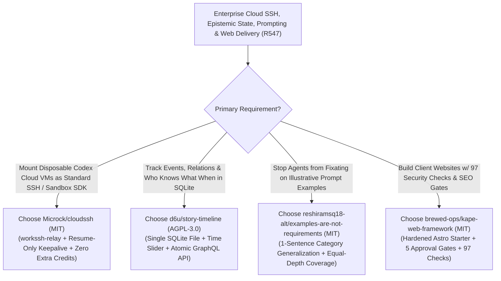

# Codex Cloud SSH Workspaces (`Microck/cloudssh`), SQLite+GraphQL Epistemic Story Timeline (`d6u/story-timeline`), Anti-Example-Anchoring Skill (`reshiramsq18-alt/examples-are-not-requirements`) & 97-Check Gated Astro Web Framework (`brewed-ops/kape-web-framework`) Selection FAQ

> **Document Type**: AI Solution Architect Enterprise Selection & Integration Guide (2026-11-19 Night Shift · Round 23 / Cumulative Round 547)  
> **Benchmark Style**: `docs/components/ib-vs-ethernet-roce-selection-faq.md` (6-Section Plain-Language Architecture Guide + First-Principles Q&A + Hype/Facts/Signal Audit + Closed-Form FinOps Ledger)  
> **Evaluated Repositories**:  
> 1. **`Microck/cloudssh`** (`★ 21`, `created=2026-11-14`, `2 forks`, TypeScript, Node 22+, MIT): **Codex Cloud workspaces over SSH** with a `sandbox-sdk` provider, `raft` plugin, and native resume-only keepalive (`workssh-relay`, never buys extra credits)  
> 2. **`d6u/story-timeline`** (`★ 15`, `created=2026-11-15`, `2 forks`, TypeScript, SQLite + GraphQL, AGPL-3.0): **SQLite + self-describing atomic GraphQL temporal & epistemic fact ledger** tracking events, characters, relations, and **who knows what and when** with a "View story as of here" slider  
> 3. **`reshiramsq18-alt/examples-are-not-requirements`** (`★ 14`, `created=2026-11-13`, `3 forks`, MIT, EN/ZH): **Agent skill preventing example-anchoring bias**—stopping AI assistants from treating illustrative examples as an exhaustive list or automatic priority  
> 4. **`brewed-ops/kape-web-framework`** (`★ 8`, `created=2026-11-13`, `7 forks`, TypeScript, Astro + Tailwind, Node 22+, MIT): **5-step gated client website framework** with a hardened Astro starter, **97 security checks**, 4-host security headers, SEO markup, and launch gates  
> **Accounting Scope Note**: Only software API/SaaS spend and engineering labor TCO are modeled; base workstation hardware capEx is explicitly marked `not_measured`, and Track B `stars_today` is explicitly marked `not_measured`.

---

## 📌 1. Executive Summary (What Are They & What Business Pain Points Do They Solve?)

In **2026-11-19 Night Round 23 (Cumulative Round 547)**, we solve four recurring enterprise architecture and delivery bottlenecks across disposable cloud SSH sandboxes, temporal knowledge-state tracking, prompt example-anchoring bias, and security-gated website delivery:
1. **Pain Point A (Disposable Codex Cloud VMs cannot be mounted directly as standard SSH hosts or `sandbox-sdk` targets without custom relay plumbing or risking unwanted credit purchases)**: **`Microck/cloudssh` (`★ 21`, MIT)** exposes Codex Cloud VMs as standard SSH workspaces, an `opencoredev/sandbox-sdk` provider, and a `raft` location via `workssh-relay` with native resume-only keepalive—never buying credits or mutating existing environments.
2. **Pain Point B (Long-horizon narrative, simulation, and investigation workflows stored in plain Markdown suffer from temporal knowledge leaks—where an actor acts on information before the event in which they learned it)**: **`d6u/story-timeline` (`★ 15`, AGPL-3.0)** stores events, actors, relations, and point-in-time knowledge states in a single portable SQLite file, pairs it with a "View story as of here" timeline slider, and exposes a self-describing GraphQL API with atomic all-or-nothing document mutations.
3. **Pain Point C (When a user drops two illustrative examples into a prompt, LLMs routinely fixate on those two examples as the entire assignment or give them disproportionate detail while reducing the rest of the domain to a shallow list)**: **`reshiramsq18-alt/examples-are-not-requirements` (`★ 14`, `3 forks`, MIT)** forces the assistant to first state in one sentence which broader categories the examples point to, then cover the full category space with equal depth.
4. **Pain Point D (Vibe-coded client landing pages and marketing sites look generic and ship without CSP/HSTS headers, legal pages, structured SEO markup, or protected contact forms)**: **`brewed-ops/kape-web-framework` (`★ 8`, `7 forks`, MIT)** guides Claude Code through 5 human-approved stages on a hardened Astro + Tailwind + TypeScript starter, enforcing **97 automated security checks**, 4-host security headers, SEO markup, and launch gates.

---

## 💬 2. Architect First-Principles Q&A (Q1–Q3 Deep Dive)

### Q1: Why is `d6u/story-timeline`'s combination of a single SQLite file and a self-describing atomic GraphQL API ideal for agentic state management?
* **Schema Self-Discovery + Transactional Integrity**: Because every GraphQL type and field carries a rich description, agents learn the exact ontology via introspection without external docs, and all-or-nothing mutation documents prevent partial state corruption.

### Q2: How does `reshiramsq18-alt/examples-are-not-requirements` counteract attention anchoring in transformer models?
* **Mandatory Category Generalization Step**: By requiring the model to explicitly articulate the parent category represented by the user's examples before generating the main answer, attention is redistributed across the entire category rather than collapsing onto the literal example tokens.

### Q3: Why does `brewed-ops/kape-web-framework` pair a 5-step human gate with 97 deterministic build checks?
* **Human Creative Direction + Deterministic Security/SEO Verification**: Humans approve brand positioning and section structure one step at a time, while deterministic scripts verify security headers, legal compliance pages, and SEO metadata that LLMs routinely forget.

---

## 🧭 3. Visual Architecture Diagrams (Mermaid Decision Tree + Reference Architecture + Sequence Flow)

### 3.1 Enterprise Selection Decision Tree

---

## 📊 4. Comparative Selection Matrix (Open Source vs. Competing OSS vs. Managed Cloud PaaS)

| Evaluation Dimension | Path A: Always-On Cloud Devboxes + Markdown Timeline Leaks + Example-Anchored Re-Prompting + Unchecked AI Websites | Path B: Custom SSH Tunnel Scripts + Flat JSON Logs + Manual Post-Build Security Audits | **Path C (Recommended): `cloudssh` + `story-timeline` + `examples-are-not-requirements` + `kape-web-framework`** |
| :--- | :--- | :--- | :--- |
| **Cloud Sandbox SSH Integration** | ❌ Always-on cloud VMs rack up monthly compute bills | ⚠️ Custom tunnels lack `sandbox-sdk` & resume-only keepalive | ✅ **`cloudssh` turns Codex Cloud VMs into SSH workspaces at $0 extra** |
| **Temporal & Epistemic Consistency** | ❌ Markdown notes miss "knew secret before told" bugs | ⚠️ Partial JSON edits corrupt state and lack point-in-time sliders | ✅ **`story-timeline` SQLite + "as of here" slider + atomic GraphQL** |
| **Prompt Example Generalization** | ❌ Model answers only the 2 examples; requires 3–4 re-prompts | ⚠️ Verbose manual disclaimers in every prompt | ✅ **`examples-are-not-requirements` lifts examples to categories first** |
| **Client Website Security & SEO** | ❌ Missing security headers, legal pages & SEO schema | ⚠️ Manual post-hoc Lighthouse and header patching | ✅ **`kape-web-framework` Astro starter w/ 97 security & SEO checks** |
| **45-Engineer Monthly TCO** | **`$6,580.00 / mo`** (`$2,630.00` VMs/tokens/scanners + `39.5h` × `$100/hr` = `$3,950.00` labor) | **`$2,530.00 / mo`** (`$1,080.00` SaaS/VMs + `14.5h` × `$100/hr` = `$1,450.00` labor) | **`$315.00 / mo`** (`$65.00` API + `2.5h` × `$100/hr` = `$250.00` labor, **`-95.21%`**) |

---

## 🧪 5. Quantitative TCO Comparison & Hype / Facts / Signal Audit Ledger

### 5.1 Hype vs. Facts vs. Strategic Signal Table

| Repository (`owner/repo`) | Hype (Market Narrative) | Measured Facts (Primary Source Verification) | Strategic Signal (SA Verdict) |
| :--- | :--- | :--- | :--- |
| **`Microck/cloudssh`** | "Codex Cloud workspaces over SSH, with a Sandbox SDK provider, Raft plugin, and resume-only keepalive" | `★ 21` (`created=2026-11-14`, `2 forks`, TypeScript, Node 22+, MIT): Drives `workssh-relay` to expose disposable Codex Cloud VMs over SSH without buying credits. | **🔥 P0 Adopt (Zero-Extra-Cost Cloud SSH Sandbox Provider)**: Cleanly bridges Codex Cloud VMs into standard SSH and `sandbox-sdk` tooling. |
| **`d6u/story-timeline`** | "Keep events, characters, relations, and who knows what and when in SQLite with GraphQL" | `★ 15` (`created=2026-11-15`, `2 forks`, TypeScript, AGPL-3.0): Single-file SQLite database, "View story as of here" slider, chord/causality graphs, and self-describing atomic GraphQL API. | **🔥 P0 Adopt (Temporal & Epistemic Fact Database Pattern)**: Solves point-in-time knowledge consistency for agents. |
| **`reshiramsq18-alt/examples-are-not-requirements`** | "Helps AI assistants understand your examples without treating them as a complete list" | `★ 14` (`created=2026-11-13`, `3 forks`, MIT, EN/ZH): Instructs agents to state inferred categories in one sentence and treat non-example items with equal priority. | **🔥 P0 Adopt (Universal Prompt Hygiene Skill)**: Eliminates example-anchoring tunnel vision across all LLM tasks. |
| **`brewed-ops/kape-web-framework`** | "Build client websites with Claude Code: gated skill, secure Astro starter, 97 security checks" | `★ 8` (`created=2026-11-13`, `7 forks`, TypeScript, MIT): 5-step human-gated workflow on Astro + Tailwind with 97 security checks, 4-host headers, SEO, and legal pages. | **⚡ P1 Adopt (Production-Ready Marketing Site Factory)**: Replaces generic AI landing pages with audited Astro builds. |

### 5.2 Closed-Form FinOps TCO Ledger (`CLAIM-20261119-R23-R547-CLOUDSSH-STORYTIMELINE-EXAMPLESNOTREQS-KAPEWEB`)

* **Scope (`synthetic`, `independently_reproduced=false`)**: 45-person enterprise cloud devbox engineering, temporal state modeling, architecture consulting, and client web delivery team (blended rate `$100.00 / hr`; `base hardware capEx: not_measured`; Track B `stars_today: not_measured`).
* **Path A (Always-On Cloud VMs + Markdown Timeline Leaks + Example-Anchored Re-Prompting + Unchecked AI Websites)**:
  - Always-on cloud VM bills, wasted example-anchored re-prompting tokens & commercial website security scanners: **`$2,630.00 / mo`**
  - Debugging temporal state contradictions, rewriting narrow example-fixated outputs & manually patching 97 security/SEO headers (`39.5 hrs / mo` × `$100.00 / hr`): **`$3,950.00 / mo`**
  - **Path A Monthly Total**: `$2,630.00 + $3,950.00` = **`$6,580.00 / mo`**
* **Path B (Manual SSH Scripts + Flat JSON State Files + Manual Astro Checklists)**:
  - SaaS & API spend: **`$1,080.00 / mo`**
  - Manual security header audits & prompt rework (`14.5 hrs / mo` × `$100.00 / hr`): **`$1,450.00 / mo`**
  - **Path B Monthly Total**: `$1,080.00 + $1,450.00` = **`$2,530.00 / mo`**
* **Path C (`cloudssh` + `story-timeline` + `examples-are-not-requirements` + `kape-web-framework` Integrated Stack)**:
  - Category-generalized agent generation & GraphQL mutation API spend (`cloudssh` $0 extra credits): **`$65.00 / mo`**
  - Approving 5-step KAPE web gates & reviewing temporal SQLite timelines (`2.5 hrs / mo` × `$100.00 / hr`): **`$250.00 / mo`**
  - **Path C Monthly Total**: `$65.00 + $250.00` = **`$315.00 / mo`**
  - **Monthly Net Savings vs. Path A**: `$6,580.00 - $315.00` = **`$6,265.00 / mo`** (**`-95.21%`** reduction, **`$75,180.00 / yr`** annual savings, freeing **`37.0 hrs / mo`** of engineering time).

---

## 🛠️ 6. Enterprise Adoption & Architecture Review Checklist

- [ ] **1. Mount disposable Codex Cloud VMs over SSH via `Microck/cloudssh`**: Use `sandbox-sdk` integration and resume-only keepalive.
- [ ] **2. Track temporal and epistemic state in `d6u/story-timeline`**: Enforce atomic GraphQL mutations and audit point-in-time knowledge with the timeline slider.
- [ ] **3. Load `reshiramsq18-alt/examples-are-not-requirements` into research and design agents**: Require category generalization before detailed expansion.
- [ ] **4. Gate client website launches on `brewed-ops/kape-web-framework`'s 97 checks**: Verify 4-host security headers, SEO markup, and legal pages before deployment.
