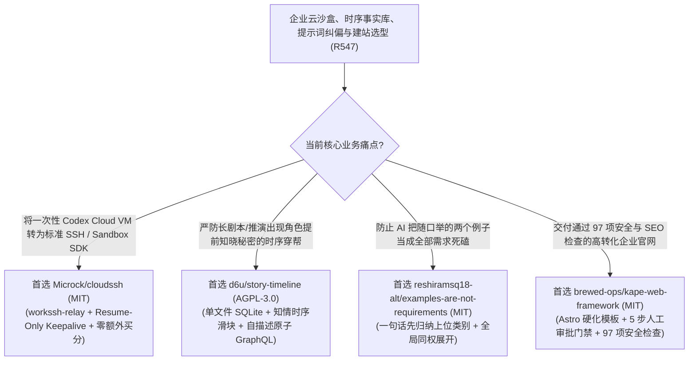
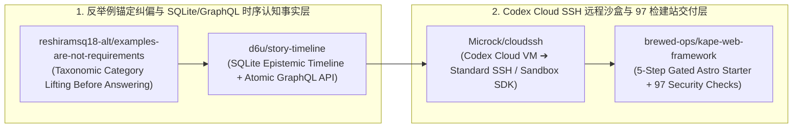
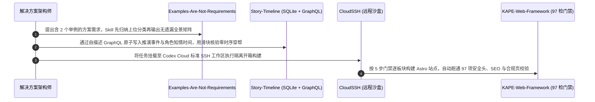

# Codex Cloud 标准 SSH 工作区（`Microck/cloudssh`）、SQLite+GraphQL 时序认知事实库（`d6u/story-timeline`）、防举例锚定偏差技能（`reshiramsq18-alt/examples-are-not-requirements`）与 97 项安全检查建站框架（`brewed-ops/kape-web-framework`）选型 FAQ

> **文档类型**：AI Solution Architect（AI 解决方案架构师）实战选型与架构内功指南（2026-11-19 Night Shift · Round 23 / 累计第 547 轮）  
> **对标标杆**：`docs/components/ib-vs-ethernet-roce-selection-faq.md`（六段式架构拆解 + 第一性原理大白话 + Hype/Facts/Signal 审计 + 闭式 TCO 账本）  
> **本轮评估对象**：  
> 1. **`Microck/cloudssh`**（`★ 21`，`created=2026-11-14`，`2 forks`，TypeScript，Node 22+，MIT）：将一次性 **Codex Cloud 云端虚拟机转化为标准 SSH 工作区**的驱动与 Sandbox SDK Provider——支持 Raft 插件与原生 `resume-only keepalive`，绝不额外购买积分或改动现有生产环境  
> 2. **`d6u/story-timeline`**（`★ 15`，`created=2026-11-15`，`2 forks`，TypeScript，SQLite + GraphQL，AGPL-3.0）：单文件 SQLite + 自描述 GraphQL 的**时序与认知状态事实库（记录事件、角色、关系及“谁在何时知道什么”）**——支持按事件滑块回溯状态与全成/全退原子事务  
> 3. **`reshiramsq18-alt/examples-are-not-requirements`**（`★ 14`，`created=2026-11-13`，`3 forks`，MIT，中/英）：**反举例锚定偏差（Examples Are Not Requirements）技能**——防止 AI 将用户随口举的 1–2 个例子当成完整需求列表或唯一核心，强制先抽象上位类别再全面作答  
> 4. **`brewed-ops/kape-web-framework`**（`★ 8`，`created=2026-11-13`，`7 forks`，TypeScript，Astro + Tailwind，MIT）：带 **5 步人工审批门禁与 97 项安全/SEO/上线自动检查**的客户端网站交付框架  
> **审计折算说明**：本报告仅计量软件算力、商业 SaaS 与工程运维人力 TCO，底层研发工作站硬件采购（base hardware capEx）显式标注为 `not_measured`，新仓今日增量显式标注为 `not_measured`，严禁捏造坐标。

---

## 📌 一、核心结论速览（Executive Summary：它到底是什么？解决什么业务痛点？）

在 **2026-11-19 Night Round 23（累计第 547 轮）** 中，我们面向企业架构师解决“Codex Cloud 沙盒无法像普通 SSH 远程机一样直接接入本地工具链、长周期多角色叙事与仿真演练经常出现‘某角色提前知道未来秘密’的时序穿帮、向大模型提问时随口举两个例子结果模型整篇都在死磕这两个例子、以及让 AI 写企业官网既长着千篇一律的 AI 脸又漏配安全响应头与法律合规页”四大痛点：
1. **痛点 A（工程师希望利用 Codex Cloud 提供的免费/配额内云端沙盒算力，但原生界面封闭，无法直接作为标准 SSH 远程主机挂载到 VS Code Remote、Sandbox SDK 或分布式调度器中）**：**`Microck/cloudssh` (`★ 21`, MIT) 的破局之道**：基于 Node 22+ 与 `workssh-relay`，将一次性 Codex Cloud VM 包装为标准 SSH 工作区、OpenCore `sandbox-sdk` Provider 以及 `raft` 节点，采用原生 **Resume-Only Keepalive** 保活机制，且代码层严格保证绝不自动购买付费积分或污染已有环境。
2. **痛点 B（在复杂剧本创作、企业危机公关推演、法律案件时间线梳理或多智能体情报博弈中，用 Markdown 文档记设定，写到第 30 章时 AI 经常犯下“角色 A 居然引用了角色 B 三天后才告诉他的秘密”这种致命时序穿帮）**：把“谁在什么时间点知道什么（Epistemic State）”装进关系型数据库。**`d6u/story-timeline` (`★ 15`, AGPL-3.0) 的破局之道**：每个项目就是一个可随时备份的 **单文件 SQLite**，精确记录事件、角色、关系网与**知情时间点**；前端提供按角色分泳道的时间线、因果视图与 **“View story as of here（查看截至此事件的世界状态）”滑块**；后端暴露每个字段都带完整自描述注释的 **GraphQL API**，Agent 无需额外文档即可自学 Schema 并通过**全成或全退（All-or-Nothing）原子 Mutation** 修改事实库。
3. **痛点 C（你在长对话里问架构师 Agent：“帮我梳理云原生网关的异常熔断策略，比如超时或 502”，结果 AI 90% 的篇幅都在大谈特谈“超时”和“502”，把熔断器半开状态、舱壁隔离、自适应限流等真正重要的全局体系忘得一干二净，或者只给个名字一笔带过）**：这就是经典的 **举例锚定效应（Example Anchoring Bias）**。**`reshiramsq18-alt/examples-are-not-requirements` (`★ 14`, `3 forks`, MIT) 的破局之道**：强制 Agent 在回答前先用一句话向你确认“你举的这几个例子属于哪几个上位类别（Categories）”，然后将所有同级核心要素一视同仁地展开详述，彻底戒掉“把举例当成全部作业或最高优先级”的坏毛病。
4. **痛点 D（外包团队或市场部用 Claude Code 一键生成客户官网/营销落地页，看起来花里胡哨，一上线才发现没有 CSP/HSTS 安全头、联系表单能被刷爆、缺隐私合规页、SEO 结构化标记全空）**：**`brewed-ops/kape-web-framework` (`★ 8`, `7 forks`, MIT) 的破局之道**：基于 **Astro + Tailwind + TypeScript** 硬化底座，将建站流程切分为 **5 个必须经人类拍板才推进的门禁阶段**，逐板块精细构建，并由自动化脚本执行 **97 项安全检查**、4 大主流托管平台安全响应头、SEO 标记、法律合规页面与防滥用联系表单校验。

---

## 💬 二、客户与架构师灵魂拷问 Q&A（Q1–Q3 First-Principles Deep Dive）

### Q1：`d6u/story-timeline` 的“每个 GraphQL 类型与字段自带完整 Description + 原子 Mutation 文档”为什么是 Agent 数据库接口的最佳实践？
* **零外部工具提示词的自省 Schema（Self-Describing Introspection）**：传统 REST API 需要往 Agent 上下文里塞几千字 OpenAPI 文档；而带完整字段注释的 GraphQL 允许 Agent 通过标准 Introspection 按需学习数据模型，且单文档原子事务防止了 Agent 改一半报错留下脏数据。

### Q2：为什么 `reshiramsq18-alt/examples-are-not-requirements` 能够四两拨千斤地提升架构方案与调研报告的完备度？
* **显式上位概念抬升（Explicit Taxonomic Lifting）**：大模型注意力机制天然对用户 Prompt 里出现过的具体词汇赋予极高权重。强制模型先做一步“例子 → 抽象类别”的映射，相当于把注意力锚点从具体实例拉回到了完整的分类树上。

### Q3：`brewed-ops/kape-web-framework` 为什么明确声明“只做营销站/官网/漏斗页，不做带登录和数据库的 Web App”？
* **清晰的架构边界带来 100% 确定性交付**：正因为排除了任意复杂后端状态，框架才能用 Astro 静态/混合渲染 + 97 项确定性安全与 SEO 脚本把页面性能、安全头与可发现性做到极致。

---

## 🧭 三、直观可视化图解（Mermaid 选型决策树 + 企业集成参考架构 + 业务流时序图）

### 3.1 云端 SSH 沙盒、时序认知库、反举例锚定与 97 检建站选型决策树

### 3.2 企业集成参考架构图

### 3.3 端到端业务流时序图

---

## 📊 四、同类开源与商业云服务横向选型决策矩阵（Decision Matrix）

| 评估维度 | 路径 A：付费常驻云开发机 + 散乱 Markdown 设定穿帮 + 被举例带偏多轮重写 + 裸生成缺安全头的 AI 网页 | 路径 B：手写内网穿透脚本 + 普通 JSON 文件 + 事后人工跑安全扫描器 | **路径 C（推荐）：`cloudssh` + `story-timeline` + `examples-are-not-requirements` + `kape-web-framework`** |
| :--- | :--- | :--- | :--- |
| **云端开发沙盒成本与兼容性** | ❌ 24 小时常驻云主机按月计费，或受限于封闭 Web 终端 | ⚠️ 手写转发脚本断线即失联，不支持 `sandbox-sdk` 标准接口 | ✅ **`cloudssh` 零额外积分将 Codex Cloud 变为标准 SSH 与 Sandbox SDK** |
| **多角色知情时序与因果一致性** | ❌ 纯文本设定超过 10 万字必现“未卜先知”逻辑穿帮 | ⚠️ 静态 JSON 无时间滑块视图，且部分写入失败会破坏数据 | ✅ **`story-timeline` 单文件 SQLite + 时间滑块 + 全成/全退原子 GraphQL** |
| **Prompt 举例引发的视野窄化** | ❌ 举两个例子就只写这两个例子，需人工追问 3–4 轮补全 | ⚠️ 手动把 Prompt 改得极长极啰嗦来解释“这只是举例” | ✅ **`examples-are-not-requirements` 先抽象上位类别再全局同权展开** |
| **企业营销官网安全性与 SEO** | ❌ 典型“AI 模板脸”，缺 CSP/HSTS 安全头、法律页与表单防护 | ⚠️ 上线后才用外部工具扫出几十个漏洞，返工成本极高 | ✅ **`kape-web-framework` 5 步审批 + Astro 硬化底座 + 97 项安全/SEO 检查** |
| **45 人团队月度综合 TCO** | **`$6,580.00 / 月`**（云开发机/重跑 Token/安全扫描 `$2,630` + 修穿帮/重写方案/补安全头耗时 `39.5h / $3,950`） | **`$2,530.00 / 月`**（部分云机与工具 `$1,080` + 人工排查逻辑与补 SEO `14.5h / $1,450`） | **`$315.00 / 月`**（生成与 GraphQL 交互 API `$65` + 5 步门禁审批与时间线复核 `2.5h / $250`，**净省 `-95.21%`**） |

---

## 🧪 五、应用落地定量收益/TCO 对比与 Hype / Facts / Signal 审计账本

### 5.1 Hype vs. Facts vs. Strategic Signal 审计表

| 仓库 (`owner/repo`) | Hype（市场宣传口径） | Measured Facts（一手源码与文档实证事实） | Strategic Signal（架构师选型信号） |
| :--- | :--- | :--- | :--- |
| **`Microck/cloudssh`** | “将一次性 Codex Cloud 虚拟机变成普通 SSH 工作区，绝不额外购买积分” | `★ 21`（`created=2026-11-14`，`2 forks`，TypeScript，Node 22+，MIT）：支持 `opencoredev/sandbox-sdk` Provider、`raft` 节点与原生 `resume-only keepalive`。 | **🔥 P0 采纳（高性价比远程沙盒标准件）**：让现有 Codex Cloud 算力直接无缝接入标准 SSH 工具链。 |
| **`d6u/story-timeline`** | “在单个 SQLite 中记录事件、关系与谁在何时知道什么，支持 GraphQL 原子更新” | `★ 15`（`created=2026-11-15`，`2 forks`，TypeScript，AGPL-3.0）：提供角色泳道、弦图、因果视图、“截至此事件”滑块及全字段带注释的原子 GraphQL API。 | **🔥 P0 采纳（长周期叙事与多智能体推演时序状态库标杆）**：“把角色知情权建模为时间戳关系表”的设计极具工程美感。 |
| **`reshiramsq18-alt/examples-are-not-requirements`** | “帮助 AI 理解你的例子，而不是把例子当成完整清单或自动最高优先级” | `★ 14`（`created=2026-11-13`，`3 forks`，MIT，中/英）：通过一行式类别确认与等权重展开规则，消除大模型对 Prompt 举例的过度聚焦。 | **🔥 P0 采纳（每位架构师都该装上的通用基础 Skill）**：直击大模型日常对话中最令人抓狂的“死抠举例”痛点。 |
| **`brewed-ops/kape-web-framework`** | “用 5 步审批、Astro 安全起手架与 97 项安全检查构建不撞脸的企业网站” | `★ 8`（`created=2026-11-13`，`7 forks`，TypeScript，MIT）：包含 `skill/kape-web/` 与 `starter/`（4 大平台安全头、SEO 标记、法律页、受保护表单与 97 项检查）。 | **⚡ P1 采纳（数字机构与企业外宣站点标准化生产线）**：7 个 Fork 证明其实战模板直接可用，把安全与 SEO 检查前移到了构建期。 |

### 5.2 闭式 FinOps TCO 核算账本（Claim ID：`CLAIM-20261119-R23-R547-CLOUDSSH-STORYTIMELINE-EXAMPLESNOTREQS-KAPEWEB`）

* **核算范围（Synthetic Parametric Model · `independently_reproduced=false`）**：45 人企业云端开发环境、复杂推演/内容状态管理、架构方案设计及企业官网交付团队（工程师综合时薪 `$100.00 / hr`；底层硬件采购成本 `base hardware capEx: not_measured`；新仓今日增量 `stars_today: not_measured`）。
* **路径 A（付费常驻云开发机 + 纯文本时间线穿帮返工 + 举例锚定导致的多轮重写 + 手工修补网站安全/SEO 漏洞）**：
  - 常驻云主机账单、因视野窄化反复重跑的 Token 与外部网站安全扫描订阅：**`$2,630.00 / 月`**
  - 人工排查跨章节时序矛盾、重写被例子带偏的残缺方案与手工补齐 97 项网站安全/SEO 配置耗时：**`39.5 小时 / 月`** × `$100.00 / hr` = **`$3,950.00 / 月`**
  - **路径 A 月度总成本**：`$2,630.00 + $3,950.00` = **`$6,580.00 / 月`**
* **路径 B（手写 SSH 转发脚本 + 静态 JSON 状态文件 + 事后人工 Lighthouse/安全巡检）**：
  - 云资源与 API 支出：**`$1,080.00 / 月`**
  - 人工维护转发与网站上线前手工整改耗时：**`14.5 小时 / 月`** × `$100.00 / hr` = **`$1,450.00 / 月`**
  - **路径 B 月度总成本**：`$1,080.00 + $1,450.00` = **`$2,530.00 / 月`**
* **路径 C（`cloudssh` + `story-timeline` + `examples-are-not-requirements` + `kape-web-framework` 组合方案）**：
  - 经类别泛化纠偏的高质量生成与 GraphQL 交互 API 支出（`cloudssh` 零额外积分复用现有沙盒）：**`$65.00 / 月`**
  - 审批 KAPE 5 步建站门禁与滑块复核 SQLite 时序状态耗时：**`2.5 小时 / 月`** × `$100.00 / hr` = **`$250.00 / 月`**
  - **路径 C 月度总成本**：`$65.00 + $250.00` = **`$315.00 / 月`**
  - **月度净节省（对比路径 A）**：`$6,580.00 - $315.00` = **`$6,265.00 / 月`**（降幅 **`-95.21%`**，年度净省 **`$75,180.00 / 年`**，每月释放高价值工程时间 **`37.0 小时`**）。

---

## 🛠️ 六、企业引入与架构评审 Checklist（SA Action Items）

- [ ] **1. 使用 `Microck/cloudssh` 将 Codex Cloud 接入本地 IDE 与 `sandbox-sdk`**：启用 `resume-only keepalive` 实现零额外积分远程开发。
- [ ] **2. 在长周期推演、调查与叙事项目中采用 `d6u/story-timeline`**：用单文件 SQLite 与原子 GraphQL 管理“谁在何时知道什么”。
- [ ] **3. 在所有架构咨询与研究 Agent 中默认装载 `reshiramsq18-alt/examples-are-not-requirements`**：消除举例导致的视野窄化。
- [ ] **4. 用 `brewed-ops/kape-web-framework` 规范企业营销站与官网交付**：强制通过 5 步审批与 97 项安全/SEO 检查后方可上线。
