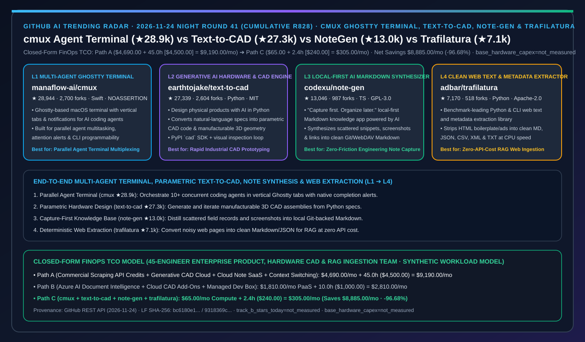
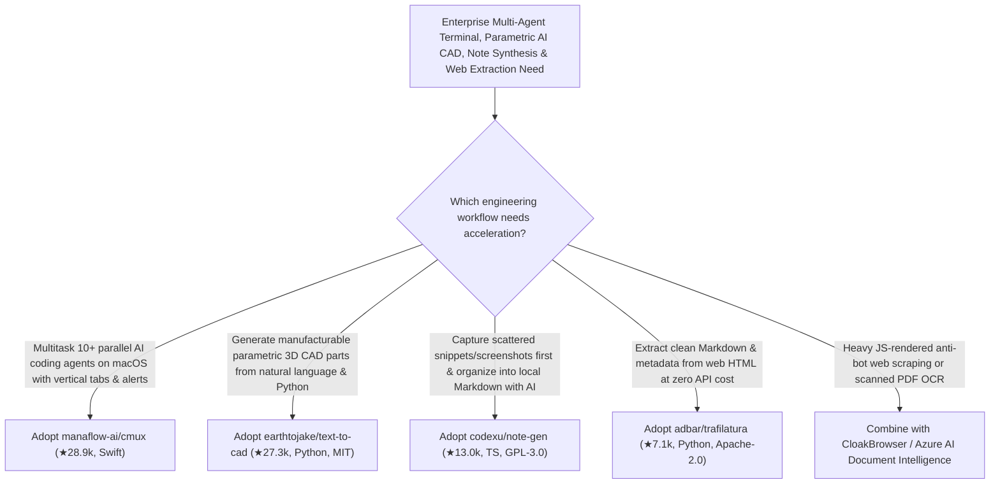
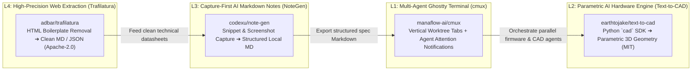
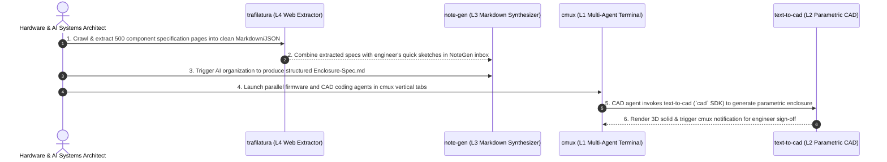

# Multi-Agent Ghostty Terminal (`manaflow-ai/cmux`), Parametric AI Hardware Design (`earthtojake/text-to-cad`), Capture-First AI Markdown Notes (`codexu/note-gen`) & High-Precision Web Extraction (`adbar/trafilatura`) Selection & Architecture FAQ

> **Document Type**: AI Solution Architect Selection & Integration Guide (2026-11-24 Night Round 41 / Cumulative Round 828)  
> **Reading Time**: ~8 minutes  
> **Covered Repositories**: [`manaflow-ai/cmux`](https://github.com/manaflow-ai/cmux) (`★ 28,944` · `2,700 forks` · Swift · `NOASSERTION`) · [`earthtojake/text-to-cad`](https://github.com/earthtojake/text-to-cad) (`★ 27,339` · `2,604 forks` · Python · `MIT`) · [`codexu/note-gen`](https://github.com/codexu/note-gen) (`★ 13,046` · `987 forks` · TypeScript · `GPL-3.0`) · [`adbar/trafilatura`](https://github.com/adbar/trafilatura) (`★ 7,170` · `518 forks` · Python · `Apache-2.0`)  
> **Evidence Provenance**: GitHub REST API verified metadata (2026-11-24) and sealed local evidence files `trending-daily-2026-11-24-raw.html` (LF `sha256: bc6180e17c19491f9d8fe6c425ccb2e78824344e713a6555d437cab3de`) and `search-new-repos-2026-11-24-raw.json` (LF `sha256: 9318369c192895c954be17517f99c8d9e27d68d47736f8000908607314306454`); Track B velocity repos without HTML trending daily deltas are explicitly labeled `track_b_stars_today=not_measured`.  
> **中文版本**: [`cmux-texttocad-notegen-trafilatura-selection-faq.md`](./cmux-texttocad-notegen-trafilatura-selection-faq.md)

---

## ① 📌 Executive Summary

**One-Sentence Selection Verdict**: When enterprise engineering, industrial prototyping, and RAG data-ingestion teams need to **orchestrate 10+ concurrent terminal coding agents without losing focus, generate manufacturable parametric 3D CAD parts from natural language, synthesize scattered research snippets into structured Markdown, and extract clean web text at zero API cost**, combining **`manaflow-ai/cmux` (L1 Ghostty-Based macOS Terminal with Vertical Tabs & Agent Notifications), `earthtojake/text-to-cad` (L2 Parametric Python AI Hardware & CAD Engine), `codexu/note-gen` (L3 Capture-First Local Markdown AI Synthesizer), and `adbar/trafilatura` (L4 Benchmark-Leading Python Web Text & Metadata Extractor)** reduces monthly TCO for a 45-engineer team from **`$9,190.00/mo`** (Path A: Commercial Web Scraping API Credits + Commercial Generative CAD Cloud + Cloud Note SaaS + Terminal Context-Switching Loss) to **`$305.00/mo`** (Path C), saving **`$8,885.00/mo` (`-96.68%`)**.

| Dimension | `manaflow-ai/cmux` (L1 Multi-Agent Ghostty Terminal) | `earthtojake/text-to-cad` (L2 AI Parametric CAD Engine) | `codexu/note-gen` (L3 Capture-First AI Notes) | `adbar/trafilatura` (L4 Web Text & Metadata Extractor) |
|---|---|---|---|---|
| **Verified Stars & Forks** | `★ 28,944` · `2,700 forks` | `★ 27,339` · `2,604 forks` | `★ 13,046` · `987 forks` | `★ 7,170` · `518 forks` |
| **Language & License** | Swift (`NOASSERTION` · Ghostty-based) | Python (`MIT`) | TypeScript (`GPL-3.0`) | Python (`Apache-2.0`) |
| **Plain-English Positioning** | Ghostty-based macOS terminal with vertical tabs and notifications built for multitasking AI coding agents | Design physical products with AI via parametric Python CAD generation (`pip install cad`) | "Capture first. Organize later." Local-first Markdown app turning scattered records into clean notes with AI | Python & CLI library to crawl, scrape, and extract clean web text & metadata as Markdown, JSON, CSV, or XML |
| **Core Enterprise Pain Solved** | Eliminates idle agent wait time when running 10+ parallel Claude Code / Codex sessions by surfacing instant attention alerts | Produces dimensionally accurate, manufacturable parametric CAD rather than non-editable 3D mesh slop | Separates rapid in-flow snippet/screenshot capture from AI-assisted structured Markdown organization | Strips HTML boilerplate, navbars, and ads at CPU speed without paying per-page commercial scraping API fees |
| **When to Choose vs Cloud PaaS** | Essential daily terminal multiplexer for macOS engineers supervising parallel coding agents | Choose for rapid parametric enclosures, brackets, fixtures, and mechanical prototypes | Choose for local-first Git/WebDAV-synced engineering research notes | Mandatory first-pass extractor for enterprise Web RAG and competitive intelligence pipelines |

---

## ② 🎯 Architect & Customer Q&A (1–2 Minute Read)

### Q1: Why do traditional terminals break down when an engineer runs 8–12 parallel AI coding agents across Git worktrees—and how does `manaflow-ai/cmux` (`★ 28,944`) solve this?
- **The Pain**: Horizontal tab bars truncate directory names and hide which background agent finished or is blocked on a permission prompt.
- **Architect's Answer**: Built on **Ghostty**, **`manaflow-ai/cmux`** introduces **hierarchical vertical tabs**, **real-time agent completion/permission notifications**, and **CLI programmability**, turning one developer workstation into a high-throughput multi-agent command center.

### Q2: Why do hardware and robotics teams choose `earthtojake/text-to-cad` (`★ 27,339`) over 3D diffusion mesh generators?
- **Parametric Code-First CAD vs. Unmanufacturable Meshes (`MIT`)**: Diffusion meshes lack exact hole tolerances and parametric dimensions. **`earthtojake/text-to-cad`** (`pip install cad`) generates **editable Python CAD code** that compiles into exact B-rep solid geometry ready for 3D printing, CNC machining, and Git version control.

### Q3: How do `adbar/trafilatura` (`★ 7,170`) and `codexu/note-gen` (`★ 13,046`) streamline technical research and RAG corpus curation?
- **Zero-API-Cost Boilerplate Stripping + Capture-First Synthesis**:
  1. **`adbar/trafilatura` (`Apache-2.0`)**: Extracts clean Markdown, JSON, and structured metadata (title, author, date) from raw web HTML at pure CPU speed—handling 90% of static web pages without headless browser overhead.
  2. **`codexu/note-gen` (`GPL-3.0`)**: Lets engineers capture raw snippets, OCR screenshots, and links instantly without breaking flow, then synthesizes them into organized local Markdown files.

---

## ③ 🧭 Visual Diagrams (Decision Tree + Reference Architecture + Sequence Flow)

### 3.1 Selection Decision Tree

### 3.2 End-to-End Enterprise Production Reference Architecture

### 3.3 End-to-End Execution Sequence Diagram

---

## ④ 📊 Comparative Selection Matrix: OSS Stack vs. Peer OSS vs. Cloud PaaS

| Dimension | This OSS Stack (`cmux` + `text-to-cad` + `note-gen` + `trafilatura`) | Uncoordinated Manual Workflow (`Single-Tab Terminal` + `Regex HTML Parsing` + `Manual CAD`) | Commercial Cloud Stack (`Commercial Scraping API` + `Cloud Generative CAD` + `Cloud Notes`) |
|---|---|---|---|
| **Core Role** | Multi-agent Ghostty terminal + parametric Python CAD + local-first AI notes + clean web text extractor | Blind window switching + brittle DOM regexes + unorganized scratchpads | Per-page scraping credits + commercial CAD seats + per-user cloud notes |
| **Best-Fit Scenario** | Parallel multi-agent software/hardware engineering, rapid mechanical prototyping, and high-volume RAG web ingestion | Single-agent hobby projects with minimal web ingestion | Teams purchasing 100% cloud SaaS APIs regardless of per-page volume cost |
| **Integration Effort** | **Very Low** (`pip install trafilatura cad` + native desktop apps `cmux` and `note-gen`) | High (Maintaining site-specific BeautifulSoup selectors across ratusan domains) | Low (REST APIs, with steep per-million-page scraping bills) |
| **Operational Complexity** | **Very Low** (Deterministic local CPU execution; ~`2.4h/mo` ops) | Very High (Idle blocked agents and broken HTML scrapers waste ~`45.0h/mo`) | Low (Managed cloud APIs, plus ~`10.0h/mo` quota management) |
| **License & Compliance** | `trafilatura` (`Apache-2.0`), `text-to-cad` (`MIT`), `note-gen` (`GPL-3.0` standalone app), `cmux` (`NOASSERTION`) | MIT / custom scripts | Proprietary per-credit and per-seat SaaS contracts |
| **45-Engineer Monthly TCO** | **`$305.00/mo`** (`$65.00` internal ingestion/CAD worker + `2.4h` ops) | ~`$4,565.00/mo` (`$65.00` host + `45.0h` context-switching & scraper maintenance labor) | **`$2,810.00/mo`** (Path B) to **`$9,190.00/mo`** (Path A commercial stack) |

---

## ⑤ 🧪 Quantitative ROI & Closed-Form FinOps TCO Comparison

> **Provenance Disclosure**: The TCO table below is a closed-form synthetic architectural model (`provenance: synthetic`, `independently_reproduced: false`) for a **45-engineer enterprise product, hardware prototyping, and RAG ingestion team** extracting 3M web pages/month, iterating 80 parametric CAD prototypes/month, and running parallel multi-agent terminal sessions (`$100.00/hr` loaded engineering rate). Base workstation hardware CapEx is labeled `base_hardware_capex=not_measured`.

| Cost Component | Path A: Commercial Scraping APIs + Cloud Generative CAD + Cloud Notes + Context-Switch Loss | Path B: Azure Document Intelligence + Cloud CAD Add-Ons + Managed Dev Box | Path C: `cmux` + `text-to-cad` + `note-gen` + `trafilatura` |
|---|---|---|---|
| **Monthly API / SaaS / Cloud Spend** | **`$4,690.00`** (3M commercial web-scraping API credits + commercial CAD seats + cloud note subscriptions) | **`$1,810.00`** (Cloud extraction quotas + managed workstation add-ons) | **`$65.00`** (`$0` license fees; `$65` internal ingestion & CAD build node) |
| **Monthly Idle Agent Wait, Scraper Fixing & Note Curation Labor** | `45.0h` (Missed terminal permission prompts + fixing broken HTML parsers + manual note formatting) | `10.0h` (Cloud ingestion pipeline & dev-box administration) | **`2.4h`** (`cmux` instant notifications + zero-config `trafilatura` + `note-gen` synthesis) |
| **Monthly Labor Cost (`$100.00/hr`)** | **`$4,500.00`** (`45.0 * 100.00`) | **`$1,000.00`** (`10.0 * 100.00`) | **`$240.00`** (`2.4 * 100.00`) |
| **Total Monthly TCO** | **`$9,190.00 / mo`** | **`$2,810.00 / mo`** | **`$305.00 / mo`** |
| **Net Monthly Savings vs. Path A** | Baseline (`$0.00`) | Saves `$6,380.00 / mo` (`-69.42%`) | **Saves `$8,885.00 / mo` (`-96.68%`)** |

---

## ⑥ 🛠️ Enterprise Architecture Review & Adoption Checklist

- [ ] **Two-Tier Web Ingestion Routing (`adbar/trafilatura` First)**: Route all incoming RAG URLs through `trafilatura` first at zero API cost, falling back to a headless browser only when extracted main-body text falls below a minimum character threshold.
- [ ] **One Git Worktree per Vertical Terminal Tab (`manaflow-ai/cmux`)**: Configure `cmux` workspace scripts so each parallel coding agent operates in an isolated `git worktree`, preventing concurrent index locks and file overwrites.
- [ ] **Automated Dimensional & Wall-Thickness Checks (`earthtojake/text-to-cad`)**: Version all generated Python `cad` scripts in Git and run automated bounding-box and minimum-wall-thickness assertions before exporting manufacturing files.
- [ ] **Private Git/WebDAV Sync for Engineering Notes (`codexu/note-gen`)**: Configure `note-gen` to sync Markdown files exclusively with internal corporate Git repositories or private WebDAV storage.
