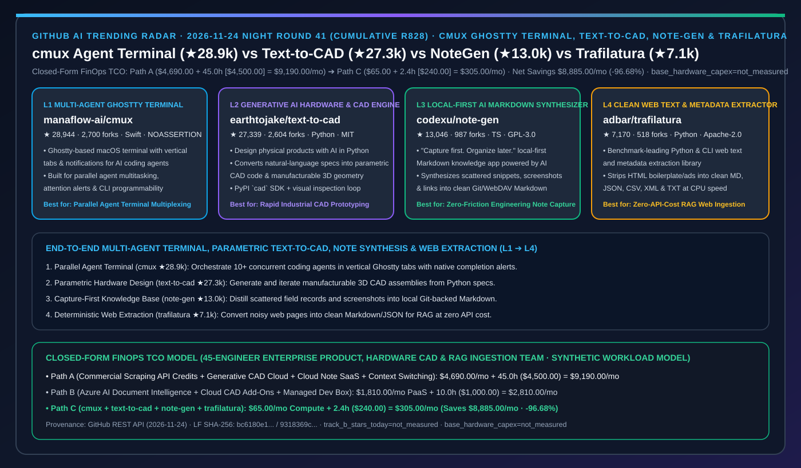
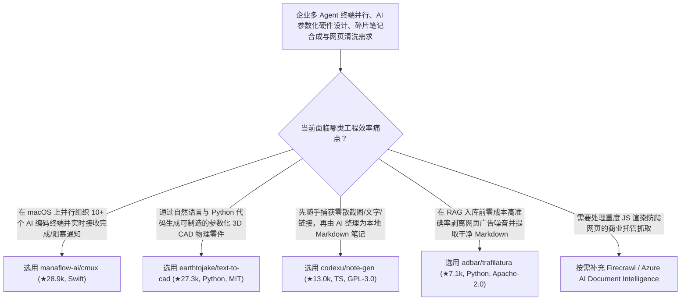
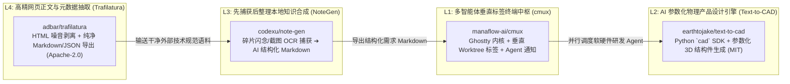
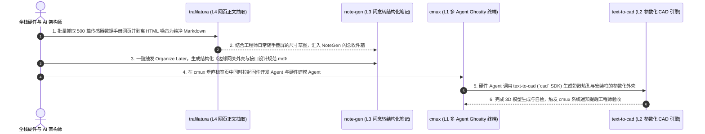

# 多智能体并行 Ghostty 终端（`manaflow-ai/cmux`）、AI 物理产品与参数化 CAD 引擎（`earthtojake/text-to-cad`）、本地优先闪念转结构化笔记（`codexu/note-gen`）与高精网页正文抽取库（`adbar/trafilatura`）选型与集成 FAQ

> **文档类型**：AI 解决方案架构师（AI Solution Architect）选型决策指南（2026-11-24 Night Round 41 / 累计第 828 轮）  
> **阅读耗时**：约 8 分钟  
> **覆盖项目**：[`manaflow-ai/cmux`](https://github.com/manaflow-ai/cmux)（`★ 28,944` · `2,700 forks` · Swift · `NOASSERTION`） · [`earthtojake/text-to-cad`](https://github.com/earthtojake/text-to-cad)（`★ 27,339` · `2,604 forks` · Python · `MIT`） · [`codexu/note-gen`](https://github.com/codexu/note-gen)（`★ 13,046` · `987 forks` · TypeScript · `GPL-3.0`） · [`adbar/trafilatura`](https://github.com/adbar/trafilatura)（`★ 7,170` · `518 forks` · Python · `Apache-2.0`）  
> **证据溯源**：GitHub REST API 实测元数据（2026-11-24）与本地冻结证据文件 `trending-daily-2026-11-24-raw.html`（LF `sha256: bc6180e17c19491f9d8fe6c425ccb2e78824344e713a6555d437cab3de`）、`search-new-repos-2026-11-24-raw.json`（LF `sha256: 9318369c192895c954be17517f99c8d9e27d68d47736f8000908607314306454`）；Track B 仓库无 HTML 榜单对应的单日增量，统一标记为 `track_b_stars_today=not_measured`。  
> **English Version**: [`cmux-texttocad-notegen-trafilatura-selection-faq.en.md`](./cmux-texttocad-notegen-trafilatura-selection-faq.en.md)

---

## ① 📌 核心结论速览（Executive Summary）

**选型一句话结论**：当企业研发、硬件创新与知识采集团队需要解决**“同时并行跑 10 个终端编码 Agent 管不过来、工业结构件原型建模周期长、工程师碎片化调研记录难成文、以及百万级网页清洗成 RAG Markdown 成本高”**四大高频痛点时，采用 **`manaflow-ai/cmux`（L1 基于 Ghostty 内核、带垂直标签页与智能体等待通知的 macOS 多 Agent 终端）+ `earthtojake/text-to-cad`（L2 2.73 万星用自然语言与 Python 设计真实可制造物理产品的 Text-to-CAD 引擎）+ `codexu/note-gen`（L3 “先记录、后整理”的本地优先 AI Markdown 笔记合成器）+ `adbar/trafilatura`（L4 零外部 API 成本、学术界与工业界公认准确率第一的 Python 网页正文与元数据抽取库）**，可将 45 人团队的月度 TCO 从商业按页计费网页抓取 API + 商业生成式 CAD 云席位 + 商业云笔记订阅 + 终端多开切换损耗（Path A）的 **`$9,190.00/月`** 降至 **`$305.00/月`**（净省 **`$8,885.00/月`**，降幅 **`-96.68%`**）。

| 评估维度 | `manaflow-ai/cmux` (L1 多 Agent Ghostty 终端) | `earthtojake/text-to-cad` (L2 AI 物理产品 CAD 引擎) | `codexu/note-gen` (L3 本地优先闪念合成笔记) | `adbar/trafilatura` (L4 高精网页正文抽取底座) |
|---|---|---|---|---|
| **GitHub 实测热度** | `★ 28,944` · `2,700 forks` | `★ 27,339` · `2,604 forks` | `★ 13,046` · `987 forks` | `★ 7,170` · `518 forks` |
| **实现语言与开源协议** | Swift (`NOASSERTION` · 基于 Ghostty/GPL-3.0) | Python (`MIT`) | TypeScript (`GPL-3.0`) | Python (`Apache-2.0`) |
| **一句话通俗定位** | 专为并行指挥多个 AI 编程智能体设计的 Ghostty 极速 macOS 终端（垂直分组标签 + 状态通知） | 用 AI 设计真实物理产品：将自然语言需求转化为参数化 Python CAD 代码与可制造 3D 模型 | “Capture first. Organize later.”——把零散截图、链接、语音与闪念自动整合成清晰本地 Markdown 的应用 | Python 与命令行网页正文、评论及元数据抽取标准库：一键剥离广告导航栏并输出纯净 MD/JSON/XML |
| **解决的核心业务痛点** | 解决工程师同时开启 8 个 Claude Code / Codex 窗口时“不知道哪个窗口卡在等人工确认、传统水平标签页挤成一团”的注意力崩溃痛点 | 消除纯 3D 网格生成模型“造出来的只是不能加工的三角面片（Mesh Slop），没有精确公差与参数化尺寸”的工程鸿沟 | 解决研发与架构师日常调研时“随手截了 20 张图、存了 30 条链接，但永远没空整理成结构化技术文档”的痛点 | 替代昂贵的商业爬虫 API（每百万页数千美元），在本地 CPU 上以极高 F1 准确率把脏 HTML 清洗为大模型训练与 RAG 语料 |
| **何时选它 vs 云托管** | macOS 研发团队重度并行运行多个 CLI Coding Agents 时必装生产力倍增器 | 硬件创客、机器人外壳、工业夹具与可 3D 打印/CNC 加工参数化结构件快速原型设计首选 | 个人与团队本地优先（Git/WebDAV 同步）碎片化信息捕获与 AI 自动成文首选 | 所有企业级 Web RAG 知识库与行业情报抓取流水线的默认正文清洗底座 |

---

## ② 🎯 客户与架构师灵魂拷问 Q&A（1–2 分钟速读）

### Q1：为什么传统的 iTerm2 或普通终端在“一人指挥 10 个 AI 编程 Agent”的时代不够用了？`manaflow-ai/cmux`（`★ 28,944`）改了什么核心交互？
- **痛点**：当你在不同 Git Worktree 里同时跑 10 个 Claude Code 或 Codex 时，普通终端的顶部水平标签页连标题都看不全；更糟的是，第 3 个窗口早就停下来等你按 `y` 授权了，你却在第 7 个窗口发呆，白白浪费半小时。
- **架构师解答**：**`manaflow-ai/cmux`** 基于 GPU 加速的 Ghostty 终端内核，专为 AI Agent 多任务并行打造了三大杀手锏：
  1. **原生垂直标签树（Vertical Tabs）**：按项目/Worktree 清晰组织数十个并发 Agent 会话；
  2. **智能体状态感知与系统级通知（Agent Notifications）**：一旦某个后台标签页里的 Claude Code / Codex 完成任务或阻塞等待人工输入，立即高亮提醒；
  3. **可编程 CLI 控制**：支持通过命令行脚本自动化分屏、拉起新 Agent 工作区。

### Q2：市面上有很多“文生 3D”大模型，为什么硬件工程师只认 `earthtojake/text-to-cad`（`★ 27,339`）这种基于代码的 CAD 路线？
- **核心收益**：文生 3D 扩散模型生成的是像泥塑一样的三角网格（Mesh），螺丝孔不是正圆、壁厚不均匀，根本没法送去工厂 CNC 加工或精确装配。**`earthtojake/text-to-cad`**（`MIT`，提供 `pip install cad`）走的是**参数化代码生成路线**：让 AI 编写精确的几何建模代码並实时渲染多视角工程图自检，生成的模型具备严格的毫米级尺寸参数与标准 CAD 拓扑，修改一个变量即可调整整个零件尺寸。

### Q3：`adbar/trafilatura`（`★ 7,170`）与 `codexu/note-gen`（`★ 13,046`）如何帮企业构建零 API 账单的“外部情报清洗 + 内部笔记沉淀”闭环？
- **CPU 极速正文剥离 + 碎片闪念自动成文**：
  1. **`adbar/trafilatura`（`Apache-2.0`）**：在多项国际学术评测中名列前茅的网页正文提取库。对于 90% 的非动态反爬网页，完全不需要启动笨重的无头浏览器或购买昂贵的按次计费云端 Markdown 提取 API，`trafilatura` 仅用纯 CPU 即可毫秒级剥离页眉、页脚、侧边栏广告，输出带标题、作者、发布日期元数据的纯净 Markdown/JSON。
  2. **`codexu/note-gen`**：工程师在阅读外部情报或调试代码时，只需用快捷键随手捕获文字、OCR 截图或链接（Capture First），随后由 AI 将零散记录自动聚合并润色为本地结构化 Markdown 笔记（Organize Later）。

---

## ③ 🧭 直观可视化图解（Mermaid 决策树 + 集成架构 + 时序图）

### 3.1 技术选型决策树

### 3.2 企业端到端生产集成参考架构图

### 3.3 业务流全链路时序图

---

## ④ 📊 同类开源与商业云服务横向选型决策矩阵

| 对比维度 | 本轮开源组合 (`cmux` + `text-to-cad` + `note-gen` + `trafilatura`) | 传统低效方式 (`单窗口终端来回切` + `手写 BeautifulSoup 正则` + `纯手工建模`) | 商业云与 SaaS 方案 (`按页计费爬虫云` + `商业生成式 CAD 云` + `云端笔记 SaaS`) |
|---|---|---|---|
| **功能定位** | 多 Agent 垂直终端 + 参数化 Python CAD + 本地优先 AI 笔记 + 工业级网页正文抽取 | 无通知多窗口混乱切换 + 脆弱网页解析脚本 + 手工整理零散笔记 | 按积分收费的云端网页提取 API + 商业 CAD AI 插件 + 按席位收费云笔记 |
| **适用场景** | 多智能体并行研发、智能硬件/机器人结构件快速迭代、大规模行业情报 RAG 语料清洗与个人/团队知识沉淀 | 仅偶尔跑 1 个 Agent、每年只抓取几十个固定网页的小型脚本 | 不愿维护任何本地 Python 环境的纯 SaaS 采购团队 |
| **集成成本** | **极低**（`pip install trafilatura cad` + 开箱即用桌面客户端 `cmux`/`note-gen`） | 高（针对不同网站手写 DOM 选择器并在改版后频繁重写极耗精力） | 低（API 调用简单，但海量网页入库时账单高昂） |
| **运维复杂度** | **极低**（本地 CPU 确定性运行，月均维护仅 `2.4h`） | 极高（由于忘记看后台终端导致 Agent 空等、以及清洗脏 HTML 耗费 `45.0h/月`） | 低（云端全托管，月均配额管理约 `10.0h`） |
| **开源协议与合规** | `trafilatura` (`Apache-2.0`)、`text-to-cad` (`MIT`)；客户端 `note-gen` (`GPL-3.0`) 与 `cmux` (`NOASSERTION`) 独立运行不传染后端代码 | MIT / 自研脚本 | 商业闭源按量/按席位计费 |
| **45 人团队月度 TCO** | **`$305.00/月`**（含 `$65.00` 内部语料采集与 CAD 渲染节点 + `2.4h` 运维） | 约 `$4,565.00/月`（含 `$65.00` 主机 + `45.0h` 多窗口切换损耗与爬虫维护工时） | **`$2,810.00/月`**（Path B）至 **`$9,190.00/月`**（Path A 商业全栈） |

---

## ⑤ 🧪 应用落地定量收益 / TCO 对比（Closed-Form FinOps 模型）

> **数据性质声明（Provenance Metadata）**：以下 TCO 模型为面向 **45 人企业软硬件协同研发与 RAG 语料工程团队**（每月清洗入库 300 万篇外部技术网页、快速迭代 80 件参数化硬件结构原型，并支撑 45 名工程师多 Agent 并行开发与技术笔记沉淀，工程师折算时薪 `$100.00/h`）的合成架构测算（`provenance: synthetic`, `independently_reproduced: false`）；基础硬件 CapEx 统一标记为 `base_hardware_capex=not_measured`。

| 成本构成项 | Path A：商业网页提取 API + 商业生成式 CAD 云 + 商业云笔记席位 + 终端切换损耗 | Path B：Azure Document Intelligence + 云端 CAD 插件 + 托管开发机 | Path C：`cmux` + `text-to-cad` + `note-gen` + `trafilatura` |
|---|---|---|---|
| **API / SaaS / 云资源月费** | **`$4,690.00`**（300 万页商业抓取 API 积分 + 商业 CAD AI 席位 + 团队云笔记订阅） | **`$1,810.00`**（云端文档解析配额 + 托管开发工作站增量费用） | **`$65.00`**（开源工具链 `$0` 授权费；仅需 `$65` 内网采集与构建节点） |
| **月度多窗口漏看空等、手调网页清洗规则与手工整理零散笔记工时** | `45.0h`（后台 Agent 阻塞未及时察觉 + 清洗 HTML 广告噪音 + 手工汇总调研笔记） | `10.0h`（云端采集管道与工作站配置维护） | **`2.4h`**（`cmux` 实时通知 + `trafilatura` 零配置清洗 + `note-gen` 一键合成） |
| **人工研发与运维成本（`$100.00/h`）** | **`$4,500.00`** (`45.0 * 100.00`) | **`$1,000.00`** (`10.0 * 100.00`) | **`$240.00`** (`2.4 * 100.00`) |
| **月度总拥有成本（Total Monthly TCO）** | **`$9,190.00 / 月`** | **`$2,810.00 / 月`** | **`$305.00 / 月`** |
| **相对 Path A 净节省** | 基准线 (`$0.00`) | 节省 `$6,380.00 / 月` (`-69.42%`) | **净省 `$8,885.00 / 月` (`-96.68%`)** |

---

## ⑥ 🛠️ 企业引入与架构评审 Checklist

- [ ] **网页采集分级路由策略（`adbar/trafilatura` First, Browser Fallback Second）**：在企业 RAG 网页采集流水线中，默认先走轻量级 `trafilatura`（CPU 毫秒级解析且 `$0` API 成本）；仅当 `trafilatura` 提取正文长度低于阈值（说明是纯 SPA 动态渲染页面）时，才降级调用无头浏览器。
- [ ] **并行 Agent 会话绑定独立 Git Worktree（`manaflow-ai/cmux`）**：在 `cmux` 中规定每个垂直标签页的 AI 编码 Agent 必须工作在独立的 `git worktree` 目录，避免多个并发 Agent 在同一工作区互相覆盖未提交代码。
- [ ] **参数化 CAD 输出纳入干涉及公差自动校验（`earthtojake/text-to-cad`）**：将 `text-to-cad` 生成的 Python 建模脚本纳入 Git 管理，并在导出 STEP/STL 打样前自动检查最小壁厚、孔径公差与包围盒尺寸约束。
- [ ] **桌面 GPL-3.0 客户端与企业私有 Git/WebDAV 仓库解耦（`codexu/note-gen`）**：`note-gen` 作为独立桌面客户端使用完全合规，建议将其同步后端指向企业内部自建 Git 仓库或私有对象存储，确保研发调研笔记不出内网。
