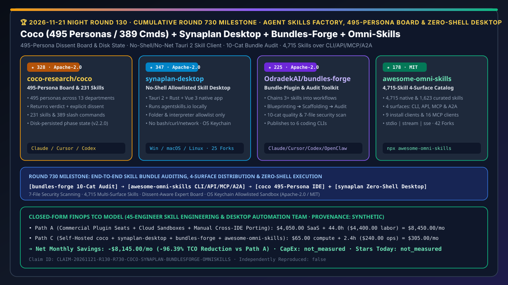
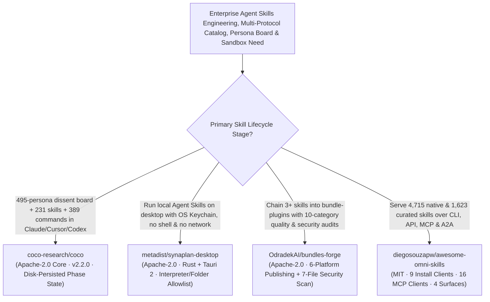
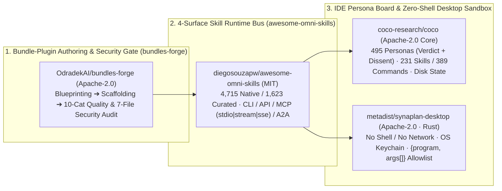
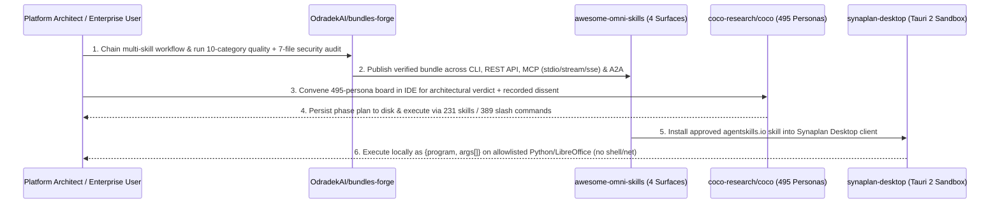

# [Round 730 Milestone] 495-Persona / 231-Skill / 389-Command Cross-IDE Board (`coco-research/coco`), No-Shell/No-Network Allowlisted Skill Desktop (`metadist/synaplan-desktop`), 6-Platform Bundle-Plugin & 10-Category Audit Toolkit (`OdradekAI/bundles-forge`) & 4,715-Skill CLI/API/MCP/A2A Runtime Catalog (`diegosouzapw/awesome-omni-skills`) Selection & Architecture FAQ

> **Document Type**: Enterprise AI Solution Architect Selection & Integration Guide (GitHub Trending AI Radar — 2026-11-21 Night Round 130 / **Cumulative Round 730 Milestone**)
> **Covered Repositories**: [`coco-research/coco`](https://github.com/coco-research/coco) (`★ 328`, `16 forks`, `Apache-2.0` Core — `v2.2.0` installing 495 expert personas across 13 departments, 231 skills & 389 slash commands into Claude Code, Cursor & Codex with disk-persisted phase state and recorded dissent) · [`metadist/synaplan-desktop`](https://github.com/metadist/synaplan-desktop) (`★ 347`, `25 forks`, `Apache-2.0` — Tauri 2 + Rust + Vue 3 native desktop client running `agentskills.io` skills locally as `{program, args[]}` against allowlisted interpreters with OS Keychain storage, no shell & no network) · [`OdradekAI/bundles-forge`](https://github.com/OdradekAI/bundles-forge) (`★ 225`, `13 forks`, `Apache-2.0` — bundle-plugin engineering toolkit chaining `blueprinting ➔ scaffolding ➔ authoring ➔ 10-category auditing ➔ optimizing` across Claude Code, Cursor, Codex, OpenCode, Gemini CLI & OpenClaw) · [`diegosouzapw/awesome-omni-skills`](https://github.com/diegosouzapw/awesome-omni-skills) (`★ 178`, `42 forks`, `MIT` — 4,715 native skills & 1,623 curated best-practice skills served across 4 runtime surfaces: `CLI`, `Read-Only API`, `MCP stdio/stream/sse` & `A2A Task Lifecycle`)
> **Core Scenario**: Celebrating our **730th Cumulative Deep-Dive FAQ Milestone**, how enterprise AI architects engineer, audit, distribute, and safely execute **Agent Skills** across the organization: **authoring and security-auditing multi-skill workflow bundles across 6 coding platforms (`bundles-forge`)**, **serving 4,715 skills over CLI, REST API, MCP, and A2A runtime surfaces (`awesome-omni-skills`)**, **augmenting developer IDEs with a 495-persona dissent-aware review board and 389 slash commands (`coco`)**, and **executing local file skills on employee desktops inside a zero-shell, zero-network allowlisted Rust sandbox (`synaplan-desktop`)**.

---

## 1. 📌 Executive Summary (One-Line Selection Verdict)

1. **Need a single-command enhancement (`npx cocosuperintelligence`) for Claude Code, Cursor, and Codex that seats a 495-persona expert board across 13 departments (returning a primary verdict plus explicit dissent), backed by 231 skills, 389 slash commands, and disk-persisted phase state** ➔ Choose **[`coco-research/coco`](https://github.com/coco-research/coco) (`★ 328`, `16 forks`, `Apache-2.0` Core)**.
   - **Plain-English Mechanism**: Instead of getting a single unchallenged LLM opinion on high-stakes architecture decisions, `coco` (`v2.2.0`) convenes relevant personas from 495 cited expert profiles across 13 departments to surface both the recommended path and dissenting arguments, then executes work via **231 skills and 389 commands** while writing phase state to disk so clearing chat never erases the plan. (*Note: Core is `Apache-2.0`; `systems/superintelligence` is proprietary*).
2. **Need a native Tauri 2 + Rust + Vue 3 desktop client (Windows, macOS, Linux) that executes `agentskills.io` Agent Skills locally on employee machines under strict folder and interpreter allowlists—with zero shell (`bash`), zero `curl`, and zero network access** ➔ Choose **[`metadist/synaplan-desktop`](https://github.com/metadist/synaplan-desktop) (`★ 347`, `25 forks`, `Apache-2.0`)**.
   - **Plain-English Mechanism**: Stores workspace credentials exclusively in the OS secret store (Windows Credential Manager, macOS Keychain, Linux Secret Service) and executes enabled skills locally as `{program, args[]}` using allowlisted interpreters (`Python`, `Node`, `LibreOffice`) inside allowlisted folders—automatically refusing any skill that requests a shell or network socket.
3. **Need an engineering toolkit to build, chain, and security-audit multi-skill "Bundle-Plugins" (3+ collaborating `SKILL.md` units) and publish them across Claude Code, Cursor, Codex, OpenCode, Gemini CLI, and OpenClaw** ➔ Choose **[`OdradekAI/bundles-forge`](https://github.com/OdradekAI/bundles-forge) (`★ 225`, `13 forks`, `Apache-2.0`)**.
   - **Plain-English Mechanism**: Implements a self-hosted meta-workflow (`blueprinting ➔ scaffolding ➔ authoring ➔ auditing ➔ optimizing`) that chains multiple skills together and enforces a **10-category quality assessment plus pattern-based security checks across 7 file categories** before multi-platform packaging.
4. **Need a self-installing catalog of 4,715 native skills and 1,623 curated best-practice skills (`npx awesome-omni-skills`) that exposes 4 live runtime surfaces (`CLI`, `Read-Only REST API`, `MCP stdio/stream/sse`, and `A2A Task Lifecycle`) across 9 install clients and 16 MCP clients** ➔ Choose **[`diegosouzapw/awesome-omni-skills`](https://github.com/diegosouzapw/awesome-omni-skills) (`★ 178`, `42 forks`, `MIT`)**.
   - **Plain-English Mechanism**: Transforms static skill markdown files into an active multi-protocol catalog serving CLI installers, read-only HTTP discovery, MCP (`stdio`, `streamable-http`, `sse`), and A2A task lifecycle endpoints out of the box.

---

## 2. 🎯 Architect & Customer Deep-Dive Q&A

### Q1: Why do ad-hoc `SKILL.md` files create security risks and cross-IDE fragmentation in enterprises—and how does this four-project stack establish end-to-end skill governance?

- **Four Enterprise Skill Governance Pillars**:
  1. **Multi-Skill Chaining & 10-Category Security Auditing (`OdradekAI/bundles-forge`)**: Replaces isolated, unverified `SKILL.md` snippets with structured **Bundle-Plugins** validated across 10 quality dimensions and 7 security file categories across 6 coding agent platforms.
  2. **Multi-Protocol Runtime Distribution (`diegosouzapw/awesome-omni-skills`)**: Serves 1,623 curated and 4,715 total skills over **CLI, REST API, MCP (`stdio|stream|sse`), and A2A** to 16 MCP clients.
  3. **Dissent-Aware Expert Board & Disk-Persisted Plans (`coco-research/coco`)**: Prevents single-model groupthink via 495 expert personas (with recorded dissent) and 389 slash commands backed by on-disk phase checkpoints.
  4. **Zero-Shell, Zero-Network Desktop Sandbox (`metadist/synaplan-desktop`)**: Protects business users by running local `agentskills.io` tools strictly as `{program, args[]}` against allowlisted interpreters (`Python`, `Node`, `LibreOffice`) with OS Keychain credential storage.
- **When to Choose Managed Cloud Services (Path B)**:
  - Organizations using only first-party GitHub cloud extensions without custom local skill execution can rely on **GitHub Copilot Extensions + Azure AI Foundry**.

### Q2: How do we wire an end-to-end Enterprise Agent Skill Factory, Multi-Protocol Registry & Sandboxed Execution architecture?

1. **Skill Blueprinting & 10-Category Audit Gate (`OdradekAI/bundles-forge`)**:
   - Design multi-skill workflow bundles and run `bundles-forge:auditing` (10 quality categories + 7 security file checks) in CI.
2. **4-Surface Skill Registry (`diegosouzapw/awesome-omni-skills`)**:
   - Publish audited bundles alongside the 1,623 curated skills via `npx awesome-omni-skills` over CLI, read-only API, MCP (`stdio | stream | sse`), and A2A endpoints.
3. **Developer IDE Super-Intelligence Layer (`coco-research/coco`)**:
   - Install `coco` into Claude Code, Cursor, and Codex to run 495-persona architectural reviews (with dissent) and 389 slash commands with disk-persisted phase state.
4. **Business Desktop Zero-Shell Sandbox Layer (`metadist/synaplan-desktop`)**:
   - Deploy signed internal builds of `synaplan-desktop` so non-technical staff can run allowlisted local Python/Node/LibreOffice skills with zero shell or network exposure.

### Q3: What are the licensing and build considerations for this stack?

- **Key Strengths**:
  - Permissive open-source foundations (**`Apache-2.0` and `MIT`**) covering the entire `SKILL.md` / `agentskills.io` lifecycle.
- **Licensing & Build Boundaries**:
  - Note that `coco-research/coco` uses an open-core model (`Apache-2.0` core + proprietary `systems/superintelligence` persona layer), and `metadist/synaplan-desktop` (`1.0 preview`) should be built from source and signed with your enterprise code-signing certificate prior to internal rollout.

---

## 3. 🧭 Visual Architecture & Decision Diagrams

### 3.1 Solution Architect Selection Decision Tree

### 3.2 End-to-End Enterprise Reference Architecture

### 3.3 Bundle Auditing, Multi-Surface MCP/A2A Publishing, 495-Persona Dissent Review & Zero-Shell Desktop Execution Sequence

---

## 4. 📊 Peer Open-Source vs Commercial Cloud Selection Matrix

| Dimension | `coco-research/coco` (`★ 328`) | `synaplan-desktop` (`★ 347`) | `OdradekAI/bundles-forge` (`★ 225`) | `awesome-omni-skills` (`★ 178`) | Commercial Enterprise Plugin Cloud + Hosted Sandboxes (Path A) | Unaudited Ad-Hoc `SKILL.md` Copy-Paste (Path B) |
| :--- | :--- | :--- | :--- | :--- | :--- | :--- |
| **Core Role** | 495-persona board + 231 skills + 389 commands | Zero-shell/zero-network Tauri 2 skill desktop | 6-platform bundle-plugin & 10-cat audit toolkit | 4,715-skill CLI/API/MCP/A2A catalog | Per-seat commercial plugin suites & cloud sandboxes | Manual copy-pasting of single markdown prompts |
| **Architectural Edge** | **Verdict + recorded dissent across 13 depts + disk phase state** | **OS Keychain + `{program, args[]}` allowlist + no bash/curl** | **Workflow skill chaining + 10-cat quality & 7-file security scan** | **4 runtime surfaces (CLI, API, MCP, A2A) across 16 clients** | High per-seat fees; forces local files into cloud sandboxes | Zero security auditing, no skill chaining, IDE lock-in |
| **License** | `Apache-2.0` Core | `Apache-2.0` | `Apache-2.0` | `MIT` | Proprietary SaaS | Unmanaged Scripts |
| **Monthly TCO (45-Eng Team)** | **`$305.00/mo` combined** (`$65.00` registry compute + `2.4h` ops) | Included in `$305.00/mo` stack | Included in `$305.00/mo` stack | Included in `$305.00/mo` stack | **`$8,450.00/mo`** (`$4,050.00` seats + `44.0h` manual port/audit) | `~$2,800.00/mo` (manual porting & security review toil) |

---

## 5. 🧪 Quantitative ROI / FinOps TCO Model & 7-Card Report

> **📊 Provenance & Closed-Form Audit Declaration**:
> - **Provenance**: `synthetic` (45-engineer enterprise developer productivity, agent skill engineering & desktop automation workload model; `independently_reproduced = false`; `base_hardware_capex = not_measured`; `track_b_stars_today = not_measured`).
> - **Closed-Form Equations**:
>   - **Path A (Commercial Per-Seat Coding Plugin Subscriptions + Cloud Document Sandbox Seats + Manual Multi-IDE Skill Porting & Security Review Labor)**: Monthly commercial seat subscriptions **`$4,050.00`** + manual cross-IDE skill porting & security auditing labor **`44.0h × $100.00/h = $4,400.00`** = **`$8,450.00/mo`**.
>   - **Path C (Self-Hosted `coco-research/coco` + `metadist/synaplan-desktop` + `OdradekAI/bundles-forge` + `diegosouzapw/awesome-omni-skills`)**: Internal skill catalog container compute **`$65.00`** + automated bundle audit & catalog maintenance **`2.4h × $100.00/h = $240.00`** = **`$305.00/mo`**.
>   - **Net Savings vs Path A**: **`-$8,145.00/mo`** (**`96.39%`** cost reduction).

| Architecture Option | API / SaaS / Compute | Skill Engineering & Audit Labor (`$100/h`) | Total Monthly TCO | Net Savings vs Path A | Key Architectural Outcome |
| :--- | :---: | :---: | :---: | :---: | :--- |
| **Path A: Commercial Plugin Seats + Cloud Sandboxes** | `$4,050.00` | `44.0h` (`$4,400.00`) | **`$8,450.00`** | Baseline | Expensive per-seat markups; manual porting across 6 CLIs |
| **Path B: Ad-Hoc `SKILL.md` Files + Unsandboxed Local Shell** | `$1,400.00` | `14.0h` (`$1,400.00`) | **`$2,800.00`** | `-$5,650.00` (`-66.86%`) | Lacks 10-category security audit, 495-persona dissent & no-shell sandbox |
| **Path C: `coco` + `synaplan` + `bundles-forge` + `omni-skills`** | **`$65.00`** | **`2.4h` (`$240.00`)** | **`$305.00`** | **`-$8,145.00` (`-96.39%`)** | **495-persona board + zero-shell desktop + 4,715 4-surface skills** |

- 🔗 **7-Card 4:5 Visual Report**: [`workshops/github-trending-radar/cards.en.html`](../cards.en.html) · [`cards.html`](../cards.html)

---

## 6. 🛠️ Enterprise Adoption & Architecture Review Checklist

- [ ] **1. Gate Multi-Skill Workflows with `OdradekAI/bundles-forge`**: Require all internal skill bundles (3+ chained skills) to pass `bundles-forge:auditing` (10 quality categories + 7 security file checks) before cross-platform release.
- [ ] **2. Serve Curated Skills via `diegosouzapw/awesome-omni-skills`**: Expose the 1,623 curated skills and internal bundles over CLI, read-only API, MCP (`stdio | stream | sse`), and A2A surfaces.
- [ ] **3. Augment Developer IDEs with `coco-research/coco`**: Use the 495-persona board (with recorded dissent), 231 skills, 389 commands, and disk-persisted phase state inside Claude Code, Cursor, and Codex.
- [ ] **4. Roll Out Signed Internal Builds of `metadist/synaplan-desktop`**: Run local desktop `agentskills.io` workflows under OS Keychain credential storage and `{program, args[]}` interpreter/folder allowlists with shell and network access disabled.
