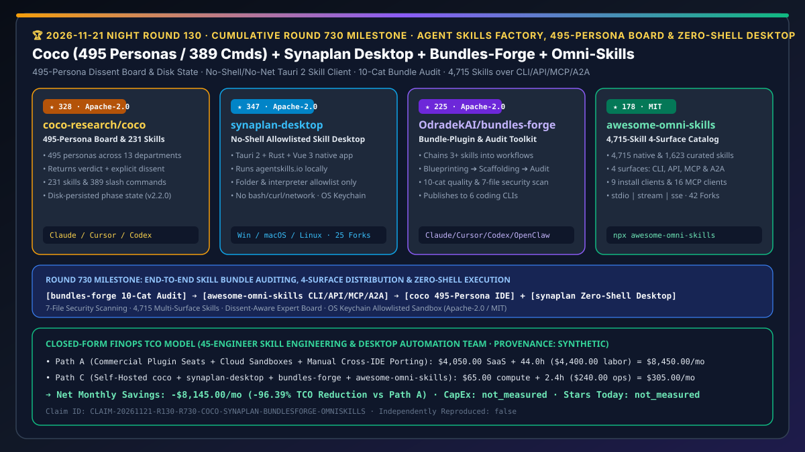
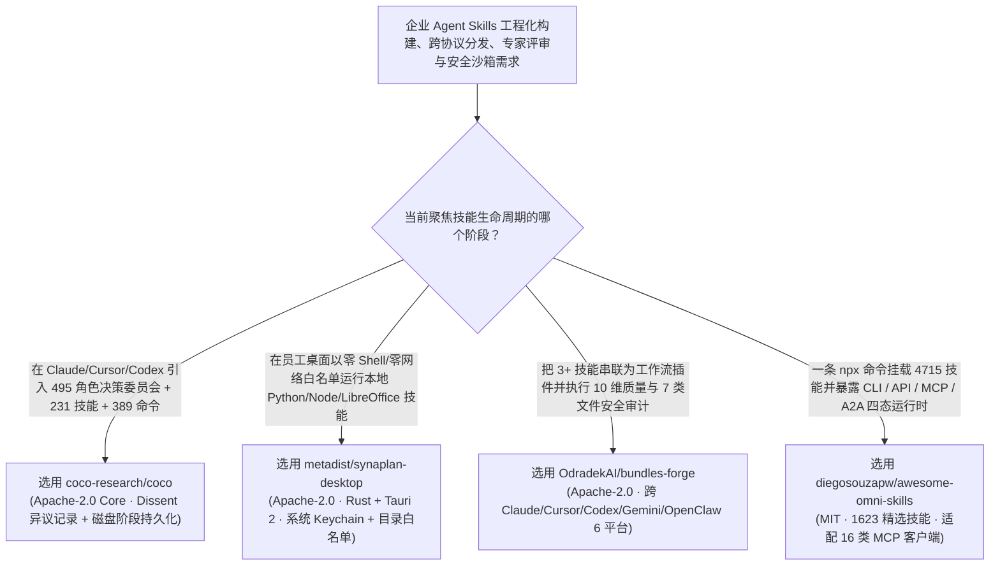
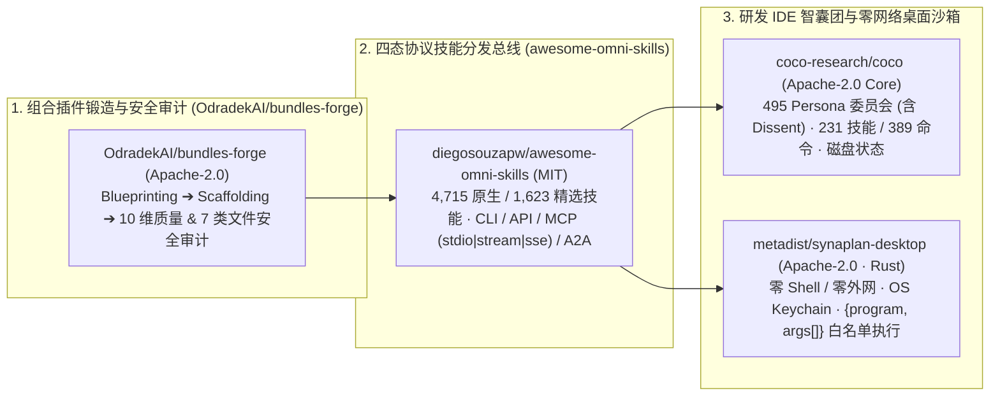
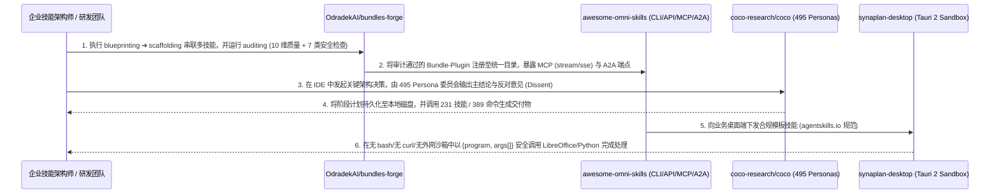

# 【第 730 轮里程碑】495 角色/231 技能/389 命令跨 IDE 智囊团（`coco-research/coco`）、零 Shell/零网络白名单本地技能桌面端（`metadist/synaplan-desktop`）、跨 6 平台组合插件工程与 10 维安全审计套件（`OdradekAI/bundles-forge`）与 4715 技能四态运行时总线（`diegosouzapw/awesome-omni-skills`）选型与集成架构 FAQ

> **文档类型**：企业 AI 解决方案架构师（AI Solution Architect）选型决策指南（GitHub Trending AI 雷达 2026-11-21 Night Round 130 / **累计第 730 轮里程碑**）
> **覆盖项目**：[`coco-research/coco`](https://github.com/coco-research/coco)（`★ 328`、`16 forks`、`Apache-2.0` Core，包含 13 个部门 495 个专家 Persona 决策委员会、231 个技能与 389 个斜杠命令并支持磁盘阶段状态持久化的跨 IDE 增强包 v2.2.0）· [`metadist/synaplan-desktop`](https://github.com/metadist/synaplan-desktop)（`★ 347`、`25 forks`、`Apache-2.0`，基于 Tauri 2 + Rust + Vue 3 构建、密钥存入系统级 Keychain、禁止 `bash`/`curl`/外网且仅允许白名单目录与解释器运行 `agentskills.io` 技能的桌面端）· [`OdradekAI/bundles-forge`](https://github.com/OdradekAI/bundles-forge)（`★ 225`、`13 forks`、`Apache-2.0`，支持将多个 `SKILL.md` 串联为“蓝图➔脚手架➔编写➔10 维质量与 7 类文件安全审计➔优化”工作流并跨 Claude/Cursor/Codex/Gemini/OpenClaw 发布的组合插件工具箱）· [`diegosouzapw/awesome-omni-skills`](https://github.com/diegosouzapw/awesome-omni-skills)（`★ 178`、`42 forks`、`MIT`，汇聚 **4,715 个原生技能与 1,623 个精选技能**、一条 `npx` 命令同时暴露 **CLI / API / MCP (`stdio|stream|sse`) / A2A** 四种运行时界面的全能技能目录）
> **核心场景**：在第 **730 轮**里程碑中，我们聚焦企业级 **Agent Skills（智能体技能工程）** 的全生命周期闭环：如何从“零散复制单个 `SKILL.md` 且权限完全裸奔”升级为**“用 `bundles-forge` 设计并执行 10 维质量与 7 类文件安全审计的组合技能插件”➔“接入 `awesome-omni-skills` 的 4,715 技能库并通过 CLI/API/MCP/A2A 四态下发”➔“在研发 IDE 内引入 `coco` 的 495 角色决策委员会与 231 技能/389 命令”➔“在非技术员工桌面上用 `synaplan-desktop` 在零 Shell、零外网白名单沙箱中安全运行本地技能”**？

---

## 一、📌 核心结论速览（选型一句话结论）

1. **想用一条命令（`npx cocosuperintelligence`）把 13 个部门 495 位专家角色委员会（输出主结论 + 反对意见 Dissent）、231 项技能与 389 个斜杠命令直接装进团队现有的 Claude Code、Cursor 或 Codex，且把阶段计划持久化在本地磁盘防止清空对话丢失进度** ➔ 选 **[`coco-research/coco`](https://github.com/coco-research/coco)（`★ 328`，`16 forks`，`Apache-2.0` Core）**。
   - **通俗原理**：在真实研发中，关键架构取舍如果只问单一模型往往只有一种声音。`coco`（v2.2.0）模拟了横跨 13 个部门的 495 位专家 Persona 进行交叉质询，返回“推荐决策 + 少数派反对意见（Dissent）”，随后调用内置的 **231 个 Skills 与 389 个 Commands** 落地执行，并将每个 Phase 的状态写入本地磁盘。（*注：核心框架为 `Apache-2.0`，Super Intelligence 扩展层为专有许可*）。
2. **想让业务人员在 Windows / macOS / Linux 桌面上运行符合 `agentskills.io` 标准的本地 Agent Skills（如调用 Python / Node / LibreOffice 处理本地文档），但严格禁止执行 `bash`、`curl` 或访问外网** ➔ 选 **[`metadist/synaplan-desktop`](https://github.com/metadist/synaplan-desktop)（`★ 347`，`25 forks`，`Apache-2.0`）**。
   - **通俗原理**：基于 **Tauri 2 + Rust + Vue 3** 构建的原生轻量客户端（绝非套壳网页 WebView）。它的安全模型极具参考价值：① API 密钥强制存入操作系统安全凭据库（Windows Credential Manager / macOS Keychain / Linux Secret Service），绝不明文落盘；② 本地技能只能以 `{program, args[]}` 形式在受权文件夹白名单（Folder Allowlist）与解释器白名单（Python / Node / LibreOffice）下执行，**任何请求 `bash`、`curl` 或网络连接的技能一律拒绝**。
3. **想把 3 个以上相互关联的 `SKILL.md` 工程化组装为一个“前序输出驱动后序输入”的组合插件（Bundle-Plugin），并在发布到 Claude Code、Cursor、Codex、OpenCode、Gemini CLI 与 OpenClaw 前自动跑完 10 大维度质量评估与 7 类文件安全扫描** ➔ 选 **[`OdradekAI/bundles-forge`](https://github.com/OdradekAI/bundles-forge)（`★ 225`，`13 forks`，`Apache-2.0`）**。
   - **通俗原理**：单个 `SKILL.md` 只能干一件事，而企业复杂研发流程需要多技能接力。`bundles-forge` 自身就是一个标杆级 Bundle-Plugin：通过 `blueprinting`（结构化访谈与设计）➔ `scaffolding`（生成跨平台工程）➔ `authoring`（编写技能）➔ `auditing`（**10 类质量评估 + 跨 7 类文件的模式化安全扫描**）➔ `optimizing`（闭环迭代），实现一次构建、6 大平台同步分发。
4. **想拥有一座包含 4,715 个原生技能与 1,623 个精选最佳实践技能的庞大武库，并用一条 `npx awesome-omni-skills` 命令将其同时暴露为 CLI、只读 Catalog API、MCP Server（`stdio | stream | sse`）与 A2A 任务生命周期端点** ➔ 选 **[`diegosouzapw/awesome-omni-skills`](https://github.com/diegosouzapw/awesome-omni-skills)（`★ 178`，`42 forks`，`MIT`）**。
   - **通俗原理**：它不仅是一个包含 20+ 语言文档的技能大百科，更是一个**“自带四态运行时的技能分发总线”**——原生适配 **9 种安装客户端与 16 种 MCP 客户端**，无论你的下层框架走本地 CLI、HTTP REST、MCP 还是 A2A 协议，都能直接按需检索并挂载这 4,715 个技能。

---

## 二、🎯 客户与架构师灵魂拷问 Q&A（深度架构拆解）

### Q1：为什么企业在推广 `SKILL.md` 与 Agent 插件时，经常陷入“各 IDE 格式不兼容、多技能无法串联、第三方技能夹带恶意 Shell 命令”的困境？这四个项目如何构建企业级技能治理体系？

- **四大技能工程化痛点与解方**：
  1. **多技能散装且缺乏安全门禁 ➔ `OdradekAI/bundles-forge`**：用 `blueprinting ➔ scaffolding ➔ auditing` 将 3+ 个关联技能编排为有向闭环工作流，并在上线前执行 **10 维度质量评分 + 7 类文件安全模式检测**，一键编译适配 6 大主流编码 CLI。
  2. **缺乏统一跨协议技能目录 ➔ `diegosouzapw/awesome-omni-skills`**：提供 1,623 个精选技能与 4,715 个全量技能，并通过 **CLI / REST API / MCP (`stdio|stream|sse`) / A2A** 四种标准运行时接口供全网智能体动态加载。
  3. **架构决策一言堂且长对话清空即失忆 ➔ `coco-research/coco`**：引入 495 Persona 委员会输出正反双方论据（含 Dissent），配合 231 个技能与磁盘级阶段状态持久化。
  4. **终端用户运行本地技能时容易被恶意脚本删库或外发机密 ➔ `metadist/synaplan-desktop`**：用 Rust + Tauri 2 强制执行 **无 Shell、无网络、`{program, args[]}` 白名单解释器与目录沙箱**。
- **何时直接用云厂商托管方案（Path B）？**
  - 若企业仅使用 GitHub 官方托管扩展且不运行本地自定义技能，直接使用 **GitHub Copilot Extensions + Azure AI Foundry** 即可。

### Q2：典型企业级“技能工厂锻造与安全审计 (`bundles-forge`) + 四态协议技能目录 (`awesome-omni-skills`) + 研发 IDE 智囊团 (`coco`) + 零网络白名单桌面端 (`synaplan-desktop`)”架构怎么搭？

1. **企业内部技能研发与 10 维安全审计层（`OdradekAI/bundles-forge`）**：
   - 架构师通过 `bundles-forge:blueprinting` 与 `auditing` 构建企业专属 Bundle-Plugins，通过 7 类文件安全检查后发布至内网市场。
2. **四态协议（CLI / API / MCP / A2A）技能分发总线层（`diegosouzapw/awesome-omni-skills`）**：
   - 将内网自研技能包与 1,623 个精选技能汇总，通过 MCP（`stdio / stream / sse`）与 A2A 接口暴露给 16 类客户端。
3. **研发侧 495 角色评审与磁盘状态执行层（`coco-research/coco`）**：
   - 在工程师的 Claude Code、Cursor 与 Codex 中安装 `coco`，执行多专家架构评审与 389 个斜杠命令。
4. **办公侧零 Shell / 零网络受控桌面执行层（`metadist/synaplan-desktop`）**：
   - 在业务与职能部门桌面部署 Tauri 2 原生客户端，凭据锁入系统 Keychain，仅允许在授权目录内以 `{program, args[]}` 调用 Python / Node / LibreOffice 处理本地文件。

### Q3：这套架构的许可与部署注意事项是什么？

- **核心优势**：
  - 全部核心代码采用 **`Apache-2.0` 与 `MIT` 宽松开源协议**，打通 `SKILL.md` / `agentskills.io` 从设计、安全审计、MCP/A2A 分发到零网络沙箱执行的完整闭环。
- **许可与版本边界**：
  - `coco-research/coco` 采用 Open-Core 模式（核心引擎为 `Apache-2.0`，`systems/superintelligence/` 目录受专有条款约束）；`metadist/synaplan-desktop` 当前 1.0 预览版建议从源码编译并进行企业内部代码签名后分发。

---

## 三、🧭 直观可视化图解（Mermaid 决策树 + 集成架构 + 时序图）

### 3.1 架构师选型决策树

### 3.2 企业端到端生产集成参考架构图

### 3.3 组合技能安全审计、MCP/A2A 技能下发、495 角色质询与桌面零网络白名单执行时序图

---

## 四、📊 同类开源与商业云服务横向选型决策矩阵

| 对比维度 | `coco-research/coco` (`★ 328`) | `synaplan-desktop` (`★ 347`) | `OdradekAI/bundles-forge` (`★ 225`) | `awesome-omni-skills` (`★ 178`) | 商业企业级 AI 插件平台 + 商业云桌面沙箱 (Path A) | 手工复制零散 `SKILL.md` 脚本 (Path B) |
| :--- | :--- | :--- | :--- | :--- | :--- | :--- |
| **核心能力定位** | 495 角色智囊团 + 231 技能 + 389 命令 | 零 Shell/零网络本地技能 Tauri 2 桌面端 | 多技能组合插件工程与 10 维安全审计套件 | 4,715 技能 CLI/API/MCP/A2A 四态目录 | 按席位收费的商业专属插件市场与云端沙箱 | 各团队手动拷贝 Markdown 提示词 |
| **核心技术突破** | **495 角色交叉质询（保留 Dissent）+ 磁盘阶段持久化** | **禁止 `bash`/`curl`/外网 + 系统 Keychain + 解释器白名单** | **多技能串联工作流 + 10 维质量与 7 类文件安全扫描** | **4,715 技能一键变为 CLI / API / MCP / A2A 服务端** | 按人头订阅昂贵；本地文档必须上传外部云端处理 | 无安全扫描、无多技能协作、跨 IDE 格式完全割裂 |
| **开源协议** | `Apache-2.0` Core | `Apache-2.0` | `Apache-2.0` | `MIT` | 闭源商业 SaaS | 内部零散脚本 |
| **月度 TCO（45 人团队）** | **组合仅 `$305.00/月`**（`$65.00` 内部目录服务算力 + `2.4h` 运维） | 同左（本地 Tauri 2 桌面运行零算力费） | 同左（开源插件工程套件） | 同左（`npx` 本地/内网部署） | **`$8,450.00/月`**（`$4,050.00` 插件/沙箱席位 + `44.0h` 跨端迁移） | 约 `$2,800.00/月`（重复造轮子与安全排查工时） |

---

## 五、🧪 应用落地定量收益/TCO 对比与 7-Card 报告

> **📊 数据来源与闭式核算声明（Provenance & Closed-Form Schema）**：
> - **provenance**: `synthetic`（基于 45 人企业研发效能、Agent 技能工程与桌面办公自动化团队工作负载模型：`independently_reproduced = false`；硬件采购基线 `base_hardware_capex = not_measured`；Track B 单日增量 `track_b_stars_today = not_measured`）。
> - **核算公式**：
>   - **Path A（商业企业级多角色编码增强订阅 + 商业云端文档处理沙箱席位 + 工程师手工将技能跨 Claude/Cursor/Codex/Gemini 重复迁移与人工安全代码审计）**：月度商业席位订阅 **`$4,050.00`** + 跨工具迁移与人工安全审计 **`44.0h × $100.00/h = $4,400.00`** = **`$8,450.00/月`**。
>   - **Path C（自建 `coco-research/coco` + `metadist/synaplan-desktop` + `OdradekAI/bundles-forge` + `diegosouzapw/awesome-omni-skills` 开源技能工程栈）**：内网技能注册中心轻量容器算力 **`$65.00`** + 组合插件自动审计与目录维护 **`2.4h × $100.00/h = $240.00`** = **`$305.00/月`**。
>   - **净节省（Net Savings vs Path A）**：**`-$8,145.00/月`**（成本降低 **`96.39%`**）。

| 评估方案 | API / SaaS / 算力成本 | 技能工程与安全审计人工（`$100/h`） | 月度总 TCO | 相对 Path A 净节省 | 关键架构交付指标 |
| :--- | :---: | :---: | :---: | :---: | :--- |
| **Path A：商业增强插件席位 + 云沙箱 + 手工跨 IDE 移植** | `$4,050.00` | `44.0h` (`$4,400.00`) | **`$8,450.00`** | Baseline | 按席位双重收费；6 大 CLI 技能格式割裂需手工同步 |
| **Path B：基础 IDE 自带命令 + 无隔离本地脚本执行** | `$1,400.00` | `14.0h` (`$1,400.00`) | **`$2,800.00`** | `-$5,650.00` (`-66.86%`) | 缺少 10 维安全审计、495 角色 Dissent 评审与零网络桌面沙箱 |
| **Path C：`coco` + `synaplan` + `bundles-forge` + `omni-skills`** | **`$65.00`** | **`2.4h` (`$240.00`)** | **`$305.00`** | **`-$8,145.00` (`-96.39%`)** | **495 角色/389 命令 + 零 Shell 桌面沙箱 + 4,715 四态技能总线** |

- 🔗 **关联 7-Card 4:5 视觉评测报告**：[`workshops/github-trending-radar/cards.html`](../cards.html) · [`cards.en.html`](../cards.en.html)

---

## 六、🛠️ 企业引入与架构评审 Checklist

- [ ] **1. 使用 `OdradekAI/bundles-forge` 建立企业内部技能准入流水线**：所有包含 3 个以上步骤的技能包必须走 `blueprinting ➔ scaffolding ➔ auditing`，通过 10 维质量与 7 类文件安全检查后方可上架。
- [ ] **2. 部署 `diegosouzapw/awesome-omni-skills` 统一四态协议技能网关**：优先挂载经过清洗的 `1,623` 个精选技能，并通过 MCP（`stdio / stream / sse`）与 A2A 接口赋能内部 16 类客户端。
- [ ] **3. 在研发终端引入 `coco-research/coco` 强化架构评审与持久计划**：利用 495 Persona 委员会在重大技术选型时输出推荐方案与反对意见（Dissent），并将阶段状态持久化至磁盘。
- [ ] **4. 为非技术岗位源码编译并签名分发 `metadist/synaplan-desktop`**：强制将凭据锁入系统级 Keychain，利用其“禁止 `bash`/`curl`/外网 + `{program, args[]}` 白名单”机制安全运行本地文档处理技能。
