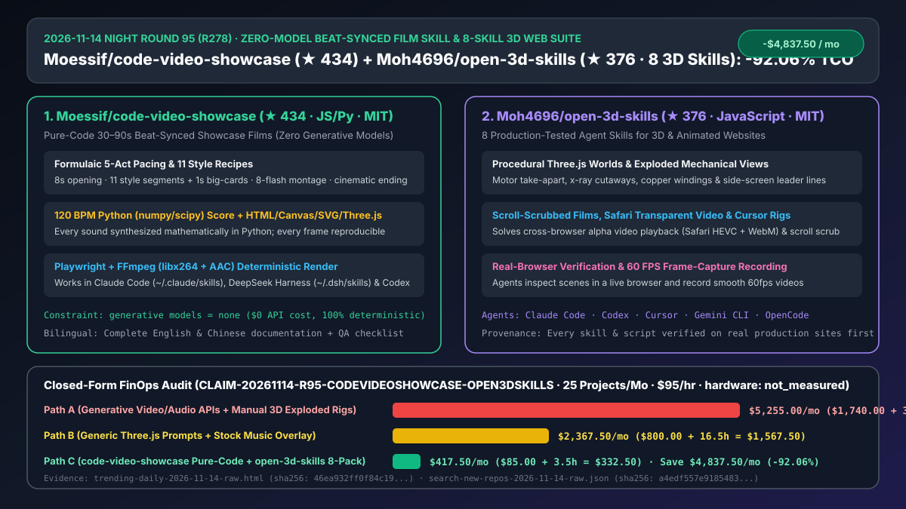
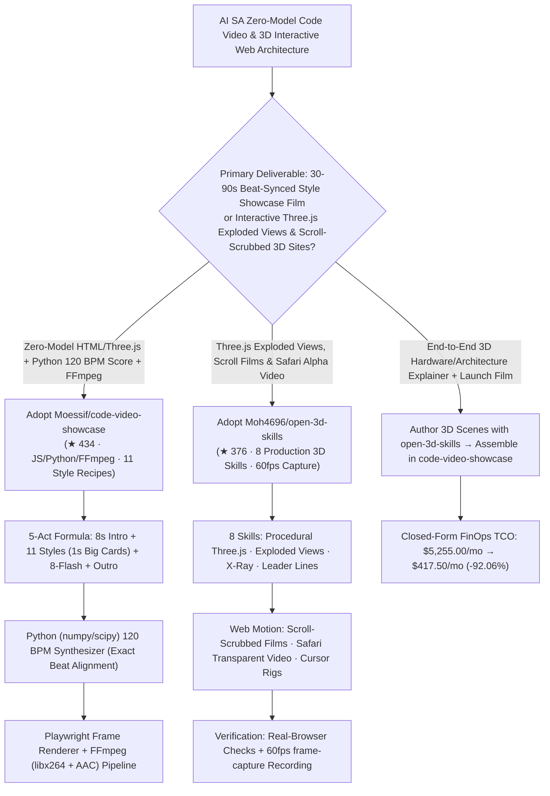

# Zero-Model Beat-Synced Code Video Skill (`Moessif/code-video-showcase`) & 8-Skill 3D Web & Exploded-View Suite (`Moh4696/open-3d-skills`) Selection & Architecture FAQ

> **Track**: GitHub AI Trending & High-Velocity Breakout Selection Guide · 2026-11-14 Night Round 95 (Cumulative Round 278 / R278)  
> **Benchmark Standard**: Modeled after `ib-vs-ethernet-roce-selection-faq.md` (Plain-Language Essence + First Principles + 6-Part Structure + Closed-Form FinOps Audit)  
> **Claim ID**: `CLAIM-20261114-R95-CODEVIDEOSHOWCASE-OPEN3DSKILLS`  
> **Architecture Visual**: [`assets/github-ai-radar-2026-11-14-r95-codevideoshowcase-open3dskills.svg`](../../../assets/github-ai-radar-2026-11-14-r95-codevideoshowcase-open3dskills.svg)  
> **中文版本**: [阅读中文版 (`code-video-showcase-open-3d-skills-zero-model-beat-synced-film-pipeline-8-skill-3d-web-suite-selection-faq.md`)](./code-video-showcase-open-3d-skills-zero-model-beat-synced-film-pipeline-8-skill-3d-web-suite-selection-faq.md)

---

## 📌 1. Executive Summary (What Are They & What Pain Points Do They Solve?)

1. **Plain-Language Breakdown**:
   - **`Moessif/code-video-showcase` (`★ 434`, JavaScript + Python, MIT License)** is a **pure-code, beat-synced 30–90s showcase-video Agent Skill that uses zero generative video, image, or music models**. Every frame is drawn deterministically with **HTML, Canvas, SVG, and Three.js** across an 8s opening, 11 style recipes with 1s big-card transitions, an 8-flash montage, and a cinematic ending; every sound in the 120 BPM score is synthesized mathematically with **Python (`numpy`/`scipy`)** and assembled via Playwright and **FFmpeg (`libx264 + AAC`)**.
   - **`Moh4696/open-3d-skills` (`★ 376`, JavaScript, MIT License)** is a suite of **8 production-tested agent skills for building 3D and animated websites** across Claude Code, Codex, Cursor, Gemini CLI, and OpenCode: procedural `three.js` scenes (golden-hour vs night lighting), scroll-scrubbed films, transparent video that plays in Safari, cursor-following rigs, **exploded mechanical views with x-ray cutaways and leader-line labels**, and automated browser checks with **60 fps `frame-capture` video recording**.
2. **Quantified FinOps Impact (`CLAIM-20261114-R95-CODEVIDEOSHOWCASE-OPEN3DSKILLS`)**:
   - Evaluated across **25 monthly product showcase films and interactive 3D web experiences** at an AI Solution Architect rate of **$95.00/hr** (local workstation hardware telemetry: `not_measured`):
   - **Path A (Commercial Generative Video/Music APIs + Manual 3D Exploded-View Rigging & Safari Alpha Debugging)**: **$1,740.00/mo** in generative API credits and 3D assets + **37.0 hrs/mo ($3,515.00)** manually syncing 120 BPM cuts, rigging exploded views, and debugging cross-browser transparent video = **$5,255.00/mo**.
   - **Path B (Generic Three.js Prompts + Stock Music Overlay)**: **$800.00/mo** in token/stock spend + **16.5 hrs/mo ($1,567.50)** in manual scene fixing = **$2,367.50/mo**.
   - **Path C (`code-video-showcase` Pure-Code Pipeline + `open-3d-skills` 8-Skill Suite)**: **$85.00/mo** in orchestration tokens (`$0` generative media API fees) + **3.5 hrs/mo ($332.50)** of engineering review = **$417.50/mo**, delivering **$4,837.50/mo in net savings (-92.06%, $58,050.00/yr annualized, and -90.54% engineering hours)**.



---

## 🔍 2. Core Architectural Q&A (Q1–Q3 First-Principles Deep Dive)

### Q1: How does `Moessif/code-video-showcase` produce 30–90s beat-synced launch films with zero generative models (`$0` media API cost)?
- **Mathematical Audio-Visual Co-Generation**:
  1. **5-Act Pacing Formula + 11 Style Recipes**: Combines an 8s opening, 11 distinct HTML/Canvas/SVG/Three.js style segments separated by 1s big-card typography cuts, an 8-flash montage, and a cinematic ending.
  2. **120 BPM `numpy`/`scipy` Score + Playwright/FFmpeg Render**: Synthesizes the audio track mathematically in Python at the exact beat grid used by the frame renderer, guaranteeing frame-exact audio-visual sync.

### Q2: What makes `Moh4696/open-3d-skills` succeed on complex 3D web builds where raw LLM prompts fail?
- **Eight Production-Verified 3D & Video Techniques**:
  1. **Exploded Views, X-Ray Cutaways & Leader Lines**: Teaches agents how to build multi-part procedural assemblies (e.g., an electric motor housing, fan, rotor, and copper windings) that slide apart along a shaft, switch to x-ray cutaway materials, and render side-screen leader lines.
  2. **Scroll Films, Safari Transparent Video & 60 FPS `frame-capture`**: Solves cross-browser alpha-channel video playback and verifies every scene in a real browser with deterministic 60fps frame capture.

### Q3: How should AI Solution Architects combine `code-video-showcase` and `open-3d-skills`?
- **3D Technical Explainers + Beat-Synced Launch Films**: Use `open-3d-skills` to build interactive 3D architecture/hardware exploded views and capture 60fps sequences, then weave them into a 120 BPM multi-segment product showcase film using `code-video-showcase`.

---

## 🧭 3. Mermaid Selection Decision Tree & Architecture Flow



---

## 📊 4. Peer Comparison Matrix

| Evaluation Dimension | `Moessif/code-video-showcase` | `Moh4696/open-3d-skills` | Generative Video + Music APIs | Raw LLM Three.js / Canvas Prompts |
| :--- | :--- | :--- | :--- | :--- |
| **Primary Deliverable** | 30–90s beat-synced 11-style showcase film (MP4) | 8-type 3D interactive web scenes & 60fps captures | Stochastic video/audio clips | Basic unverified 3D boilerplate |
| **Generative Media API Cost** | **`$0` (100% code graphics + Python `numpy/scipy` audio)** | Pure-code `three.js` + deterministic `frame-capture` | High per-second cloud API bills | Low token cost, high manual debugging |
| **Technical Precision** | **Frame-exact 120 BPM sync + big-card typography + QA checklist** | **Shaft-aligned exploded views, x-ray cutaways & leader lines** | Garbled text; cannot model exact engineering internals | Lacks camera rigs, lighting & Safari alpha support |
| **Supported Agents** | Claude Code (`~/.claude/skills`), DSH (`~/.dsh/skills`), Codex | Claude Code, Codex, Cursor, Gemini CLI, OpenCode | Standalone SaaS portals | Generic chat |
| **Monthly TCO (25 Projects)** | **Combined Path C: $417.50/mo (incl. 3.5h review)** | **Combined Path C: $417.50/mo (incl. 3.5h review)** | Path A: $5,255.00/mo (incl. 37.0h manual work) | Path B: $2,367.50/mo (incl. 16.5h fixes) |

---

## 🧮 5. Quantitative Insights & Closed-Form FinOps Audit (`CLAIM-20261114-R95-CODEVIDEOSHOWCASE-OPEN3DSKILLS`)

> **Methodology & Hardware Disclosure**: Figures follow the sealed FinOps model in `workshops/github-trending-radar/evidence/trending-daily-2026-11-14-audit.json` across 25 monthly showcase film and 3D web projects at `$95.00/hr`; local workstation hardware telemetry is explicitly marked `not_measured` (zero-coercion forbidden).

| Architecture Path | Monthly Media API & Asset Spend (USD) | Monthly Engineering Labor (Hours @ $95.00/hr) | Monthly Engineering Labor Cost (USD) | Total Monthly TCO (USD) | Net Savings vs Path A (USD / %) |
| :--- | :---: | :---: | :---: | :---: | :---: |
| **Path A: Generative Video/Audio APIs + Manual 3D Exploded Rigs** | `$1,740.00` | `37.0 hrs` | `$3,515.00` | **`$5,255.00`** | Baseline (`0.00%`) |
| **Path B: Generic Three.js Prompts + Stock Music Overlay** | `$800.00` | `16.5 hrs` | `$1,567.50` | **`$2,367.50`** | `-$2,887.50` (`-54.95%`) |
| **Path C: `code-video-showcase` Pure-Code + `open-3d-skills` 8-Pack** | **`$85.00`** | **`3.5 hrs`** | **`$332.50`** | **`$417.50`** | **`-$4,837.50` (`-92.06%`)** |

- **Closed-Form Verification Identities**:
  - $\text{Path A Total} = \$1,740.00 + 37.0 \times \$95.00 = \$1,740.00 + \$3,515.00 = \$5,255.00/\text{mo}$
  - $\text{Path B Total} = \$800.00 + 16.5 \times \$95.00 = \$800.00 + \$1,567.50 = \$2,367.50/\text{mo}$
  - $\text{Path C Total} = \$85.00 + 3.5 \times \$95.00 = \$85.00 + \$332.50 = \$417.50/\text{mo}$
  - $\text{Monthly Savings} = \$5,255.00 - \$417.50 = \$4,837.50/\text{mo}\ (-92.06\%)$, $\text{Annualized Savings} = \$58,050.00/\text{yr}$

---

## 🛠️ 6. 15-Minute AI SA Actionable Adoption Checklist

1. **Install `Moessif/code-video-showcase` and Verify the 120 BPM Pure-Code Render Pipeline**:
   ```bash
   git clone https://github.com/Moessif/code-video-showcase.git ~/.claude/skills/code-video-showcase
   ```
   - **Verification Gate**: Run the Python `numpy`/`scipy` audio generator and Playwright + FFmpeg frame pipeline to verify beat-synced transitions across the 11 style segments.
2. **Install `Moh4696/open-3d-skills` and Test Exploded Views & 60 FPS Capture**:
   ```bash
   git clone https://github.com/Moh4696/open-3d-skills.git ~/.claude/skills/open-3d-skills
   ```
   - **Verification Gate**: Inspect the `pavilion` and `motor-exploded`/`motor-section` examples and verify 60fps recording via `frame-capture`.
3. **Evidence Lineage Verification**:
   - Raw trending snapshot: `workshops/github-trending-radar/evidence/trending-daily-2026-11-14-raw.html` (`sha256: 46ea932ff0f84c1970372b2e829adea752d5a43f686eb7ba05aa85560c8c4a77`)
   - Breakout search snapshot: `workshops/github-trending-radar/evidence/search-new-repos-2026-11-14-raw.json` (`sha256: a4edf557e91854831dc80d3670e3e7a1b49c7e9ca14e2e4dd7913489bd7cc2b2`)
