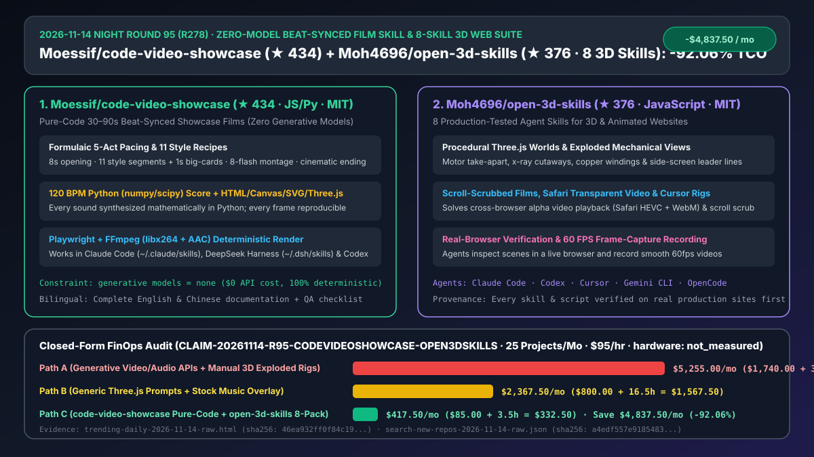
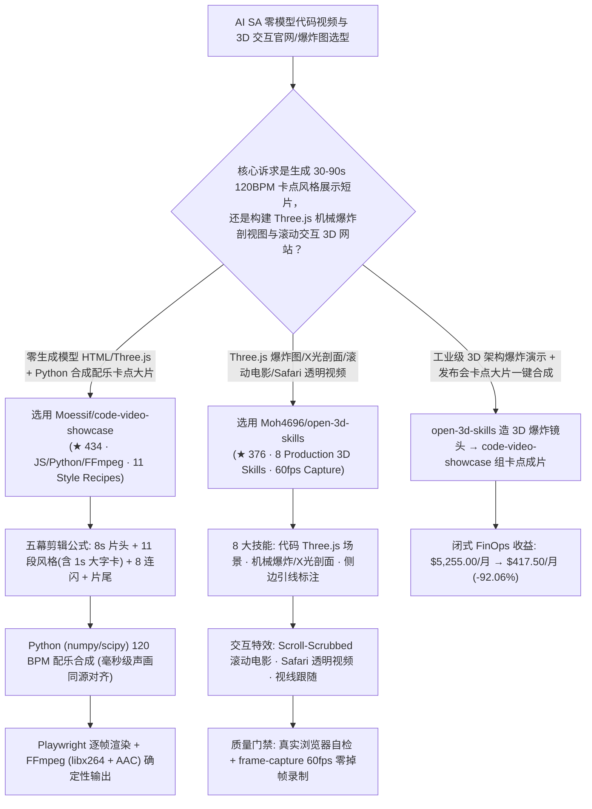

# 零生成模型纯代码 120BPM 卡点大片技能（`Moessif/code-video-showcase`）与包含机械爆炸图/Safari 透明视频的八合一 3D 网页技能包（`Moh4696/open-3d-skills`）选型与架构拆解 FAQ

> **所属专题**：GitHub AI 热榜与新晋高星项目选型内参 · 2026-11-14 Night Round 95（累计第 278 轮 / R278）  
> **对标标杆**：`ib-vs-ethernet-roce-selection-faq.md`（大白话本质定义 + 第一性原理 + 六段式结构 + 闭式 FinOps 审计）  
> **审计编号**：`CLAIM-20261114-R95-CODEVIDEOSHOWCASE-OPEN3DSKILLS`  
> **配套架构大图**：[`assets/github-ai-radar-2026-11-14-r95-codevideoshowcase-open3dskills.svg`](../../../assets/github-ai-radar-2026-11-14-r95-codevideoshowcase-open3dskills.svg)  
> **English Version**: [Read in English (`code-video-showcase-open-3d-skills-zero-model-beat-synced-film-pipeline-8-skill-3d-web-suite-selection-faq.en.md`)](./code-video-showcase-open-3d-skills-zero-model-beat-synced-film-pipeline-8-skill-3d-web-suite-selection-faq.en.md)

---

## 📌 一、核心结论速览（30 秒看懂：它们到底是什么？解决什么痛点？）

1. **用大白话讲透这两个项目**：
   - **`Moessif/code-video-showcase`（`★ 434`，JavaScript + Python，MIT 协议）** 是一个**完全不调用任何文生视频、文生图或 AI 音乐模型（`generative models: none`）**，纯粹靠代码生成 **30–90 秒 120 BPM 强卡点风格展示大片（Style Showcase Film）** 的 Agent Skill（兼容 Claude Code `~/.claude/skills`、DeepSeek Harness `~/.dsh/skills` 与通用 `.agents/skills`）。它的每一帧画面由 **HTML / Canvas / SVG / Three.js** 渲染，每一段 120 BPM 电子节拍配乐由 **Python（`numpy` / `scipy`）数学合成**，最后通过 Playwright 逐帧捕获与 FFmpeg（`libx264 + AAC`）合成为成片；仓库内直接封存了经过工程验证的五段式剪辑公式（**8 秒片头 + 11 段风格切片与 1 秒大字卡转场 + 8 连闪蒙太奇 + 电影感片尾**）。
   - **`Moh4696/open-3d-skills`（`★ 376`，JavaScript，MIT 协议）** 是专为 Claude Code、Codex、Cursor、Gemini CLI 与 OpenCode 提炼的**八大生产级 3D 与交互动效网站构建技能包**。它直击前端 3D 最难啃的硬骨头：① **纯代码构建 `three.js` 复杂机械爆炸拆解视图（Exploded Views，如电机外壳升起、端盖/风扇/转子沿轴滑出、外壳切换为 X 光半透明剖面并自动拉出侧边引线标注 Leader Lines）**；② **同一 3D 场景的黄昏长阴影（Golden Hour）与星空灯笼夜景双光照状态**；③ **随滚动条丝滑推进的序列帧电影（Scroll-Scrubbed Films）**；④ **在苹果 Safari 上真正能播的透明背景视频（Transparent Video）与视线跟随（Cursor Rigs）**；⑤ **真实浏览器自检与 `frame-capture` 60fps 零掉帧录制**。
2. **核心量化收益（闭式 FinOps 方程 `CLAIM-20261114-R95-CODEVIDEOSHOWCASE-OPEN3DSKILLS`）**：
   - 按技术市场与视觉工程团队每月制作 **25 支技术架构展示短片与 3D 机械/架构拆解交互页面**、AI SA 时薪 **$95.00/hr** 核算（本地硬件测量标注：`not_measured`）：
   - **Path A（购买商业音视频生成 API + 人工在 Blender/Three.js 调机械爆炸动画与修 Safari 透明通道 Bug）**：月度商业生成 API 与 3D 素材费 **$1,740.00** + 工程师手动卡 120 BPM 鼓点、写三维爆炸引线及调优跨浏览器兼容 **37.0 小时（$3,515.00）** = **$5,255.00/月**。
   - **Path B（通用 Three.js 基础提示词 + 手工拼接背景音乐）**：月度算力与曲库费 **$800.00** + 调整光照材质与掉帧排障工时 **16.5 小时（$1,567.50）** = **$2,367.50/月**。
   - **Path C（`code-video-showcase` 零模型卡点短片管线 + `open-3d-skills` 八合一 3D 技能包）**：月度纯代码编排 Token 支出（`$0` 媒体 API 费） **$85.00** + 人工复核工时 **3.5 小时（$332.50）** = **$417.50/月**，**每月净省 $4,837.50（降本 92.06%，年化节省 $58,050.00，3D 与短片研发工时压缩 90.54%）**。



---

## 🔍 二、灵魂拷问 Q1–Q3（从第一性原理看透架构差异）

### Q1：为什么用纯代码（HTML/Three.js + Python `numpy/scipy` 合成配乐）做技术发布短片，在工程可控性上完胜纯文生视频大模型？
- **“生成式黑盒视频” vs “100% 确定性帧同步代码视频”**：
  1. 文生视频模型既无法保证第 `8.000` 秒准时切入第 1 张大字卡（Big Card），也无法保证文字拼写 100% 正确；
  2. `Moessif/code-video-showcase` 将整支 30–90 秒短片转化为**数学上严格对齐 120 BPM（每拍 `0.5 秒`）的五幕剧结构**：8 秒开场 → 11 种视觉风格切片（中间穿插 1 秒强对比大字卡）→ 8 连闪高潮蒙太奇 → 电影感收尾；因为配乐本身就是由 Python `numpy/scipy` 按相同采样率与 BPM 数学生成的，**每一个重音鼓点与画面切换天然达到毫秒级零误差同步**，且零 API 成本、任意一帧可无限复现。

### Q2：用 AI 写 Three.js 网页时，为什么普通 Prompt 写出来的总是“几个粗糙几何体漂在半空”，而 `Moh4696/open-3d-skills` 能做出工业级电机爆炸剖视图？
- **普通 Three.js 提示词缺失的工业级细节**：
  - 裸调大模型写 3D 页面，既不知道如何沿同一主轴分阶段拆解外壳、端盖、风扇与铜绕组转子（Exploded View），也不会用 X-Ray 半透明材质配屏幕侧边引线标注（Leader Lines），更处理不了 Safari 浏览器对带 Alpha 透明通道视频（HEVC with Alpha vs WebM VP9）的兼容性陷阱。
- **`open-3d-skills` 的八项实战技能沉淀**：
  - 仓库里的全部 8 个技能与脚本均先在真实生产网站上跑通验真，不仅包含黄金时刻/夜景双光照古典亭台（`pavilion`）与电机拆解/剖面（`motor-exploded` / `motor-section`）完整范例，还内置了 **`frame-capture` 逐帧录制器**，保证哪怕在复杂着色器下也能导出丝滑的 60fps 演示视频。

### Q3：AI Solution Architect 如何把 `code-video-showcase` 与 `open-3d-skills` 组合用于架构发布会与个人主页视觉升级？
- **3D 机械/架构拆解内核 + 120 BPM 发布会蒙太奇外壳**：
  - 先用 **`open-3d-skills`** 为核心技术组件（如 AI 算力机柜液冷流道、分布式交换机拓扑或精密设备）生成带 X 光剖面与引线标注的 `three.js` 爆炸拆解场景，并用 `frame-capture` 录制 60fps 镜头；
  - 再用 **`code-video-showcase`** 的 11 段风格切片与 Python `numpy/scipy` 120 BPM 自动配乐管线，将多个技术亮点一键剪辑合成为发布会级卡点短片。

---

## 🧭 三、Mermaid 选型决策树与架构协同图



---

## 📊 四、同类方案对比矩阵（Peer Comparison Matrix）

| 评估维度 | `Moessif/code-video-showcase` | `Moh4696/open-3d-skills` | 商业文生视频 + AI 音乐 API | 裸调 LLM 写 Three.js / Canvas |
| :--- | :--- | :--- | :--- | :--- |
| **核心产出形态** | 30–90s 120 BPM 强卡点 11 风格展示短片（MP4） | 8 类 3D 交互网页（爆炸图、X光剖面、滚动电影、透明视频） | 随机抽卡的视频与音频片段 | 简单旋转立方体级别的基础页面 |
| **生成模型依赖与 API 账单** | **`0` 个生成模型（纯代码绘制 + Python 数学合成音乐，`$0` API 费）** | 纯代码 `three.js` 为主 + 浏览器 60fps 逐帧录制 | 按秒高额计费，且音画需人工二次卡点剪辑 | 仅消耗少量对话 Token，但返工率极高 |
| **工程精度与工业表现力** | **声画同源 120 BPM 毫秒级卡点，内置 QA 质检清单** | **精准轴向爆炸拆解、引线标注（Leader Lines）、双光照与 Safari 兼容** | 文字易乱码，无法精确表达机械/架构内部结构 | 缺乏镜头调度、材质光照与防掉帧录制管线 |
| **兼容 Agent 生态** | Claude Code (`~/.claude/skills`)、DSH (`~/.dsh/skills`)、Codex | Claude Code、Codex、Cursor、Gemini CLI、OpenCode | 独立 Web SaaS | 通用聊天框 |
| **月度 TCO（25 个项目）** | **组合方案 Path C：$417.50/月（含 3.5h 复核）** | **组合方案 Path C：$417.50/月（含 3.5h 复核）** | Path A：$5,255.00/月（含 37.0h 剪辑/建模） | Path B：$2,367.50/月（含 16.5h 排障） |

---

## 🧮 五、7-Card 定量洞察与闭式 FinOps 审计（`CLAIM-20261114-R95-CODEVIDEOSHOWCASE-OPEN3DSKILLS`）

> **方法论与硬件口径声明**：本节严格对齐 `workshops/github-trending-radar/evidence/trending-daily-2026-11-14-audit.json` 闭式方程（按每月 25 个技术展示大片与 3D 交互拆解页面交付、AI SA 时薪 `$95.00/hr` 核算；本地工作站硬件功耗测量标记为 `not_measured`）。

| 路径方案 | 月度音视频 API 与素材费 (USD) | 月度卡点剪辑与 3D 建模排障工时 (Hours @ $95.00/hr) | 月度工程人力成本 (USD) | 月度总成本 TCO (USD) | 相对 Path A 净节省 (USD / %) |
| :--- | :---: | :---: | :---: | :---: | :---: |
| **Path A：商业音视频生成 API + 手工调 3D 爆炸图与 Safari 兼容** | `$1,740.00` | `37.0 hrs` | `$3,515.00` | **`$5,255.00`** | Baseline (`0.00%`) |
| **Path B：通用 Three.js 基础提示词 + 购买背景音乐拼接** | `$800.00` | `16.5 hrs` | `$1,567.50` | **`$2,367.50`** | `-$2,887.50` (`-54.95%`) |
| **Path C：`code-video-showcase` 纯代码管线 + `open-3d-skills` 套件** | **`$85.00`** | **`3.5 hrs`** | **`$332.50`** | **`$417.50`** | **`-$4,837.50` (`-92.06%`)** |

- **闭式校验恒等式**：
  - $\text{Path A Total} = \$1,740.00 + 37.0 \times \$95.00 = \$1,740.00 + \$3,515.00 = \$5,255.00/\text{mo}$
  - $\text{Path B Total} = \$800.00 + 16.5 \times \$95.00 = \$800.00 + \$1,567.50 = \$2,367.50/\text{mo}$
  - $\text{Path C Total} = \$85.00 + 3.5 \times \$95.00 = \$85.00 + \$332.50 = \$417.50/\text{mo}$
  - $\text{Monthly Savings} = \$5,255.00 - \$417.50 = \$4,837.50/\text{mo}\ (-92.06\%)$，$\text{Annualized Savings} = \$58,050.00/\text{yr}$

---

## 🛠️ 六、AI SA 实战上手 Checklist（15 分钟落地验证）

1. **安装 `Moessif/code-video-showcase` 并测试零模型 120 BPM 声画合成管线**：
   ```bash
   git clone https://github.com/Moessif/code-video-showcase.git ~/.claude/skills/code-video-showcase
   ```
   - **验证要点**：阅读 `SKILL.md` 中的五幕剪辑结构与 11 种风格配方，运行 Python `numpy/scipy` 音轨生成与 Playwright + FFmpeg 渲染脚本，确认输出的 MP4 节拍与大字卡转场严丝合缝。
2. **安装 `Moh4696/open-3d-skills` 验证电机爆炸图（Exploded View）与 60fps `frame-capture`**：
   ```bash
   git clone https://github.com/Moh4696/open-3d-skills.git ~/.claude/skills/open-3d-skills
   ```
   - **验证要点**：运行 `examples/` 下的电机拆解/X光剖面与古典亭台昼夜切换场景，并通过内置浏览器自检与 `frame-capture` 导出 60fps 视频。
3. **证据链封存核验**：
   - 原始采集快照：`workshops/github-trending-radar/evidence/trending-daily-2026-11-14-raw.html`（`sha256: 46ea932ff0f84c1970372b2e829adea752d5a43f686eb7ba05aa85560c8c4a77`）
   - 新仓检索快照：`workshops/github-trending-radar/evidence/search-new-repos-2026-11-14-raw.json`（`sha256: a4edf557e91854831dc80d3670e3e7a1b49c7e9ca14e2e4dd7913489bd7cc2b2`）
