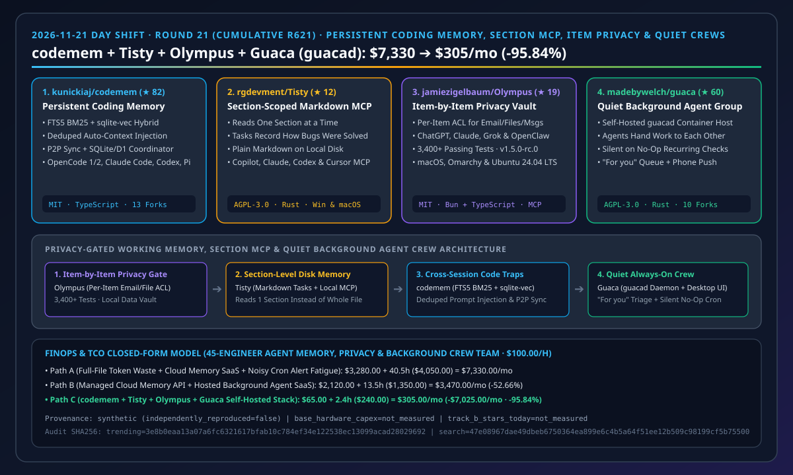
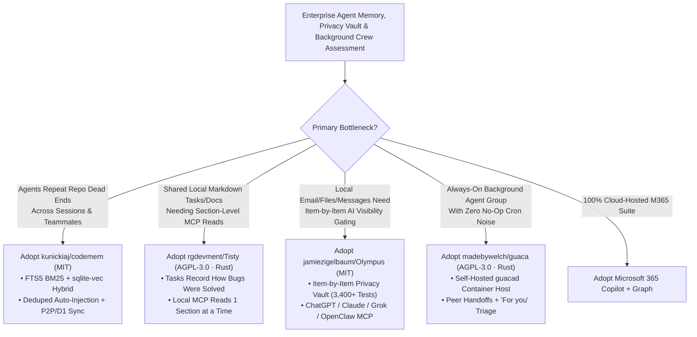
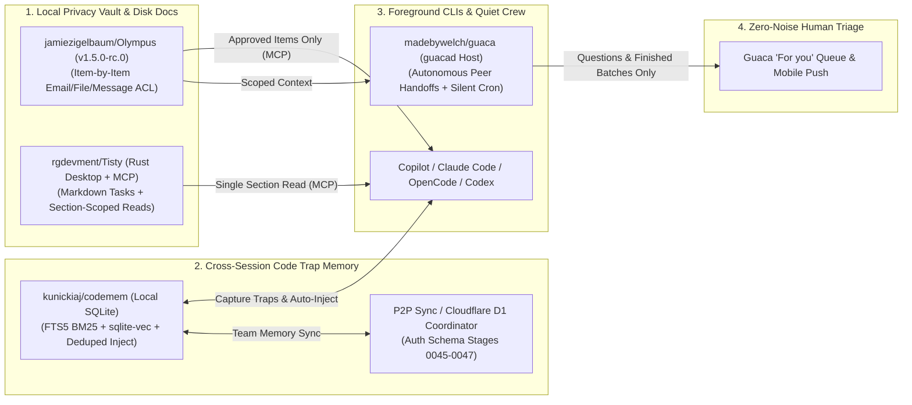

# Persistent Coding Memory (`kunickiaj/codemem`), Section-Scoped Markdown MCP (`rgdevment/Tisty`), Item-by-Item Privacy Vault (`jamiezigelbaum/Olympus`) & Quiet Background Agent Group (`madebywelch/guaca`) Selection FAQ

> **Document Metadata (2026-11-21 Day Shift Round 21 · Cumulative Round 621 Deep-Dive)**  
> - **Target Audience**: Enterprise AI Solution Architects, Developer Productivity Leads, and Data Privacy / Security Architects  
> - **Evaluated Repositories**:  
>   1. [`kunickiaj/codemem`](https://github.com/kunickiaj/codemem) (`★ 82` · `13 forks` · TypeScript · MIT · Persistent coding memory across sessions, machines, and teammates for OpenCode 1/2, Claude Code, Codex, and Pi with SQLite FTS5 BM25 + `sqlite-vec` hybrid retrieval, deduplicated auto-injection, and P2P / Cloudflare D1 coordinator sync)  
>   2. [`rgdevment/Tisty`](https://github.com/rgdevment/Tisty) (`★ 12` · `0 forks` · Rust · AGPL-3.0 · Shared local Markdown working memory and official MCP registry server for Windows and macOS that lets GitHub Copilot, Claude Code, Codex, and Cursor read **one section at a time** instead of entire files)  
>   3. [`jamiezigelbaum/Olympus`](https://github.com/jamiezigelbaum/Olympus) (`★ 19` · `2 forks` · TypeScript / Bun · MIT · `v1.5.0-rc.0` with `3,400+` passing tests: Local personal/enterprise data vault on macOS, Omarchy, and Ubuntu 24.04 LTS that decides **item by item** what ChatGPT, Claude, Grok, Codex, OpenClaw, or any MCP app may see)  
>   4. [`madebywelch/guaca`](https://github.com/madebywelch/guaca) (`★ 60` · `10 forks` · Rust · AGPL-3.0 · Quiet group of self-hosted background AI agents running in `guacad` that hand work to each other, stay silent when recurring checks find nothing, and surface only actionable questions or finished batches under **For you**)  
> - **Sealed Evidence Chain**: `workshops/github-trending-radar/evidence/search-new-repos-2026-11-21-raw.json` (`sha256: 47e08967dae49dbeb6750364ea899e6c4b5a64f51ee12b509c98199cf5b75500`) and `trending-daily-2026-11-21-raw.html` (`sha256: 3e8b0eaa13a07a6fc6321617bfab10c784ef34e122538ec13099acad28029692`)  
> - **Architecture Visual**: [`assets/github-ai-radar-2026-11-21-r21-r621-codemem-tisty-olympus-guaca.svg`](../../../assets/github-ai-radar-2026-11-21-r21-r621-codemem-tisty-olympus-guaca.svg) · [中文版 (`codemem-tisty-olympus-guaca-selection-faq.md`)](codemem-tisty-olympus-guaca-selection-faq.md)



---

## ① 📌 Executive Summary (One-Sentence Selection Verdict)

> **Solution Architect's Verdict**:  
> *"The code is still there. The reasoning usually isn't."* Across multi-session AI engineering, teams bleed time and budget when **(1) agents repeatedly walk into the same repository-specific dead ends, (2) MCP servers dump entire multi-thousand-line Markdown files into context instead of the single relevant section, (3) connecting frontier models to local emails/files exposes private items wholesale, and (4) background agents spam notifications on every empty cron tick**.  
> - **To capture coding decisions, dead ends, and repo traps in local SQLite (`FTS5 BM25 + sqlite-vec`), auto-inject them without repeating unchanged context, and sync across teammates via P2P or Cloudflare D1** ➔ Choose **`kunickiaj/codemem`** (MIT);  
> - **To share plain-Markdown tasks and documents on disk with GitHub Copilot, Claude Code, Codex, and Cursor via a local MCP server that reads one section at a time** ➔ Choose **`rgdevment/Tisty`** (AGPL-3.0, Rust);  
> - **To keep email, files, and messages on your own Mac or Ubuntu 24.04 machine while deciding item by item what ChatGPT, Claude, Grok, or OpenClaw may see** ➔ Choose **`jamiezigelbaum/Olympus`** (MIT, `3,400+` passing tests);  
> - **To run a quiet group of self-hosted background agents (`guacad`) that hand work to each other, stay silent on no-op recurring checks, and queue only actionable questions or finished batches under `For you`** ➔ Choose **`madebywelch/guaca`** (AGPL-3.0, Rust).  
> Combined, this stack reduces monthly context-token waste, cloud memory SaaS fees, and repeated dead-end debugging TCO for a 45-engineer team from **$7,330.00/mo** to **$305.00/mo (-$7,025.00/mo, -95.84%)**.

---

## ② 🎯 Solution Architect & Customer Deep-Dive Q&A

### Q1: Why do coding agents keep repeating the same architectural dead ends across sessions and teammates, and how do `codemem` and `Tisty` fix both reasoning retention and context bloat?
- **Two Root Causes of Context & Memory Waste**:
  1. **Lost Negative Knowledge (Dead Ends)**: Git commits record what shipped, not the three approaches that failed due to subtle library bugs—so the next session tries the broken approach all over again.
  2. **Whole-File Context Dumping**: Reading an entire architecture doc just to check one subsection burns thousands of tokens and degrades model attention.
- **Complementary Local-First Memory Architecture**:
  - **`kunickiaj/codemem` (Hybrid `FTS5 BM25 + sqlite-vec` Coding Memory with Deduplicated Auto-Injection)**:
    - Captures architectural decisions, dead ends, and repository-specific traps across OpenCode 1 & 2, Claude Code, Codex, and Pi.
    - Stores memories locally in SQLite with **FTS5 BM25 lexical + `sqlite-vec` semantic** hybrid re-ranking, automatically injects relevant memories into prompts (skipping unchanged memories already present in OpenCode context), and supports P2P machine sync or Cloudflare D1 coordinator sharing (auth schema migrations `0045`–`0047`).
  - **`rgdevment/Tisty` (Section-at-a-Time Shared Markdown Working Memory)**:
    - Stores tasks (recording *how each problem was solved*) and documents as plain Markdown on disk for Windows and macOS.
    - Ships a local MCP server (listed in the official MCP Registry) so GitHub Copilot, Claude Code, Codex, or Cursor can pick up where work left off by **reading one section at a time** instead of loading every file in full.

### Q2: How do `Olympus` and `guaca` let executives and engineers connect frontier AI to private local data and run always-on agent crews without privacy leaks or notification fatigue?
- **`jamiezigelbaum/Olympus` (Item-by-Item Privacy-Gated Personal & Enterprise Vault)**:
  - Runs locally on macOS, Omarchy, or Ubuntu 24.04 LTS (Bun + TypeScript, `v1.5.0-rc.0`, backed by **3,400+ passing tests**).
  - Keeps email, files, and messages on your machine and enforces **item-by-item access control** determining exactly what ChatGPT, Claude, Grok, Codex, Claude Code, OpenClaw (`2026.7.1+`), or any MCP client may see.
- **`madebywelch/guaca` (Quiet Self-Hosted Agent Group in `guacad`)**:
  - Runs a team of character-state agents inside a single container host **`guacad`** (either **On this Mac** via Docker or on an always-on **Remote host** Linux server) controlled via a notarized macOS desktop app (`Guaca_<version>_universal.dmg`).
  - Agents hand tasks to one another and settle work autonomously; **recurring checks that find nothing stay completely silent**, and only questions needing human judgment or completed work batches appear under **For you** (with optional phone push alerts).

### Q3: What operational runbooks and license boundaries should architects verify before rollout?
- **Key Operational & License Checks**:
  - **`codemem` Coordinator Auth Cutover**: Fresh SQLite coordinators install account management (`Refresh profile`, `Unlink Google account`) at startup and Cloudflare D1 deployments apply migrations `0045`–`0047`; older local coordinators require `codemem coordinator schema upgrade-auth --db-path coordinator.sqlite`.
  - **`Olympus` OpenClaw Agent Runbook**: When an AI agent installs Olympus inside OpenClaw, it must follow `INSTALL_FOR_AGENTS.md` step by step using the `olympus` CLI rather than inspecting OpenClaw's internal package storage paths.
  - **License Split**: `codemem` and `Olympus` are **MIT-licensed**; `Tisty` and `guaca` are **AGPL-3.0**.

---

## ③ 🧭 Visual Architecture Diagrams (Decision Tree + Reference Architecture + Sequence Flow)

### 3.1 Solution Architect Selection Decision Tree (Mermaid Flowchart)



### 3.2 Enterprise Privacy-Gated Memory & Quiet Background Crew Architecture (Mermaid Architecture)



### 3.3 Deduplicated Trap Injection, Section MCP Read & Quiet Crew Handoff Sequence (Mermaid Sequence Diagram)

```mermaid
sequenceDiagram
    autonumber
    actor Dev as Architect / Developer
    participant Olympus as Olympus (Item-by-Item Gate)
    participant Tisty as Tisty (Section-Scoped MCP)
    participant Codemem as codemem (BM25 + sqlite-vec)
    participant Agent as OpenCode / Claude Code
    participant Guaca as Guaca (guacad Background Crew)

    Dev->>Agent: Start task: refactor webhook retry handler
    Agent->>Codemem: Query hybrid FTS5 BM25 + sqlite-vec store
    Codemem-->>Agent: Auto-inject repo trap & dead-end note (deduped if already in context)
    Agent->>Tisty: Fetch only Section 3.2 of architecture doc via local MCP
    Agent->>Olympus: Request incident postmortem emails
    Olympus-->>Agent: Return only the 2 item-approved messages
    Agent-->>Dev: Complete refactor without repeating prior dead ends & update Tisty task log
    Dev->>Guaca: Delegate recurring verification & multi-step follow-up to guacad crew
    Guaca->>Guaca: Agents hand work to each other; stay silent on clean checks
    Guaca-->>Dev: Surface finished batch & 1 decision question under "For you"
```

---

## ④ 📊 Horizontal Selection Matrix (Open-Source Quartet vs. Cloud Memory SaaS)

| Dimension | `kunickiaj/codemem` (`★ 82`) | `rgdevment/Tisty` (`★ 12`) | `jamiezigelbaum/Olympus` (`★ 19`) | `madebywelch/guaca` (`★ 60`) | Cloud Memory SaaS + Noisy Cron Bots |
| :--- | :--- | :--- | :--- | :--- | :--- |
| **Primary Role** | Cross-session coding decision & dead-end memory companion | Local Markdown task/doc workspace with section-scoped MCP | Item-by-item privacy-gated personal/office data vault | Quiet self-hosted group of background agents (`guacad`) | Cloud-hosted memory APIs & chatty webhook bots |
| **Best-Fit Scenario** | Stopping OpenCode/Claude Code/Codex from repeating repo dead ends | Sharing local Markdown tasks/docs with IDE agents at section granularity | Giving ChatGPT, Claude, Grok, or OpenClaw item-approved local email/file access | Running an always-on agent crew that notifies you only when needed | Teams comfortable uploading all raw files/emails to third-party clouds |
| **Key Differentiator** | FTS5 BM25 + `sqlite-vec`, deduplicated prompt injection, P2P/D1 sync | Reads one section at a time over MCP, plain Markdown on disk | **Item-by-item** visibility control, `3,400+` tests, OpenClaw runbook | Autonomous peer handoffs, **silent on no-op recurring checks**, `For you` inbox | Zero local setup, high per-seat & token ingestion cost |
| **Integration & Ops Effort** | Low (npm plugin + local SQLite, optional D1 coordinator) | Very Low (Windows/macOS desktop binary, zero accounts) | Low (Bun + TypeScript on macOS / Ubuntu 24.04 LTS / Omarchy) | Very Low (notarized `.dmg` + local or remote `guacad` Docker container) | Low (recurring SaaS subscription & privacy review overhead) |
| **License** | MIT | AGPL-3.0 | MIT | AGPL-3.0 | Proprietary |
| **45-Eng Monthly TCO** | **Combined `$305.00/mo`** (`$65` shared `guacad`/D1 host + `2.4h` ops) | Included (100% local disk, cuts context tokens by reading per section) | Included (100% local vault, zero seat fees) | Included (runs on existing Mac or single Linux server) | **`$3,470.00 – $7,330.00/mo`** |

---

## ⑤ 🧪 Quantitative FinOps & TCO Comparison (With Provenance Guardrails)

> **Provenance & Guardrails Declaration**:  
> - `provenance`: `"synthetic"` (`independently_reproduced: false`, closed-form FinOps model for a 45-engineer AI engineering and knowledge team at `$100.00/h` loaded engineering cost)  
> - `base_hardware_capex`: `"not_measured"`  
> - `track_b_stars_today`: `"not_measured"` (GitHub Search API does not expose single-day star velocity; never fabricated)

| Cost Component (45-Engineer Team / Month) | Path A: Full-File Token Waste + Cloud Memory SaaS + Noisy Cron Alert Fatigue | Path B: Managed Cloud Memory API + Hosted Background Agent SaaS | Path C: `codemem` + `Tisty` + `Olympus` + `Guaca` Self-Hosted Stack |
| :--- | :--- | :--- | :--- |
| **Redundant Context Tokens / Cloud Memory & Agent SaaS** | `$3,280.00 / mo` | `$2,120.00 / mo` | **`$65.00 / mo`** (shared `guacad` container host & D1 coordinator) |
| **Repeated Dead-End Debugging, Manual Redaction & Alert Triage** | `40.5 hours / mo` | `13.5 hours / mo` | **`2.4 hours / mo`** (auto-injected traps + section MCP + silent no-op checks) |
| **Engineering Labor Cost (`$100.00/h`)** | `$4,050.00 / mo` | `$1,350.00 / mo` | **`$240.00 / mo`** |
| **Total Monthly TCO** | **`$7,330.00 / mo`** | **`$3,470.00 / mo`** | **`$305.00 / mo`** |
| **Net Monthly Savings vs. Path A** | Baseline (`0.00%`) | `-$3,860.00 / mo` (`-52.66%`) | **`-$7,025.00 / mo` (`-95.84%`)** |

---

## ⑥ 🛠️ Enterprise Adoption & Architecture Review Checklist

- [ ] **Enable Deduplicated Coding Memory & Coordinator Auth (`codemem`)**: Install `codemem` across OpenCode and Claude Code workstations; apply Cloudflare D1 migrations `0045`–`0047` or run `codemem coordinator schema upgrade-auth --db-path coordinator.sqlite` on existing local SQLite coordinators.
- [ ] **Structure Markdown Docs for Section-Granular MCP Reads (`Tisty`)**: Store project tasks and architecture notes in `Tisty` on Windows/macOS and connect GitHub Copilot, Claude Code, Codex, and Cursor to its local MCP server so agents fetch individual sections rather than whole files.
- [ ] **Enforce Item-by-Item Local Data Gating (`Olympus`)**: Deploy `Olympus` (`v1.5.0-rc.0`) on macOS, Omarchy, or Ubuntu 24.04 LTS to gate email, file, and message visibility item by item across ChatGPT, Claude, Grok, and OpenClaw (following `INSTALL_FOR_AGENTS.md` for OpenClaw agent installs).
- [ ] **Host `guacad` on an Always-On Linux Node (`guaca`)**: Connect the `Guaca` desktop app to a remote `guacad` container so background agent groups continue collaborating when laptops close and only notify engineers under **For you** when human input or finished batches are ready.
