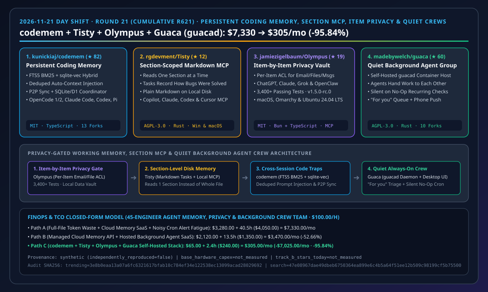
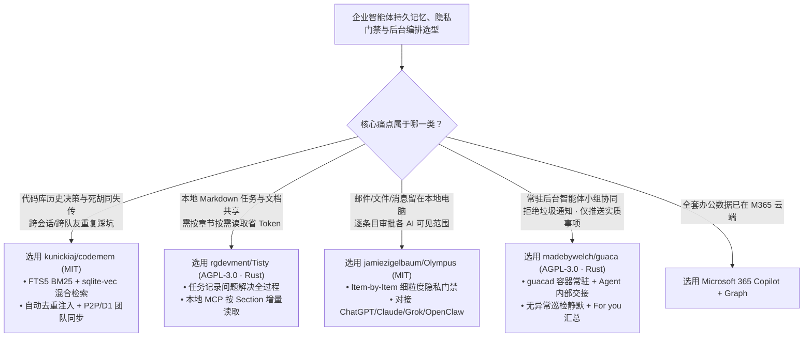
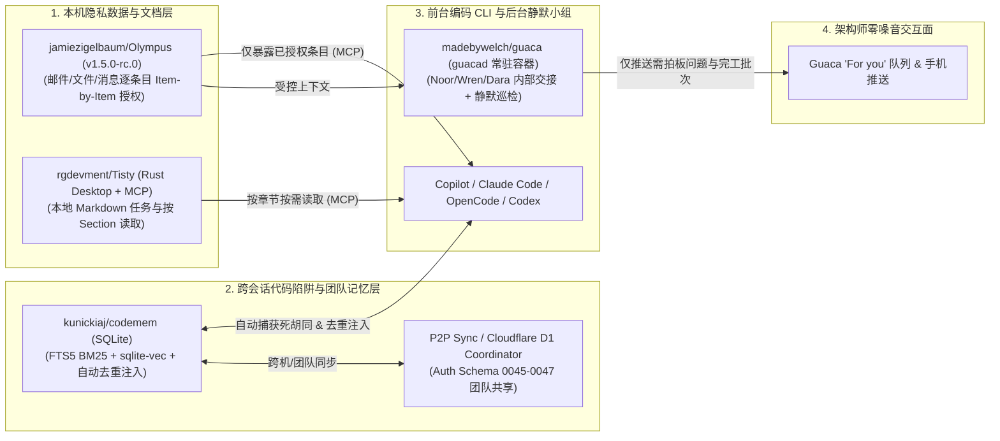
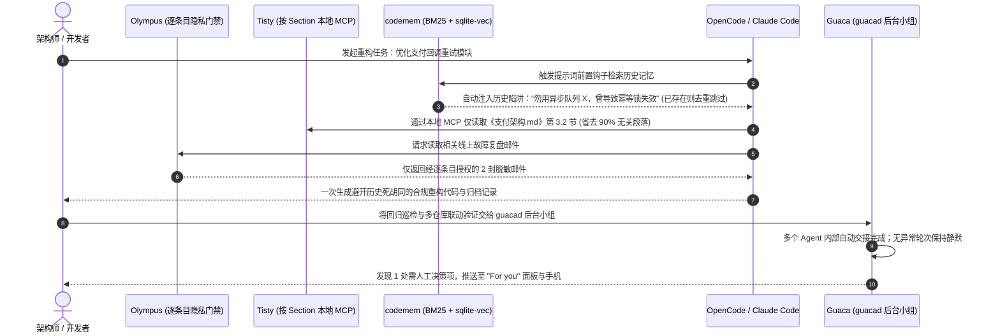

# 跨会话代码陷阱记忆（`kunickiaj/codemem`）、按章节按需读取的本地共享记忆（`rgdevment/Tisty`）、逐条目隐私授权个人数据金库（`jamiezigelbaum/Olympus`）与静默后台智能体小组（`madebywelch/guaca`）架构选型与落地 FAQ

> **文档元数据（2026-11-21 白班 Day Round 21 · 累计第 621 轮深潜专题）**  
> - **面向对象**：企业 AI 解决方案架构师（AI Solution Architect）、研发效能负责人、数据隐私与安全架构师  
> - **本轮核心评估对象**：  
>   1. [`kunickiaj/codemem`](https://github.com/kunickiaj/codemem)（`★ 82` · `13 forks` · TypeScript · MIT · 面向 OpenCode 1/2、Claude Code、Codex 与 Pi 的跨会话/跨机器持久编码记忆伴侣，融合 SQLite FTS5 BM25 + `sqlite-vec` 混合重排、自动去重注入与 P2P/Cloudflare D1 团队同步）  
>   2. [`rgdevment/Tisty`](https://github.com/rgdevment/Tisty)（`★ 12` · `0 forks` · Rust · AGPL-3.0 · 人与 AI 共享的本地 Markdown 工作记忆桌面应用与官方 MCP 注册表服务，支持 GitHub Copilot / Claude Code / Codex / Cursor **每次只按需读取一个章节（section）**而非吞下整份大文件）  
>   3. [`jamiezigelbaum/Olympus`](https://github.com/jamiezigelbaum/Olympus)（`★ 19` · `2 forks` · TypeScript / Bun · MIT · `v1.5.0-rc.0`，拥有 `3,400+` 通过测试的本机隐私记忆金库，对邮件、文件与消息实施**逐条目（item-by-item）可见性授权**，支持 ChatGPT、Claude、Grok、OpenClaw 与任意 MCP 客户端）  
>   4. [`madebywelch/guaca`](https://github.com/madebywelch/guaca)（`★ 60` · `10 forks` · Rust · AGPL-3.0 · 运行在自有机器或常驻服务器 `guacad` 容器内的静默智能体小组，内部自动交接任务，无异常的定时巡检保持完全静默，仅将需人工拍板的问题或完工批次汇总至 **For you** 队列并推送手机）  
> - **关联检索证据链**：`workshops/github-trending-radar/evidence/search-new-repos-2026-11-21-raw.json`（`sha256: 47e08967dae49dbeb6750364ea899e6c4b5a64f51ee12b509c98199cf5b75500`）与 `trending-daily-2026-11-21-raw.html`（`sha256: 3e8b0eaa13a07a6fc6321617bfab10c784ef34e122538ec13099acad28029692`）  
> - **高清架构图**：[`assets/github-ai-radar-2026-11-21-r21-r621-codemem-tisty-olympus-guaca.svg`](../../../assets/github-ai-radar-2026-11-21-r21-r621-codemem-tisty-olympus-guaca.svg) · [English Version (`codemem-tisty-olympus-guaca-selection-faq.en.md`)](codemem-tisty-olympus-guaca-selection-faq.en.md)

---

## ① 📌 核心结论速览（选型一句话结论）

> **架构师一句话选型结论**：  
> 代码留在了 Git 仓库里，但**“为什么当时放弃了方案 A、某个历史遗留模块的隐蔽陷阱在哪、哪封客户邮件能给 AI 看而哪封绝不能给”**往往随着会话关闭而烟消云散。  
> - **需要把编码过程中的“设计决策、死胡同（dead ends）与仓库特定陷阱”自动沉淀到 SQLite（`FTS5 BM25 + sqlite-vec`），并在后续 OpenCode / Claude Code 会话中自动去重注入、跨队友 P2P 同步** ➔ 选 **`kunickiaj/codemem`**（MIT）；  
> - **需要与 GitHub Copilot / Claude Code / Codex / Cursor 共享本地磁盘上的 Markdown 任务与文档，且让 Agent 每次只按需读取一个章节（Section）以节省 80%+ 上下文 Token** ➔ 选 **`rgdevment/Tisty`**（AGPL-3.0，Rust）；  
> - **想让前沿大模型（ChatGPT / Claude / Grok / OpenClaw）辅助处理本机邮件、文件与聊天记录，但必须“逐条目（item by item）”精准审批每个 AI 能看到什么** ➔ 选 **`jamiezigelbaum/Olympus`**（MIT，`3,400+` 单测）；  
> - **需要一组在后台容器（`guacad`）中默默协作、自己互相交接任务、周期巡检无事发生时绝对不发垃圾通知打扰你，只在有实质产出或卡点时推入 `For you` 队列的智能体团队** ➔ 选 **`madebywelch/guaca`**（AGPL-3.0，Rust）。  
> 四者协同可将 45 人研发与知识工程团队的月度重复踩坑排障、全文件 Token 浪费与告警疲劳治理成本从 **$7,330.00/月** 降至 **$305.00/月（节省 $7,025.00/月，降幅 95.84%）**。

---

## ② 🎯 客户与架构师灵魂拷问 Q&A（业务痛点 · 架构集成 · 边界取舍）

### Q1：“The code is still there. The reasoning usually isn’t.”——为什么团队用 AI 写代码时，不同工程师（甚至同一个人在第二天）会反复掉进同一个架构死胡同？`codemem` 与 `Tisty` 怎么配合解决？
- **研发记忆流失的两大现场**：
  1. **隐性决策与死胡同失传**：昨天架构师花了 2 小时发现某第三方 SDK 在异步模式下有内存泄漏并改用同步包装，但今天另一位同事用 Claude Code 重构时又把它改回了异步，因为代码注释没写全、昨天对话已关闭。
  2. **整文件塞入上下文导致 Token 爆炸与注意力稀释**：把几千行的架构文档全塞给 Agent 既贵又容易让模型漏看重点。
- **双层记忆互补方案**：
  - **`kunickiaj/codemem`（自动捕获死胡同 + 去重提示词注入）**：
    - 专为 OpenCode（1 & 2）、Claude Code、Codex 与 Pi 打造，自动观察会话中的架构决策、走不通的死胡同（dead ends）与仓库专属陷阱，存入本地 SQLite。
    - 采用 **FTS5 BM25 词法检索 + `sqlite-vec` 语义向量检索**混合重排；在后续每次提问时**自动注入相关记忆**，且如果某条记忆已存在于当前 OpenCode 上下文中且未发生变化，绝不重复注入浪费 Token；支持 P2P 跨机同步及基于 SQLite / Cloudflare D1（迁移脚本 `0045`–`0047`）的团队 Coordinator。
  - **`rgdevment/Tisty`（全局视图归人、章节细节归 Agent 的本地 Markdown MCP）**：
    - 人类在桌面端（Windows / macOS）纵览任务流与文档全局，每个任务沉淀“当时是如何解决的”；
    - 内置已收录于官方 MCP Registry 的本地 MCP Server，让 GitHub Copilot、Claude Code、Codex 或 Cursor 接着上次进度继续工作，且**每次按章节（a section at a time）增量读取**而非暴力读取整个文件。

### Q2：高管和架构师想用个人/企业邮件、聊天记录与本地文件喂给 AI 做决策助手，又怕敏感隐私一键裸奔；同时后台定时跑的 Agent 每天发几百条“检查完毕无异常”的垃圾通知，如何用 `Olympus` 和 `guaca` 解决？
- **`jamiezigelbaum/Olympus`（逐条目权限门禁的本机个人/办公记忆金库）**：
  - 运行在 macOS、Omarchy 或 Ubuntu 24.04 LTS 本机（基于 Bun + TypeScript，拥有 **3,400+ 通过的自动化测试**）。
  - 核心铁律：**逐条目（item by item）决定每个 AI 能看什么**——邮件、本地文件与消息全部留在你自己的电脑上，由 Olympus 充当安全闸门，向 ChatGPT、Claude、Grok、Codex、OpenClaw（`2026.7.1+`）或任何 MCP 应用按最小权限暴露已授权条目。
- **`madebywelch/guaca`（“无事不扰”的自托管后台智能体小组）**：
  - 后端运行在本地 Mac Docker 或远端常驻 Linux 服务器的单个容器宿主 **`guacad`** 中，桌面端（提供 Apple 公证签名的 `Guaca_<version>_universal.dmg`）只做观察窗口。
  - **内部自治与静音哲学**：你只需吩咐其中一个智能体（如 Noor、Wren、Pip、Dara、Marlow），它们会在内部互相交接工作并自行结案；**如果某项周期性巡检什么问题也没发现，它会保持绝对静默（stays silent）**；只有真正需要你回答的问题或已完工的成果批次，才会进入 **For you** 列表并推送到手机。

### Q3：落地这四个项目时有哪些运维细节与许可证边界？何时直接用云厂商托管记忆/自动化方案？
- **运维与合规关键细节**：
  - **`codemem` 认证 Schema 升级路径**：本地 SQLite Coordinator 启动时自动安装账号管理 Schema，Cloudflare D1 部署应用编号迁移 `0045` 至 `0047`；旧版存量库需显式执行 `codemem coordinator schema upgrade-auth --db-path coordinator.sqlite`。
  - **`Olympus` 面向 OpenClaw Agent 的安装纪律**：若由 AI Agent 自动在 OpenClaw 环境中安装 Olympus，必须严格遵循仓库根目录 `INSTALL_FOR_AGENTS.md` 的分步 Runbook（使用已安装的 `olympus` CLI 而非直接搜寻 OpenClaw 内部托管存储路径）。
  - **开源协议拆分**：`codemem` 与 `Olympus` 为 **MIT 许可证**；`Tisty` 与 `guaca` 为 **AGPL-3.0**（自托管/桌面自用完全免费合规）。
- **何时选云托管方案**：如果全公司数据已在 Microsoft 365 云端（Exchange / SharePoint / Teams）且信任云端 Microsoft Graph 权限边界，直接使用 **Microsoft 365 Copilot** 最省事。

---

## ③ 🧭 直观可视化图解（选型决策树 + 企业集成架构 + 业务流时序图）

### 3.1 架构师选型决策树（Mermaid Flowchart）

### 3.2 企业隐私门禁工作记忆与静默后台智能体参考架构图（Mermaid Architecture）

### 3.3 跨会话防踩坑注入、按章节读取与静默小组交接时序图（Mermaid Sequence Diagram）

---

## ④ 📊 同类开源与商业云服务横向选型决策矩阵

| 评估维度 | `kunickiaj/codemem` (`★ 82`) | `rgdevment/Tisty` (`★ 12`) | `jamiezigelbaum/Olympus` (`★ 19`) | `madebywelch/guaca` (`★ 60`) | 云端商业记忆 SaaS + 传统定时告警机器人 |
| :--- | :--- | :--- | :--- | :--- | :--- |
| **核心定位** | 跨会话/跨队友代码决策与死胡同持久记忆伴侣 | 按章节按需读取的本地 Markdown 任务与文档共享记忆 | 逐条目隐私授权的本机邮件/文件/消息安全金库 | 运行于 `guacad` 的静默自托管后台多智能体小组 | 全量上传云端的商业记忆 API 与高噪音 Cron 任务 |
| **最适用场景** | OpenCode / Claude Code / Codex / Pi 自动记忆历史踩坑与团队同步 | 人类管全局、Agent 按 Section 读细节的零账号本地知识工作台 | 将个人/高管邮件与私密文件安全接入 ChatGPT/Claude/Grok/OpenClaw | 关闭笔记本后仍在服务器后台自主协作、仅汇报关键结果的团队 | 不介意数据全量上云且能容忍高频通知的团队 |
| **关键差异化机制** | FTS5 BM25 + `sqlite-vec` 混合重排、未变上下文去重不重复注入 | 本地纯 Markdown、任务沉淀解题过程、MCP 按 Section 读取 | **Item-by-Item** 逐条目可见性控制、`3,400+` 测试、OpenClaw 集成 | 角色化状态面孔、内部自动交接、**空巡检保持静默**、`For you` 队列 | 免本地安装，但按存储量/Token 与席位双向收费 |
| **集成与运维成本** | 低（npm 插件 + 本地 SQLite，可选 Cloudflare D1 协同） | 极低（Windows / macOS 原生应用，无账号无服务端） | 低（macOS / Ubuntu 24.04 / Omarchy + Bun 运行时） | 极低（macOS 公证 `.dmg` + 本地/远端 `guacad` Docker 容器） | 低（高额月度订阅费 + 隐私合规审批成本高） |
| **开源协议** | MIT | AGPL-3.0 | MIT | AGPL-3.0 | 商业专有 |
| **45 人团队月均 TCO** | **组合方案 `$305.00/月`**（含共享 `guacad`/D1 节点 `$65` + 运维 `2.4h`） | 同左（100% 本地磁盘零订阅费，且大幅削减输入 Token） | 同左（本机运行零云端席位费） | 同左（复用自有 Mac 或单台 Linux 容器主机） | **`$3,470.00 ~ $7,330.00/月`** |

---

## ⑤ 🧪 应用落地定量收益 / FinOps TCO 对比（含数据血缘声明）

> **数据血缘与严谨性声明（Provenance & Guardrails）**：  
> - `provenance`: `"synthetic"`（`independently_reproduced: false`，基于 45 人研发与知识工程团队在 `$100.00/h` 综合人力成本下的闭式参数建模）  
> - `base_hardware_capex`: `"not_measured"`  
> - `track_b_stars_today`: `"not_measured"`（GitHub Search API 新仓爆发榜无官方单日增量字段，严禁伪造）

| 成本分项（45 人团队 / 月） | Path A：全文件暴力塞 Token + 云端记忆 SaaS + 重复踩坑与噪音告警 | Path B：托管云端记忆 API + 商业后台 Agent 平台 | Path C：`codemem` + `Tisty` + `Olympus` + `Guaca` 自建栈 |
| :--- | :--- | :--- | :--- |
| **冗余上下文 Token 费 / 云端记忆与 Agent SaaS 订阅** | `$3,280.00 / 月` | `$2,120.00 / 月` | **`$65.00 / 月`**（常驻 `guacad` 容器主机与 D1 协同器） |
| **历史死胡同重复排障、手动脱敏与无效通知分诊工时** | `40.5 小时 / 月` | `13.5 小时 / 月` | **`2.4 小时 / 月`**（死胡同自动注入 + 按章节读取 + 静默巡检） |
| **折算工程人力成本（`$100.00/h`）** | `$4,050.00 / 月` | `$1,350.00 / 月` | **`$240.00 / 月`** |
| **月度总拥有成本（Total Monthly TCO）** | **`$7,330.00 / 月`** | **`$3,470.00 / 月`** | **`$305.00 / 月`** |
| **相对 Path A 净节省额与降幅** | 基准线（`0.00%`） | `-$3,860.00 / 月`（`-52.66%`） | **`-$7,025.00 / 月`（`-95.84%`）** |

---

## ⑥ 🛠️ 企业引入与架构评审 Checklist

- [ ] **部署跨会话代码陷阱记忆与 Schema 迁移（`codemem`）**：在 OpenCode 与 Claude Code 中启用 `codemem` 插件，开启 FTS5 BM25 + `sqlite-vec` 混合检索；若升级旧版团队本地 Coordinator，执行 `codemem coordinator schema upgrade-auth --db-path coordinator.sqlite`（Cloudflare D1 则应用迁移 `0045`–`0047`）。
- [ ] **规范 Markdown 章节结构以最大化按需读取收益（`Tisty`）**：将项目架构文档与任务复盘保存为结构清晰的本地 Markdown 标题层级，通过 `Tisty` 本地 MCP Server 接入 Copilot / Claude Code / Codex / Cursor，强制 Agent 按 Section 读取而非全量拉取。
- [ ] **落实本机敏感邮件与文件逐条目授权（`Olympus`）**：在 macOS 或 Ubuntu 24.04 LTS 工作站部署 `Olympus`（`v1.5.0-rc.0`），对接入 ChatGPT、Claude、Grok 或 OpenClaw 的邮件与文档启用 Item-by-Item 审批（OpenClaw 环境务必按 `INSTALL_FOR_AGENTS.md` 执行）。
- [ ] **将常驻后台任务交由静默 `guacad` 容器宿主（`guaca`）**：在内网常驻 Linux 服务器部署 `guacad` 并通过桌面端连接 **Remote host**，把跨智能体交接与周期性检查收敛至 `For you` 队列，彻底消除无异常轮次的告警噪音。
