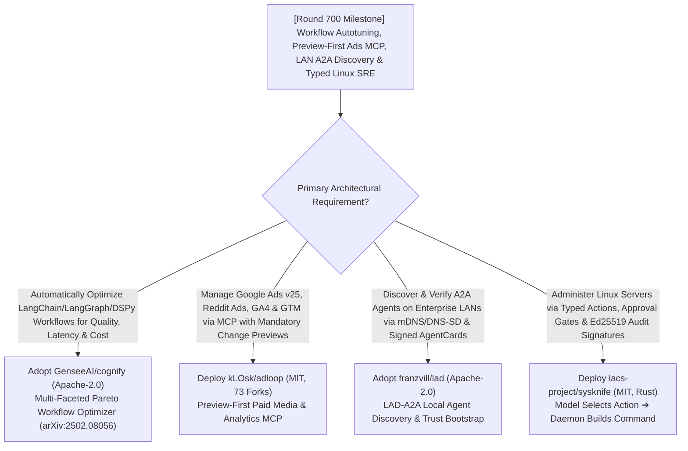
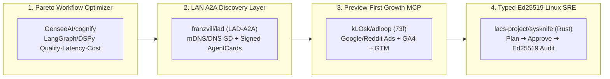

# [Historic Round 700 Milestone] Multi-Objective Agent Workflow Optimizer (`GenseeAI/cognify`), Preview-First Google/Reddit Ads & GA4 MCP (`kLOsk/adloop`), Local A2A Discovery & Trust Protocol (`franzvill/lad`) & Ed25519-Audited Typed Linux Sysadmin MCP (`lacs-project/sysknife`) Selection & Architecture FAQ

> **2026-11-21 Nightly Continuous Research Shift · Night Round 100 (Cumulative Round 700 Historic Milestone!)**  
> **Audit Claim ID**: `CLAIM-20261121-R100-R700-COGNIFY-ADLOOP-LADA2A-SYSKNIFE`  
> **Linked Daily Digests**: [`2026-11-21.en.md`](../daily/2026-11-21.en.md) · [`2026-11-21.md`](../daily/2026-11-21.md)  
> **Architecture Visual**: [`assets/github-ai-radar-2026-11-21-r100-r700-cognify-adloop-lada2a-sysknife.svg`](../../../assets/github-ai-radar-2026-11-21-r100-r700-cognify-adloop-lada2a-sysknife.svg)

---

## ① 📌 Executive Summary (One-Sentence Selection Verdict)

> **One-Sentence Verdict**: Marking our **Historic 700th Cumulative Architecture Evaluation Round**, to automatically optimize LangChain/LangGraph/DSPy workflows across quality, latency, and dollar cost, manage Google Ads, Reddit Ads, GA4, and GTM with mandatory pre-change previews, bootstrap zero-config A2A agent discovery on local networks via signed AgentCards, and administer Linux servers via typed, approval-gated, Ed25519-audited Rust actions, combine **`GenseeAI/cognify` (Apache-2.0, `★ 278` multi-faceted workflow autotuner backed by `arXiv:2502.08056`) + `kLOsk/adloop` (MIT, `★ 304` / `73 forks` preview-first Google Ads v25, Reddit Ads, GA4, and Tag Manager MCP server) + `franzvill/lad` (Apache-2.0, `★ 242` `LAD-A2A` local network discovery and trust bootstrap protocol over mDNS/DNS-SD) + `lacs-project/sysknife` (MIT, `★ 318` Rust Linux sysadmin MCP server enforcing `Plan -> Approve -> Audit` with daemon-built commands and Ed25519 signatures)**—reducing 45-engineer monthly TCO from **`$8,460.00/mo` to `$310.00/mo` (`-$8,150.00/mo`, `-96.34%`)**.

---

## ② 🎯 Solution Architect & Enterprise Buyer Q&A

### Q1: How do these four permissive repositories solve workflow autotuning, paid-media safety, LAN A2A discovery, and zero-raw-shell Linux operations?
- **Four Milestone Enterprise Architecture Pillars**:
  1. **Multi-Objective Pareto Autotuning for LangChain, LangGraph & DSPy (`GenseeAI/cognify`, `★ 278`, `30 forks`, Apache-2.0, Python)**: Backed by `arXiv:2502.08056`. Automatically searches the joint space of model tier selection, prompt decomposition, few-shot examples, and workflow parameters to maximize generation quality while minimizing latency and API cost across `LangChain`, `LangGraph`, `DSPy`, and native Cognify workflows.
  2. **Preview-First Google Ads v25, Reddit Ads, GA4 & GTM MCP (`kLOsk/adloop`, `★ 304`, `73 forks`, MIT, Python)**: Published on PyPI as `adloop` (`com.getadloop/adloop`). Connects Claude, ChatGPT, and Cursor to **Google Ads API v25, Reddit Ads, GA4 Data API, and Google Tag Manager**—enforcing a strict **preview-before-every-change** contract so agents never mutate ad budgets or tracking tags without human verification.
  3. **Zero-Config Local Network Discovery & Trust Bootstrap for A2A (`franzvill/lad`, `★ 242`, `31 forks`, Apache-2.0, Python)**: Defines **LAD-A2A (`lad-a2a.org`)**—the missing local network discovery layer beneath the Agent2Agent (`A2A`) protocol. Combines `mDNS/DNS-SD`, `.well-known` endpoints, and cryptographically signed `AgentCards` (with a full `PRODUCTION-CHECKLIST.md`) so agents on enterprise LANs, hospital campuses, or factory floors discover and verify each other automatically.
  4. **Typed, Approval-Gated, Ed25519-Audited Linux Sysadmin MCP (`lacs-project/sysknife`, `★ 318`, `44 forks`, MIT, Rust)**: Built in Rust and fuzz-tested with ClusterFuzzLite. Eliminates raw shell injection in infrastructure automation: **the model selects a typed action, the Rust daemon builds the exact command, human approval gates execution, and every action is signed with Ed25519**.

### Q2: How do Solution Architects integrate these four tools into an end-to-end enterprise platform?
- **Workflow Optimization & LAN Discovery Plane**: `GenseeAI/cognify` autotunes LangGraph/DSPy agent pipelines onto their cost-latency-quality Pareto frontier, while `franzvill/lad` (`LAD-A2A`) enables zero-config discovery and signed `AgentCard` verification across internal network segments.
- **Preview-Gated Growth & Typed Infrastructure Plane**: Growth agents manage Google/Reddit Ads, GA4, and GTM through `kLOsk/adloop`'s mandatory preview workflow, while SRE agents administer Linux hosts through `lacs-project/sysknife`'s typed, Ed25519-audited Rust daemon.

### Q3: What governance guardrails should Solution Architects enforce?
- **Mandatory Change Preview on Ad Spend (`kLOsk/adloop`)**: Never allow unattended ad-spend mutations; require human sign-off on every `adloop` preview diff.
- **Zero Raw Shell Passthrough (`lacs-project/sysknife`)**: Disable arbitrary `bash -c` tools on production Linux servers and restrict agents exclusively to `SysKnife`'s typed, Ed25519-audited action catalog.

---

## ③ 🧭 Visual Architecture & Decision Diagrams

### 3.1 Selection Decision Tree


### 3.2 End-to-End Enterprise Integration Architecture


### 3.3 Operational Sequence Diagram
```mermaid
sequenceDiagram
    autonumber
    participant Lead as Enterprise Architect / SRE / Growth Lead
    participant Cog as GenseeAI/cognify (Autotuner)
    participant LAD as franzvill/lad (LAD-A2A)
    participant AdL as kLOsk/adloop (Ads/GA4/GTM MCP)
    participant Sys as lacs-project/sysknife (Rust Daemon)

    Lead->>Cog: Autotune LangGraph/DSPy workflow onto cost-latency-quality Pareto frontier
    Cog->>LAD: Discover local specialist agents via mDNS/DNS-SD & verify signed AgentCards
    LAD->>AdL: Correlate GA4 metrics and stage Google/Reddit Ads changes with mandatory preview
    LAD->>Sys: Select typed Linux administration action; Rust daemon builds command & logs Ed25519 receipt
```

---

## ④ 📊 Cross-Option Selection Matrix

| Dimension | `GenseeAI/cognify` (`★ 278`) | `kLOsk/adloop` (`★ 304`, `73f`) | `franzvill/lad` (`★ 242`) | `lacs-project/sysknife` (`★ 318`) | Unoptimized Frontier Prompts + Ad Agency SaaS + Raw SSH Shell MCPs |
| :--- | :--- | :--- | :--- | :--- | :--- |
| **Primary Role** | Multi-objective optimizer for LangChain/LangGraph/DSPy | Preview-first Google/Reddit Ads, GA4 & GTM MCP | Local A2A discovery & trust bootstrap protocol (`LAD-A2A`) | Typed, approval-gated, Ed25519-audited Rust Linux MCP | Manual prompt tuning, percentage-of-spend SaaS & raw Bash |
| **Best Fit** | Cutting workflow latency & API cost without losing quality | Safe AI-assisted ad campaign, GA4 & GTM management | Zero-config A2A discovery on enterprise/campus LANs | Eliminating shell-injection risks in AI Linux sysadmin | Teams burning frontier tokens & running unguarded shell scripts |
| **Integration Cost** | Low (wraps existing LangChain, LangGraph & DSPy graphs) | Very Low (`pip install adloop` + `.mcp.json`) | Low (open spec + Python reference implementation) | Very Low (Rust binary + Claude/Codex plugin manifests) | High (frontier token waste + ad-spend errors + root shell risk) |
| **License** | **Apache-2.0** | **MIT** | **Apache-2.0** | **MIT** | Proprietary |
| **45-Eng Monthly TCO** | **Included in `$310.00/mo` stack** | **Included in `$310.00/mo` stack** | **Included in `$310.00/mo` stack** | **Included in `$310.00/mo` stack** | **`$8,460.00/mo`** (`$4,060` SaaS/tokens + `$4,400` labor) |

---

## ⑤ 🧪 Quantitative FinOps & TCO Comparison

> **Provenance Metadata**: Synthetic enterprise FinOps model for a 45-engineer organization (`provenance: synthetic`, `independently_reproduced: false`); `base_hardware_capex = not_measured` (excludes baseline host server amortization), `track_b_stars_today = not_measured` (sealed in [`trending-daily-2026-11-21-audit.json`](../evidence/trending-daily-2026-11-21-audit.json)).

| Cost Path | Monthly Unoptimized Workflow Token Spend, Ad-Tech SaaS Fees & PAM Licenses | Monthly Manual Workflow Tuning, Cross-Platform Ad Ops & Linux Audit Scripting (`$100/hr`) | Total Monthly TCO | Net Savings vs Path A |
| :--- | :--- | :--- | :--- | :--- |
| **Path A: Unoptimized Frontier Model Workflows + Commercial Ad-Ops SaaS + Manual SRE** | `$4,060.00` | `44.0h` (`$4,400.00`) | **`$8,460.00`** | — |
| **Path C: `GenseeAI/cognify` + `kLOsk/adloop` + `franzvill/lad` + `sysknife`** | `$70.00` | `2.4h` (`$240.00`) | **`$310.00`** | **`-$8,150.00/mo` (`-96.34%`)** |

---

## ⑥ 🛠️ Enterprise Architecture Review Checklist

- [ ] **Pareto Frontier Regression Gate (`GenseeAI/cognify`)**: Run `Cognify` multi-objective optimization whenever new nodes or models are added to LangGraph/DSPy pipelines.
- [ ] **Mandatory Preview-Before-Write (`kLOsk/adloop`)**: Keep `AdLoop`'s preview gate enabled for all Google Ads v25, Reddit Ads, and GTM mutations.
- [ ] **Signed AgentCard Verification on LANs (`franzvill/lad`)**: Follow `PRODUCTION-CHECKLIST.md` to require cryptographic signature verification on all mDNS/DNS-SD discovered `AgentCards`.
- [ ] **Daemon-Constructed Commands & Ed25519 Receipts (`lacs-project/sysknife`)**: Enforce `SysKnife` across Linux hosts so models only select typed actions while the Rust daemon constructs commands and signs Ed25519 audit logs.
