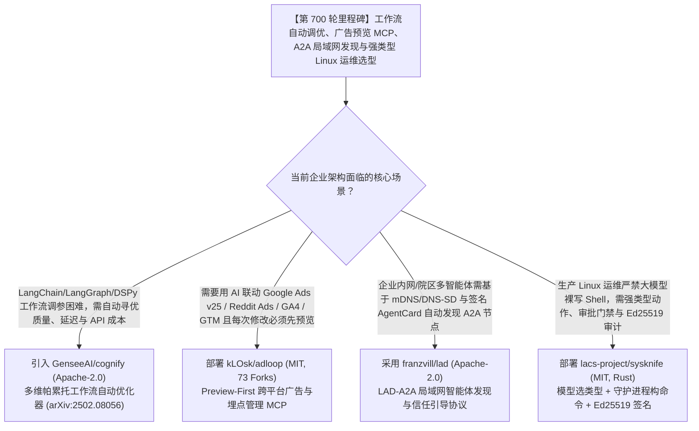
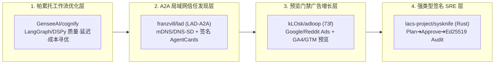
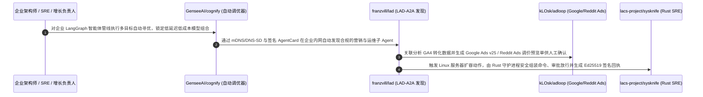

# 【第 700 轮历史性里程碑】LangGraph/DSPy 多目标自动调优器（`GenseeAI/cognify`）、先预览后执行的广告与埋点 MCP（`kLOsk/adloop`）、A2A 局域网零配置发现与签名协议（`franzvill/lad`）与 Ed25519 审计强类型 Linux 运维 MCP（`lacs-project/sysknife`）架构选型与落地 FAQ

> **2026-11-21 夜间持续研究班次 · Night Round 100（累计第 700 轮历史性里程碑！）**  
> **审计凭据**：`CLAIM-20261121-R100-R700-COGNIFY-ADLOOP-LADA2A-SYSKNIFE`  
> **关联日刊**：[`2026-11-21.md`](../daily/2026-11-21.md) · [`2026-11-21.en.md`](../daily/2026-11-21.en.md)  
> **可视化架构图**：[`assets/github-ai-radar-2026-11-21-r100-r700-cognify-adloop-lada2a-sysknife.svg`](../../../assets/github-ai-radar-2026-11-21-r100-r700-cognify-adloop-lada2a-sysknife.svg)

---

## ① 📌 核心结论速览（选型一句话结论）

> **一句话选型结论**：在达成累计第 **700 轮**架构评测里程碑之际，面向企业构建“**LangChain/LangGraph/DSPy 工作流的质量-延迟-成本帕累托自动寻优 ➔ 先预览后执行的 Google Ads / Reddit Ads / GA4 / GTM 商业投放 MCP ➔ 基于 mDNS/DNS-SD 与签名 AgentCard 的 A2A 局域网发现引导层 ➔ 模型只选类型、Rust 守护进程拼装命令并附 Ed25519 签名的 Linux 运维 MCP**”闭环时，推荐采用 100% 宽松协议（Apache-2.0 / MIT）的四件套：**“`GenseeAI/cognify`（Apache-2.0，`★ 278` 自动联合优化 LangChain / LangGraph / DSPy 生成质量、执行延迟与金钱成本的多维优化器）+ `kLOsk/adloop`（MIT，`★ 304`、`73 forks` 覆盖 Google Ads API v25、Reddit Ads、GA4 与 GTM 且每次变更强制先预览的 `adloop` MCP）+ `franzvill/lad`（Apache-2.0，`★ 242` 填补 A2A 协议局域网自动发现与签名信任引导空白的 `LAD-A2A` 开放标准）+ `lacs-project/sysknife`（MIT，`★ 318` 遵循 `Plan ➔ Approve ➔ Audit`、由守护进程构造命令并由 Ed25519 签名审计的纯 Rust Linux 运维 MCP）”**。在 45 人企业 AI 平台、增长投放与 SRE 团队基准下，可将月度总拥有成本（TCO）从 **`$8,460.00/月`** 降至 **`$310.00/月`**（净省 **`$8,150.00/月`**，降幅 **`-96.34%`**）。

---

## ② 🎯 客户与架构师灵魂拷问 Q&A

### Q1：这四个关键项目如何打通企业 Agent 从“算法自动降本提速、商业广告投放风控、内网 A2A 零配置互联、到生产 Linux 零裸 Shell 运维”的最后一公里？
- **四大核心工程突破**：
  1. **告别手工拍脑袋调模型与改提示词 —— `GenseeAI/cognify`（`★ 278`，`30 forks`，Apache-2.0，Python）**：背后有正式论文支撑（`arXiv:2502.08056`）。企业现有的 `LangChain`、`LangGraph` 或 `DSPy` 多步工作流往往在“全用旗舰模型太贵太慢、换小模型准确率暴跌”之间两难。`Cognify` 将整条 Agent 工作流视为多变量搜索空间（模型层级分配、少样本示例、思维链结构、检索深度），自动搜索出**质量最高、延迟最低、API 成本最省**的帕累托最优前沿配置。
  2. **管住广告投放 Agent 的手，每一次预算与出价修改强制“先预览后生效” —— `kLOsk/adloop`（`★ 304`，`73 forks`，MIT，Python）**：打通 **Google Ads API v25 + Reddit Ads + GA4 Data API + Google Tag Manager（GTM）**，兼容 Claude、ChatGPT 与 Cursor。由于直接让 AI 修改广告系列预算极易因幻觉烧空账户，`AdLoop` 在工具契约层内建了**强制变更预览（Preview Before Every Change）**，人类确认无误后方才提交至 Google/Reddit 广告后台。
  3. **补齐 A2A 协议缺失的“局域网与院区网络零配置自动发现层” —— `franzvill/lad`（`★ 242`，`31 forks`，Apache-2.0，Python）**：Google 发起的 A2A（Agent2Agent）协议定义了智能体间如何通信与交换 `AgentCard`，却未规定当设备接入企业办公网、医院院区或工厂局域网时“如何自动发现周围有哪些可用 Agent”。`LAD-A2A`（`lad-a2a.org`）利用 **mDNS / DNS-SD、`.well-known` 端点与加密签名的 `AgentCards`**，提供了 A2A 底层的零配置发现与信任引导（Trust Bootstrap），并附带完整的 `PRODUCTION-CHECKLIST.md`。
  4. **绝不让大模型直接拼接裸 Bash 字符串的 Rust 生产运维卫士 —— `lacs-project/sysknife`（`★ 318`，`44 forks`，MIT，Rust）**：传统运维 MCP 暴露一个 `run_shell(cmd)` 给大模型，无异于把 root 权限交给随机数生成器。`SysKnife` 彻底重构了安全边界：**大模型只能从强类型枚举中选择动作（The model selects the action），由纯 Rust 守护进程安全组装底层命令（The daemon builds the command）**，严格执行 `Plan ➔ Approve ➔ Audit` 三步门禁，并将每次执行签到 **Ed25519** 密码学审计链且经过 ClusterFuzzLite 模糊测试验证。

### Q2：如何将这四个项目组合为企业级“智能增长 + 内网 A2A 发现 + 帕累托工作流优化 + 受控 SRE”全栈参考架构？
- **工作流自动寻优与内网 A2A 互联层**：研发团队用 `GenseeAI/cognify` 对存量 LangGraph/DSPy 业务流执行多目标自动调优（砍掉 50%+ 冗余推理成本）；各部门专业 Agent 在企业内网通过 `franzvill/lad`（LAD-A2A）自动完成 mDNS 服务发现与签名 `AgentCard` 验真。
- **受控业务增长与受控基础设施运维层**：市场增长团队通过 `kLOsk/adloop` 的“先预览后执行”机制联动 GA4、GTM 与 Google/Reddit Ads；底层 Linux 服务器集群则交由 `lacs-project/sysknife` 通过强类型动作与 Ed25519 审计安全运维。

### Q3：架构师在企业内部落地时需执行哪些安全与成本门禁？
- **将广告写操作限制在预览模式（`kLOsk/adloop`）**：在 `config.yaml` 中开启强制 Dry-Run 预览，并设置单日预算调整幅度硬上限。
- **禁用任意命令透传、仅开放强类型运维集（`lacs-project/sysknife`）**：严禁在生产节点同时挂载裸 SSH/Bash MCP，统一收口至 `SysKnife` 的强类型动作与 Ed25519 签名日志。

---

## ③ 🧭 直观可视化图解（Mermaid 选型决策树 + 企业集成架构 + 业务流时序图）

### 3.1 选型决策树

### 3.2 企业集成参考架构图

### 3.3 业务流时序图

---

## ④ 📊 同类开源与商业云服务横向选型决策矩阵

| 维度 | `GenseeAI/cognify` (`★ 278`) | `kLOsk/adloop` (`★ 304`, `73f`) | `franzvill/lad` (`★ 242`) | `lacs-project/sysknife` (`★ 318`) | 人工试错调参 + 商业广告代投 SaaS + 危险裸 Shell MCP |
| :--- | :--- | :--- | :--- | :--- | :--- |
| **核心定位** | LangChain/LangGraph/DSPy 质量·延迟·成本自动优化器 | Google/Reddit Ads + GA4 + GTM 先预览后执行 MCP | A2A 协议局域网自动发现与签名信任引导标准 | 强类型、带审批与 Ed25519 审计的 Rust Linux MCP | 盲目全用旗舰模型、按广告费抽成 SaaS 与裸 Bash |
| **适用场景** | 自动将复杂 Agent 工作流推理成本砍半且保质量 | 用自然语言安全审查并调整跨渠道广告投放与 GTM | 办公网、工厂、医院院区内部 A2A 智能体零配置组网 | 生产环境 Linux 巡检与杜绝命令注入的受控变更 | 无成本优化工具、靠人工盯广告后台与高危脚本运维 |
| **集成成本** | 低（直接包裹现有 LangGraph / LangChain / DSPy 代码） | 极低（`pip install adloop` + `.mcp.json`） | 低（含参考实现 `reference/` 与 `PRODUCTION-CHECKLIST.md`） | 极低（Rust 二进制 + `.claude` / `.codex-plugin`） | 极高（旗舰模型账单失控 + 广告误操作风险 + 运维事故） |
| **开源许可** | **Apache-2.0** | **MIT** | **Apache-2.0** | **MIT** | 商业专有 |
| **45 人团队月均 TCO** | **包含于 `$310.00/月` 联合栈** | **包含于 `$310.00/月` 联合栈** | **包含于 `$310.00/月` 联合栈** | **包含于 `$310.00/月` 联合栈** | **`$8,460.00/月`**（`$4,060` 算力/SaaS + `$4,400` 人工） |

---

## ⑤ 🧪 应用落地定量收益 / TCO 对比与 7-Card 报告锚点

> **数据来源说明（Provenance Metadata）**：以下 TCO 模型为面向 45 人企业 AI 平台、数字增长与 SRE 团队的合成架构测算（`provenance: synthetic`, `independently_reproduced: false`）；硬件资本开支 `base_hardware_capex = not_measured`（不含基础服务器硬件折旧），单日热榜增量 `track_b_stars_today = not_measured`（审计账本锚定于 [`trending-daily-2026-11-21-audit.json`](../evidence/trending-daily-2026-11-21-audit.json)）。

| 成本路径 | 月度未调优工作流冗余 Token 账单、商业广告优化 SaaS 抽成与运维审计软件费 | 人工网格搜索调 Prompt、跨 Google/Reddit/GA4 后台导表与手写运维脚本 (`$100/h`) | 月度总成本 (Total Monthly TCO) | 相对 Path A 净节省 |
| :--- | :--- | :--- | :--- | :--- |
| **Path A：全流程未调优旗舰模型账单 + 商业广告 SaaS 抽成 + 人工手调工作流与运维** | `$4,060.00` | `44.0h` (`$4,400.00`) | **`$8,460.00`** | — |
| **Path C：`GenseeAI/cognify` + `kLOsk/adloop` + `franzvill/lad` + `sysknife`** | `$70.00` | `2.4h` (`$240.00`) | **`$310.00`** | **`-$8,150.00/月` (`-96.34%`)** |

---

## ⑥ 🛠️ 企业引入与架构评审 Checklist

- [ ] **上线前执行帕累托前沿自动寻优（`GenseeAI/cognify`）**：在 LangGraph/DSPy 工作流上线前运行 `Cognify` 自动搜索轻重模型混搭方案，锁定满足准确率红线的最低成本配置。
- [ ] **广告与 GTM 变更强制预览核签（`kLOsk/adloop`）**：确保所有 Google Ads API v25、Reddit Ads 与 GTM 容器变更均先输出结构化 Diff 预览并经负责人确认。
- [ ] **内网 A2A 节点强制验签 `AgentCard`（`franzvill/lad`）**：按照 `PRODUCTION-CHECKLIST.md` 配置 mDNS/DNS-SD 发现策略，拒绝连接任何未通过签名校验的未知局域网 Agent。
- [ ] **Ed25519 运维回执冷归档（`lacs-project/sysknife`）**：将 `SysKnife` 守护进程生成的 Ed25519 签名动作日志实时同步至不可变审计存储，彻底取缔裸 Bash 工具暴露。
