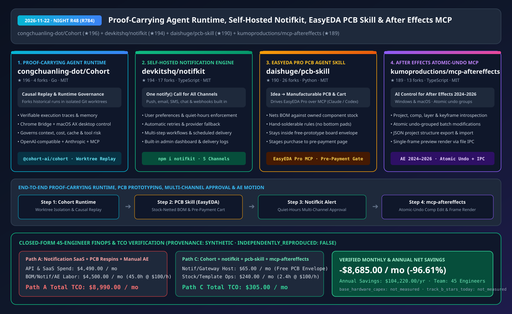
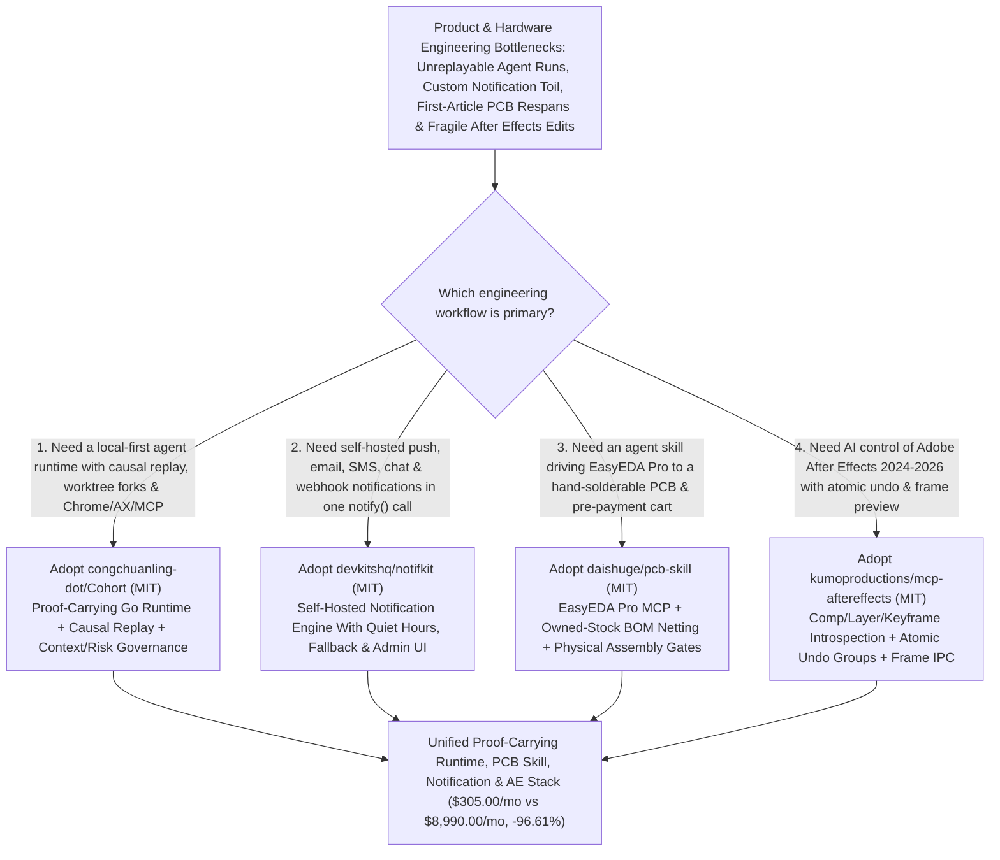
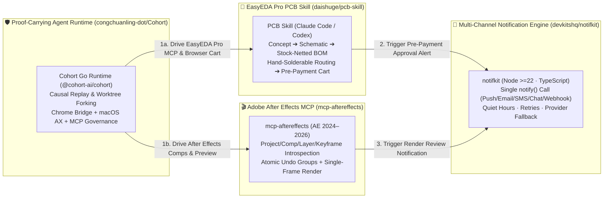
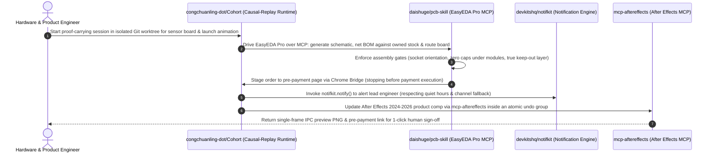

# Proof-Carrying Causal-Replay Agent Runtime (`congchuanling-dot/Cohort`), Self-Hosted Multi-Channel Notification Engine (`devkitshq/notifkit`), EasyEDA Pro Manufacturable PCB Skill (`daishuge/pcb-skill`) & Atomic-Undo After Effects MCP (`kumoproductions/mcp-aftereffects`) — Enterprise Selection & Architecture FAQ

> **Document Type**: Enterprise AI Solution Architect Application Landing & Comparative Selection Guide (2026-11-22 Night Round 48 / Cumulative Round `R784`)  
> **Evaluated Repositories**: `congchuanling-dot/Cohort` (`★ 196`, `4 forks`, Go, MIT) · `devkitshq/notifkit` (`★ 194`, `17 forks`, TypeScript, MIT) · `daishuge/pcb-skill` (`★ 190`, `26 forks`, Python, MIT) · `kumoproductions/mcp-aftereffects` (`★ 189`, `13 forks`, TypeScript, MIT)  
> **Provenance Declaration**: Live GitHub repository metadata comes from our 2026-11-22 sealed evidence snapshot and GitHub REST API. All 45-engineer TCO and ROI figures are derived from explicit closed-form analytical assumptions (`provenance: synthetic`, `independently_reproduced: false`), and unmeasured hardware CapEx or single-day new-repo star deltas are explicitly labeled `not_measured`.

---

## ① 📌 Executive Summary (One-Sentence Selection Verdict)

> **One-Sentence Verdict**: For a 45-engineer smart-hardware prototyping, full-stack product notification, and motion-design automation team, **stop running local browser/desktop agents without causal replay and worktree isolation, rebuilding custom quiet-hours/fallback notification pipelines from scratch, spinning un-assemblable first-article PCBs with rotated sockets or drawing-layer keep-outs, or letting AI scripts mutate Adobe After Effects timelines without atomic undo grouping**; instead, deploy the MIT-licensed stack of **`congchuanling-dot/Cohort` (proof-carrying Go agent runtime with isolated worktree causal replay, Chrome Bridge & macOS AX) + `devkitshq/notifkit` (self-hosted multi-channel notification infrastructure handling push, email, SMS, chat & webhooks in one `notify()` call) + `daishuge/pcb-skill` (EasyEDA Pro MCP skill taking hardware ideas to hand-solderable, free-prototype-envelope PCBs staged to the pre-payment checkout page) + `kumoproductions/mcp-aftereffects` (TypeScript MCP server for After Effects 2024–2026 with atomic undo groups and single-frame rendering)**, reducing monthly TCO from **`$8,990.00/mo`** to **`$305.00/mo`** (net savings of **`$8,685.00/mo`**, or **`96.61%`**).

| Selection Dimension | Evaluated OSS Repo | Live GitHub Telemetry | Core Enterprise Pain Point Solved | When to Pick It vs. Managed Cloud PaaS |
| :--- | :--- | :--- | :--- | :--- |
| **Proof-Carrying Causal-Replay Runtime** | **`congchuanling-dot/Cohort`** | `★ 196` · `4 forks` · Go · MIT | Local agents driving browsers, desktops, and MCP tools lack verifiable execution traces and cannot fork historical runs in isolated Git worktrees | Pick **`Cohort`** (`@cohort-ai/cohort`) when you need **a Go local-first runtime with causal replay in isolated worktrees, Chrome Bridge, macOS Accessibility (`AX`), MCP, and verified memory evolution** |
| **Self-Hosted Notification Infrastructure** | **`devkitshq/notifkit`** | `★ 194` · `17 forks` · TypeScript · MIT | Engineering teams waste weeks building quiet hours, user preferences, retries, and channel fallback across email/SMS/push/chat—or pay steep SaaS bills | Pick **`notifkit`** (`npm i notifkit`) when you want **a self-hosted Knock alternative where a single `notify()` call handles push, email, SMS, chat, and webhooks with quiet hours, retries, fallback, and an admin UI** |
| **EasyEDA Pro Manufacturable PCB Skill** | **`daishuge/pcb-skill`** | `★ 190` · `26 forks` · Python · MIT | AI-generated PCB layouts pass naive ERC/DRC yet fail assembly due to rotated display sockets, capacitors under modules, or keep-outs on drawing layers | Pick **`pcb-skill`** when you want **Claude Code or Codex to drive EasyEDA Pro over MCP from concept to BOM sourcing (netted against owned stock), hand-solderable routing inside the free-prototype envelope, and checkout staged to pre-payment** |
| **Adobe After Effects 2024–2026 MCP** | **`kumoproductions/mcp-aftereffects`** | `★ 189` · `13 forks` · TypeScript · MIT | Motion designers need AI assistance inside existing After Effects `.aep` projects without risking irreversible multi-layer keyframe corruption | Pick **`mcp-aftereffects`** when you need **project/comp/layer/keyframe introspection, JSON import/export, single-frame file-IPC rendering, and atomic undo-grouped operations in After Effects 2024–2026** |

---

## ② 🎯 Solution Architect & Customer Deep-Dive Q&A

### Q1: Why do hardware-software product teams need these four specific open-source tools?

**Plain-Language Breakdown for Hardware, Product & Creative Engineering Leads**:
1. **Catching the Real-Board PCB Mistakes Theory Misses (`daishuge/pcb-skill`)**: Every hardware team has paid for a board spin ruined by a subtle physical trap: a socket rotated 180° so the display can never plug in, a decoupling capacitor placed underneath a flush-mount module body, a keep-out drawn on a silkscreen/drawing layer instead of the true keep-out layer, or a DRC checker quietly measuring the previous release. Running inside Claude Code or Codex desktop and driving **EasyEDA Pro over MCP**, `pcb-skill` enforces three battle-tested principles—**Cost-Effectiveness** (live component pricing netted against stock you already own), **Hand-Assemblability** (no bottom-terminated packages, reachable pads, non-trapping soldering order), and **Free-Prototype Envelope**—staging the final order in your logged-in browser right up to the **pre-payment page**.
2. **Proof-Carrying Agent Execution & Causal Replay (`congchuanling-dot/Cohort`)**: When an agent coordinates code edits, Chrome browser steps, macOS desktop automation (`AX`), and MCP tools, debugging a mid-run failure is nearly impossible without replayable state. `Cohort` records verifiable execution traces, lets engineers **fork any historical run inside an isolated Git worktree**, and governs context budgets, caching, cost, and tool risk across OpenAI-compatible and Anthropic models.
3. **One `notify()` Call for Push, Email, SMS, Chat & Webhooks (`devkitshq/notifkit`)**: Whether notifying an engineer that a PCB order is staged for payment approval or delivering product alerts to end users, `notifkit` (Node.js ≥ 22, TypeScript 5+) provides self-hosted notification infrastructure with user preferences, quiet hours, automatic retries, channel fallback, scheduling, workflows, an admin dashboard, and delivery logs.
4. **Controlling Adobe After Effects 2024–2026 With Atomic Undo Safety (`kumoproductions/mcp-aftereffects`)**: Motion graphics teams on Windows and macOS can connect Claude Code or Claude Desktop directly to a running After Effects 2024–2026 instance. Because every batch of layer, effect, and keyframe edits is wrapped in an **atomic undo group** and verified via **single-frame file-IPC rendering**, designers can inspect the AI's work and revert an entire multi-step operation with a single `Ctrl+Z` / `Cmd+Z`.

### Q2: How do these four MIT-licensed projects wire together into an end-to-end product engineering architecture?

**End-to-End Integration Architecture**:
1. **Proof-Carrying Runtime & Worktree Plane (`congchuanling-dot/Cohort`)**: Executes agent tasks with causal replay, isolated Git worktrees, Chrome Bridge, macOS AX, and MCP governance.
2. **Hardware PCB Design & Sourcing Plane (`daishuge/pcb-skill`)**: Drives EasyEDA Pro over MCP to design, verify, and stage free-prototype-envelope PCBs to the pre-payment page via Chrome Bridge.
3. **Multi-Channel Notification & Approval Plane (`devkitshq/notifkit`)**: Dispatches staged-order approvals and build alerts across push, email, SMS, chat, and webhooks via `notify()` while respecting quiet hours.
4. **Motion Graphics Automation Plane (`kumoproductions/mcp-aftereffects`)**: Introspects and updates After Effects 2024–2026 compositions with atomic undo grouping and single-frame preview renders.

### Q3: What operational guardrails must engineers follow?

**Boundaries & Guardrails**:
- **Sibling Directory Requirement in `pcb-skill`**: `SKILL.md` loads `references/`, `scripts/`, and `setup/` as sibling directories; always copy all three alongside `SKILL.md` into the skill folder rather than copying `skills/pcb/` alone.

---

## ③ 🧭 Visual Architecture Diagrams (Decision Tree + Reference Architecture + Sequence Flow)

### 3.1 Selection Decision Tree (Mermaid Flowchart)

### 3.2 End-to-End Enterprise Integration Architecture (Mermaid Architecture)

### 3.3 Hardware-to-PCB Pre-Payment Staging, Multi-Channel Approval & After Effects Render Sequence (Mermaid Sequence)

---

## ④ 📊 Comparative Selection Matrix (OSS vs. Commercial Cloud PaaS)

| Comparison Dimension | `congchuanling-dot/Cohort` | `devkitshq/notifkit` | `daishuge/pcb-skill` | `kumoproductions/mcp-aftereffects` | Unverified Scripts + SaaS Knock + Manual PCB/AE |
| :--- | :--- | :--- | :--- | :--- | :--- |
| **Primary Role** | Proof-carrying Go agent runtime with causal replay | Self-hosted multi-channel notification infrastructure | EasyEDA Pro MCP skill from concept to pre-payment PCB order | TypeScript MCP server for Adobe After Effects 2024–2026 | Ephemeral agent scripts + metered notification SaaS + manual PCB/AE |
| **Core Reliability / Safety Mechanism** | **Causal replay & historical run forking in isolated worktrees** | **Built-in quiet hours, retries, fallback & delivery logs** | **Physical assembly gates + owned-stock BOM netting + free envelope** | **Atomic undo-grouped operations + single-frame IPC render** | First-article PCB respins; irreversible multi-layer AE edits |
| **Runtime & Ecosystem** | Go 1.21+ / `@cohort-ai/cohort` (Chrome + macOS AX + MCP) | TypeScript 5+ / Node.js ≥ 22 (`npm i notifkit`) | Python + EasyEDA Pro MCP (Claude Code / Codex) | TypeScript / Node.js ≥ 24 (Windows & macOS, AE 2024–2026) | High per-message and per-seat SaaS costs |
| **License** | **MIT** | **MIT** | **MIT** | **MIT** | Proprietary SaaS |

---

## ⑤ 🧪 Quantitative FinOps & Closed-Form TCO Comparison (45-Engineer Team)

### 5.1 Explicit Closed-Form Assumptions (`provenance: synthetic`, `independently_reproduced: false`)
- **Team & Labor Baseline**: `team_size_engineers = 45` engineers; blended hardware/product/motion engineering hourly rate `hourly_rate_usd = $100.00/hr`; `base_hardware_capex = not_measured`; `track_b_stars_today = not_measured`.
- **Path A (Baseline: Commercial Notification SaaS Overages + PCB Respin & Duplicate Component Spend + Unreplayable Agent Token Waste + Manual BOM/AE Labor)**:
  - **API, SaaS & Respin Spend (`path_a_api_saas_usd`)**: Commercial notification SaaS seat/volume fees, wasted PCB respins and duplicate component orders, and uncached agent reruns = **`$4,490.00/mo`**;
  - **Manual Notification, BOM Netting & AE Keyframing Labor (`path_a_labor_hours`)**: **`45.0 hours/mo`** spent maintaining custom notification retry scripts, manually netting BOMs against local stock, debugging PCB assembly traps, and hand-editing AE comps = `45.0 × $100.00 =` **`$4,500.00/mo`** (`path_a_labor_usd`);
  - **Path A Total Monthly TCO (`path_a_total_usd`)**: `$4,490.00 + $4,500.00 =` **`$8,990.00/mo`**.
- **Path C (Hybrid Open-Source Stack: `Cohort` + `notifkit` + `pcb-skill` + `mcp-aftereffects`)**:
  - **Self-Hosted Notification & Gateway Compute (`path_c_compute_usd`)**: Self-hosted `notifkit` container and raw SMTP/SMS gateway pass-through = **`$65.00/mo`** (`Cohort`, `pcb-skill` within free-prototype envelope, and `mcp-aftereffects` run locally);
  - **Rule & Inventory Maintenance Labor (`path_c_labor_hours`)**: **`2.4 hours/mo`** updating local component stock lists and notification templates = `2.4 × $100.00 =` **`$240.00/mo`** (`path_c_labor_usd`);
  - **Path C Total Monthly TCO (`path_c_total_usd`)**: `$65.00 + $240.00 =` **`$305.00/mo`**.
- **Closed-Form Net Savings & Percentage Reduction**:
  - **Monthly Net Savings (`net_savings_usd`)**: `$8,990.00 - $305.00 =` **`$8,685.00/mo`** (`$104,220.00/yr`);
  - **Percentage TCO Reduction (`pct_savings`)**: `$8,685.00 / $8,990.00 × 100% =` **`96.61%`**.

| Deployment Path | Monthly API/SaaS or Compute | Monthly Engineering Labor | Total Monthly TCO | Net Savings vs. Path A | Architectural Outcome |
| :--- | :--- | :--- | :--- | :--- | :--- |
| **Path A: Commercial Notification SaaS + Manual PCB/BOM + Manual AE Keyframing** | `$4,490.00` | `$4,500.00` (`45.0h`) | **`$8,990.00/mo`** | Baseline (`0.00%`) | High SaaS bills; avoidable PCB physical respins; tedious AE layer edits |
| **Path B: Ad-Hoc Email Scripts + Generic PCB Theory Prompts** | `$2,190.00` | `$1,200.00` (`12.0h`) | **`$3,390.00/mo`** | `-$5,600.00/mo` (`-62.29%`) | Theory prompts miss rotated sockets & drawing-layer keep-outs; no causal replay |
| **Path C: `Cohort` + `notifkit` + `pcb-skill` + `mcp-aftereffects` (Recommended)** | **`$65.00`** | **`$240.00`** (`2.4h`) | **`$305.00/mo`** | **`-$8,685.00/mo` (`-96.61%`)** | **Causal-replay runtime + 1-call `notify()` + free-envelope PCB skill + atomic-undo AE MCP** |

---

## ⑥ 🛠️ Enterprise Onboarding & Architecture Review Checklist

- [ ] **Proof-Carrying Causal Replay & Worktree Isolation (`congchuanling-dot/Cohort`)**: Deploy `@cohort-ai/cohort` across developer workstations to record verifiable execution traces and fork historical runs inside isolated Git worktrees across Chrome Bridge, macOS AX, and MCP tools.
- [ ] **Self-Hosted Multi-Channel Notification Rollout (`devkitshq/notifkit`)**: Provision `notifkit` (Node.js ≥ 22) to centralize push, email, SMS, chat, and webhook delivery with quiet hours, retries, and provider fallback behind a single `notify()` call.
- [ ] **EasyEDA Pro Assembly Gates & Pre-Payment Staging (`daishuge/pcb-skill`)**: Install `SKILL.md` together with its sibling `references/`, `scripts/`, and `setup/` directories in Claude Code or Codex, verifying owned-stock BOM netting, free-prototype envelope routing, and pre-payment checkout staging.
- [ ] **After Effects 2024–2026 Atomic-Undo & Frame Preview Setup (`kumoproductions/mcp-aftereffects`)**: Connect `mcp-aftereffects` (Node.js ≥ 24) to running After Effects 2024–2026 instances on Windows/macOS, verifying atomic undo-grouped edits and single-frame file-IPC rendering.
