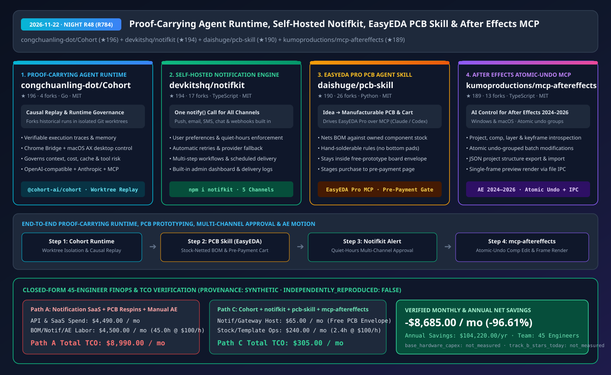
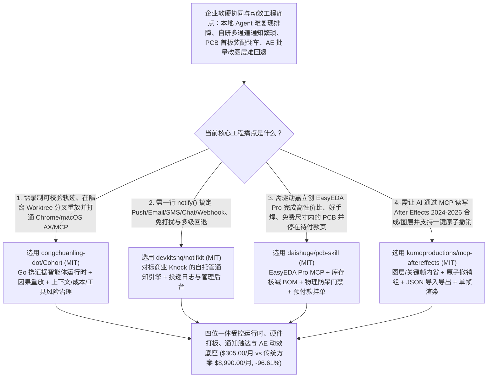
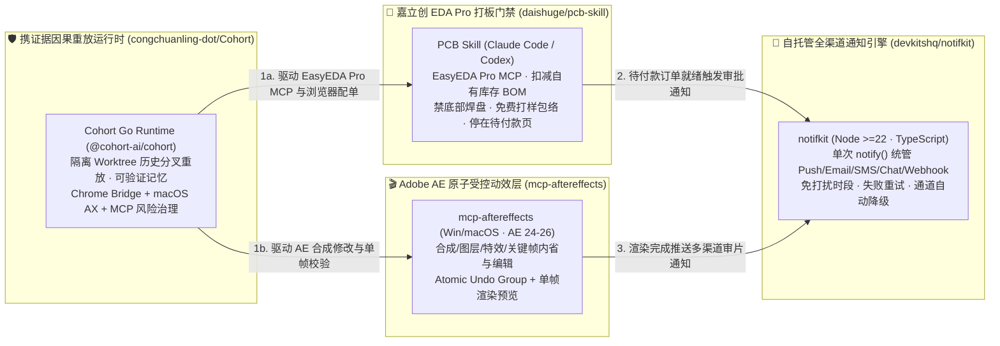
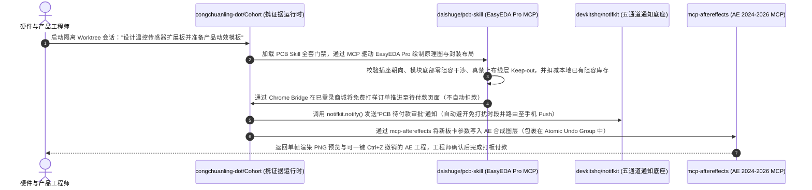

# 携带证据与因果重放的本地智能体运行时（`congchuanling-dot/Cohort`）、单函数五通道自托管通知底座（`devkitshq/notifkit`）、驱动嘉立创 EDA Pro 直达待付款页的硬件打板 Skill（`daishuge/pcb-skill`）与带原子级撤销组的 After Effects 2024–2026 MCP（`kumoproductions/mcp-aftereffects`）企业选型与集成架构 FAQ

> **文档类型**：AI 解决方案架构师（AI Solution Architect）企业应用落地与横向选型指南（2026-11-22 Night Round 48 / 累计第 784 轮 `R784`）  
> **评测锚点**：`congchuanling-dot/Cohort` (`★ 196`, `4 forks`, Go, MIT) · `devkitshq/notifkit` (`★ 194`, `17 forks`, TypeScript, MIT) · `daishuge/pcb-skill` (`★ 190`, `26 forks`, Python, MIT) · `kumoproductions/mcp-aftereffects` (`★ 189`, `13 forks`, TypeScript, MIT)  
> **Provenance 声明**：本文实时 GitHub 元数据采自 2026-11-22 封存快照与 GitHub REST API；45 人智能硬件研发、产品工程与视觉动效团队的 TCO 与 ROI 测算均为显式闭式假设推导（`provenance: synthetic`, `independently_reproduced: false`），所有未实测硬件资本开支与新仓单日增量统一标注为 `not_measured`。

---

## ① 📌 核心结论速览（选型一句话结论）

> **一句话选型结论**：在 45 人规模的智能硬件敏捷打板、产品全渠道消息触达与 Adobe 商业动效自动化团队中，**切勿让操控浏览器与桌面的智能体在无因果重放与 Worktree 隔离的情况下盲跑、为简单的邮件/短信/Push 降级重试支付高昂的商业 Knock/Novu 账单、因 AI 画 PCB 漏看模块下方电容或丝印层 Keep-out 导致首板报废，或让智能体在没有原子撤销组（Atomic Undo Group）保护下直接改崩设计师的 After Effects 工程**；应当采用 **“Cohort（支持隔离 Worktree 分叉重放、Chrome Bridge 与 macOS AX 的携证据 Go 运行时）+ notifkit（单次 `notify()` 搞定 Push/邮件/SMS/Chat/Webhook 免打扰与多级回退的自托管底座）+ pcb-skill（通过 MCP 驱动嘉立创 EasyEDA Pro 完成原理图、核减库存 BOM、免费打样框内布线并停在待付款页的实战门禁 Skill）+ mcp-aftereffects（支持合成/图层/关键帧内省、单帧渲染与原子撤销组的 AE 2024–2026 MCP）”**，将月度综合 TCO 从 **`$8,990.00/月`** 压降至 **`$305.00/月`**（净省 **`$8,685.00/月`**，降幅 **`96.61%`**）。

| 选型维度 | 评测开源方案 | GitHub 实测指标 | 核心解决的企业业务痛点 | 一句话何时选它 vs 云端商业 PaaS |
| :--- | :--- | :--- | :--- | :--- |
| **携证据与因果重放智能体运行时** | **`congchuanling-dot/Cohort`** | `★ 196` · `4 forks` · Go · MIT | 本地智能体操控 Chrome 与桌面应用出错后无法在当时的文件状态上分叉重放，且缺乏对上下文、缓存与工具风险的统一运行时治理 | 需要 **Go 编写的 Proof-Carrying Agent Runtime，录制可校验执行轨迹、在隔离 Worktree 中分叉历史运行并打通 Chrome Bridge / macOS AX / MCP** 时首选 `Cohort` |
| **单函数五通道自托管通知底座** | **`devkitshq/notifkit`** | `★ 194` · `17 forks` · TypeScript · MIT | 自研产品与智能体审批通知需手写邮件、短信、App Push、企微/Slack 与 Webhook 的免打扰时段、失败重试与通道降级；买 Knock 又贵 | 需要 **对标商业 Knock、一行 `notify()` 调用包揽 Push/Email/SMS/Chat/Webhook、自带静默时段（Quiet Hours）、通道 Fallback 与管理后台的 MIT 自托管引擎** 时选 `notifkit` |
| **EasyEDA Pro 全流程打板门禁 Skill** | **`daishuge/pcb-skill`** | `★ 190` · `26 forks` · Python · MIT | 理论正确的原理图做出的首版 PCB 常因插座方向旋反插不上屏幕、模块正下方塞电容、Keep-out 画在普通丝印层而整批报废 | 需要 **在 Claude Code / Codex 中通过 MCP 驱动嘉立创 EasyEDA Pro，按“性价比（扣减已有库存）、好手工焊接（禁底部焊盘）、免费打样尺寸包络”三大铁律走完概念到下单待付款页** 时选 `pcb-skill` |
| **After Effects 原子撤销 MCP** | **`kumoproductions/mcp-aftereffects`** | `★ 189` · `13 forks` · TypeScript · MIT | 视觉团队主力使用 Adobe After Effects 2024–2026，但 AI 修改几十个图层与关键帧若出错，设计师需要按上百次 `Ctrl+Z` 才能恢复 | 需要 **跨 Windows/macOS 连接运行中的 After Effects 2024–2026，支持项目/合成/图层/特效/关键帧读写、单帧即时预览渲染以及原子级撤销组（Atomic Undo Group）** 时选它 |

---

## ② 🎯 客户与架构师灵魂拷问 Q&A（直击业务落地痛点）

### Q1：我们正在开发一款智能硬件产品，既要快速打出能一版点亮的 PCB 样板，又要开发配套云端通知服务并用 After Effects 出产品宣传片，这四个项目各自挡住了什么真坑？

**通俗解答（给智能硬件总监与全栈架构师）**：
1. **每一条规则都是用报废板子换来的实战教训（`daishuge/pcb-skill` 破局）**：
   普通 AI 只会背诵电子学课本，画出来的板子寄回来才发现：**排母旋反了 180 度导致显示屏根本插不进去、滤波电容摆在了无线模块肚子底下顶起模块、天线净空区（Keep-out）画在了丝印层而没画在禁止布线层、或者 DRC 脚本静默检查的其实是上一个版本的旧文件**！`pcb-skill` 在 Claude Code 或 Codex 桌面端通过 MCP 直接驱动 **嘉立创 EDA 专业版（EasyEDA Pro）**，坚守三条铁律：① **性价比**（实时抓取网页真价并自动核减你抽屉里已有的库存元器件）；② **好装配**（禁用手工烙铁焊不到的底部焊盘封装，规划不挡烙铁的焊接顺序）；③ **免费 PCB**（从第一笔草图就锁死在嘉立创免费打样尺寸包络内），最后在浏览器里把订单一直推进到 **待付款结账页（Pre-payment Page）** 交由人类确认支付。
2. **让智能体改 After Effects 再也不怕“改毁工程回不去”（`kumoproductions/mcp-aftereffects` 破局）**：
   企业品牌部门有大量现成的 Adobe After Effects 2024–2026（`.aep`）商业模板。`mcp-aftereffects` 通过高效文件 IPC 让 Claude Code / Claude Desktop 直接内省和修改 AE 的合成（Compositions）、图层、特效与关键帧，支持导出/导入 JSON 工程结构与 **单帧快速渲染检查（Single-Frame Rendering）**，最贴心的是所有批量修改都被包裹在 **原子撤销组（Atomic Undo-Grouped Operations）** 中——哪怕 AI 改了 50 个图层参数，设计师不满意只需按 **1 次 `Ctrl+Z` / `Cmd+Z`** 即可瞬间完整复原。
3. **别再重复造轮子写“免打扰时段 + 短信失败切邮件”（`devkitshq/notifkit` 破局）**：
   无论是智能体卡在待付款页请求人工审批，还是物联网硬件触发告警，如果自己写通知系统，光处理用户偏好（Preferences）、夜间免打扰（Quiet Hours）、指数退避重试与多通道回退（Push 不通切 SMS/Email）就要耗掉两个后端工程师一个月。`notifkit`（Node ≥ 22 + TypeScript 5）提供媲美商业 Knock 的自托管底座，一次 `notify()` 调用搞定全渠道编排与投递审计日志。
4. **用“携带证据的因果重放（Proof-Carrying Causal Replay）”管住本地智能体（`congchuanling-dot/Cohort` 破局）**：
   当智能体通过 Chrome Bridge 操作浏览器下单、通过 macOS AX 操作桌面软件或调用 MCP 时，`Cohort` 会把完整执行轨迹录制为可校验的证据链；一旦某一步跑偏，工程师可以在 **隔离的 Git Worktree 中从任意历史步骤分叉（Fork）重放**，同时严格治理上下文预算、缓存与高危工具权限。

### Q2：如何把这四个项目串成一套“Cohort 受控运行时 → EasyEDA Pro 自动打板下单 → Notifkit 跨渠道审批通知 → After Effects 宣发渲染”的端到端架构？

**端到端集成参考架构**：
1. **底层携证据智能体运行时层（`congchuanling-dot/Cohort`）**：提供隔离 Worktree、Chrome Bridge、桌面自动化与可验证演进记忆（Verified Evolution Memory），统管所有 MCP 工具调用的上下文、缓存与风险门禁。
2. **硬件原理图与免费打样闭环层（`daishuge/pcb-skill`）**：在 `Cohort` 监管下，智能体通过 MCP 驱动 EasyEDA Pro 完成原理图、自动核减库存 BOM、按免费打样规则布局布线并通过物理装配门禁核验，通过 Chrome Bridge 将采购单停在待付款页。
3. **全渠道通知与人工审批触达层（`devkitshq/notifkit`）**：当打板订单就绪或长任务需要审批时，调用 `notifkit` 的 `notify()` 接口，按工程师免打扰偏好自动路由至企微/Slack/Push/SMS/Email。
4. **商业动效合成与单帧校验层（`kumoproductions/mcp-aftereffects`）**：智能体通过 `mcp-aftereffects` 将硬件参数与新特性写入 After Effects 2024–2026 合成模板（带原子撤销保护），调用单帧渲染核对视觉效果后输出成片。

### Q3：这套架构有哪些工程注意事项？

**工程铁律与边界**：
- **`pcb-skill` 的完整目录结构要求**：`pcb-skill` 的 `SKILL.md` 在运行时会以同级兄弟目录方式加载 `references/`、`scripts/` 与 `setup/`，因此安装时必须将这三个目录一并放入 Skill 目录（切勿只单独复制 `skills/pcb/` 子文件夹）。
- **`mcp-aftereffects` 操作安全边界**：由于该 MCP 直接操控运行中的 After Effects 实例并支持执行脚本，应在已保存副本的工作站工程上运行，并充分利用其内置的原子撤销组与单帧渲染校验。

---

## ③ 🧭 直观可视化图解（选型决策树 + 集成参考架构 + 业务流时序图）

### 3.1 选型决策树（Mermaid Flowchart）

### 3.2 企业生产集成参考架构图（Mermaid Architecture）

### 3.3 硬件概念到 EasyEDA Pro 打板预下单、Notifkit 审批触达与 AE 动效合成时序图（Mermaid Sequence Diagram）

---

## ④ 📊 同类开源与商业云服务横向选型决策矩阵

| 对比维度 | `congchuanling-dot/Cohort` | `devkitshq/notifkit` | `daishuge/pcb-skill` | `kumoproductions/mcp-aftereffects` | 无保护脚本 + 商业 Knock + 手工打板返工 |
| :--- | :--- | :--- | :--- | :--- | :--- |
| **核心功能定位** | 带因果重放与 Worktree 分叉的 Go 本地智能体运行时 | 单次 `notify()` 覆盖五通道的自托管通知基础设施 | 驱动 EasyEDA Pro 从概念直达待付款页的实战 PCB Skill | 面向 After Effects 2024–2026 的图层/关键帧/单帧渲染 MCP | 裸跑浏览器脚本 + 按条计费通知 SaaS + 手工核对 PCB 丝印 |
| **防错与回退机制** | **录制可验证轨迹，支持在隔离 Worktree 分叉历史运行** | **内置指数重试、通道 Fallback、免打扰时段与投递日志** | **专抓插座反装、模块下藏电容、假 Keep-out 与旧文件误检** | **所有批量修改封装进原子撤销组（1 次 `Ctrl+Z` 复原）** | 首版 PCB 极易因物理干涉报废；AI 改坏 AE 工程难以恢复 |
| **技术栈与平台** | Go 1.21+ / `@cohort-ai/cohort` (Chrome + macOS AX + MCP) | TypeScript 5+ / Node ≥ 22 (`npm i notifkit`) | Python + EasyEDA Pro MCP (Claude Code / Codex) | TypeScript / Node ≥ 24 · Windows & macOS · AE 2024–2026 | 闭源商业 SaaS |
| **开源协议** | **MIT** | **MIT** | **MIT** | **MIT** | 专有商业订阅 |

---

## ⑤ 🧪 应用落地定量收益 / 闭式 TCO 对比（45 人智能硬件与产品工程团队）

### 5.1 闭式参数假设（`provenance: synthetic`, `independently_reproduced: false`）
- **团队规模与人力单价**：`team_size_engineers = 45` 人，硬件、全栈与动效工程师折算时薪 `hourly_rate_usd = $100.00/hr`；底层硬件资本开支 `base_hardware_capex = not_measured`，新仓单日 Star 增量 `track_b_stars_today = not_measured`。
- **Path A（基准方案：商业多通道通知 SaaS 按量账单 + 首版 PCB 物理干涉废板重打费 + 人工手写通知重试逻辑/手工核减 BOM 库存/在 AE 中逐层改字幕与关键帧）**：
  - **API、SaaS 与废板重投费（`path_a_api_saas_usd`）**：商业通知平台（如 Knock/Novu Cloud）席位与消息超额费、未核减库存的重复元器件采购与废板加急打样费、以及无重放运行时导致的重复模型调用，合计 **`$4,490.00/月`**；
  - **人工核查与返工工时（`path_a_labor_hours`）**：每月用于手写多通道通知降级逻辑、人工比对库存表凑免换料费打样单、排查 PCB 焊接干涉返工及手工调整 AE 模板耗费 **`45.0 小时`**，折合人工成本 `45.0 × $100.00 =` **`$4,500.00/月`**（`path_a_labor_usd`）；
  - **Path A 月度总成本（`path_a_total_usd`）**：`$4,490.00 + $4,500.00 =` **`$8,990.00/月`**。
- **Path C（开源混合自建方案：`Cohort` + `notifkit` + `pcb-skill` + `mcp-aftereffects`）**：
  - **自托管容器与通道网关费（`path_c_compute_usd`）**：自托管 `notifkit` 容器与基础邮件/短信网关底费仅 **`$65.00/月`**（`Cohort`、`pcb-skill` 与 `mcp-aftereffects` 均本地运行且首选免费 PCB 打样包络）；
  - **规则与模板维护工时（`path_c_labor_hours`）**：每月仅需 **`2.4 小时`** 更新本地元器件库存表与通知模板，折合人工成本 `2.4 × $100.00 =` **`$240.00/月`**（`path_c_labor_usd`）；
  - **Path C 月度总成本（`path_c_total_usd`）**：`$65.00 + $240.00 =` **`$305.00/月`**。
- **净节省与 ROI 闭式校验**：
  - **月度净节省（`net_savings_usd`）**：`$8,990.00 - $305.00 =` **`$8,685.00/月`**（年化节省 **`$104,220.00/年`**）；
  - **成本降幅百分比（`pct_savings`）**：`$8,685.00 / $8,990.00 × 100% =` **`96.61%`**。

| 方案路径 | 月度 API/SaaS 或算力费 | 月度硬件与全栈人工 | 月度综合 TCO 总额 | 相对 Path A 净节省 | 关键架构收益 |
| :--- | :--- | :--- | :--- | :--- | :--- |
| **Path A：商业通知 SaaS + 手工排 BOM 打板 + 人工逐层改 AE** | `$4,490.00` | `$4,500.00` (`45.0h`) | **`$8,990.00/月`** | 基准 (`0.00%`) | 通知按量计费贵，首板易遇物理装配陷阱，AE 批量改耗时 |
| **Path B：手写发信脚本 + 普通 PCB 理论教程 Prompt** | `$2,190.00` | `$1,200.00` (`12.0h`) | **`$3,390.00/月`** | `-$5,600.00/月` (`-62.29%`) | 理论 Prompt 拦不住插座旋反与假 Keep-out，缺 Worktree 因果重放 |
| **Path C：`Cohort` + `notifkit` + `pcb-skill` + `mcp-aftereffects`（推荐）** | **`$65.00`** | **`$240.00`** (`2.4h`) | **`$305.00/月`** | **`-$8,685.00/月` (`-96.61%`)** | **携证据因果重放 + 一行 `notify()` 五通道 + 免费打样实战门禁 + AE 原子撤销** |

---

## ⑥ 🛠️ 企业引入与架构评审 Checklist

- [ ] **携证据执行轨迹与隔离 Worktree 分叉重放配置（`congchuanling-dot/Cohort`）**：在工程师终端安装 `@cohort-ai/cohort`，开启 Chrome Bridge、macOS AX 与 MCP 工具风险治理，验证任意失败步骤均可在独立 Worktree 中基于历史状态分叉重放。
- [ ] **自托管五通道通知与免打扰降级联调（`devkitshq/notifkit`）**：部署 `notifkit`（Node ≥ 22），配置 Push、Email、SMS、Chat 与 Webhook 渠道，测试静默时段（Quiet Hours）延迟投递与主通道失败自动 Fallback 逻辑。
- [ ] **EasyEDA Pro 实战防呆门禁与预付款挂单验证（`daishuge/pcb-skill`）**：将 `SKILL.md` 连同同级 `references/`、`scripts/`、`setup/` 完整部署至 Claude Code / Codex，验证 BOM 自动扣减自有库存、无底部焊盘封装、免费打样尺寸约束及订单自动停在待付款页。
- [ ] **After Effects 2024–2026 原子撤销组与单帧渲染校验（`kumoproductions/mcp-aftereffects`）**：在 Windows / macOS 动效工作站（Node ≥ 24）连接 `mcp-aftereffects`，验证 AI 批量修改图层与关键帧后可通过单帧渲染预览，且按一次 `Ctrl+Z` / `Cmd+Z` 即可完整回滚该批次全部操作。
